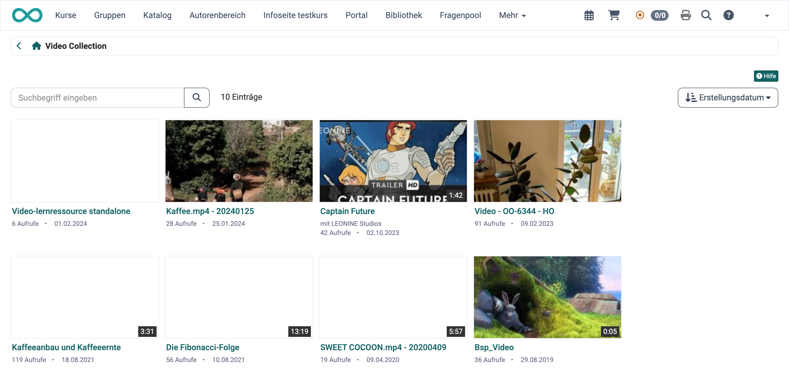

# Video Collection {: #video_collection}

Wer ein Lernvideo sucht, ohne zu wissen, in welchem Kurs es steckt, findet es in der "Video Collection". Sie zeigt alle Video-Lernressourcen Ihrer OpenOlat-Instanz, die für Sie freigegeben sind, und Sie öffnen jedes Video direkt von dort. Die "Video Collection" erreichen Sie über die Hauptnavigation.

Das Suchfeld durchsucht Titel, Beschreibung, Lernziele und Autor:innen der Videos. Die Sortierung ordnet die Kacheln nach "Relevanz", "Titel", "Autor:innen", "Erstellungsdatum" oder "Ansicht" (Anzahl Aufrufe). Voreingestellt ist "Erstellungsdatum", das neueste Video steht zuerst.

{ class="shadow lightbox" title="Video Collection · 2026.11.10" }

!!! note "Hinweis"

    Welche Personen den Eintrag "Video Collection" in der Hauptnavigation sehen, legen Administrator:innen fest, zum Beispiel alle registrierten Konten oder nur Autor:innen und Lernressourcenverwalter:innen. Sehen Sie den Eintrag nicht, wenden Sie sich an Ihre Administrator:innen.

---

## Steckbrief

Name | Video Collection
---------|----------
Verfügbar seit | Release 10.5 (OO-2013)

## Was wird in der Video Collection angeboten? {: #offering}

Die Video Collection bündelt die Video-Lernressourcen an einem Ort, so dass Sie ein Video nicht erst in einem Kurs suchen müssen. Sie führt in OpenOlat hochgeladene Videos ebenso wie per URL eingebundene Videos, sofern sie für die Video Collection freigegeben sind.

Auch Video-Lernressourcen mit Quizfragen erscheinen in der Video Collection. Eine Quizfrage hält das Video an ihrer Stelle an. Je nach Einstellung lässt sich eine falsch beantwortete Frage überspringen.

Was Sie zu einem Video sehen, stammt aus den Einstellungen der Lernressource:

* **Beschreibung:** In der Einzelansicht eines Videos steht die "Beschreibung" der Infoseite. Sie wird gepflegt unter: 
`Autorenbereich > "Lernressource" > Administration > Einstellungen > Tab "Info"`

* **Bild der Kachel:** Die Kachel zeigt das "Titelbild" der Lernressource aus demselben Tab "Info". Ein Poster, das Sie im Tab "Poster konfigurieren" wählen, übernimmt OpenOlat zugleich als Titelbild. 
`Autorenbereich > "Lernressource" > Administration > Einstellungen > Tab "Poster konfigurieren"`

* **Bewertung und Kommentare:** In der Einzelansicht bewerten Sie das Video mit Sternen und schreiben einen Kommentar. Gäste sehen beides nicht.

!!! info "Wichtig"

    Ein Video, das Sie im Kursbaustein "HTML-Seite" direkt über eine URL verlinken, ist keine Lernressource in OpenOlat und erscheint deshalb nicht in der Video Collection. Mehr dazu: [Videos im Kursbaustein "HTML-Seite"](../basic_concepts/Video_in_HTML_Pages.de.md)

[Zum Seitenanfang ^](#video_collection)

---

## Wie kommen die Videos in die Video Collection? [:octicons-tag-16:{ title="ab Release 18.2 (OO-7575)" }](https://track.frentix.com/issue/OO-7575) {: #selection}

Ob ein Video in der Video Collection erscheint, legen die Besitzer:innen der Video-Lernressource in deren Einstellungen fest. OpenOlat stellt die Auswahl daraus automatisch zusammen. Zwei Einstellungen müssen stimmen:

* **Status:** Die Video-Lernressource steht auf "Veröffentlicht". 
`Autorenbereich > "Lernressource" > Button "Status"`

* **Freigabe:** Im Abschnitt "Video Collection" ist "Im Video Collection anzeigen" eingeschaltet. Diesen Abschnitt zeigt OpenOlat, wenn die Video Collection in Ihrer Instanz eingeschaltet ist. 
`Autorenbereich > "Lernressource" > Administration > Einstellungen > Tab "Freigabe"` 
Ist die Verwaltung von Organisationen eingeschaltet, wählen Sie unter "Sichtbar für" mindestens eine Organisation. Die Video Collection zeigt das Video dann den Personen dieser Organisationen.

!!! tip "Tipp"

    Fehlt ein Video in der Video Collection, prüfen Sie zuerst diese beiden Einstellungen der Video-Lernressource.

[Zum Seitenanfang ^](#video_collection)

---

## Weiterführende Informationen {: #further_information}

[Funktionskonzept Kurse und Lernressourcen >](../learningresources/General_Functions_Concept.de.md) 
[Lernressource: Video >](../learningresources/Learning_resource_Video.de.md) 
[Video hochladen >](../basic_concepts/Video_Upload.de.md) 
[Video aufnehmen >](../basic_concepts/Video_Recording.de.md) 
[Videos im Kursbaustein "HTML-Seite" >](../basic_concepts/Video_in_HTML_Pages.de.md)

[Zum Seitenanfang ^](#video_collection)
