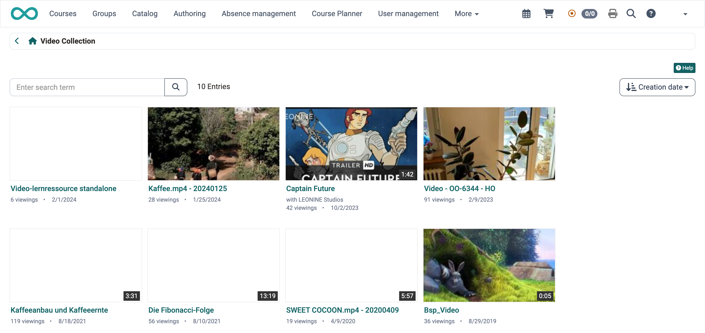

# Video Collection {: #video_collection}

If you are looking for a learning video without knowing which course it is in, you will find it in the "Video Collection". It shows all video learning resources of your OpenOlat instance that are released for you, and you open each video directly from there. You reach the "Video Collection" via the main navigation.

The search field searches the title, description, objectives and authors of the videos. The sorting orders the tiles by "Relevance", "Title", "Author", "Creation date" or "Views". The default is "Creation date", with the newest video first.

{ class="shadow lightbox" title="Video Collection · 2026.11.10" }

!!! note "Note"

    Administrators decide which persons see the "Video Collection" entry in the main navigation, for example all registered accounts or only authors and learning resource managers. If you do not see the entry, contact your administrators.

---

## Profile

Name | Video Collection
---------|----------
Available since | Release 10.5 (OO-2013)

## What is offered in the Video Collection? {: #offering}

The Video Collection gathers the video learning resources in one place, so you do not have to search for a video in a course first. It lists videos uploaded in OpenOlat as well as videos embedded via URL, provided they are released for the Video Collection.

Video learning resources with quiz questions also appear in the Video Collection. A quiz question pauses the video at its position. Depending on the setting, a question answered incorrectly can be skipped.

What you see about a video comes from the settings of the learning resource:

* **Description:** The single view of a video shows the "Description" of the info page. It is maintained under: 
`Authoring > "Learning resource" > Administration > Settings > Tab "Info"`

* **Tile image:** The tile shows the "Cover image" of the learning resource from the same tab "Info". A poster you select in the tab "Configure poster" is also taken over by OpenOlat as the cover image. 
`Authoring > "Learning resource" > Administration > Settings > Tab "Configure poster"`

* **Rating and comments:** In the single view, you rate the video with stars and write a comment. Guests see neither.

!!! info "Important"

    A video you link directly via a URL in the course element "HTML page" is not a learning resource in OpenOlat and therefore does not appear in the Video Collection. More on this: [Videos in course element "HTML page"](../basic_concepts/Video_in_HTML_Pages.md)

[To the top of the page ^](#video_collection)

---

## How do the videos get into the Video Collection? [:octicons-tag-16:{ title="ab Release 18.2 (OO-7575)" }](https://track.frentix.com/issue/OO-7575) {: #selection}

The owners of a video learning resource decide in its settings whether the video appears in the Video Collection. OpenOlat compiles the selection from this automatically. Two settings must be right:

* **Status:** The video learning resource is set to "Published". 
`Authoring > "Learning resource" > Button "Status"`

* **Share:** In the section "Video Collection", "Show in video collection site" is switched on. OpenOlat shows this section if the Video Collection is switched on in your instance. 
`Authoring > "Learning resource" > Administration > Settings > Tab "Share"` 
If the management of organisations is switched on, select at least one organisation under "Visible for". The Video Collection then shows the video to the persons of these organisations.

!!! tip "Tip"

    If a video is missing from the Video Collection, first check these two settings of the video learning resource.

[To the top of the page ^](#video_collection)

---

## Further information {: #further_information}

[Function concept courses and learning resources >](../learningresources/General_Functions_Concept.md) 
[Learning resource: Video >](../learningresources/Learning_resource_Video.md) 
[Video Upload >](../basic_concepts/Video_Upload.md) 
[Video Recording >](../basic_concepts/Video_Recording.md) 
[Videos in course element "HTML page" >](../basic_concepts/Video_in_HTML_Pages.md)

[To the top of the page ^](#video_collection)
