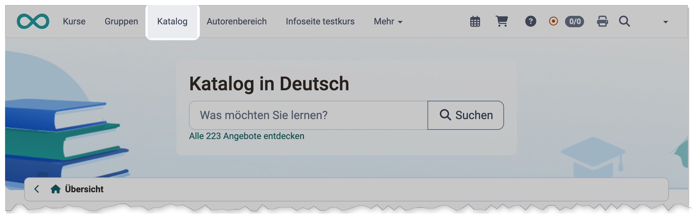
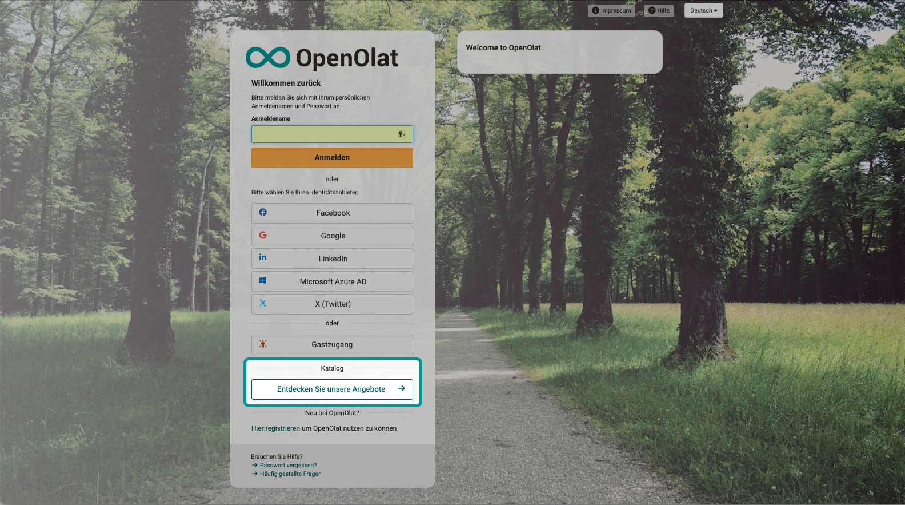
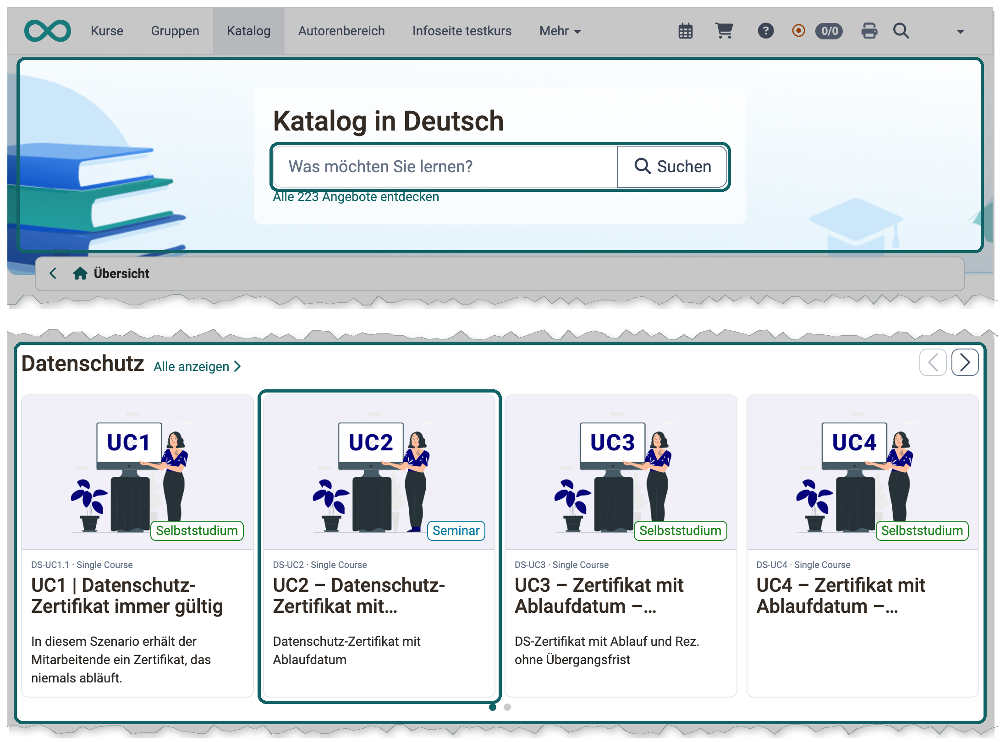
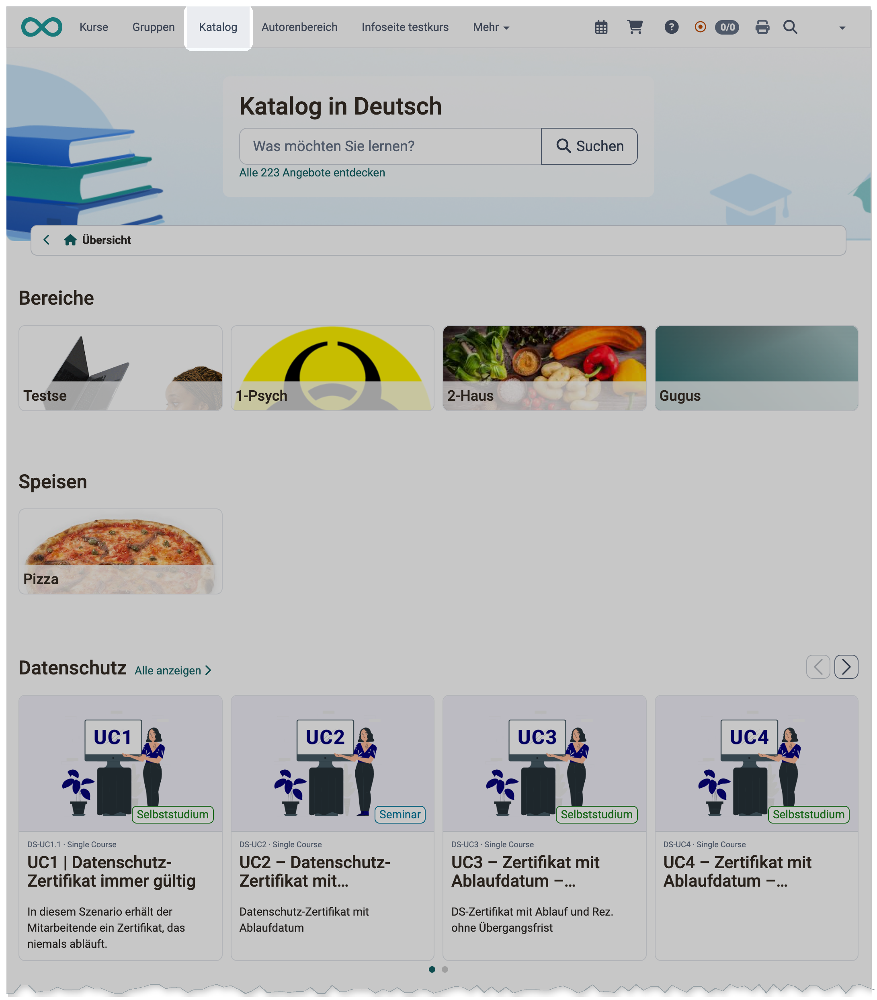
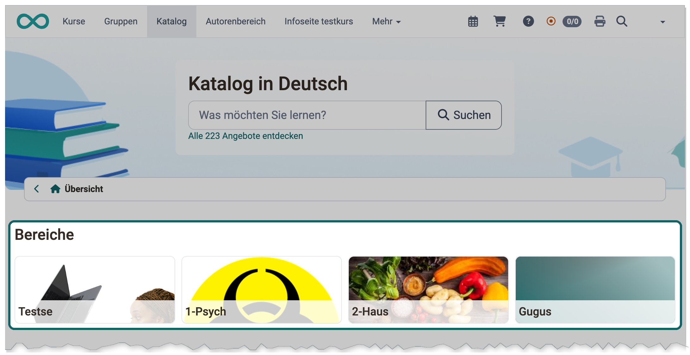
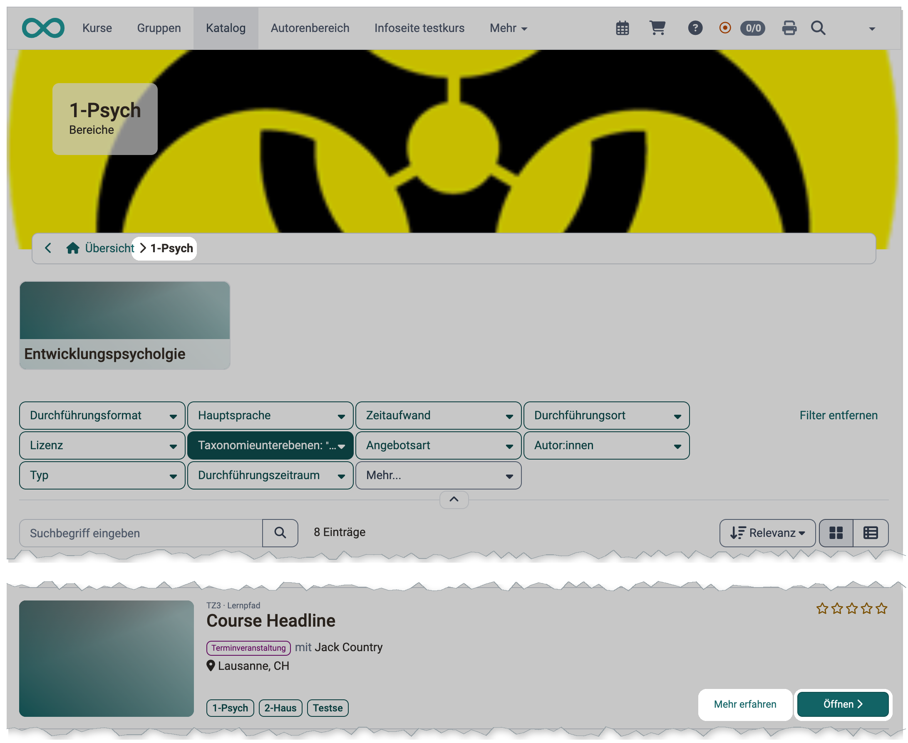

# Katalog 2.0: Übersicht {: #catalog_overview}

## Steckbrief

Name | Katalog 2.0
---------|----------
Verfügbar seit | Release 17.0 (OO-6143)

## Wozu dient der Katalog? {: #catalog_purpose}

Im Katalog präsentieren Sie den Lernenden die Kurse und Lernressourcen, die in OpenOlat erstellt wurden.

Wer sich genauer für ein bestimmtes Angebot interessiert, öffnet zu jedem Eintrag die zugehörige Infoseite.

Entscheidet sich eine Benutzer:in für einen Kurs, öffnet sie ihn direkt aus dem Katalog. Hat sie noch keinen Zugang, bucht sie den Kurs zuerst mit "Buchen".

[Zum Seitenanfang ^](#catalog_overview)

---

## Wo findet man den Katalog 2.0? {: #catalog_access}

Der Katalog kann sowohl registrierten wie auch nicht registrierten Personen zugänglich gemacht werden. Wo Sie den Katalog aufrufen können, hängt davon ab, ob Sie bereits als Benutzer:in in OpenOlat registriert sind oder nicht.

Registrierte OpenOlat-Benutzer:innen finden den Katalog in der Hauptnavigation.

{ class="shadow lightbox" title="Katalog für angemeldete Benutzer:innen · 2026.11.18" }

Voraussetzung: Der Katalog muss in der System-Administration aktiviert sein: `Administration > Module > Katalog > Tab "Einstellungen"`. Die Einrichtung beschreibt das [Administrationshandbuch](../../../manual_admin/administration/Modules_Catalog_2.0.de.md).

!!! tip "Tipp"

    Falls Sie den Eintrag in der Hauptnavigation nicht sehen, aber sicher sind, dass der Katalog 2.0 verwendet wird, schauen Sie bitte unter "Mehr" ganz rechts nach. Hierhin verschiebt OpenOlat alle Bereiche, die aufgrund der Anzeigebreite des Monitors/Geräts nicht direkt sichtbar sind.

Nicht registrierte Personen können auf eine von aussen zugängliche, gespiegelte Version des Katalogs zugreifen, sofern dieser sogenannte Web-Katalog aktiviert ist. Der Zugriff ist direkt von der Login-Seite aus möglich. Der Link zum Web-Katalog kann aber auch an anderer Stelle in eine Website eingebaut sein. [:octicons-tag-16:{ title="ab Release 20.0 (OO-8002)" }](https://track.frentix.com/issue/OO-8002)

{ class="shadow lightbox" title="Login-Seite von OpenOlat" }

[Weitere Informationen zum externen Katalog >](../../../manual_user/area_modules/catalog2.0_web.de.md) 
[Zum Seitenanfang ^](#catalog_overview)

---

## Die Bestandteile des Katalogs {: #catalog_elements}

Der Katalog 2.0 enthält die folgenden Bestandteile:

- Header: Kopfzeile mit Hintergrundbild
- Suchfeld (innerhalb Header)
- Filter für eine gezielte Suche z.B. nach Durchführungsformat, Typ der Lernressource, usw.
- Launcher: Abschnitte im Katalog, in denen Katalogeinträge nach bestimmten Kriterien zusammengestellt werden z.B. zuletzt veröffentlichte Kurse (je nach Launchertyp und Launcherkonfiguration)
- Kacheln mit Beschreibung eines Kurses oder einer Lernressource (entspricht der [Infoseite](../../learningresources/Info_page.de.md))

{ class="shadow lightbox" title="Startseite des Katalogs · 2026.11.18" }

[Zum Seitenanfang ^](#catalog_overview)

---

## Welche Seiten und Ansichten hat der Katalog? {: #catalog_views}

**Seite/Ansicht 1:** 
Rufen Sie den Katalog (2.0) in der Hauptnavigation auf, gelangen Sie zuerst auf die Startseite (Landing page) mit den Launchern.

{ class="shadow lightbox" title="Startseite des Katalogs · 2026.11.18" }

Im Suchfeld suchen Sie direkt nach bestimmten Lernressourcen. Indexiert sind dafür der Titel, der Teaser-Text und die Taxonomie. Der Link "Alle … Angebote entdecken" unter dem Suchfeld listet alle Einträge des Katalogs auf, die Zahl im Link nennt, wie viele es sind. Sie können aber auch die angezeigten Kacheln anklicken, die in den Launchern gruppiert sind. Neben dem Titel eines Launchers zeigt "Alle anzeigen" alle Einträge dieses Launchers als Liste.

**Seite/Ansicht 2:** 
Bei Klick auf eine Kachel in einem Launcher vom Typ "Taxonomieebene" (Kategorie) öffnet sich eine Microsite (Listenansicht) mit den Kursen und Lernressourcen dieser Kategorie. Zu einer Kategorie gehören alle Kurse und Lernressourcen, die derselben Taxonomieebene zugeordnet sind. Auch Unterkategorien sind möglich.

Ein Launcher vom Typ "Taxonomieebene" zeigt also keine Kurse und Lernressourcen direkt, sondern Taxonomieebenen, die dann die Kurse und Lernressourcen enthalten.

{ class="shadow lightbox" title="Launcher vom Typ Taxonomieebene auf der Startseite des Katalogs · 2026.11.18" }

Klicken Sie auf eine Kachel in einem Launcher eines anderen Typs, startet der Kurs bzw. die Lernressource sofort, wenn Sie dort schon Mitglied sind. Sonst öffnet sich die Infoseite, auch bei einem Angebot ohne Buchung und bei einer Durchführung.

**Seite/Ansicht 3:** 
Wird zuerst eine Microsite geöffnet, zeigen Sie in der Liste mit "Mehr erfahren" die [Infoseite](../../learningresources/Info_page.de.md) an oder starten den Kurs bzw. die Lernressource mit "Öffnen" gleich. Haben Sie noch keinen Zugang, steht statt "Öffnen" der Button "Buchen".

{ class="shadow lightbox" title="Microsite einer Kategorie im Katalog · 2026.11.18" }

!!! note "Hinweis"

    Entsprechend der Struktur der Taxonomie können Microsites auch Unter-Microsites enthalten.

!!! tip "Tipp"

    Mit den Filtern passen Sie die Listenansicht an.

[Zum Seitenanfang ^](#catalog_overview)

---

## Weiterführende Informationen {: #further_information}

[Angebote erstellen >](../../area_modules/catalog2.0_angebote.de.md) 
[Katalog-Design >](../../area_modules/catalog2.0_design.de.md) 
[Der Web-Katalog >](../../area_modules/catalog2.0_web.de.md) 
[Katalog einrichten (Administrationshandbuch) >](../../../manual_admin/administration/Modules_Catalog_2.0.de.md)

[Zum Seitenanfang ^](#catalog_overview)
