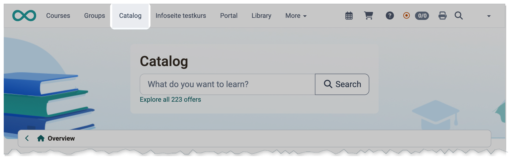
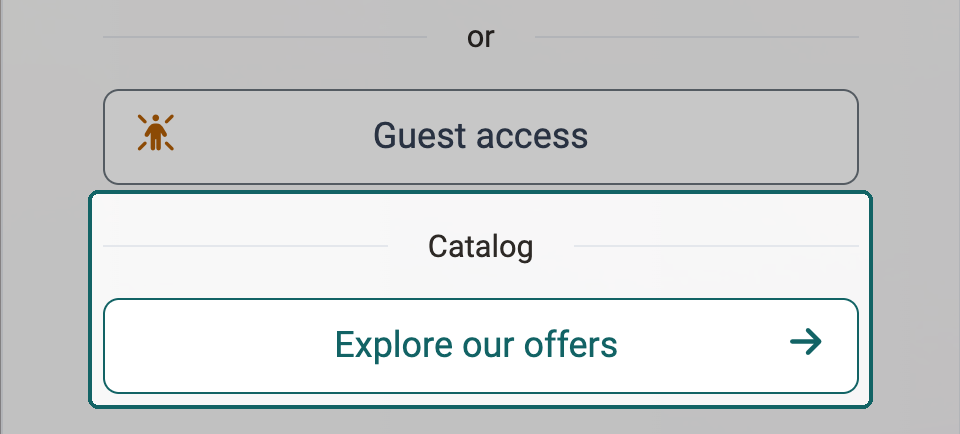
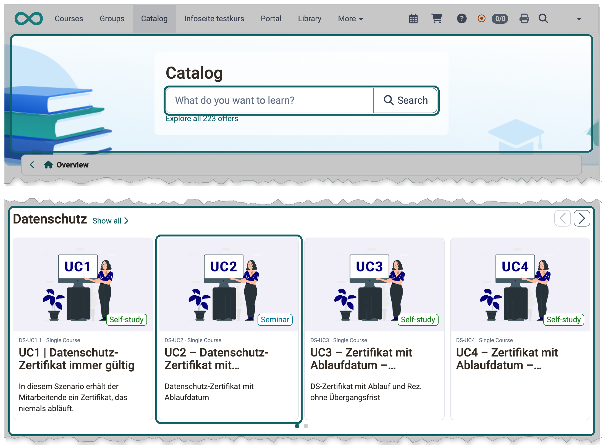
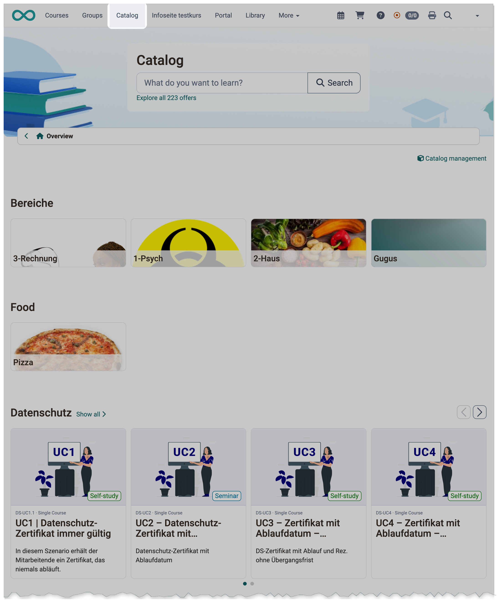
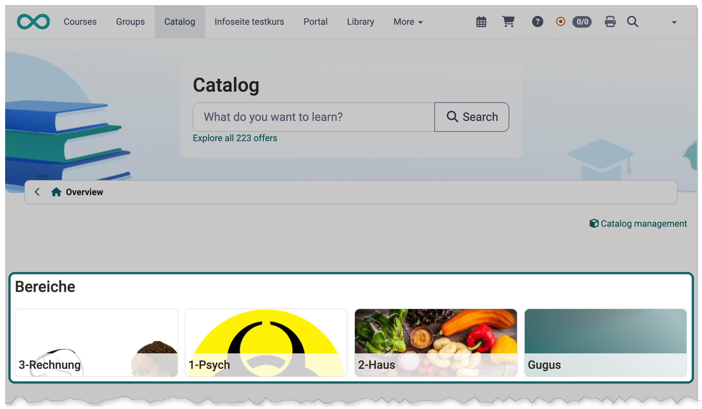
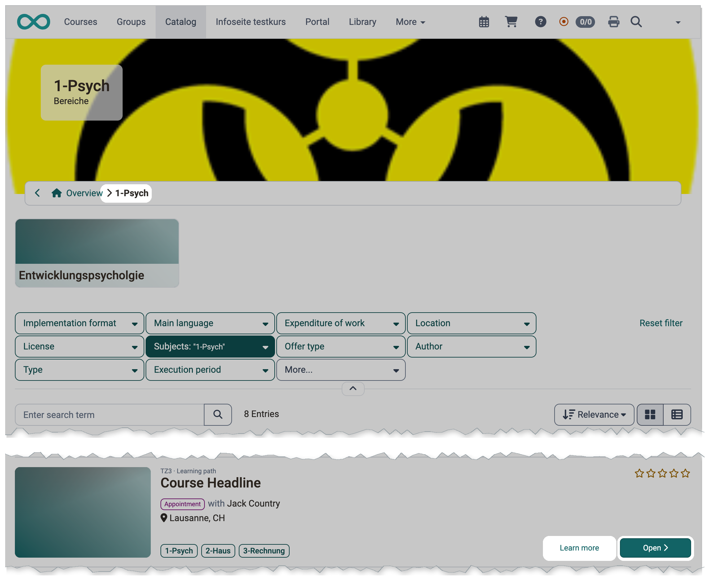

# Catalog 2.0: Overview {: #catalog_overview}

## Profile

Name | Catalog 2.0
---------|----------
Available since | Release 17.0 (OO-6143)

## What is the catalog for? {: #catalog_purpose}

In the catalog, you present to learners the courses and learning resources that were created in OpenOlat.

If someone is interested in a specific offer, they open the corresponding info page for each entry.

If a user decides on a course, they open it directly from the catalog. If they do not have access yet, they first book the course with "Book".

[To the top of the page ^](#catalog_overview)

---

## Where can I find the catalog 2.0? {: #catalog_access}

The catalog can be made available to both registered and unregistered persons. Where you can access the catalog depends on whether you are already registered as a user in OpenOlat or not.

Registered OpenOlat users find the catalog in the main navigation.

{ class="shadow lightbox" title="Catalog for logged-in users · 2026.11.18" }

Requirement: The catalog must be activated in the system administration: `Administration > Modules > Catalog > Tab "Settings"`. The setup is described in the [administration manual](../../../manual_admin/administration/Modules_Catalog_2.0.md).

!!! tip "Tip"

    If you do not see the entry in the main navigation, but are sure that Catalog 2.0 is being used, please look under "More" on the far right. OpenOlat moves all sites here that are not directly visible due to the display width of the monitor/device.

Unregistered persons can access an externally accessible, mirrored version of the catalog, provided this so-called web catalog is activated. Access is possible directly from the login page. However, the link to the web catalog can also be integrated elsewhere in a website. [:octicons-tag-16:{ title="from Release 20.0 (OO-8002)" }](https://track.frentix.com/issue/OO-8002)

{ class="shadow lightbox" title="Login page of OpenOlat · 2026.11.09" }

[Further information on the external catalog >](../../../manual_user/area_modules/catalog2.0_web.md) 
[To the top of the page ^](#catalog_overview)

---

## The components of the catalog {: #catalog_elements}

Catalog 2.0 contains the following components:

- Header: Header with background image
- Search field (inside the header)
- Filter for a directed search, e.g. by implementation format, type of learning resource, etc.
- Launcher: Sections in the catalog in which catalog entries are compiled according to certain criteria, e.g. recently published courses (depending on the launcher type and launcher configuration)
- Tiles/cards with a description of a course or learning resource (corresponds to the [info page](../../learningresources/Info_page.md))

{ class="shadow lightbox" title="Start page of the catalog · 2026.11.18" }

[To the top of the page ^](#catalog_overview)

---

## What pages and displays does the catalog have? {: #catalog_views}

**Page/Display 1:** 
If you call up the catalog (2.0) in the main navigation, you first reach the start page (landing page) with the launchers.

{ class="shadow lightbox" title="Start page of the catalog · 2026.11.18" }

In the search field, you search directly for specific learning resources. The title, teaser text and taxonomy are indexed for this purpose. However, you can also click on the displayed tiles/cards that are grouped in the launchers.

**Page/Display 2:** 
Clicking on a card/tile in a launcher of type "Taxonomy level" (category) opens a microsite (list view) with the courses and learning resources in this category. A category includes all courses and learning resources that are assigned to the same taxonomy level. Subcategories are also possible.

A launcher of type "Taxonomy level" therefore does not show courses and learning resources directly, but taxonomy levels, which then contain the courses and learning resources.

{ class="shadow lightbox" title="Launcher of the type Taxonomy level on the start page of the catalog · 2026.11.18" }

If you click on a card/tile in a launcher of another type or in a microsite, the info page or the course opens immediately.

**Page/Display 3:** 
If a microsite is opened first, you display the [info page](../../learningresources/Info_page.md) in the list with "Learn more" or start the course or learning resource immediately with "Open". If you do not have access yet, the button "Book" appears instead of "Open".

{ class="shadow lightbox" title="Microsite of a category in the catalog · 2026.11.18" }

!!! note "Note"

    According to the structure of the taxonomy, microsites can also contain sub-microsites.

!!! tip "Tip"

    With the filters you adjust the list view.

[To the top of the page ^](#catalog_overview)

---

## Further information {: #further_information}

[Create offers >](../../area_modules/catalog2.0_angebote.md) 
[Catalog design >](../../area_modules/catalog2.0_design.md) 
[The web catalog >](../../area_modules/catalog2.0_web.md) 
[Set up catalog (administration manual) >](../../../manual_admin/administration/Modules_Catalog_2.0.md)

[To the top of the page ^](#catalog_overview)
