# Katalog 2.0 - Angebote {: #offers}

## Was enthält der OpenOlat-Katalog? [:octicons-tag-16:{ title="ab Release 17.1 (OO-6201)" }](https://track.frentix.com/issue/OO-6201) {: #offers_catalog_content}

Im OpenOlat-Katalog finden Lernende, was sie buchen oder öffnen können, je Eintrag mit einer kurzen Beschreibung. Das sind:

- Kurse
- Durchführungen des Course Planners
- andere Lernressourcen, zum Beispiel Tests oder Videos

## Erscheinen alle Kurse im Katalog? {: #offers_display_decision}

Nein. Der Katalog zeigt nicht automatisch alle Kurse und Lernressourcen. Ob ein Kurs im Katalog erscheint, entscheiden seine Autor:innen: Sie erstellen dafür im Kurs ein Angebot. Ohne Angebot gibt es keinen Katalogeintrag.

[Zum Seitenanfang ^](#offers)

---

## Wie wird ein Angebot erstellt? {: #offers_create}

Angebote gehören zum Kurs. Autor:innen erstellen sie in den Kurseinstellungen: 
`Kurs > Administration > Einstellungen > Tab "Freigabe"`

!!! note "Unterschied Katalog 1.0 und Katalog 2.0"

    Im Katalog 1.0 erstellen Sie alle Angebote in den Kursen: `Kurs > Administration > Einstellungen > Tab "Freigabe"`. Anschliessend stellen Sie sie in der Katalogverwaltung zusammen.

    Im Katalog 2.0 erstellen Sie Angebote ebenfalls in den Kurseinstellungen. Dort geben Sie zusätzlich an, wo im Katalog das Angebot erscheinen soll. Mit diesen Angaben stellt der Katalog 2.0 die Angebote selbst zusammen.

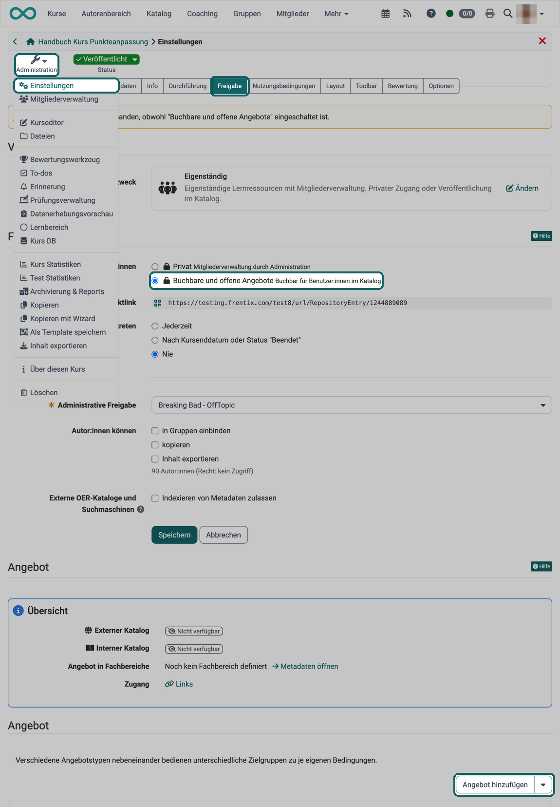{ class="shadow lightbox" title="Tab Freigabe der Kurseinstellungen · 2026.09.28" }

[Zum Seitenanfang ^](#offers)

---

## Voraussetzung für ein Angebot {: #offers_requirements}

Bevor Sie ein Angebot erstellen, öffnen Sie den Kurs für Buchungen. Dafür wählen Sie unter "Zugang für Teilnehmer:innen" eine von zwei Varianten: 
`Kurs > Administration > Einstellungen > Tab "Freigabe"`

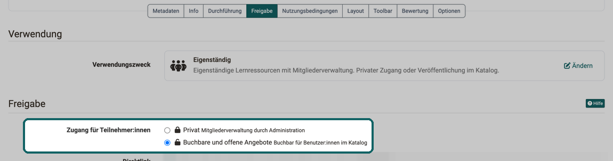{ class="shadow lightbox" title="Tab Freigabe der Kurseinstellungen · 2026.10.20" }

Mit "Privat" tragen Besitzer:innen oder Personen mit dem Recht zur Mitgliederverwaltung die Teilnehmenden ein. Ein privater Kurs erscheint nicht im Katalog.

Mit "Buchbare und offene Angebote" buchen Lernende den Kurs oder die Lernressource selbst. Je nach Angebot geben sie dafür einen Zugangscode ein.

Nur mit "Buchbare und offene Angebote" können Sie Angebote erstellen.

[Zum Seitenanfang ^](#offers)

---

## Was enthält ein Angebot? {: #offer_content}

Ein Angebot enthält die Bedingungen, zu denen der Kurs oder die Lernressource genutzt werden kann.

Ein Angebot legt fest, wer den Kurs oder die Lernressource unter welchen Bedingungen buchen kann. Möglich ist eine Buchung mit Zugangscode, eine freie Buchung oder eine kostenpflichtige Buchung mit PayPal Checkout, sofern Administrator:innen diese eingerichtet haben. Auch ein Zugang ohne Buchungsauftrag oder als Gast lässt sich einrichten. Buchen steht dabei für belegen, einschreiben oder einkaufen. Klicken Sie auf "Angebot hinzufügen", um ein Angebot zu erstellen.

Bei Angeboten einer Durchführung im Course Planner kann ein Angebot zusätzlich Formulare verlangen, die beim Buchen als Schritte ausgefüllt werden. Bei Angeboten eines Kurses oder einer anderen Lernressource ist das nicht möglich. [Formulare für Buchungsaufträge >](Course_Planner_Implementations.de.md#booking_order_forms) [:octicons-tag-16:{ title="ab Release 21.1 (OO-9724)" }](https://track.frentix.com/issue/OO-9724){:target="_blank"}

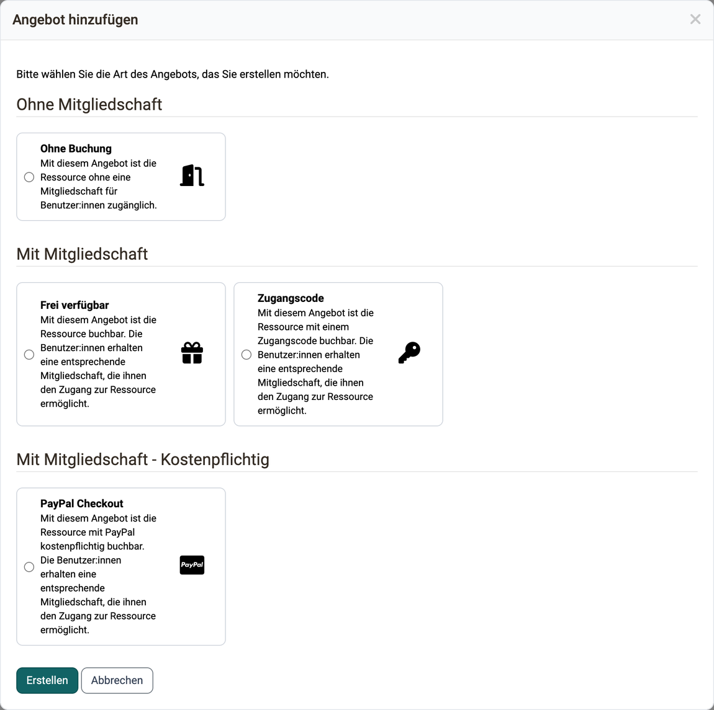{ class="shadow lightbox" title="Dialog Angebot hinzufügen · 2026.10.20" }

Der Dialog ordnet die Angebotsarten in drei Gruppen: "Ohne Mitgliedschaft", "Mit Mitgliedschaft" und "Mit Mitgliedschaft - Kostenpflichtig". Welche Angebotsarten erscheinen, hängt von der Lernressource und von den Einstellungen der System-Administration ab.

Zu einem Kurs können Sie mehrere Angebote erstellen, etwa kostenlos für die einen und kostenpflichtig für die anderen Teilnehmenden.

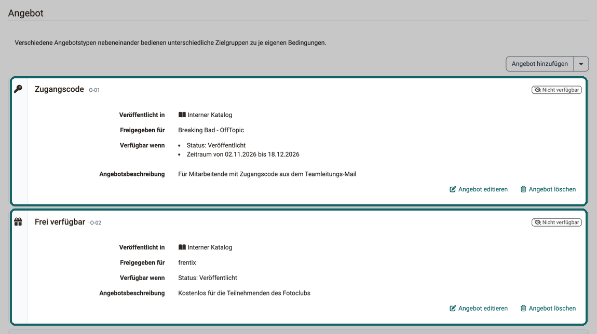{ class="shadow lightbox" title="Abschnitt Angebot im Tab Freigabe · 2026.10.20" }

Im Tab "Freigabe" steht jedes Angebot in einem eigenen Kasten. Ein Abzeichen zeigt seinen Status, zum Beispiel "Buchbar", "Geplant" oder "Nicht verfügbar". Darüber fasst eine Übersicht zusammen, ob die Angebote im internen oder im externen Katalog veröffentlicht sind.

Im Feld "Freigegeben für" beschränken Sie ein Angebot auf Organisationen oder Unterorganisationen.

!!! info "Organisationszugehörigkeit"

    Ist ein Angebot auf eine bestimmte Organisation oder Unterorganisation eingeschränkt, erscheint es im Katalog nur für Benutzer:innen, die Mitglied dieser Organisation sind. Benutzer:innen ausserhalb der Organisation sehen das Angebot nicht, auch wenn der Kurs veröffentlicht ist.

    Die Organisationszugehörigkeit wird in der [Benutzerverwaltung](../../manual_admin/usermanagement/index.de.md) gepflegt.

[Zum Seitenanfang ^](#offers)

---

## Angebote veröffentlichen {: #offer_publish}

Wann und wo ein Angebot im Katalog erscheint, legen Sie im Angebot selbst fest. Öffnen Sie es dafür mit "Angebot editieren".

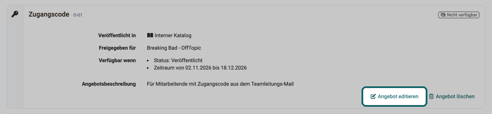{ class="shadow lightbox" title="Abschnitt Angebot im Tab Freigabe · 2026.10.20" }

Zuoberst im Angebot stehen "Interne Bezeichnung" und "Angebotsbeschreibung". Die interne Bezeichnung sehen nur Sie, die Beschreibung erscheint im Katalog, sobald das Angebot buchbar ist. Darunter folgen die Abschnitte "Katalog" mit "Veröffentlicht in", "Freigegeben für" und "Verfügbar wenn" sowie "Mitgliedschaft" mit "Buchungsbeleg". Ist dort "E-Mail an Teilnehmer:in senden" angekreuzt, erhalten Buchende eine Bestätigung per E-Mail. Bei "Frei verfügbar" steht im Abschnitt "Mitgliedschaft" zusätzlich "Automatisches Buchen". Mehr dazu unter [Zugangskonfiguration / Freigabe](../learningresources/Access_configuration.de.md#offer_availability).

Wann ein Angebot verfügbar ist, legen Sie im Angebot unter "Verfügbar wenn" fest. Mit "Kursstatus "Veröffentlicht"" gilt das Angebot, solange der Kurs veröffentlicht ist. Mit "Benutzerdefinierte Bedingung" wählen Sie unter "Status ist" einen oder mehrere Kursstatus und legen unter "Ab" und "Bis" den Zeitraum fest, jeweils als "Statusgesteuert", "Absolutes Datum" oder "Relatives Datum". Das Angebot ist dann verfügbar, wenn der Kurs einen der gewählten Status hat und das Datum im Zeitraum liegt.

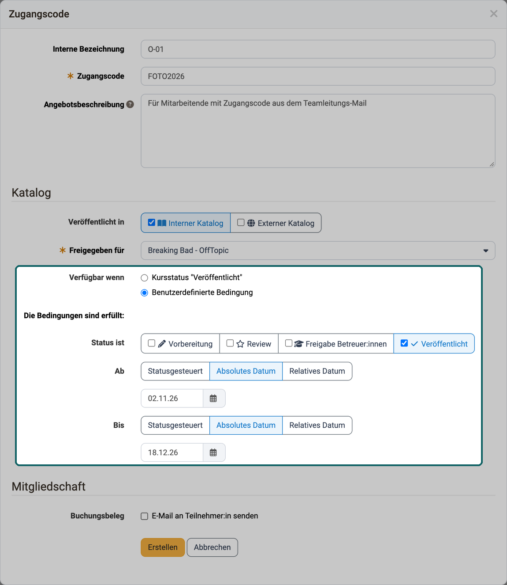{ class="shadow lightbox" title="Dialog Zugangscode · 2026.10.20" }

Unter "Veröffentlicht in" wählen Sie "Interner Katalog", damit das Angebot im OpenOlat-Katalog erscheint. Ist der externe Katalog eingeschaltet, steht zusätzlich "Externer Katalog" zur Wahl. Den Fachbereich wählen Sie nicht im Angebot, sondern im Tab "Metadaten" des Kurses. Die Übersicht im Tab "Freigabe" zeigt ihn unter "Angebot in Fachbereiche", der Link "Metadaten öffnen" führt dorthin. Ist kein Fachbereich angegeben, kann das Angebot zwar z.B. über die Suchfunktion im Katalog gefunden werden, es wird jedoch in keinem Taxonomie-Launcher angezeigt, in dem Angebote mit gleichem Fachbereich zusammengefasst angezeigt werden.

Je nach Angebotsart legen Sie weitere Angaben fest, bei "Zugangscode" zum Beispiel den Code selbst.

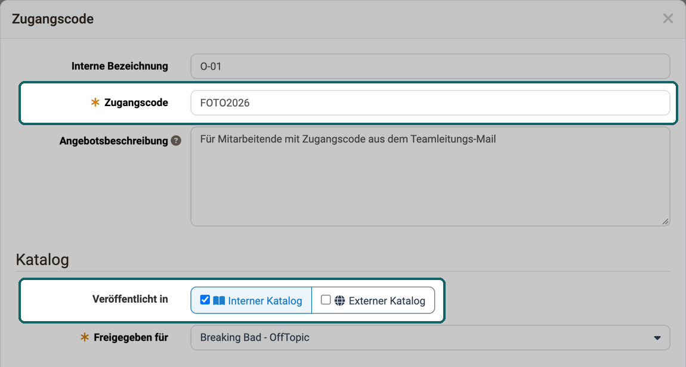{ class="shadow lightbox" title="Dialog Zugangscode · 2026.10.20" }

[Zum Seitenanfang ^](#offers)

---

## Wie läuft die Buchung eines Angebots ab? [:octicons-tag-16:{ title="ab Release 17.0 (OO-6146)" }](https://track.frentix.com/issue/OO-6146){:target="_blank"} {: #offer_booking}

Mit einer Buchung erhalten Sie Zugang zu einem Kurs oder einer Durchführung aus dem Katalog. Sie buchen auf der Infoseite im Kasten "Los geht's" mit "Buchen". Hat der Kurs oder die Durchführung mehrere Angebote, zeigt die Infoseite sie zur Auswahl, beschriftet mit der Angebotsart und, falls vorhanden, dem Preis. Wählen Sie zuerst das gewünschte Angebot aus, "Buchen" gilt dann für dieses Angebot. Was danach geschieht, hängt von der Angebotsart ab und davon, ob das Angebot Formulare verwendet.

Verwendet das Angebot kein Formular, bucht der Klick auf "Buchen" bei "Frei verfügbar" sofort. Bei "Zugangscode" öffnet sich der Dialog "Zugangscode", bei "Rechnung" der Dialog "Buchung auf Rechnung" mit dem Button "Kostenpflichtig buchen". Angebote einzelner Kurse verwenden nie Formulare: Mit Zugangscode oder frei verfügbar buchen Sie diese immer auf diesem Weg. Die Angebotsart "Rechnung" gibt es nur bei Durchführungen.

### Buchung mit Formularen als Assistent [:octicons-tag-16:{ title="ab Release 21.1 (OO-9742)" }](https://track.frentix.com/issue/OO-9742){:target="_blank"} {: #offer_booking_wizard}

Verwendet das Angebot einer Durchführung mindestens ein Formular, führt OpenOlat Sie durch einen Assistenten. So geben Sie die Angaben, welche die Verantwortlichen für die Planung brauchen, etwa Essenswünsche oder Vorkenntnisse, gleich mit der Buchung ab. Ihre Antworten stehen danach bei Ihrem Buchungsauftrag.

Der Titel des Assistenten nennt die Angebotsart und die Durchführung: "Buchung frei verfügbar für", "Buchung mit Zugangscode für" oder "Buchung auf Rechnung für", gefolgt vom Titel der Durchführung und, falls gesetzt, ihrem Kennzeichen.

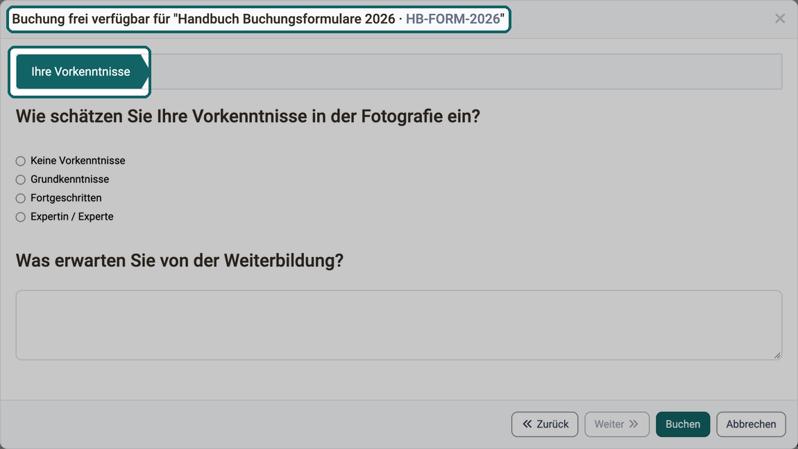{ class="shadow lightbox" title="Assistent Buchung frei verfügbar im Katalog · 2026.10.02" }

Welche Schritte der Assistent zeigt, hängt von der Angebotsart ab:

| Angebotsart | Schritte |
|---|---|
| Frei verfügbar | die Formulare |
| Zugangscode | zuerst der Schritt "Zugangscode", danach die Formulare |
| Rechnung | zuerst der Schritt "Buchungsdetails", danach die Formulare |

Im Schritt "Zugangscode" geben Sie den Zugangscode ein, den Sie erhalten haben. Im Schritt "Buchungsdetails" wählen Sie über "Rechnungsadresse auswählen" die Rechnungsadresse, sie ist Pflicht. Die "Bestellnummer (PO-Nummer)" und der "Kommentar" sind freiwillig. Hat das Angebot einen Preis oder eine Stornierungsgebühr, zeigt der Schritt diese Angaben an.

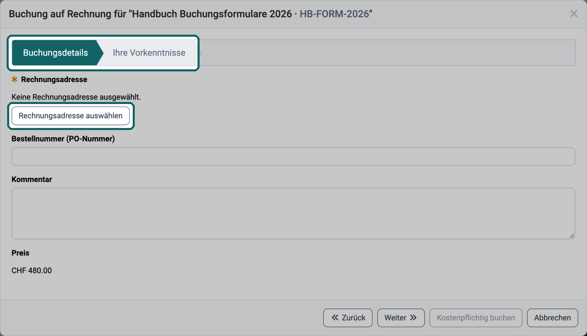{ class="shadow lightbox" title="Schritt Buchungsdetails im Assistenten Buchung auf Rechnung · 2026.10.02" }

Jedes Formular ist ein eigener Schritt, beschriftet mit seinem Schrittnamen. Die Reihenfolge der Formulare legt das Angebot fest.

- **Weiter** prüft die Pflichtfelder des angezeigten Schritts und führt zum nächsten Schritt.
- **Zurück** führt ohne Prüfung zum vorherigen Schritt. Ihre Eingaben bleiben erhalten.
- Im letzten Schritt schliesst der hervorgehobene Button die Buchung ab: "Buchen" bei "Frei verfügbar" und "Zugangscode", "Kostenpflichtig buchen" bei "Rechnung". In den Schritten davor ist dieser Button inaktiv, im letzten Schritt ist "Weiter" inaktiv.

Der Buchungsauftrag entsteht erst mit diesem letzten Klick. Brechen Sie den Assistenten vorher mit "Abbrechen" oder dem Schliessen-Symbol ab, sind Sie nicht gebucht, und OpenOlat speichert keine Antworten. Fragt OpenOlat dabei mit dem Dialog "Ungespeicherte Formulardaten" nach, schliesst "Daten nicht speichern" den Assistenten, "Zurück zum Formular" führt in den Schritt zurück.

Bucht eine andere Person für Sie, etwa mit [Buchen im Namen von](Coaching_People.de.md#linemanager_educationmanager_book_participants) im Coaching oder beim [Hinzufügen von Teilnehmer:innen](Course_Planner_Implementations.de.md#add_members) im Course Planner, füllt diese Person die Formulare aus. Die Antworten gehören zu Ihrem Buchungsauftrag. Ihre ausgefüllten Formulare sehen Sie unter [Buchungsaufträge](../personal_menu/Bookings.de.md) im Dialog "Buchung" des Buchungsauftrags.

Formulare an Angeboten gibt es nur bei Durchführungen im Course Planner, nicht bei Angeboten einzelner Kurse und nicht bei der Angebotsart PayPal Checkout. Wie Sie ein Formular in einem Angebot verwenden, beschreibt [Formular im Angebot verwenden](Course_Planner_Implementations.de.md#booking_order_forms_offer).

[Zum Seitenanfang ^](#offers)

---

## Infoseite {: #offer_info}

Wer im Katalog bei einem Angebot auf "Mehr erfahren" klickt, sieht die Infoseite des Kurses oder der Lernressource, ohne den Kurs zu öffnen. Die Infoseite ist im Katalog auch dann einsehbar, wenn der Kurs eine Zugangsberechtigung verlangt. Ihre Angaben tragen Autor:innen in den Einstellungen ein, die meisten im Tab "Info": 
`Kurs > Administration > Einstellungen > Tab "Info"`

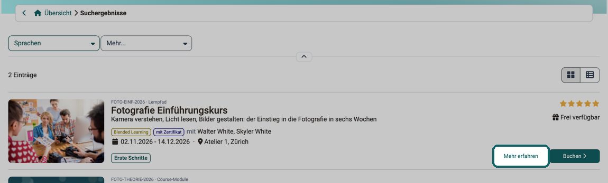{ class="shadow lightbox" title="Suchergebnisse im Katalog · 2026.10.20" }

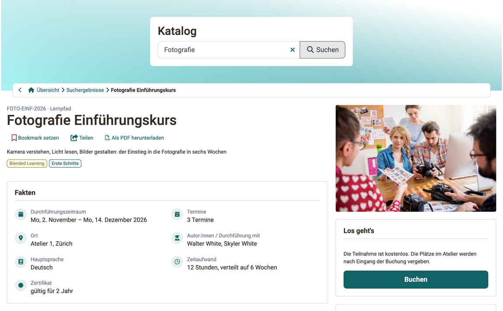{ class="shadow lightbox" title="Infoseite im Katalog · 2026.10.20" }

Woraus die Infoseite besteht und was die Kästen "Los geht's" und "Mein Kurs" zeigen, beschreibt [Allgemeine Funktionen: Infoseite](../learningresources/General_Functions_Infopage.de.md#content).

[Zum Seitenanfang ^](#offers)

---

## Metadaten, Fachbereich {: #offer_metadata}

Mit dem Fachbereich entscheiden Sie, in welchem Taxonomie-Launcher des Katalogs ein Kurs oder eine Lernressource erscheint. Hinter dem Fachbereich steht die Taxonomie, nach der der Katalog die Kurse zusammenstellt. Sie wählen den Fachbereich unter: 
`Kurs > Administration > Einstellungen > Tab "Metadaten"`

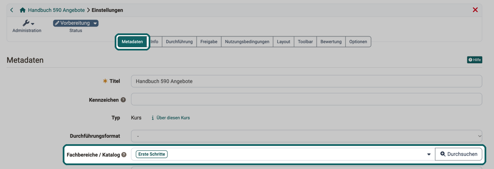{ class="shadow lightbox" title="Tab Metadaten der Kurseinstellungen · 2026.10.20" }

Ein Angebot übernimmt den Fachbereich, den Sie im Tab "Metadaten" angeben. Im Angebot selbst wählen Sie keinen Fachbereich, der Tab "Freigabe" zeigt ihn nur unter "Angebot in Fachbereiche" an. Im Katalog dienen die Fachbereiche auch als Schlagworte. Sie können mehrere Fachbereiche angeben.

Wenn Sie in das Feld "Fachbereiche / Katalog" klicken, erscheint ein Popup mit einem Suchfeld. Unter "Auswahl" stehen die gewählten Fachbereiche, darunter alle Fachbereiche nach Taxonomie gruppiert. Mit einem Häkchen fügen Sie einen Fachbereich hinzu oder entfernen ihn. "Alles auswählen" kreuzt alle aufgeführten Fachbereiche an, "Auswahl zurücksetzen" hebt die ganze Auswahl auf.

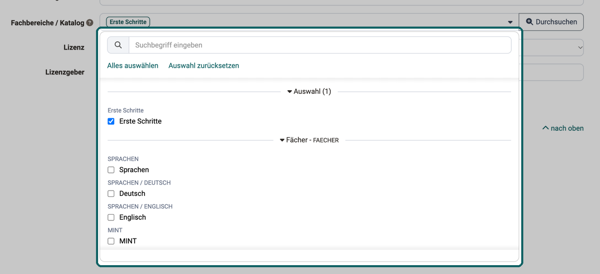{ class="shadow lightbox" title="Feld Fachbereiche / Katalog im Tab Metadaten · 2026.10.20" }

Mehr Überblick bietet die Schaltfläche "Durchsuchen" rechts neben dem Feld. Sie öffnet den Dialog "Hinzufügen" mit dem Taxonomiebaum, je Taxonomie ein eigener Tab. Kreuzen Sie die gewünschten Fachbereiche an und klicken Sie auf "Hinzufügen". Danach speichern Sie den Tab "Metadaten" mit "Speichern".

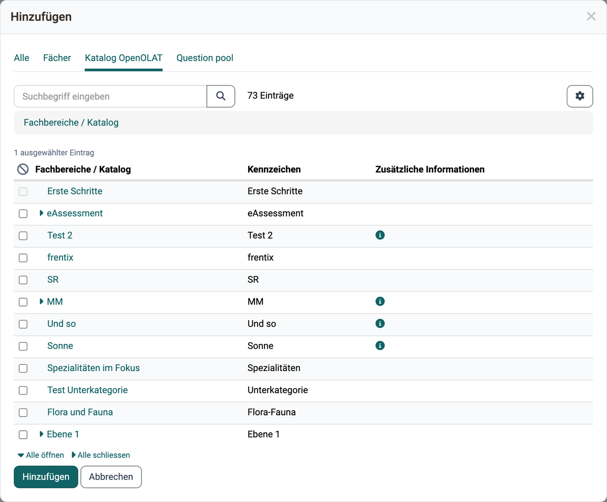{ class="shadow lightbox" title="Dialog Hinzufügen nach Klick auf Durchsuchen · 2026.10.20" }

Mit diesen Metadaten fasst der Katalog 2.0 alle Angebote mit denselben Fachbereichen zusammen und zeigt sie in einem gemeinsamen Katalogabschnitt, dem Taxonomie-Launcher.

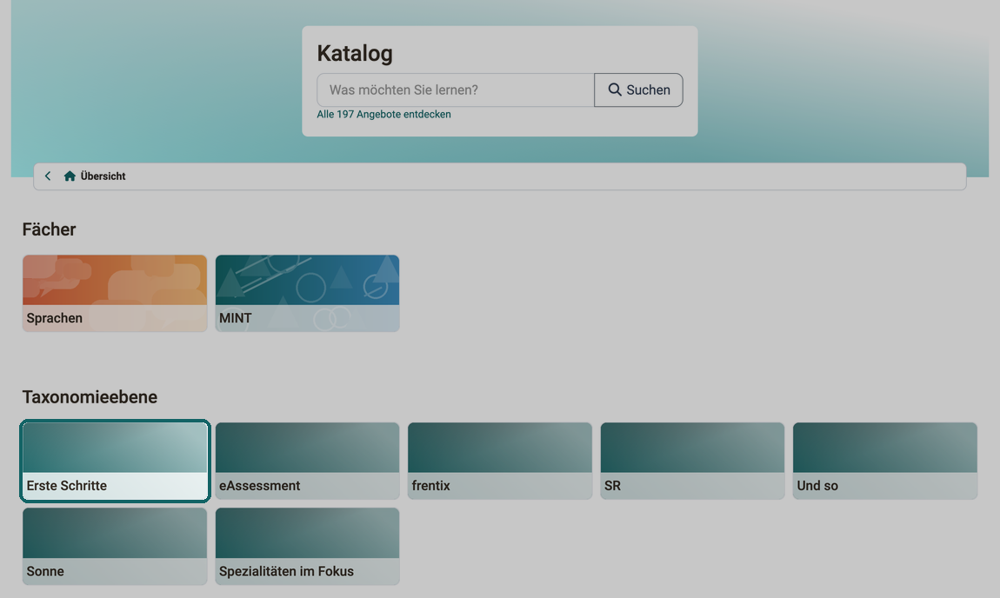{ class="shadow lightbox" title="Startseite des Katalogs · 2026.10.20" }

Ein Klick auf die Kachel im Taxonomie-Launcher öffnet die Microsite des Fachbereichs. Sie listet alle Kurse und Lernressourcen, die diesem Fachbereich zugeordnet sind.

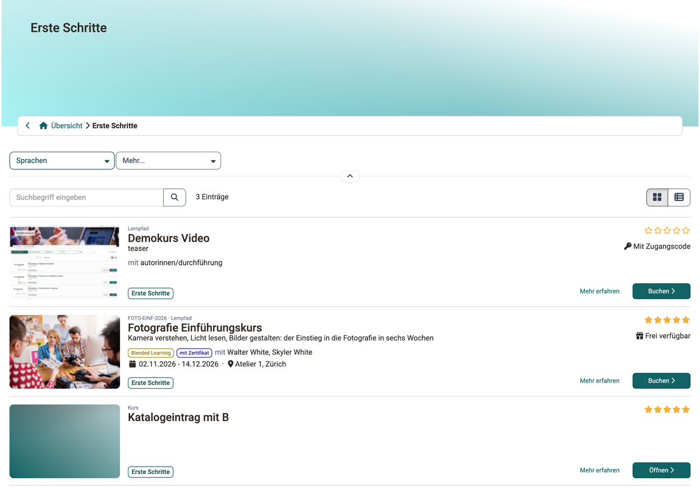{ class="shadow lightbox" title="Microsite des Taxonomie-Launchers · 2026.10.20" }

!!! note "Katalog 1.0"

    Wie Sie Angebote im Katalog 1.0 erstellen, beschreibt [Katalog 1.0](catalog1.0.de.md).

[Zum Seitenanfang ^](#offers)

---

## Weiterführende Informationen {: #further_information}

**Auf dieser Seite erwähnt** 
[Course Planner: Durchführungen >](Course_Planner_Implementations.de.md) 
[Benutzerverwaltung (Administrationshandbuch) >](../../manual_admin/usermanagement/index.de.md) 
[Zugangskonfiguration / Freigabe >](../learningresources/Access_configuration.de.md) 
[Coaching - Personen >](Coaching_People.de.md) 
[Persönliche Werkzeuge: Buchungsaufträge >](../personal_menu/Bookings.de.md) 
[Allgemeine Funktionen: Infoseite >](../learningresources/General_Functions_Infopage.de.md) 
[Katalog 1.0 >](catalog1.0.de.md)

**Weiterführend** 
[Angebotskonzepte >](../basic_concepts/Offer_Concepts.de.md) 
[Katalog 2.0: Übersicht >](catalog2.0.de.md)

[Zum Seitenanfang ^](#offers)
