# Catalog 2.0 - Offers {: #offers}

## What does the OpenOlat catalog contain? [:octicons-tag-16:{ title="from Release 17.1 (OO-6201)" }](https://track.frentix.com/issue/OO-6201) {: #offers_catalog_content}

In the OpenOlat catalog, learners find what they can book or open, each entry with a short description. These are:

- Courses
- Implementations of the Course Planner
- other learning resources, for example tests or videos

## Do all courses appear in the catalog? {: #offers_display_decision}

No. The catalog does not automatically show all courses and learning resources. Whether a course appears in the catalog is decided by its authors: they create an offer in the course for this. Without an offer, there is no catalog entry.

[To the top of the page ^](#offers)

---

## How is an offer created? {: #offers_create}

Offers belong to the course. Authors create them in the course settings: 
`Course > Administration > Settings > Tab "Share"`

!!! note "Difference between Catalog 1.0 and Catalog 2.0"

    In Catalog 1.0, you create all offers in the courses: `Course > Administration > Settings > Tab "Share"`. Afterwards you compile them in the catalog administration.

    In Catalog 2.0, you also create offers in the course settings. There you additionally specify where the offer should appear in the catalog. With this information, Catalog 2.0 compiles the offers itself.

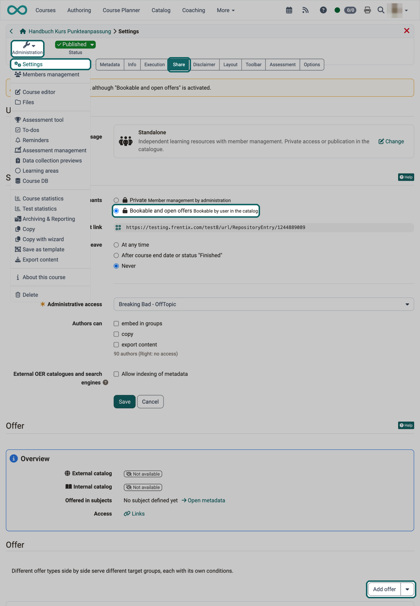{ class="shadow lightbox" title="Share tab of the course settings · 2026.09.28" }

[To the top of the page ^](#offers)

---

## Requirements for an offer {: #offers_requirements}

Before you create an offer, you open the course for bookings. For this, you select one of two variants under "Access for participants": 
`Course > Administration > Settings > Tab "Share"`

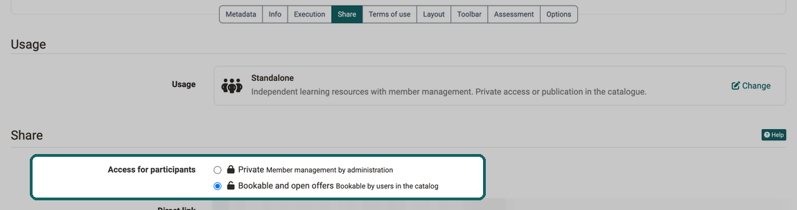{ class="shadow lightbox" title="Share tab of the course settings · 2026.10.20" }

With "Private", owners or persons with the right to manage members enter the participants. A private course does not appear in the catalog.

With "Bookable and open offers", learners book the course or the learning resource themselves. Depending on the offer, they enter an access code for this.

Only with "Bookable and open offers" can you create offers.

[To the top of the page ^](#offers)

---

## What does an offer contain? {: #offer_content}

An offer contains the conditions under which the course or learning resource can be used.

An offer defines who can book the course or the learning resource under which conditions. A booking with an access code, a free booking or a booking for a fee with PayPal Checkout is possible, provided administrators have set it up. Access without a booking order or as a guest can also be set up. Booking stands for enrolling, registering or purchasing. Click "Add offer" to create an offer.

For offers of an implementation in the Course Planner, an offer can additionally require forms that are filled in as steps when booking. This is not possible for offers of a course or another learning resource. [Booking order forms >](Course_Planner_Implementations.md#booking_order_forms) [:octicons-tag-16:{ title="from Release 21.1 (OO-9724)" }](https://track.frentix.com/issue/OO-9724){:target="_blank"}

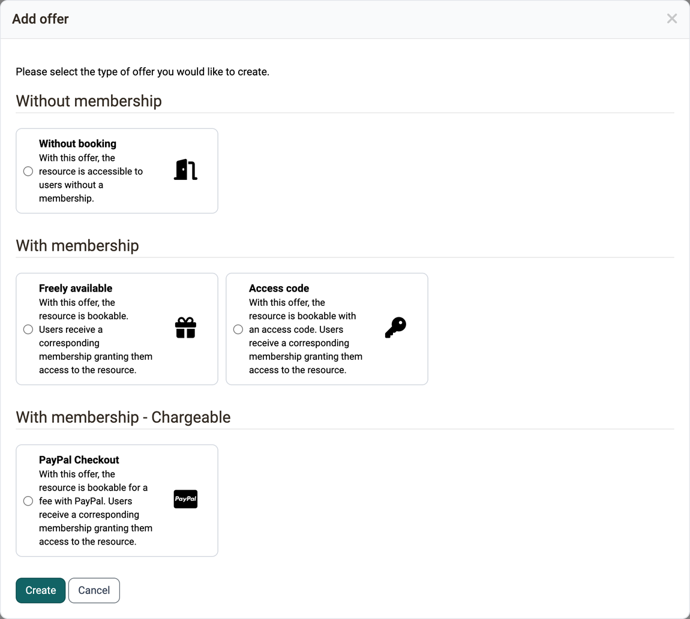{ class="shadow lightbox" title="Dialog Add offer · 2026.10.20" }

The dialog arranges the offer types in three groups: "Without membership", "With membership" and "With membership - Chargeable". Which offer types appear depends on the learning resource and on the settings of the system administration.

You can create several offers for one course, for example free of charge for some participants and for a fee for others.

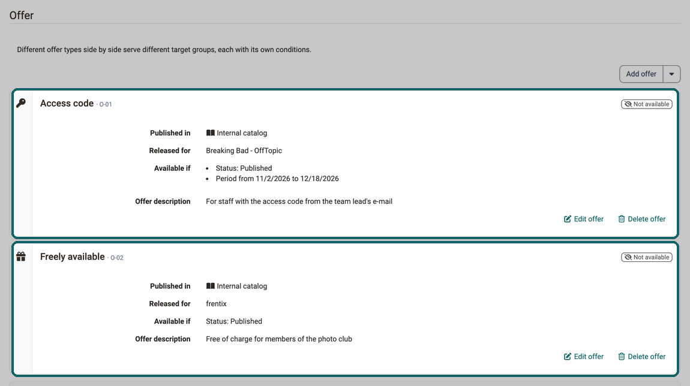{ class="shadow lightbox" title="Section Offer in the Share tab · 2026.10.20" }

In the tab "Share", each offer is in a box of its own. A badge shows its status, for example "Bookable", "Pending" or "Not available". Above it, an overview summarises whether the offers are published in the internal or in the external catalog.

In the field "Released for", you restrict an offer to organisations or sub-organisations.

!!! info "Organisation membership"

    If an offer is restricted to a specific organisation or sub-organisation, it appears in the catalog only for users who are members of that organisation. Users outside the organisation do not see the offer, even if the course is published.

    Organisation membership is managed in the [user management](../../manual_admin/usermanagement/index.md).

[To the top of the page ^](#offers)

---

## Publish offers {: #offer_publish}

When and where an offer appears in the catalog, you define in the offer itself. Open it for this with "Edit offer".

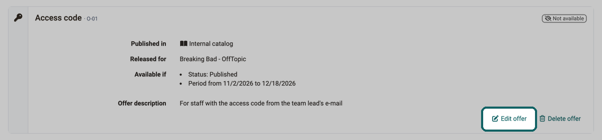{ class="shadow lightbox" title="Section Offer in the Share tab · 2026.10.20" }

At the top of the offer are "Internal label" and "Offer description". Only you see the internal label; the description appears in the catalog as soon as the offer is bookable. Below them follow the sections "Catalog" with "Published in", "Released for" and "Available if", and "Membership" with "Booking receipt". If "Send e-mail to participant" is ticked there, persons who book receive a confirmation by e-mail. For "Freely available", the section "Membership" additionally contains "Auto-booking". More on this under [Access configuration](../learningresources/Access_configuration.md#offer_availability).

You define when an offer is available under "Available if" in the offer. With "Course status "Published"", the offer applies as long as the course is published. With "Custom condition", you select one or more course statuses under "Status is" and define the period under "From" and "Until", each as "Controlled by status", "Absolute date" or "Relative date". The offer is then available when the course has one of the selected statuses and the date lies within the period.

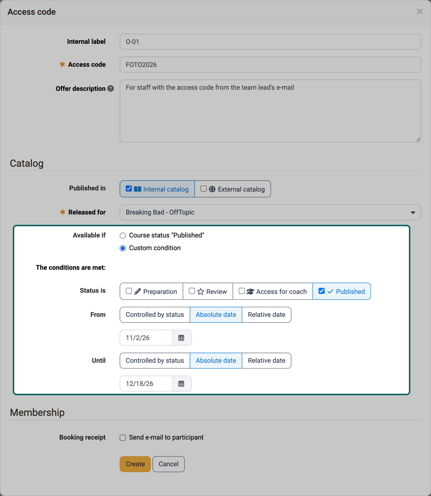{ class="shadow lightbox" title="Dialog Access code · 2026.10.20" }

Under "Published in", select "Internal catalog" so that the offer appears in the OpenOlat catalog. If the external catalog is switched on, "External catalog" is also available. You do not select the subject in the offer but in the "Metadata" tab of the course. The overview in the "Share" tab shows it under "Offered in subjects", and the link "Open metadata" leads there. If no subject is specified, the offer can be found via the search function in the catalog, for example, but it is not displayed in any taxonomy launcher in which offers with the same subject are displayed together.

Depending on the offer type, you define further details, for "Access code" for example the code itself.

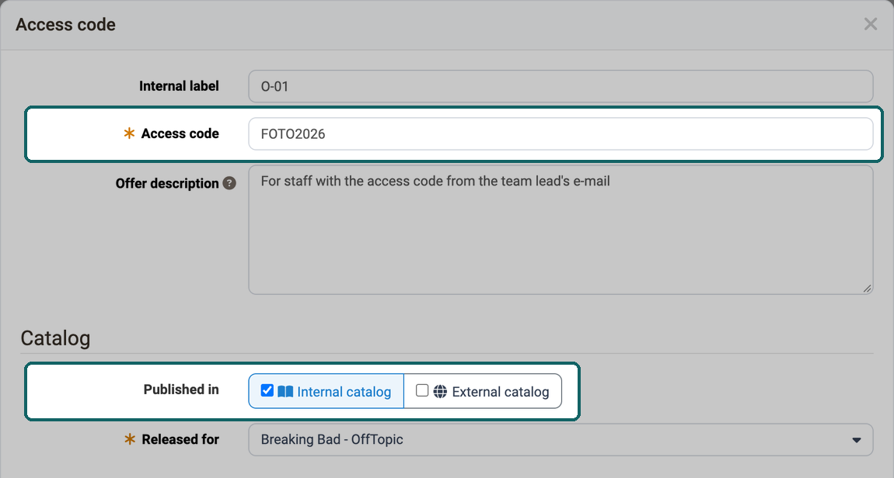{ class="shadow lightbox" title="Dialog Access code · 2026.10.20" }

[To the top of the page ^](#offers)

---

## How does booking an offer work? [:octicons-tag-16:{ title="from Release 17.0 (OO-6146)" }](https://track.frentix.com/issue/OO-6146){:target="_blank"} {: #offer_booking}

With a booking, you get access to a course or an implementation from the catalog. You book on the info page in the box "Get started" with "Book". If the course or the implementation has several offers, the info page shows them for selection, labelled with the offer type and, if available, the price. First select the desired offer; "Book" then applies to this offer. What happens next depends on the offer type and on whether the offer uses forms.

If the offer does not use a form, clicking "Book" completes the booking immediately for "Freely available". For "Access code", the dialog "Access code" opens; for "Invoice", the dialog "Booking on invoice" opens with the button "Order for a fee". Offers of individual courses never use forms: with an access code or freely available, you always book them this way. The offer type "Invoice" only exists for implementations.

### Booking with forms as a wizard [:octicons-tag-16:{ title="from Release 21.1 (OO-9742)" }](https://track.frentix.com/issue/OO-9742){:target="_blank"} {: #offer_booking_wizard}

If the offer of an implementation uses at least one form, OpenOlat guides you through a wizard. This way, you provide the details that the people responsible for planning need, for example dietary requirements or prior knowledge, together with the booking. Your answers are then available with your booking order.

The title of the wizard names the offer type and the implementation: "Booking freely available for", "Booking with an access code for" or "Booking on invoice for", followed by the title of the implementation and, if set, its reference.

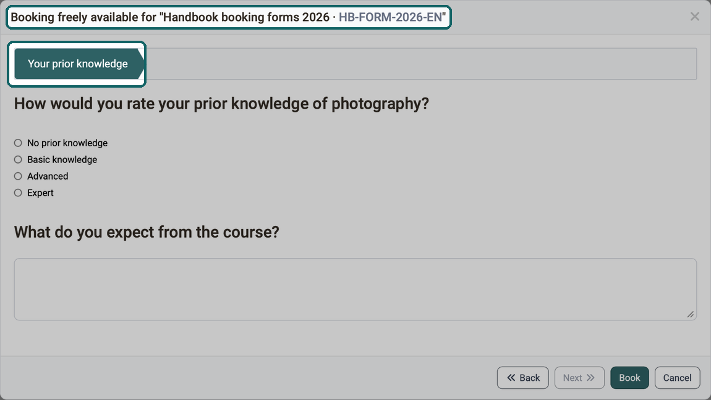{ class="shadow lightbox" title="Booking freely available wizard in the catalog · 2026.10.20" }

Which steps the wizard shows depends on the offer type:

| Offer type | Steps |
|---|---|
| Freely available | the forms |
| Access code | first the step "Access code", then the forms |
| Invoice | first the step "Booking details", then the forms |

In the step "Access code", you enter the access code you have received. In the step "Booking details", you select the billing address via "Select billing address"; it is mandatory. The "P.O. number" and the "Comment" are optional. If the offer has a price or a cancellation fee, the step shows this information.

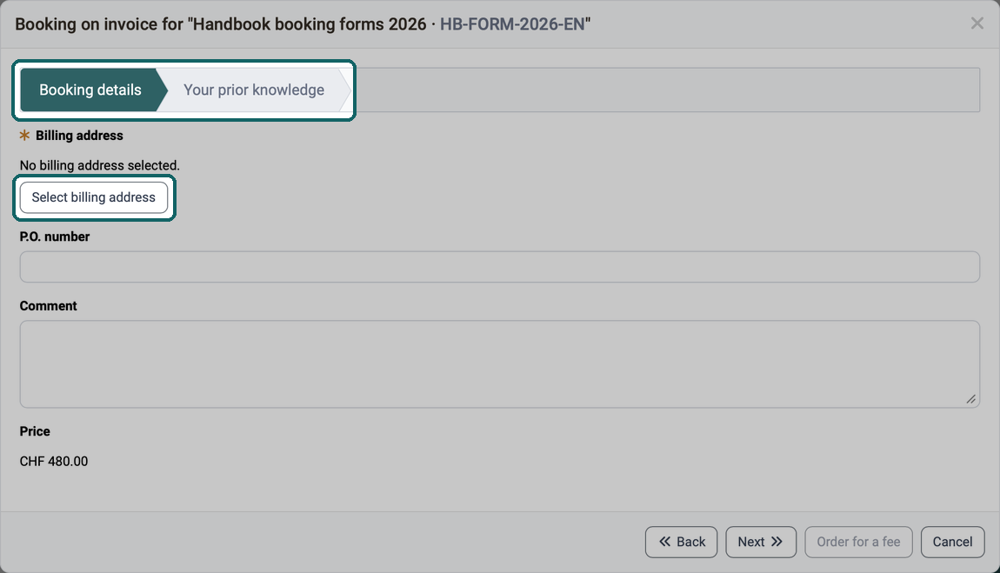{ class="shadow lightbox" title="Booking details step in the Booking on invoice wizard · 2026.10.20" }

Each form is a separate step, labelled with its step name. The offer determines the order of the forms.

- **Next** checks the mandatory fields of the displayed step and leads to the next step.
- **Back** leads to the previous step without checking. Your entries are retained.
- In the last step, the highlighted button completes the booking: "Book" for "Freely available" and "Access code", "Order for a fee" for "Invoice". In the steps before, this button is inactive; in the last step, "Next" is inactive.

The booking order is only created with this last click. If you cancel the wizard beforehand with "Cancel" or the close icon, you are not booked, and OpenOlat does not save any answers. If OpenOlat asks with the dialog "Unsaved form data", "Do not save data" closes the wizard and "Back to form" returns you to the step.

If another person books for you, for example with [Book on behalf of](Coaching_People.md#linemanager_educationmanager_book_participants) in Coaching or when [adding participants](Course_Planner_Implementations.md#add_members) in the Course Planner, this person fills in the forms. The answers belong to your booking order. You see your completed forms under [Booking orders](../personal_menu/Bookings.md) in the dialog "Booking" of the booking order.

Forms in offers only exist for implementations in the Course Planner, not for offers of individual courses and not for the offer type PayPal Checkout. How to use a form in an offer is described in [Use a form in an offer](Course_Planner_Implementations.md#booking_order_forms_offer).

[To the top of the page ^](#offers)

---

## Info page {: #offer_info}

Anyone who clicks "Learn more" for an offer in the catalog sees the info page of the course or learning resource without opening the course. The info page can be viewed in the catalog even if the course requires an access authorisation. Authors enter its details in the settings, most of them in the tab "Info": 
`Course > Administration > Settings > Tab "Info"`

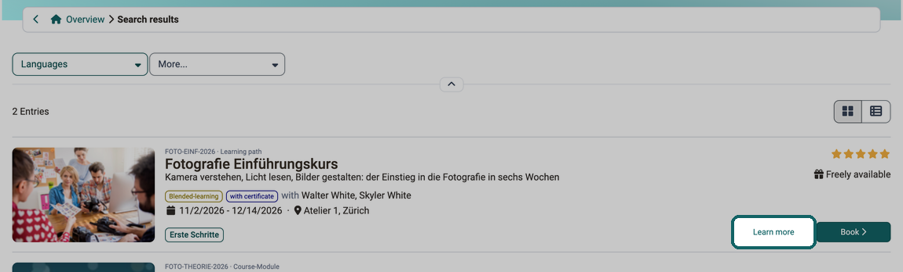{ class="shadow lightbox" title="Search results in the catalog · 2026.10.20" }

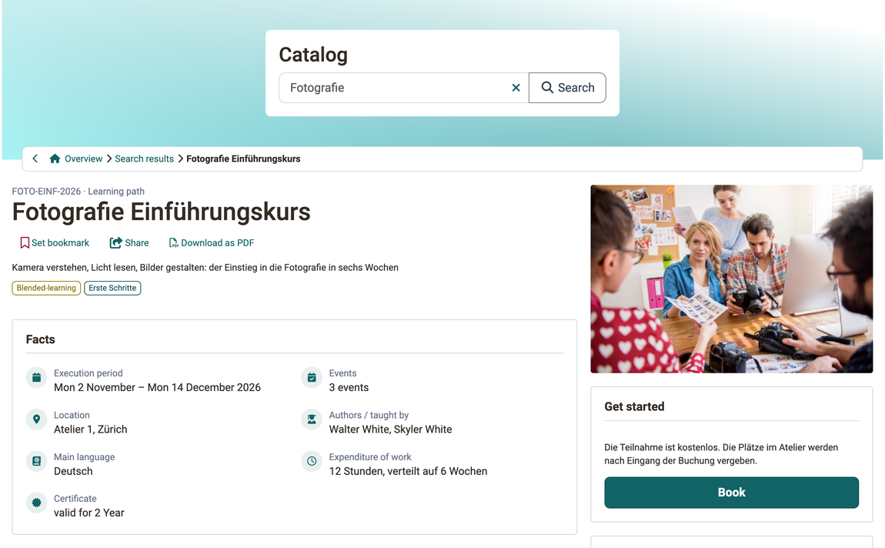{ class="shadow lightbox" title="Info page in the catalog · 2026.10.20" }

What the info page consists of and what the boxes "Get started" and "My course" show is described in [General Functions: Info Page](../learningresources/General_Functions_Infopage.md#content).

[To the top of the page ^](#offers)

---

## Metadata, subject {: #offer_metadata}

With the subject, you decide in which taxonomy launcher of the catalog a course or learning resource appears. Behind the subject is the taxonomy according to which the catalog compiles the courses. You select the subject under: 
`Course > Administration > Settings > Tab "Metadata"`

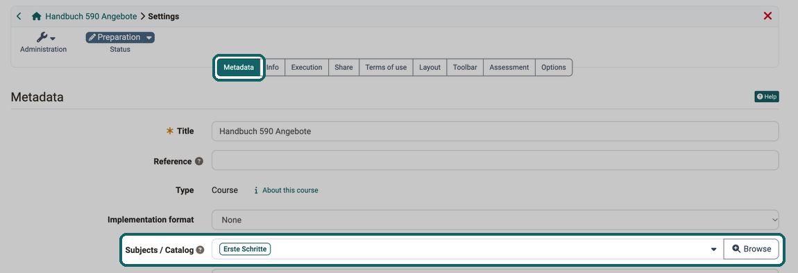{ class="shadow lightbox" title="Metadata tab of the course settings · 2026.10.20" }

An offer takes over the subject you specify in the "Metadata" tab. You do not select a subject in the offer itself; the "Share" tab only shows it under "Offered in subjects". In the catalog, the subjects also serve as keywords. You can specify several subjects.

If you click in the "Subjects / Catalog" field, a popup with a search field appears. "Selection" lists the selected subjects, followed by all subjects grouped by taxonomy. Tick a subject to add it, or untick it to remove it. "Select all" ticks all listed subjects, "Reset selection" clears the whole selection.

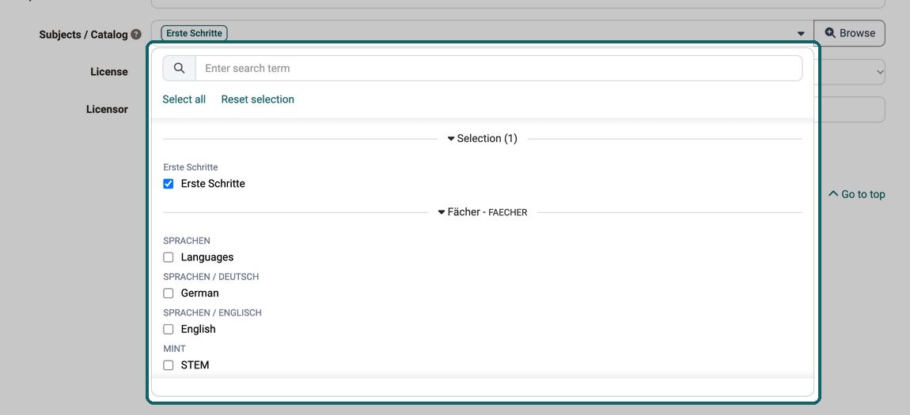{ class="shadow lightbox" title="Field Subjects / Catalog in the Metadata tab · 2026.10.20" }

The "Browse" button to the right of the field gives you a better overview. It opens the "Add" dialog with the taxonomy tree, one tab per taxonomy. Tick the subjects you want and click "Add". Then save the "Metadata" tab with "Save".

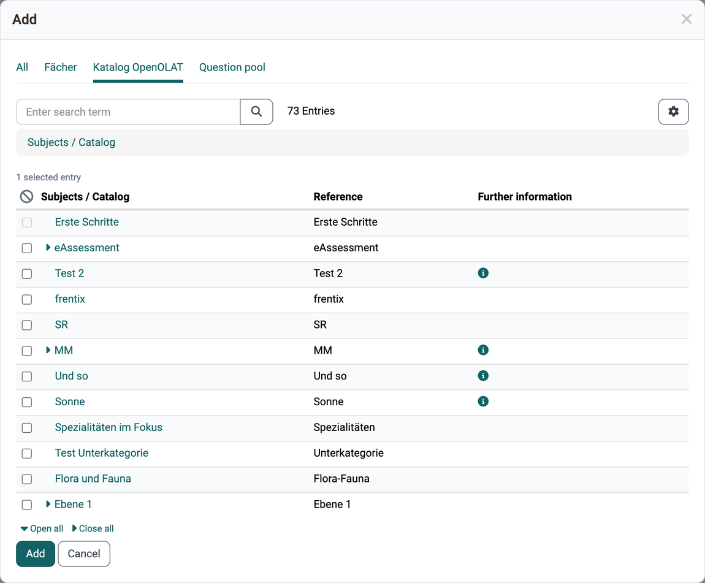{ class="shadow lightbox" title="Add dialog after clicking Browse · 2026.10.20" }

With this metadata, Catalog 2.0 combines all offers with the same subjects and shows them in a common catalog section, the taxonomy launcher.

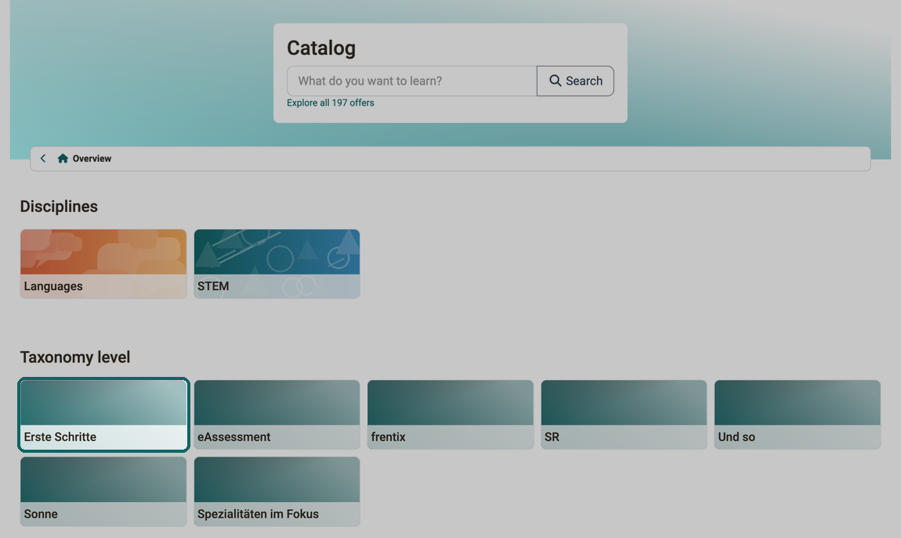{ class="shadow lightbox" title="Start page of the catalog · 2026.10.20" }

A click on the tile in the taxonomy launcher opens the microsite of the subject. It lists all courses and learning resources assigned to this subject.

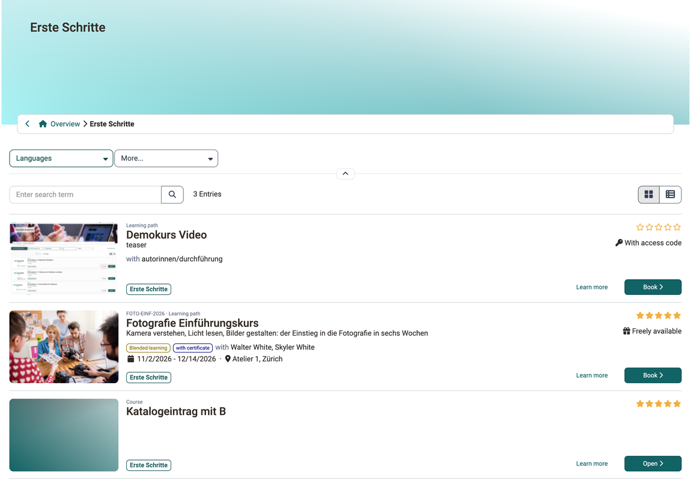{ class="shadow lightbox" title="Microsite of the taxonomy launcher · 2026.10.20" }

!!! note "Catalog 1.0"

    How to create offers in Catalog 1.0 is described in [Catalog 1.0](catalog1.0.md).

[To the top of the page ^](#offers)

---

## Further information {: #further_information}

**Mentioned on this page** 
[Course Planner: Implementations >](Course_Planner_Implementations.md) 
[User management (administration manual) >](../../manual_admin/usermanagement/index.md) 
[Access configuration >](../learningresources/Access_configuration.md) 
[Coaching - People >](Coaching_People.md) 
[User tools: Booking orders >](../personal_menu/Bookings.md) 
[General Functions: Info Page >](../learningresources/General_Functions_Infopage.md) 
[Catalog 1.0 >](catalog1.0.md)

**Further reading** 
[Offer concepts >](../basic_concepts/Offer_Concepts.md) 
[Catalog 2.0: Overview >](catalog2.0.md)

[To the top of the page ^](#offers)
