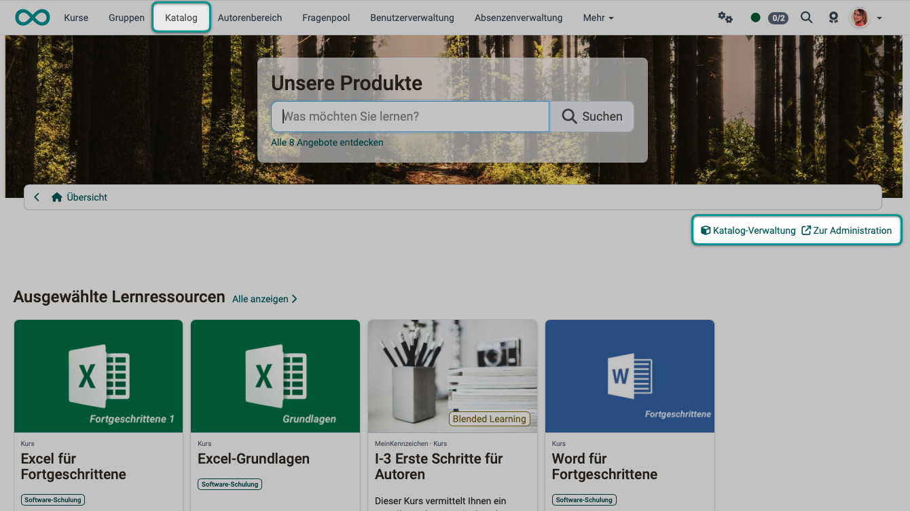
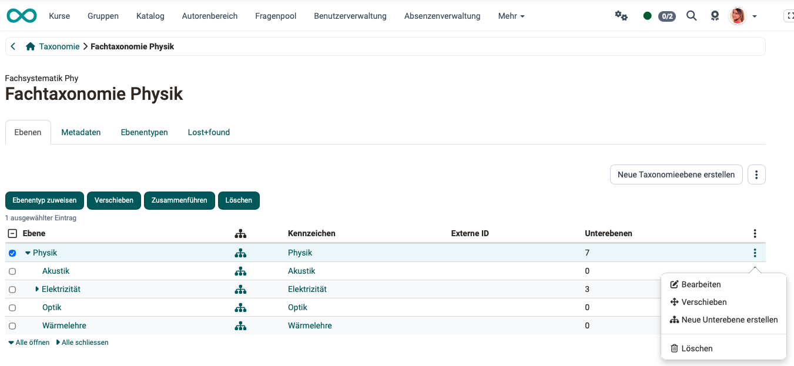
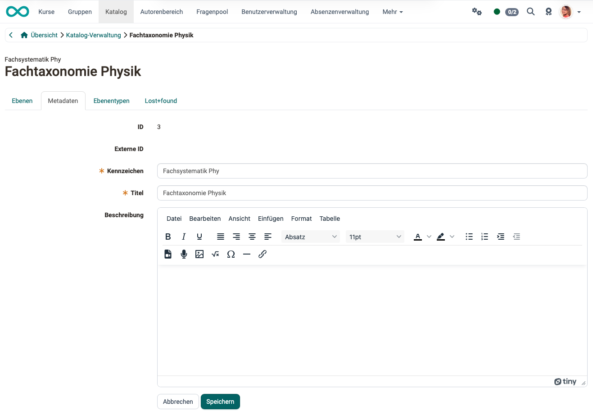
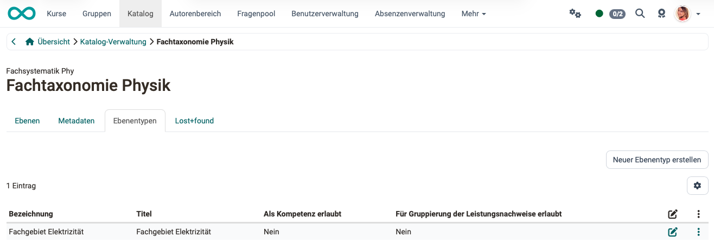
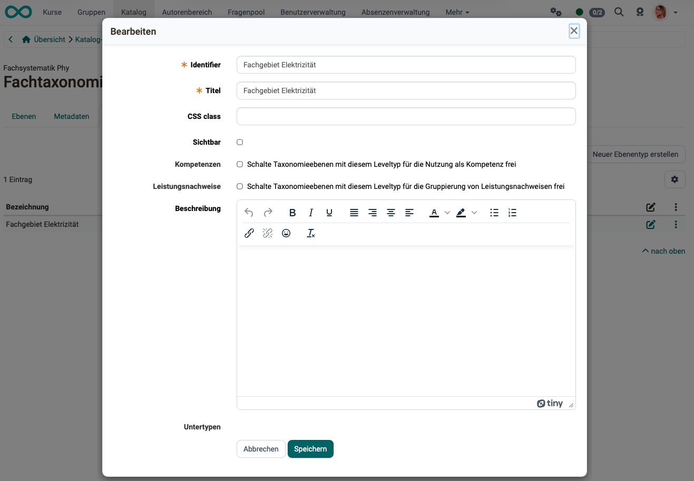
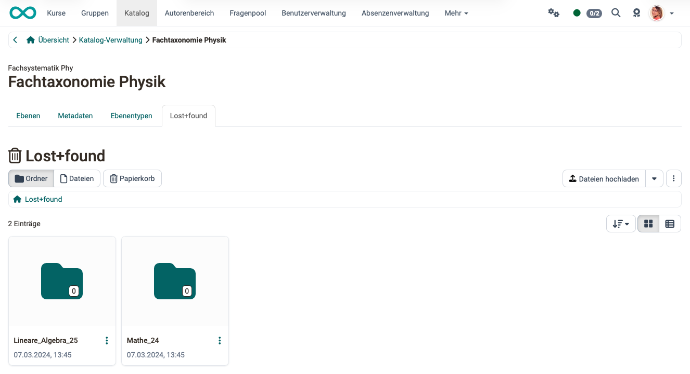

# Catalog 2.0 - Management {: #catalog_mgmt}

## Short description of catalog management {: #description}

With catalog management, you maintain the taxonomies by which Catalog 2.0 structures its offers, without being an administrator. Catalog management is not a role of its own but a right: the "Manage" competence on a taxonomy level.

## Where can I access the catalog management? [:octicons-tag-16:{ title="from Release 17.1 (OO-6201)" }](https://track.frentix.com/issue/OO-6201) {: #access}

You open catalog management via a link in the catalog. Authorized users also find these links in the top-right corner, below the header of the catalog:

- **Catalog management**
- **Jump to administration**

{ class="shadow lightbox" title="Catalog overview" }

[To the top of the page ^](#catalog_mgmt)

---

## Who sees the access links in the catalog? {: #access_links}

The "Catalog management" link is visible to:

- Learning resource managers
- Administrators
- System administrators
- Users who hold the "Manage" competence on a taxonomy level

Whether learning resource managers get the link is set by system administrators in the system administration: `Administration > Modules > Catalog > Tab "Settings"`, field "Taxonomy editable by". In any case, the link requires the Taxonomy module to be enabled.

Only system administrators see the "Jump to administration" link. It opens the Catalog module in the system administration.

[To the top of the page ^](#catalog_mgmt)

---

## How do you obtain the right (the competence) for catalog management? [:octicons-tag-16:{ title="from Release 20.1 (OO-8544)" }](https://track.frentix.com/issue/OO-8544) {: #competence}

The "Manage" competence (the right to edit the taxonomies used in the catalog) can be granted in two ways:

**Option 1:** 
By system administrators in the system administration: 
`Administration > Modules > Taxonomy > "Taxonomy title" > "Taxonomy level" > Tab "Management" > Button "Add manager"` 
The taxonomy must be enabled for the catalog. Open it with "view / edit".

**Option 2:** 
By user managers: 
`User management > "Person" > Tab "Competences" > Button Add "Manage"`

Once the competence has been granted, the "Catalog management" link appears for that person in the top-right corner, below the catalog header.

!!! info "Important"

    Catalog management is not limited to a specific organizational unit, although the role of learning resource manager may be restricted to a specific organizational unit. (Taxonomies are also not limited to organizational units.)

[To the top of the page ^](#catalog_mgmt)

---

## What do you edit in catalog management? {: #functions}

In catalog management, you edit the taxonomy of the catalog, not the learning resources. You edit and delete courses and other learning resources [in the authoring area](../area_modules/Authoring.md), for example when they have ended.

Which tabs you see depends on your right:

- System administrators, administrators and authorized learning resource managers see the tabs "Levels", "Metadata", "Level types" and "Lost+found" and edit the entire taxonomy.
- Users who only hold the "Manage" competence see the tabs "Levels" and "Metadata". They edit only the taxonomy levels for which they hold the competence, and they see the metadata of the taxonomy without changing it.

### Tab Levels {: #tab_level}

The following actions are available for the subjects (taxonomy levels):

- Edit
- Move
- Merge
- Assign level type
- Delete
- Add new level under this one

Under the three dots to the right of the "Create new taxonomy level" button, you import taxonomy levels or export them all. You download the export as a ZIP archive. It contains an Excel spreadsheet with the hierarchical structure of the taxonomy levels. Import and export are only available with the right for the entire taxonomy.

{ class="shadow lightbox" title="Levels tab of a taxonomy" }

!!! info "Important"

    System administrators design the launch page, filters and layout of the catalog in the system administration under `Administration > Modules > Catalog`.

[To the top of the page ^](#catalog_mgmt)

---

### Tab Metadata {: #tab_metadata}

The "Metadata" tab holds the data of the taxonomy itself, not of its levels. You open the metadata of an individual taxonomy level through its row in the "Levels" tab.

{ class="shadow lightbox" title="Metadata tab of a taxonomy" }

**ID:** The ID is generated automatically and allows the object to be uniquely identified.

**External ID:** If an external management system created the taxonomy, the external ID is generated in addition to the automatically generated ID.

**Reference:** (Required field) Select a unique and logical reference for the taxonomy. This reference appears in the header above the title and is more practical for many purposes than the full title (which may be more understandable and colloquial).

**Title:** (Required field) The title is used in various places (Catalog 2.0, Document Pool, e-Portfolio, Question Bank). It should provide a brief and accurate description of the taxonomy.

**Description:** Entering a more detailed description of the taxonomy is optional.

[To the top of the page ^](#catalog_mgmt)

---

### Tab Level types {: #tab_leveltype}

Use the "Add new level type" button to add another level type. The following fields are available in the edit dialog.

{ class="shadow lightbox" title="Level types tab of a taxonomy" }

{ class="shadow lightbox" title="Edit dialog of a level type" }

**Reference:** In addition to the title, a reference must be provided.

**Title:** Enter an appropriate title to describe the level type.

**CSS class:** If a corresponding CSS class is defined in the theme, it can be selected here.

**Visible:** This setting determines whether all taxonomy levels of this type should be visible.

**Competences:** Users can be assigned competences in user management. Selecting this option enables taxonomy levels with this level type to be used as competences.

**Evidence of achievement:** Selecting this option enables taxonomy levels with this level type for grouping evidence of achievements.

**Description:** A more detailed description of the level type is optional.

**Sub types:** You can select a subtype from the existing level types. This allows you to create a hierarchical structure, which will then be visible when you create the taxonomy levels.

[To the top of the page ^](#catalog_mgmt)

---

### Tab Lost+found {: #tab_lost_found}

This is where the documents of deleted taxonomy levels are stored. If you delete a level without merging it, OpenOlat copies its documents into a subfolder. The folder name consists of the reference and the ID of the deleted level. If you merge the level with another level instead, the documents move to the target level.

{ class="shadow lightbox" title="Lost+found tab of a taxonomy" }

[To the top of the page ^](#catalog_mgmt)

---

## Further information {: #further_information}

[Authoring - Overview >](../area_modules/Authoring.md) 
[Module Taxonomy >](../../manual_admin/administration/Modules_Taxonomy.md) 
[How do I present my courses in the OpenOlat catalog? >](../../manual_how-to/catalog/catalog.md) 
[Catalog 2.0 - Offers >](../area_modules/catalog2.0_angebote.md) 
[Catalog 2.0 - Design >](../area_modules/catalog2.0_design.md) 
[Externally available catalog >](../area_modules/catalog2.0_web.md) 
[Module Catalog >](../../manual_admin/administration/Modules_Catalog_2.0.md)

[To the top of the page ^](#catalog_mgmt)
