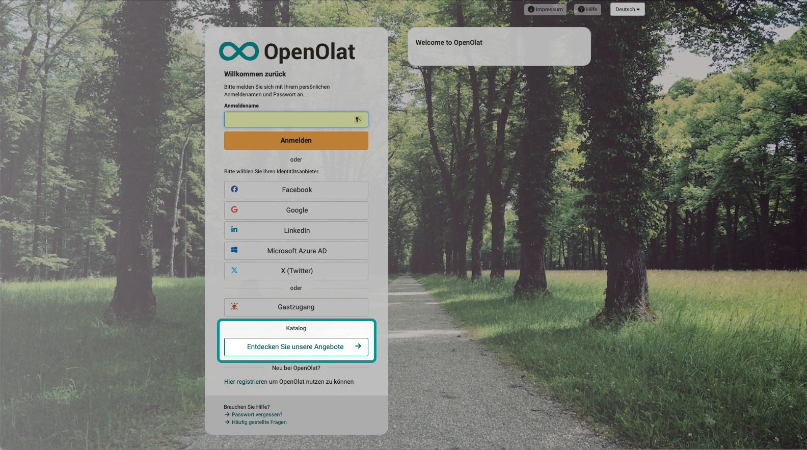
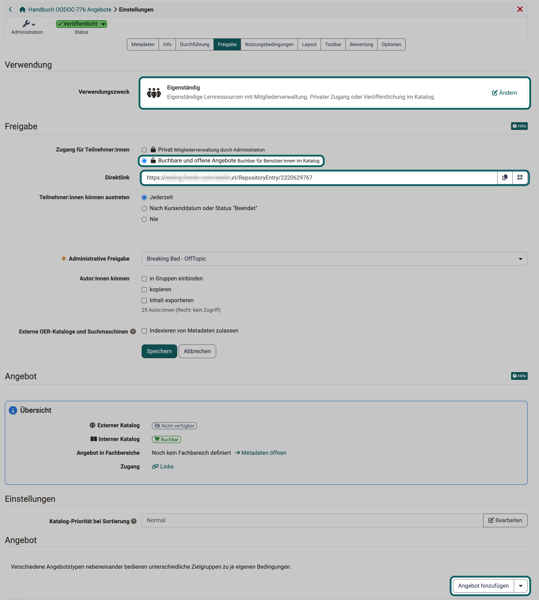
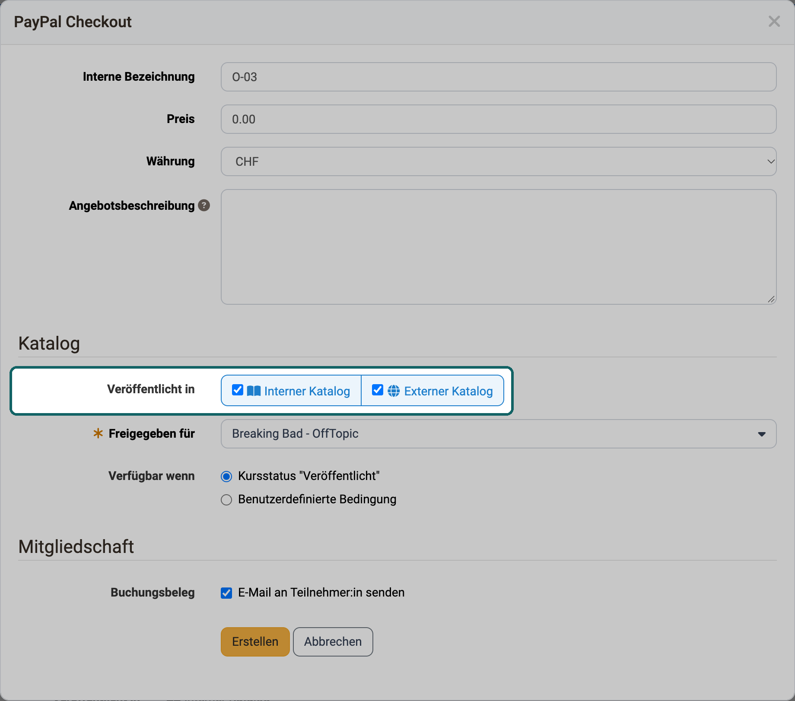
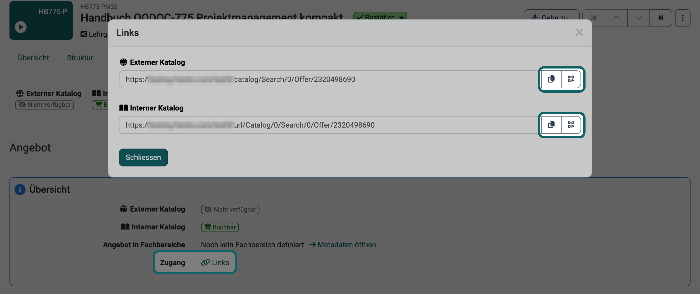

# Extern verfügbarer Katalog {: #web_catalog}

## Situation ohne externen Katalog {: #without_web_catalog}

Kurse aus OpenOlat lassen sich im Katalog anbieten. Damit OpenOlat Testergebnisse, Zertifikate und Rückmeldungen zum Kursbesuch speichern kann, brauchen die Teilnehmer:innen ein Konto in OpenOlat. Dieses Konto entsteht bei der Registrierung.

Ohne externen Katalog braucht auch ein Konto, wer den Katalog nur durchblättern will.

## Situation mit externem Katalog [:octicons-tag-16:{ title="ab Release 20.0 (OO-8002)" }](https://track.frentix.com/issue/OO-8002) {: #with_web_catalog}

Mit dem externen Katalog zeigen Sie Ihre Angebote auch Personen, die noch kein Konto in OpenOlat haben. "Extern" bedeutet, dass OpenOlat den Katalog ausserhalb der Anmeldung spiegelt: Er lässt sich ohne Registrierung aufrufen. Grundlage ist der Katalog 2.0, den angemeldete Benutzer:innen sehen. Einen Katalog 1.0 zeigt OpenOlat nicht als externen Katalog an.

Auch die Preise und die Anzahl der in einem Kurs verfügbaren Plätze sind im externen Katalog ersichtlich.

Benutzer:innen wählen dort Kurse aus und buchen sie. Erst nach der Wahl führt OpenOlat sie durch die Registrierung, damit es ihre Arbeitsergebnisse speichern kann.

Bei Benutzer:innen, die bereits in OpenOlat registriert sind, ordnet OpenOlat die Buchung dem bestehenden Konto zu und bestätigt sie anschliessend.

## Aufruf des externen Katalogs {: #web_catalog_access}

Auf der Login-Seite führt der Button "Entdecken Sie unsere Angebote" zum externen Katalog. Den externen Katalog und die Anzeige des Buttons richten Systemadministrator:innen in der System-Administration ein: `Administration > Module > Katalog > Tab "Einstellungen"`.

{ class="shadow lightbox" title="Login-Seite von OpenOlat" }

Den Link zum externen Katalog bauen Sie auch an anderer Stelle in eine Website ein.

Ebenso verschicken Sie [direkte Links zu einem Angebot](#web_catalog_direct_link).

[Zum Seitenanfang ^](#web_catalog)

---

## Angebote für den externen Katalog erstellen {: #web_catalog_offers}

Damit ein Kurs im externen oder im internen Katalog erscheint, erstellen Besitzer:innen des Kurses dafür ein Angebot unter: 
`Kurs > Administration > Einstellungen > Tab "Freigabe"`

Bevor Sie ein Angebot erstellen, stellen Sie zwei Optionen ein:

- **Verwendungszweck**: Im Abschnitt "Verwendung" ist "Eigenständig" gewählt.
- **Zugang für Teilnehmer:innen**: Im Abschnitt "Freigabe" ist "Buchbare und offene Angebote" gewählt.

Anschliessend erstellen Sie mit "Angebot hinzufügen" ein Angebot.

{ class="shadow lightbox" title="Tab Freigabe der Kurseinstellungen · 2026.11.09" }

Wählen Sie eine Angebotsart, legen Sie im Angebot unter "Veröffentlicht in" fest, ob es im internen Katalog, im externen Katalog oder in beiden erscheint. 
Soll das Angebot für internen und externen Katalog gleich sein, setzen Sie beide Häkchen. 
Sollen sich internes und externes Angebot unterscheiden (z.B. intern kostenlos, extern kostenpflichtig), erstellen Sie zwei verschiedene Angebote.

{ class="shadow lightbox" title="Dialog PayPal Checkout für ein neues Angebot · 2026.11.09" }

!!! note "Hinweis"

    Auch Durchführungen aus dem Course Planner bieten Sie im externen Katalog an. Beim Kurs einer solchen Durchführung ist unter `Kurs > Administration > Einstellungen > Tab "Freigabe" > Abschnitt "Verwendung"` die Option "Verwendung im Course Planner" gewählt. Das Angebot legen Sie dann in der Durchführung an, nicht im Kurs.

    Mehr dazu unter [Course Planner: Durchführungen](Course_Planner_Implementations.de.md#tab_catalog).

### Direktlink zu einem Angebot {: #web_catalog_direct_link}

Möchten Sie Interessierte direkt zu einem bestimmten Angebot führen, etwa per E-Mail oder mit einem Plakat, finden Sie die Links in der Übersicht der Angebote. Liegt das Angebot im Katalog, steht dort die Zeile "Zugang" mit dem Link "Links". Er öffnet den Dialog "Links" mit den Feldern "Externer Katalog" und "Interner Katalog". Für jeden Fachbereich mit eigener Microsite kommt ein Feld "Microsite" mit dem Namen des Fachbereichs dazu.

Neben jedem Link kopieren Sie ihn mit "In Zwischenablage kopieren" oder zeigen ihn mit "QR-Code anzeigen" als QR-Code. Mit "PNG herunterladen" speichern Sie den QR-Code als Bild, zum Beispiel für ein Plakat, das direkt zum Angebot im externen Katalog führt. Mehr dazu unter [Links kopieren und als QR-Code weitergeben](../basic_concepts/Navigation.de.md#url_field). [:octicons-tag-16:{ title="ab Release 21.1.2 (OO-9982)" }](https://track.frentix.com/issue/OO-9982)

In den Assistenten, etwa beim Publizieren eines Kurses, zeigt der Dialog "Links" nur "In Zwischenablage kopieren". Den QR-Code eines Angebots zeigen Sie nach dem Assistenten im selben Dialog in der Übersicht der Angebote: für einen Kurs unter `Kurs > Administration > Einstellungen > Tab "Freigabe"`, für eine Durchführung unter `Course Planner > Durchführungen > "Ihre Durchführung" > Tab Katalog`.

**Beispiel: Links zum Angebot einer Durchführung**

{ class="shadow lightbox" title="Tab Katalog einer Durchführung · 2026.11.09" }

[Zum Seitenanfang ^](#web_catalog)

---

## Weiterführende Informationen {: #further_information}

[Course Planner: Durchführungen >](Course_Planner_Implementations.de.md) 
[Navigation >](../basic_concepts/Navigation.de.md) 
[Modul Katalog >](../../manual_admin/administration/Modules_Catalog_2.0.de.md) 
[Katalog 2.0: Übersicht >](catalog2.0/index.de.md) 
[Katalog 2.0 - Angebote >](catalog2.0_angebote.de.md) 
[Zugangskonfiguration / Freigabe >](../learningresources/Access_configuration.de.md)

[Zum Seitenanfang ^](#web_catalog)
