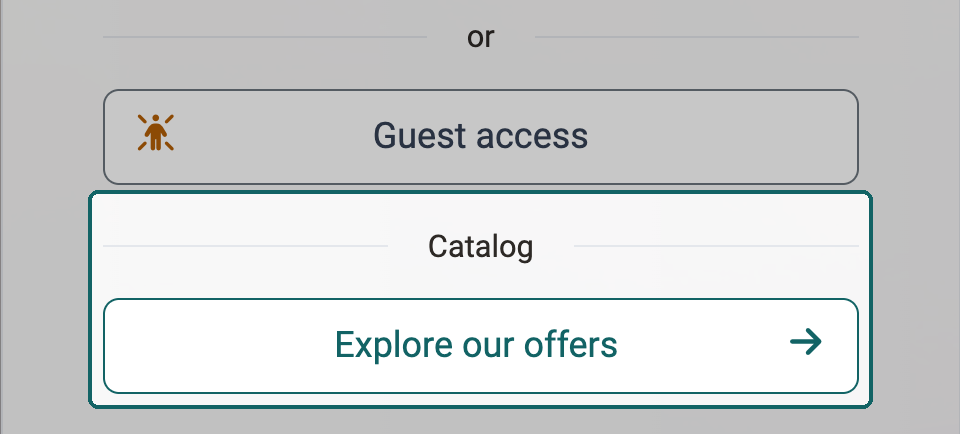
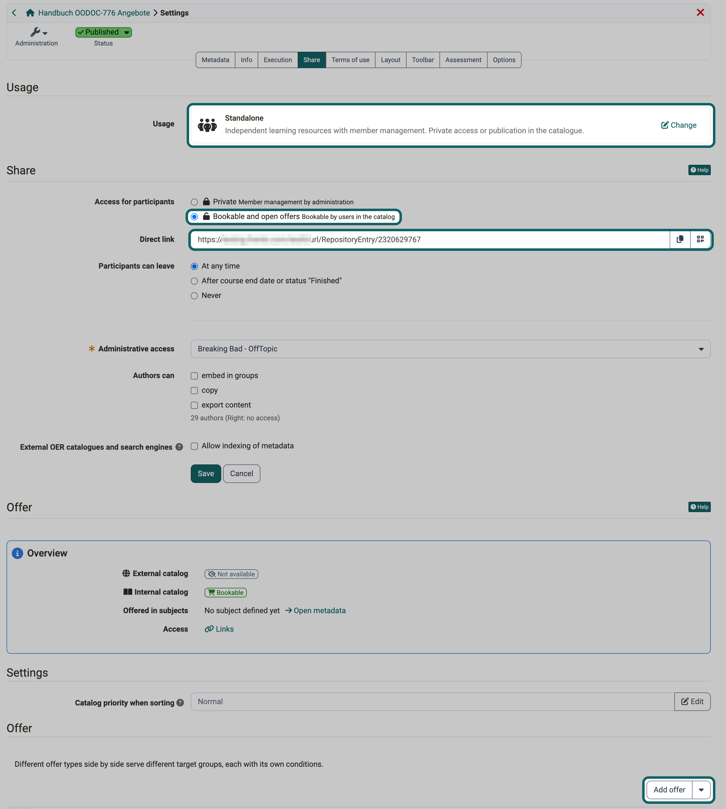
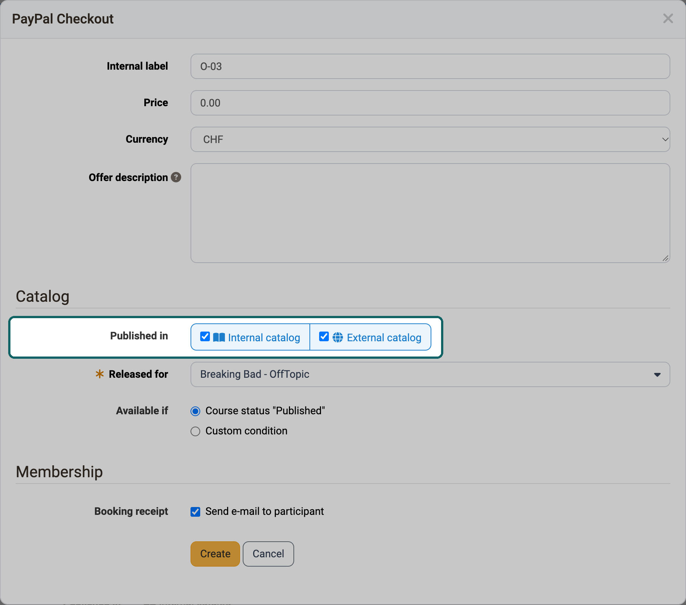
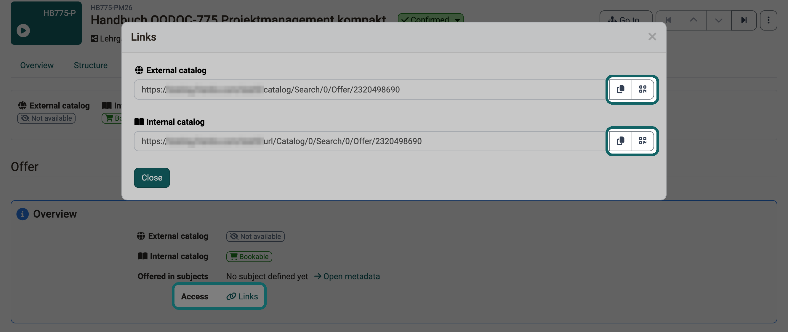

# Externally available catalog {: #web_catalog}

## Situation without external catalog {: #without_web_catalog}

Courses from OpenOlat can be offered in the catalog. So that OpenOlat can save test results, certificates and feedback on attending a course, the participants need an account in OpenOlat. This account is created during registration.

Without the external catalog, anyone who only wants to browse through the catalog also needs an account.

## Situation with external catalog [:octicons-tag-16:{ title="from Release 20.0 (OO-8002)" }](https://track.frentix.com/issue/OO-8002) {: #with_web_catalog}

With the external catalog, you show your offers also to persons who do not yet have an account in OpenOlat. "External" means that OpenOlat mirrors the catalog outside the login: it can be accessed without registration. The basis is the Catalog 2.0 that logged-in users see. OpenOlat does not display a Catalog 1.0 as an external catalog.

The prices and the number of places available in a course are also visible in the external catalog.

Users select courses there and book them. Only after their choice does OpenOlat guide them through the registration, so that it can save their work results.

For users who are already registered in OpenOlat, OpenOlat assigns the booking to their existing account and then confirms it.

## Accessing the external catalog {: #web_catalog_access}

On the login page, the button "Explore our offers" leads to the external catalog. System administrators set up the external catalog and the display of the button in the system administration: `Administration > Modules > Catalog > Tab "Settings"`.

{ class="shadow lightbox" title="Login page of OpenOlat · 2026.11.09" }

You can also integrate the link to the external catalog elsewhere in a website.

You can also send [direct links to an offer](#web_catalog_direct_link).

[To the top of the page ^](#web_catalog)

---

## Create offers for the external catalog {: #web_catalog_offers}

So that a course appears in the external or in the internal catalog, the owners of the course create an offer for it under: 
`Course > Administration > Settings > Tab "Share"`

Before you create an offer, set two options:

- **Usage**: In the section "Usage", "Standalone" is selected.
- **Access for participants**: In the section "Share", "Bookable and open offers" is selected.

Then you create an offer with "Add offer".

{ class="shadow lightbox" title="Share tab of the course settings · 2026.11.09" }

When you select an offer type, you define in the offer under "Published in" whether it appears in the internal catalog, in the external catalog or in both. 
If the offer should be the same for the internal and external catalog, tick both boxes. 
If the internal and external offer should differ (e.g. internal free of charge, external chargeable), create two different offers.

{ class="shadow lightbox" title="Dialog PayPal Checkout for a new offer · 2026.11.09" }

!!! note "Note"

    You can also offer implementations from the Course Planner in the external catalog. For the course of such an implementation, the option "Use in Course Planner" is selected under `Course > Administration > Settings > Tab "Share" > Section "Usage"`. You then create the offer in the implementation, not in the course.

    More on this under [Course Planner: Implementations](Course_Planner_Implementations.md#tab_catalog).

### Direct link to an offer {: #web_catalog_direct_link}

If you want to lead interested persons directly to a specific offer, for example by e-mail or with a poster, you find the links in the overview of the offers. If the offer is in the catalog, the row "Access" with the link "Links" appears there. It opens the dialog "Links" with the fields "External catalog" and "Internal catalog". For each subject with its own microsite, a field "Microsite" with the name of the subject is added.

Next to each link, you copy it with "Copy to clipboard" or show it as a QR code with "Show QR code". With "Download PNG" you save the QR code as an image, for example for a poster that leads directly to the offer in the external catalog. More on this under [Copy links and pass them on as a QR code](../basic_concepts/Navigation.md#url_field). [:octicons-tag-16:{ title="from Release 21.1.2 (OO-9982)" }](https://track.frentix.com/issue/OO-9982)

In the wizards, for example when publishing a course, the dialog "Links" only shows "Copy to clipboard". You show the QR code of an offer after the wizard in the same dialog in the overview of the offers: for a course under `Course > Administration > Settings > Tab "Share"`, for an implementation under `Course Planner > Implementations > "Your implementation" > Tab Catalog`.

**Example: Links to the offer of an implementation**

{ class="shadow lightbox" title="Catalog tab of an implementation · 2026.11.09" }

[To the top of the page ^](#web_catalog)

---

## Further information {: #further_information}

[Course Planner: Implementations >](Course_Planner_Implementations.md) 
[Navigation >](../basic_concepts/Navigation.md) 
[Module Catalog >](../../manual_admin/administration/Modules_Catalog_2.0.md) 
[Catalog 2.0: Overview >](catalog2.0/index.md) 
[Catalog 2.0 - Offers >](catalog2.0_angebote.md) 
[Access configuration >](../learningresources/Access_configuration.md)

[To the top of the page ^](#web_catalog)
