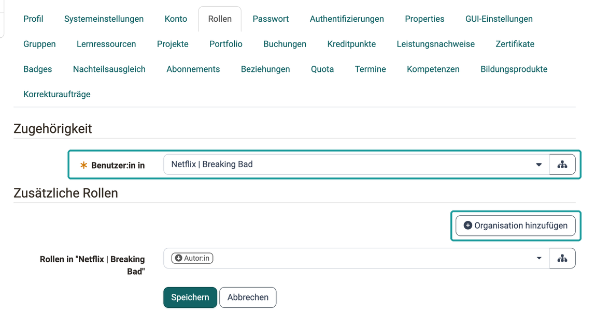
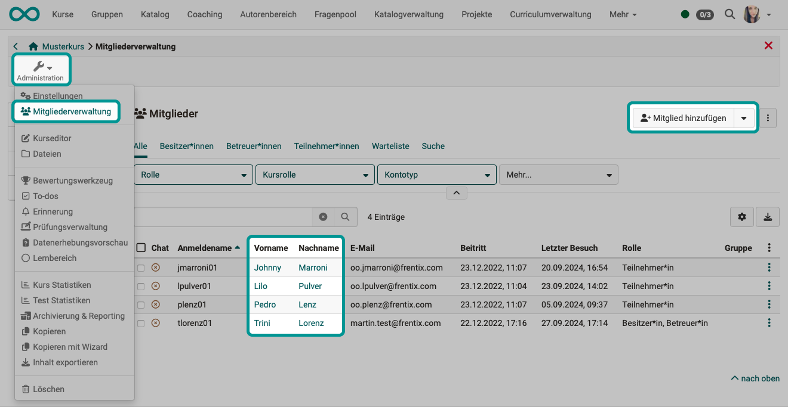
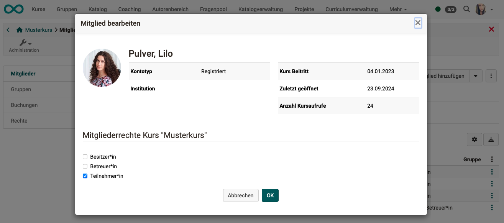
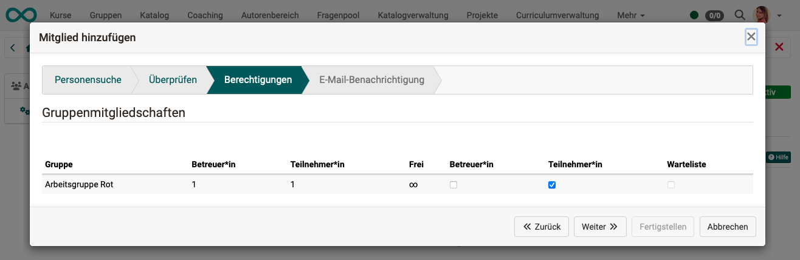
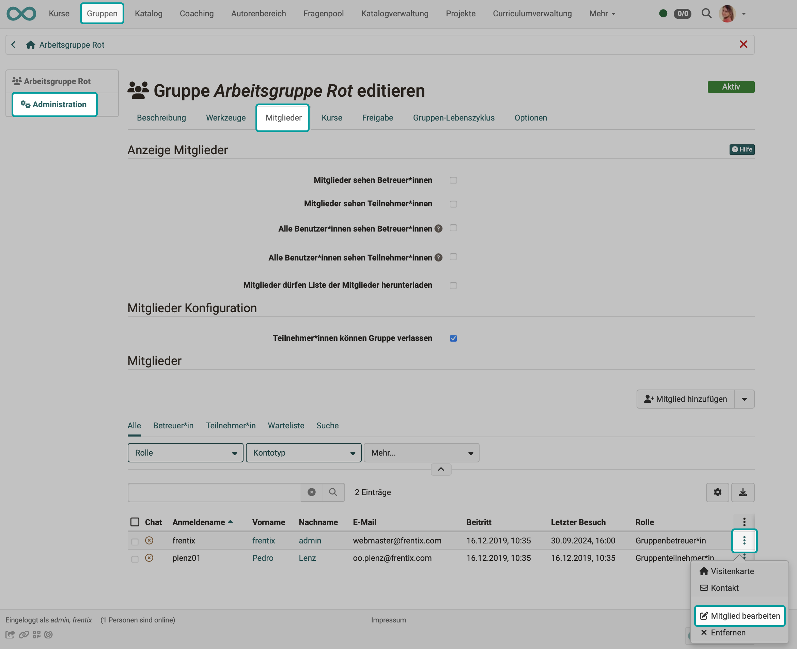
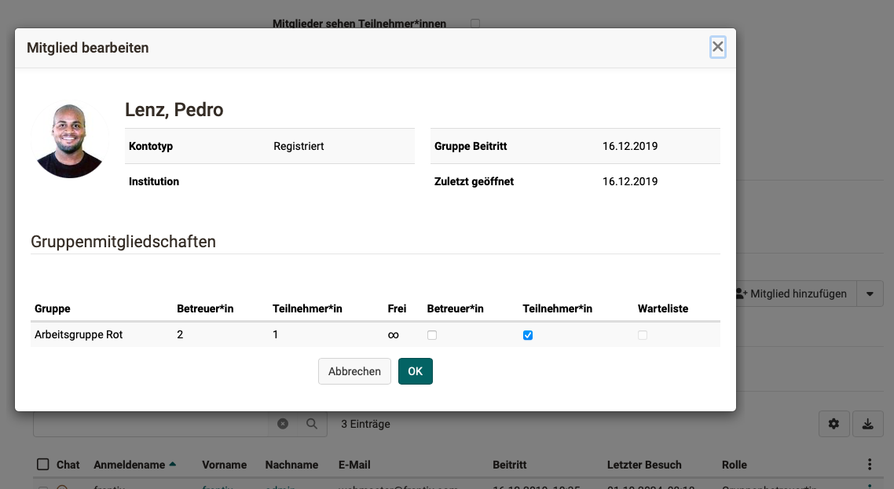
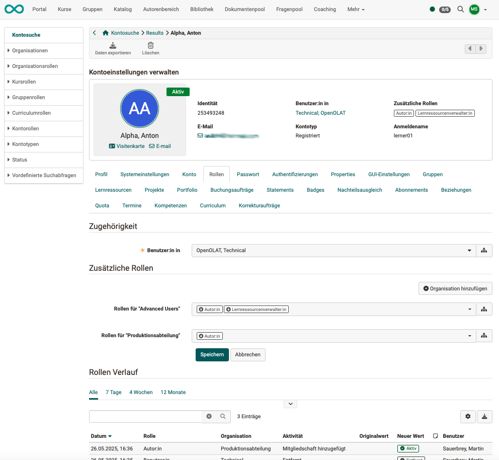
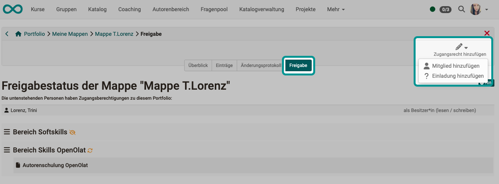

# Rollen und Rechte: Rollen zuweisen {: #role_assignment} 

## Rollenzuweisung für Organisationsrollen {: #role_assignment_org} 

Organisationsweit oder systemweit gültige Rollen werden in der Benutzerverwaltung vergeben: 
`Benutzerverwaltung > Benutzer:in auswählen > Tab "Rollen"` 
Die Zuweisung übernehmen deshalb typischerweise Benutzerverwalter:innen oder Administrator:innen.

:octicons-device-camera-video-24: **Video-Einführung**: [Benutzerverwaltung](<https://www.youtube.com/embed/V1RuH0q08J8>){:target="_blank"}

Je nach Aufgabenbereich sind Rollen, und damit weitere Rechte, hinzuzufügen. Die Seite [Rollen und ihre Arbeitsbereiche](Roles_Home_Areas.de.md) zeigt, in welchem Bereich der Hauptnavigation die einzelnen Rollen arbeiten.

Der Tab "Rollen" zeigt die Zugehörigkeit der Person ("Benutzer:in in"), ihre zusätzlichen Rollen je Organisation und unter "Rollenverlauf" jede Änderung an den Rollen. Details dazu beschreibt das Administrationshandbuch: [Rollen zuweisen](../../manual_admin/usermanagement/Assign_roles.de.md)

{ class="shadow lightbox" title="Tab Rollen in der Benutzerverwaltung" }

[zum Seitenanfang ^](#role_assignment)

---

## Rollenzuweisung für Kursrollen {: #role_assignment_course}

**Rollen neuer Kursmitglieder** 
Kursbesitzer:innen fügen neue Kursmitglieder hinzu unter 
`Kurs > Administration > Mitgliederverwaltung > Button "Mitglied hinzufügen"` 
Die gewünschte Rolle innerhalb eines Kurses wird dann während des Erfassens des neuen Mitglieds abgefragt.

**Rollenzuweisung der Kursbesitzer:innen** 
Eine Person mit Autorenrecht (= Organisationsrolle "Autor:in"), die einen Kurs erstellt, ist automatisch Besitzer:in dieses Kurses (Kursrolle "Besitzer:in"). Weitere Personen können Sie anschliessend als zusätzliche Besitzer:innen hinzufügen.

**Rollen der Kursmitglieder ändern** 
Bei Mitgliedern eines Kurses kann die Rolle geändert werden unter 
`Kurs > Administration > Mitgliederverwaltung > Klick auf den Namen des Mitglieds` 
Im Dialog "Mitglied bearbeiten" vergeben Sie eine oder mehrere Kursrollen.

{ class="shadow lightbox" title="Mitgliederverwaltung in der Administration des Kurses" }
{ class="shadow lightbox" title="Dialog Mitglied bearbeiten im Kurs" }

[zum Seitenanfang ^](#role_assignment)

---

## Rollenzuweisung für Gruppenrollen {: #role_assignment_group} 

**Rollenzuweisung beim [Erstellen einer neuen Gruppe](../groups/index.de.md) / Hinzufügen neuer Mitglieder:** 
Beim Hinzufügen neuer Mitglieder werden auch die Rollen "Gruppenteilnehmer:in" und "Gruppenbetreuer:in" vergeben.

{ class="shadow lightbox" title="Schritt Berechtigungen im Assistenten Mitglied hinzufügen" }

**Rollen der Gruppenmitglieder ändern** 
Besteht bereits eine Mitgliedschaft in einer Gruppe und Sie wollen die Rolle der Person ändern, können Sie dies (bei vorhandener Berechtigung zum Bearbeiten) in der Administration der Gruppe: 
`Gruppen > Administration > Tab "Mitglieder" > Icon mit 3 Punkten am Zeilenende > "Mitglied bearbeiten"`

{ class="shadow lightbox" title="Tab Mitglieder in der Administration der Gruppe" }
{ class="shadow lightbox" title="Dialog Mitglied bearbeiten der Gruppe" }

**Zuweisung der Rolle Gruppenbetreuer:in** 
Wenn Sie eine neue Gruppe erstellen, sind Sie automatisch Betreuer:in dieser Gruppe. Betreuer:innen einer Gruppe erhalten zusätzlich den Link "Administration" im Menü. Weiteren Personen können Sie anschliessend ebenfalls die Rolle Gruppenbetreuer:in zuweisen. 
Vorgehen: `Gruppen > Administration > Tab "Mitglieder" > Icon mit 3 Punkten am Zeilenende > "Mitglied bearbeiten"`

**Zuweisung der Rolle Gruppenverwalter:in** 
Da Gruppenverwalter:innen gruppenübergreifend Aufgaben wahrnehmen, ist dies eine organisationsweit gültige Rolle. Deshalb wird diese Rolle nicht innerhalb einer bestimmten Gruppe vergeben, sondern in der Benutzerverwaltung (Vorgehen wie für organisationsweit gültige Rollen).

[zum Seitenanfang ^](#role_assignment)

---

## Rollenzuweisung im Course Planner {: #role_assignment_course_planner} 

Wer die Rolle Kursplaner:in besitzt, hat automatisch Zugriff auf alle Kurse, die mit dem jeweiligen Produkt verbunden sind. 

Einem Produkt können keine Mitglieder zugewiesen werden, nur den Durchführungen. Kursplaner:innen können die Teilnehmer:innen für alle Durchführungen zuweisen.

[zum Seitenanfang ^](#role_assignment)

---

## Rollenzuweisung organisationsspezifischer Rollen {: #role_assignment_orgunit} 

Die Rollen, die Benutzer:innen in unterschiedlichen Organisationseinheiten erhalten, werden in der Benutzerverwaltung vergeben. 
`Benutzerverwaltung > Benutzer:in auswählen > Tab "Rollen" > Button "Organisation hinzufügen"`

:octicons-device-camera-video-24: **Video-Einführung**: [Benutzerverwaltung](<https://www.youtube.com/embed/V1RuH0q08J8>){:target="_blank"}

Eine Person kann in mehreren Organisationseinheiten Mitglied sein und in jeder Organisationseinheit andere Rollen innehaben. Z.B. wenn die Person nur in der eigenen Organisationseinheit Autorenrechte haben soll. 

{ class="shadow lightbox" title="Tab Rollen in der Benutzerverwaltung" }

[zum Seitenanfang ^](#role_assignment)

---

## Rollenzuweisung der "Einladung" {: #role_assignment_invitee} 

Die "Rolle", bzw. den zugehörigen Rechtestatus, erhalten alle Personen, die über die Option "Externe Mitglieder einladen" einem Kurs hinzugefügt wurden. In der Benutzerverwaltung sollte nur ausnahmsweise die Rolle "Einladung" zugeteilt werden. 

Soll z.B. im Portfolio eine externe Person Einsicht in eine Mappe erhalten, wird die Einladung erstellt unter 
`Portfolio > Meine Mappen > "Mappe" > Tab "Freigabe" > Zugangsrecht hinzufügen > Einladung hinzufügen`

{ class="shadow lightbox" title="Freigabe einer Portfolio-Mappe" }

[zum Seitenanfang ^](#role_assignment)

---

## Eigene Rollen und Beziehungen definieren {: #role_assignment_relations} 

Eigene Rollen schalten Administrator:innen in der System-Administration ein und legen sie dort fest: 
`Administration > Module > Rolle Person zu Person` 
Z.B. Vorgesetzte:r, Untergebene:r, Expert:in, Zu Beurteilende:r, Elternteil, Ausbildungsverantwortliche:r, Schüler:in, Mentor:in, Lernbegleiter:in, usw.

Anschliessend können Benutzerverwalter:innen unter 
`Benutzerverwaltung > Benutzer:in auswählen > Tab "Beziehungen"` 
neue Beziehungen zwischen der gewählten Person und anderen OpenOlat-Benutzer:innen angeben (z.B. Vorgesetzte:r - Untergebene:r).

Zur Wahl stehen nur die Rollen, die Administrator:innen eingerichtet haben.

Mit der Person-zu-Person-Beziehung richten Sie in der Administration bzw. in der Benutzerverwaltung kursübergreifende Betreuungsfunktionen ein, zum Beispiel für Mentor:innen, Lernbegleiter:innen und Vorgesetzte. Betreuende greifen dann im Coaching auf die Personen zu, die sie betreuen, und sehen deren Lernstand ein. Bewerten können sie über die Beziehung nicht.

Für jede Person-zu-Person-Beziehung können spezifische Rechte definiert und somit der Zugriff auf explizit freigegebene Inhalte der Betreuten erteilt werden, wie z.B. Kursliste, Kalender, Absenzenübersicht, Leistungsnachweise, Zertifikate und Kreditpunkte [:octicons-tag-16:{ title="ab Release 21.1 (OO-9490)" }](https://track.frentix.com/issue/OO-9490){:target="_blank"}. Was die einzelnen Rechte bewirken, beschreibt [Modul Organisationen: Die Rechte im Einzelnen](../../manual_admin/administration/Modules_Organisations.de.md#rights_linemanager). Analog wird auch die Rolle "Linienvorgesetzte:r" im Coaching abgebildet. Hier kann ebenfalls auf definierte Inhalte von Benutzer:innen der eigenen Organisationseinheit zugegriffen werden.

[zum Seitenanfang ^](#role_assignment)

---

## Weiterführende Informationen {: #further_information} 

**Auf dieser Seite erwähnt** 
[Rollen und ihre Arbeitsbereiche >](Roles_Home_Areas.de.md) 
[Rollen zuweisen (Administrationshandbuch) >](../../manual_admin/usermanagement/Assign_roles.de.md) 
[Gruppen >](../groups/index.de.md) 
[Modul Organisationen (Administrationshandbuch) >](../../manual_admin/administration/Modules_Organisations.de.md)

**Weiterführend** 
[Welche Rollen gibt es? >](Roles.de.md) 
[Gruppenverwaltung >](../area_modules/Group_Management.de.md) 
[Course Planner: Übersicht >](../area_modules/Course_Planner.de.md)

**youtube** 
[Benutzerverwaltung](<https://www.youtube.com/embed/V1RuH0q08J8>)

[zum Seitenanfang ^](#role_assignment)
