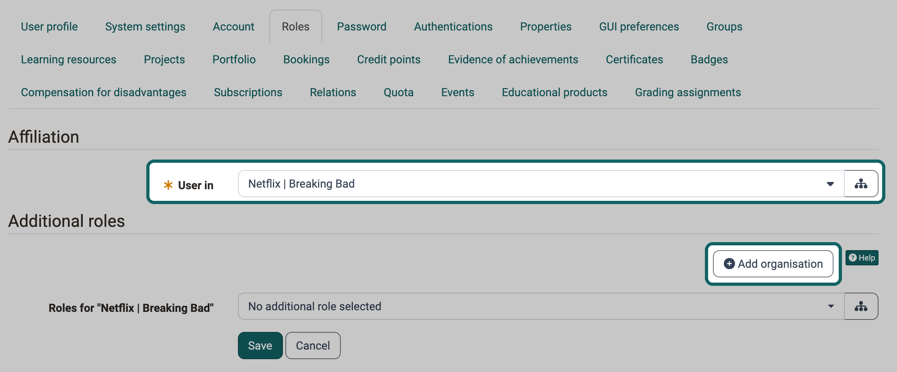

# Roles and Rights: Assign roles {: #role_assignment}

## Role assignment for organisation roles {: #role_assignment_org}

Organisation-wide or system-wide roles are assigned in the user management: 
`User management > Select user > Tab "Roles"` 
The assignment is therefore typically done by user managers or administrators.

:octicons-device-camera-video-24: **Video Introduction (German)**: [User management](<https://www.youtube.com/embed/V1RuH0q08J8>){:target="_blank"}

Depending on the area of responsibility, roles, and therefore additional rights, have to be added. The page [Roles and their working areas](Roles_Home_Areas.md) shows which site of the main navigation each role works in.

The "Roles" tab shows the affiliation of the person ("User in"), their additional roles per organisation and, under "Role history", every change to the roles. The administration manual describes the details: [Assign roles](../../manual_admin/usermanagement/Assign_roles.md)

{ class="shadow lightbox" title="Roles tab in the user management · 2026.10.26" }

[To the top of the page ^](#role_assignment)

---

## Role assignment for course roles {: #role_assignment_course}

**Roles of new course members** 
Course owners add new course members under 
`Course > Administration > Members management > Button "Add member"` 
The desired role within a course is then queried while the new member is being entered.

**Role assignment of the course owners** 
A person with authoring rights (= organisation role "Author") who creates a course is automatically the owner of this course (course role "Owner"). You can then add further people as additional owners.

**Change roles of course members** 
For members of a course, the role can be changed under 
`Course > Administration > Members management > Click on the name of the member` 
In the dialog "Edit member" you assign one or more course roles.

{ class="shadow lightbox" title="Members management in the administration of the course" }
{ class="shadow lightbox" title="Dialog Edit member in the course" }

[To the top of the page ^](#role_assignment)

---

## Role assignment for group roles {: #role_assignment_group} 

**Role assignment when [creating a new group](../groups/index.md) / adding new members:** 
When new members are added, the roles "Group participant" and "Group coach" are also assigned.

{ class="shadow lightbox" title="Step Permissions in the wizard Add member" }

**Change roles of group members** 
If a membership in a group already exists and you want to change the role of the person, you can do this (if you have the authorisation to edit) in the administration of the group: 
`Groups > Administration > Tab "Members" > Icon with 3 dots at the end of the row > "Edit membership"`

{ class="shadow lightbox" title="Members tab in the administration of the group" }
{ class="shadow lightbox" title="Dialog Edit membership of the group" }

**Assignment of the role group coach** 
When you create a new group, you are automatically the coach of this group. Coaches of a group also receive the "Administration" link in the menu. You can then assign the role group coach to further people as well. 
Procedure: `Groups > Administration > Tab "Members" > Icon with 3 dots at the end of the row > "Edit membership"`

**Assignment of the role group manager** 
As group managers perform cross-group tasks, this is an organisation-wide role. Therefore, this role is not assigned within a specific group, but in the user management (procedure as for organisation-wide roles).

[To the top of the page ^](#role_assignment)

---

## Role assignment in the Course Planner {: #role_assignment_course_planner} 

Anyone who has the role course planner automatically has access to all courses associated with the respective product. 

No members can be assigned to a product, only to the implementations. Course planners can assign the participants for all implementations.

[To the top of the page ^](#role_assignment)

---

## Role assignment of organisation-specific roles {: #role_assignment_orgunit} 

The roles that users receive in different organisation units are assigned in the user management. 
`User management > Select user > Tab "Roles" > Button "Add organisation"`

:octicons-device-camera-video-24: **Video Introduction (German)**: [User management](<https://www.youtube.com/embed/V1RuH0q08J8>){:target="_blank"}

A person can be a member of several organisation units and hold different roles in each organisation unit. For example, if the person should only have author rights in their own organisation unit. 

{ class="shadow lightbox" title="Roles tab in the user management" }

[To the top of the page ^](#role_assignment)

---

## Role assignment of the "Invitee" {: #role_assignment_invitee} 

All persons who have been added to a course via the option "Invite external members" receive this "role", or the associated rights status. In the user management the role "Invitee" should only be assigned in exceptional cases. 

If, for example, an external person is to be given access to a binder in the Portfolio, the invitation is created under 
`Portfolio > My binders > "Binder" > Tab "Shares" > Add access rights > Add invitation`

{ class="shadow lightbox" title="Shares of a portfolio binder" }

[To the top of the page ^](#role_assignment)

---

## Define own roles and relations {: #role_assignment_relations} 

Administrators switch on and define own roles in the system administration: 
`Administration > Modules > Role user to user` 
E.g. superior, subordinate, expert, appraisee, parent, education manager, student, mentor, learning guide, etc.

Subsequently, user managers can specify under 
`User management > Select user > Tab "Relations"` 
new relations between the selected person and other OpenOlat users (e.g. superior - subordinate).

Only the roles that administrators have set up are available.

With the user-to-user relation, you set up cross-course support functions in the administration or in the user management, for example for mentors, learning guides and superiors. Coaches then access the people they coach in Coaching and view their learning progress. They cannot assess via the relation.

Specific rights can be defined for each user-to-user relation and thus access can be granted to explicitly released contents of the coached persons, such as course list, calendar, absence overview, efficiency statements, certificates and credit points [:octicons-tag-16:{ title="from Release 21.1 (OO-9490)" }](https://track.frentix.com/issue/OO-9490){:target="_blank"}. What the individual rights do is described in [Module Organisations: The rights in detail](../../manual_admin/administration/Modules_Organisations.md#rights_linemanager). Similarly, the role "Line manager" is also mapped in Coaching. Here, too, defined contents of users of the own organisation unit can be accessed.

[To the top of the page ^](#role_assignment)

---

## Further information {: #further_information} 

**Mentioned on this page** 
[Roles and their working areas >](Roles_Home_Areas.md) 
[Assign roles (Administration manual) >](../../manual_admin/usermanagement/Assign_roles.md) 
[Groups >](../groups/index.md) 
[Module Organisations (Administration manual) >](../../manual_admin/administration/Modules_Organisations.md)

**Further reading** 
[Which roles are available? >](Roles.md) 
[Group Management >](../area_modules/Group_Management.md) 
[Course Planner: Overview >](../area_modules/Course_Planner.md)

**youtube** 
[User management](<https://www.youtube.com/embed/V1RuH0q08J8>)

[To the top of the page ^](#role_assignment)
