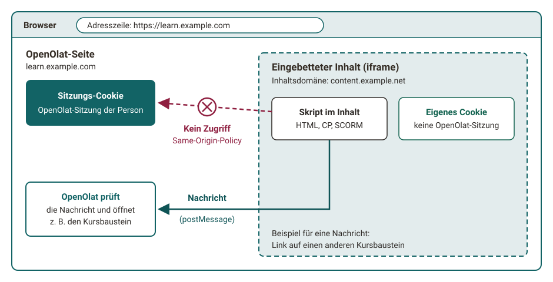
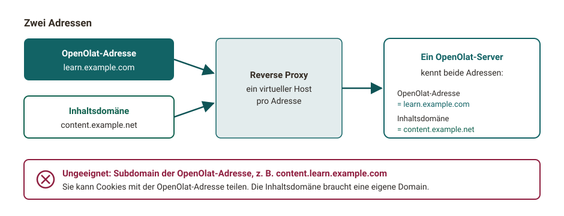

# Inhaltsdomäne [:octicons-tag-16:{ title="ab Release 21.0 (OO-7612)" }](https://track.frentix.com/issue/OO-7612){:target="_blank"} {: #content_domain}

Die Inhaltsdomäne ist eine separate Adresse für Inhalte, also eine zweite Webadresse, über die OpenOlat Inhalte ausliefert, die Autor:innen und Teilnehmer:innen hochladen: HTML-Seiten, CP-Lerninhalte (Content Packages), SCORM-Pakete, abgegebene Dokumente und ähnliche Dateien. OpenOlat selbst rufen Sie weiterhin unter der gewohnten Adresse auf. Die zweite Adresse schützt Ihre OpenOlat-Sitzung, also Ihre aktuelle Anmeldung in OpenOlat, vor Programmcode, der in solchen Inhalten steckt.

## Warum eine zweite Adresse? {: #why}

Eine HTML-Seite oder ein SCORM-Paket kann JavaScript enthalten. Liefert OpenOlat diesen Inhalt unter der eigenen Adresse aus, läuft das Skript mit denselben Rechten wie OpenOlat. Es könnte die OpenOlat-Sitzung der Person lesen, die den Inhalt öffnet, und in ihrem Namen handeln. Öffnet eine Person mit Administrationsrechten einen solchen Inhalt, stünde dem Skript das ganze System offen.

Die Inhaltsdomäne verhindert das mit einer Regel, die jeder Browser durchsetzt, der Same-Origin-Policy: Eine Seite darf nur auf Daten derselben Adresse zugreifen. Ein Inhalt von der Inhaltsdomäne erreicht deshalb weder das Sitzungs-Cookie von OpenOlat noch die OpenOlat-Seite, in die er eingebettet ist. Das gilt auch, wenn OpenOlat den Inhalt in einem Rahmen (iframe) direkt auf der Kursseite zeigt.

{ class="shadow lightbox" title="Rahmen von der Inhaltsdomäne · 2026.11.13" }

Ein schmaler Kanal bleibt offen: Der Inhalt kann OpenOlat eine Nachricht schicken, zum Beispiel "Öffne diesen Kursbaustein". OpenOlat prüft jede Nachricht, bevor es sie ausführt. So funktionieren Links aus einer HTML-Seite auf andere Teile des Kurses.

??? note "Warum genügt kein abgeschotteter Rahmen?"
    Browser können einen Rahmen mit dem Attribut `sandbox` abschotten. Für Lerninhalte reicht das nicht. SCORM-Pakete brauchen volles JavaScript, eingebettete Videos von YouTube oder Vimeo greifen auf die umgebende Seite zu. Erlaubt der Rahmen Skripte und zugleich den Zugriff auf die Adresse der umgebenden Seite (denselben Ursprung), hebt sich die Abschottung auf. Öffnet jemand den Rahmen in einem neuen Tab, wirkt sie gar nicht mehr. Eine eigene Adresse schützt in allen diesen Fällen.

[Zum Seitenanfang ^](#content_domain)

## Was Sie davon bemerken {: #what_you_notice}

Im Alltag ändert sich für Sie nichts: Der Inhalt erscheint wie gewohnt auf der Kursseite oder in einer Lightbox, etwa eine abgegebene HTML-Datei im Kursbaustein "Aufgabe". Die Adresszeile Ihres Browsers zeigt weiterhin die OpenOlat-Adresse, denn der Inhalt läuft in einem Rahmen innerhalb der OpenOlat-Seite.

Die Inhaltsdomäne sehen Sie nur in diesen Fällen:

- Sie öffnen den Inhalt selbst oder eine darin eingebettete Datei in einem neuen Tab.
- Sie sehen sich die Seite mit den Entwicklerwerkzeugen des Browsers an.

Die abweichende Adresse ist gewollt und kein Zeichen für einen Angriff. Die Inhaltsdomäne fragt nie nach Benutzername und Passwort. Ob Ihre Instanz eine Inhaltsdomäne verwendet, erkennen Sie an genau dieser abweichenden Adresse. Im neuen Tab und nach einem Neuladen der Seite erscheint der Inhalt vollständig, mit Bildern, Formatierung und Kurslayout.

[Zum Seitenanfang ^](#content_domain)

## Wenn Inhalte nicht laden {: #blocked}

Viele Organisationen prüfen mit einem Webfilter, etwa in der Firewall, welche Adressen die Browser in ihrem Netz aufrufen dürfen. Blockiert der Webfilter die Inhaltsdomäne, laden alle [Inhalte, die darüber kommen](#affected_content), nicht. Meist fällt das zuerst bei einem Kursbaustein "HTML-Seite" auf, bei einer HTML-Seite als Übersicht eines Kursbausteins "Struktur" und bei Links aus solchen Seiten auf OpenOlat-Seiten.

Die Informatik Ihrer Organisation gibt die Inhaltsdomäne im Webfilter frei. Welche Adresse Ihre Instanz verwendet, sehen Sie, wenn Sie einen Inhalt in einem neuen Tab öffnen. Für Instanzen, die frentix betreibt, steht die Adresse im Abschnitt [Einrichtung](#setup).

[Zum Seitenanfang ^](#content_domain)

## Welche Inhalte über die Inhaltsdomäne kommen {: #affected_content}

Ist eine Inhaltsdomäne eingerichtet, liefert OpenOlat diese Inhalte darüber aus:

- Kursbaustein [HTML-Seite](../learningresources/Course_Element_HTML_Page.de.md), auch in der Vorschau, die ein Kursbaustein "Struktur" mit der Übersicht "Automatische Übersicht mit Vorschau" zeigt
- Kursbaustein [CP-Lerninhalt](../learningresources/Course_Element_CP_Learning_Content.de.md)
- Kursbaustein [SCORM 1.2](../learningresources/Course_Element_SCORM_Learning_Content.de.md)
- Kursbaustein [Struktur](../learningresources/Course_Element_Structure.de.md) mit einer eigenen HTML-Seite als Übersicht
- Kursbausteine [Aufgabe](../learningresources/Course_Element_Task/index.de.md) und [Gruppenaufgabe](../learningresources/Course_Element_Grouptask.de.md): Aufgabenstellung, abgegebene Dokumente und Musterlösung
- Kursbaustein [Dokument](../learningresources/Course_Element_Document.de.md) mit einer HTML-Datei
- Vorschau einer HTML-Datei, die Sie im Kurseditor auswählen, in den Kursbausteinen "HTML-Seite", "Struktur" und [Test](../learningresources/Course_Element_Test/index.de.md)
- Inhalte aus [edu-sharing](../learningresources/Course_Element_edu_Sharing.de.md), die in eine HTML-Seite eingebettet sind
- HTML-Dateien in [Ordnern](Folder_Concept.de.md#open_html) und in [Projekten](../area_modules/Project_Files.de.md), wenn Sie die Datei nur lesen dürfen
- Vorschau von Zertifikaten
- Infoseiten im Dokumentenpool und im Fragenpool
- Impressum

[Zum Seitenanfang ^](#content_domain)

## Links in Inhalten {: #links}

Kursinterne Links in HTML-Seiten, zum Beispiel auf einen anderen Kursbaustein, funktionieren auch über die Inhaltsdomäne. OpenOlat nimmt den Link als geprüfte Nachricht entgegen und öffnet das Ziel. Bestehende Seiten müssen Sie nicht anpassen.

Links auf OpenOlat-Seiten, die in diesen Inhalten oder in einer im Kurs angezeigten PDF-Datei stehen, öffnen das Ziel im OpenOlat-Fenster selbst, nicht im Rahmen des Inhalts. Mit Ctrl-Klick, Cmd-Klick oder der mittleren Maustaste öffnet sich das Ziel in einem neuen Tab unter der OpenOlat-Adresse. Lesezeichen auf eine Adresse der Inhaltsdomäne und weitergegebene Adressen der Inhaltsdomäne führen zur OpenOlat-Adresse. [:octicons-tag-16:{ title="ab Release 21.1 (OO-10045)" }](https://track.frentix.com/issue/OO-10045){:target="_blank"}

[Zum Seitenanfang ^](#content_domain)

## Einrichtung {: #setup}

!!! info "frentix-Kund:innen"
    Bei Instanzen, die frentix betreibt, liegt die Inhaltsdomäne unterhalb von `elearning-content.com`. Schützt Ihre Organisation OpenOlat mit einer eigenen Web Application Firewall, braucht sie neben der öffentlichen OpenOlat-Adresse auch eine eigene öffentliche Inhaltsdomäne. Eine Subdomain der OpenOlat-Adresse genügt nicht. Die angezeigte Adresse heisst dann anders, das Prinzip bleibt gleich: zwei Adressen für dasselbe OpenOlat. Geben Sie im Webfilter die Inhaltsdomäne frei, die Ihre Instanz verwendet.

!!! info "Kontakt"
    Die Inhaltsdomäne ist Teil der Serverkonfiguration und gilt nach einer Änderung erst ab dem nächsten Neustart von OpenOlat. Für eine Änderung wenden Sie sich an Ihre Organisation.

Für Systemadministrator:innen gilt:

- Die Inhaltsdomäne braucht eine eigene Domain, die keine Cookies mit der OpenOlat-Adresse teilt. Eine Subdomain der OpenOlat-Adresse, etwa `content.learn.example.com` zu `learn.example.com`, genügt nicht, weil sie Cookies mit der OpenOlat-Adresse teilen kann.
- Beide Adressen zeigen auf denselben OpenOlat-Server, zum Beispiel über einen zusätzlichen virtuellen Host im Reverse Proxy.
- Ohne Inhaltsdomäne liefert OpenOlat die Inhalte über die eigene Adresse aus, ohne diesen Schutz. An einigen Stellen entfernt OpenOlat deshalb die Skripte aus HTML-Dateien, etwa aus der zugewiesenen Aufgabenstellung im Kursbaustein "Aufgabe". HTML-Dateien in Ordnern mit reinem Leserecht öffnen sich in einem neuen Browserfenster statt in der Lightbox.
- In der System-Administration erscheinen Zugriffe über die Inhaltsdomäne unter [Aktive Sitzungen](../../manual_admin/administration/System.de.md#active_sessions) mit dem Modus "Content": `Administration > System > Aktive Sitzungen`. Eine solche Sitzung dient nur der Auslieferung des Inhalts und wird nie zu einer vollständigen OpenOlat-Sitzung.

{ class="shadow lightbox" title="Ein Server mit zwei Adressen · 2026.11.13" }

Die Einrichtung beschreibt der englischsprachige [Installation guide](../../manual_admin/installation/installGuide.md#recommended-content-domain-for-user-provided-content).

[Zum Seitenanfang ^](#content_domain)

## Herkunft der Technik {: #background}

OpenOlat folgt mit der Inhaltsdomäne einem Verfahren, das grosse Plattformen seit Jahren einsetzen:

- **Google** gilt als Vorreiter. Google liefert Inhalte von Nutzer:innen, etwa Dateivorschauen aus Google Drive, Bilder und Google Sites, über die eigene Domain `googleusercontent.com` aus und hat den Ansatz 2012 im Beitrag [Content hosting for the modern web](https://security.googleblog.com/2012/08/content-hosting-for-modern-web.html){:target="_blank"} beschrieben.
- **GitHub** liefert Dateien aus Repositories in der Rohfassung über `raw.githubusercontent.com` aus.
- Den Grundgedanken, sicherheitskritische Webadressen von anderen Inhalten zu trennen, beschreibt der Entwurf [Isolated Origins](https://wicg.github.io/isolation/){:target="_blank"} der W3C-Gemeinschaftsgruppe WICG (2017).

[Zum Seitenanfang ^](#content_domain)

## Weiterführende Informationen {: #further_information}

**Auf dieser Seite erwähnt** 
[Kursbaustein "HTML-Seite" >](../learningresources/Course_Element_HTML_Page.de.md) 
[Kursbaustein "CP-Lerninhalt" >](../learningresources/Course_Element_CP_Learning_Content.de.md) 
[Kursbaustein "SCORM 1.2" >](../learningresources/Course_Element_SCORM_Learning_Content.de.md) 
[Kursbaustein "Struktur" >](../learningresources/Course_Element_Structure.de.md) 
[Kursbaustein "Aufgabe" >](../learningresources/Course_Element_Task/index.de.md) 
[Kursbaustein "Gruppenaufgabe" >](../learningresources/Course_Element_Grouptask.de.md) 
[Kursbaustein "Dokument" >](../learningresources/Course_Element_Document.de.md) 
[Kursbaustein "Test" >](../learningresources/Course_Element_Test/index.de.md) 
[Kursbaustein "edu-sharing" >](../learningresources/Course_Element_edu_Sharing.de.md) 
[Ordnerkonzept >](Folder_Concept.de.md) 
[Projekte: Dateien >](../area_modules/Project_Files.de.md) 
[System >](../../manual_admin/administration/System.de.md) 
[Installation guide >](../../manual_admin/installation/installGuide.md) 
[Content hosting for the modern web >](https://security.googleblog.com/2012/08/content-hosting-for-modern-web.html) 
[Isolated Origins >](https://wicg.github.io/isolation/)

**Weiterführend** 
[Videos im Kursbaustein "HTML-Seite" >](Video_in_HTML_Pages.de.md) 
[Technologie und Navigation >](Technology_and_Navigation.de.md)

[Zum Seitenanfang ^](#content_domain)
