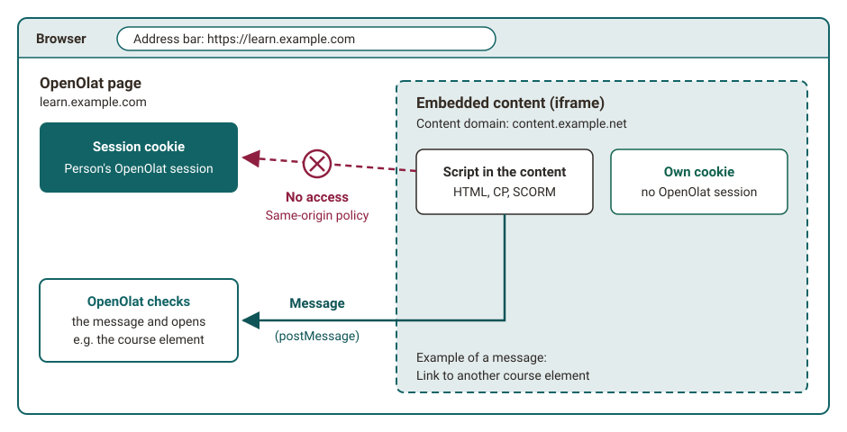
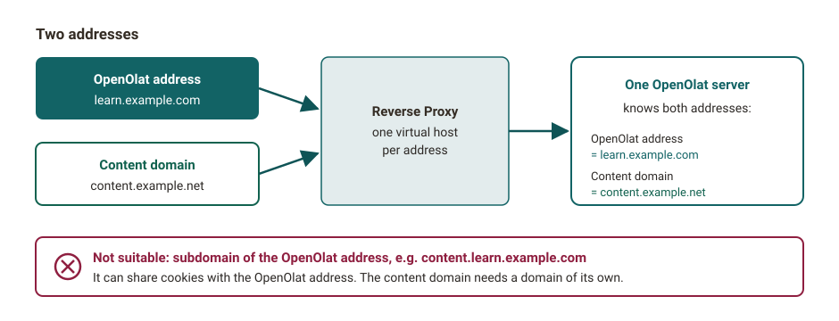

# Content domain [:octicons-tag-16:{ title="from Release 21.0 (OO-7612)" }](https://track.frentix.com/issue/OO-7612){:target="_blank"} {: #content_domain}

The content domain is a separate address for content, that is, a second web address through which OpenOlat delivers content that authors and participants upload: HTML pages, CP learning content (content packages), SCORM packages, submitted documents and similar files. You continue to call up OpenOlat itself under the usual address. The second address protects your OpenOlat session, that is, your current login to OpenOlat, from program code contained in such content.

## Why a second address? {: #why}

An HTML page or a SCORM package can contain JavaScript. If OpenOlat delivers this content under its own address, the script runs with the same rights as OpenOlat. It could read the OpenOlat session of the person who opens the content and act on their behalf. If a person with administration rights opens such content, the whole system would be open to the script.

The content domain prevents this with a rule that every browser enforces, the same-origin policy: a page may only access data of the same address. Content from the content domain therefore reaches neither the session cookie of OpenOlat nor the OpenOlat page in which it is embedded. This also applies when OpenOlat shows the content in a frame (iframe) directly on the course page.

{ class="shadow lightbox" title="Frame from the content domain · 2026.11.13" }

One narrow channel remains open: the content can send OpenOlat a message, for example "Open this course element". OpenOlat checks every message before it executes it. This is how links from an HTML page to other parts of the course work.

??? note "Why is an isolated frame not enough?"
    Browsers can isolate a frame with the attribute `sandbox`. For learning content, this is not enough. SCORM packages need full JavaScript, and embedded videos from YouTube or Vimeo access the surrounding page. If the frame allows scripts and at the same time access to the address of the surrounding page (the same origin), the isolation cancels itself out. If someone opens the frame in a new tab, it has no effect at all. A separate address protects in all these cases.

[To the top of the page ^](#content_domain)

## What you notice {: #what_you_notice}

In everyday use, nothing changes for you: the content appears as usual on the course page or in a lightbox, for example a submitted HTML file in the course element "Task". The address bar of your browser continues to show the OpenOlat address, because the content runs in a frame within the OpenOlat page.

You only see the content domain in these cases:

- You open the content itself or a file embedded in it in a new tab.
- You look at the page with the developer tools of your browser.

The different address is intended and not a sign of an attack. The content domain never asks for username and password. You can tell whether your instance uses a content domain by exactly this different address. In the new tab and after reloading the page, the content appears completely, with images, formatting and course layout.

[To the top of the page ^](#content_domain)

## When content does not load {: #blocked}

Many organisations use a web filter, for example in the firewall, to check which addresses the browsers in their network may call up. If the web filter blocks the content domain, none of the [content that comes through it](#affected_content) loads. This usually shows up first with a course element "HTML page", with an HTML page as the overview of a course element "Structure" and with links from such pages to OpenOlat pages.

The IT department of your organisation releases the content domain in the web filter. You can see which address your instance uses when you open content in a new tab. For instances operated by frentix, the address is given in the section [Setup](#setup).

[To the top of the page ^](#content_domain)

## Which content comes through the content domain {: #affected_content}

If a content domain is set up, OpenOlat delivers the following content through it:

- Course element [HTML page](../learningresources/Course_Element_HTML_Page.md), also in the preview that a course element "Structure" shows with the overview "Automatic overview incl. preview"
- Course element [CP learning content](../learningresources/Course_Element_CP_Learning_Content.md)
- Course element [SCORM 1.2](../learningresources/Course_Element_SCORM_Learning_Content.md)
- Course element [Structure](../learningresources/Course_Element_Structure.md) with its own HTML page as overview
- Course elements [Task](../learningresources/Course_Element_Task/index.md) and [Group task](../learningresources/Course_Element_Grouptask.md): assignment, submitted documents and sample solution
- Course element [Document](../learningresources/Course_Element_Document.md) with an HTML file
- Preview of an HTML file that you select in the course editor, in the course elements "HTML page", "Structure" and [Test](../learningresources/Course_Element_Test/index.md)
- Content from [edu-sharing](../learningresources/Course_Element_edu_Sharing.md) embedded in an HTML page
- HTML files in [folders](Folder_Concept.md#open_html) and in [projects](../area_modules/Project_Files.md), if you may only read the file
- Preview of certificates
- Info pages in the document pool and in the question bank
- Imprint

[To the top of the page ^](#content_domain)

## Links in content {: #links}

Course-internal links in HTML pages, for example to another course element, also work through the content domain. OpenOlat receives the link as a checked message and opens the target. You do not need to adapt existing pages.

Links to OpenOlat pages in this content or in a PDF file displayed in the course open the target in the OpenOlat window itself, not in the frame of the content. With Ctrl-click, Cmd-click or the middle mouse button, the target opens in a new tab under the OpenOlat address. Bookmarks to an address of the content domain and passed-on addresses of the content domain lead to the OpenOlat address. [:octicons-tag-16:{ title="from Release 21.1 (OO-10045)" }](https://track.frentix.com/issue/OO-10045){:target="_blank"}

[To the top of the page ^](#content_domain)

## Setup {: #setup}

!!! info "frentix customers"
    For instances operated by frentix, the content domain is located below `elearning-content.com`. If your organisation protects OpenOlat with its own web application firewall, it needs its own public content domain in addition to the public OpenOlat address. A subdomain of the OpenOlat address is not sufficient. The address shown then has a different name, the principle remains the same: two addresses for the same OpenOlat. In the web filter, release the content domain that your instance uses.

!!! info "Contact"
    The content domain is part of the server configuration, and a change only takes effect after the next restart of OpenOlat. For a change, contact your organisation.

The following applies to system administrators:

- The content domain needs a domain of its own that does not share cookies with the OpenOlat address. A subdomain of the OpenOlat address, such as `content.learn.example.com` for `learn.example.com`, is not sufficient because it can share cookies with the OpenOlat address.
- Both addresses point to the same OpenOlat server, for example via an additional virtual host in the reverse proxy.
- Without a content domain, OpenOlat delivers the content via its own address, without this protection. In some places, OpenOlat therefore removes the scripts from HTML files, for example from the assignment allocated in the course element "Task". HTML files in folders with read-only access open in a new browser window instead of in the lightbox.
- In the system administration, accesses via the content domain appear under [Active sessions](../../manual_admin/administration/System.md#active_sessions) with the mode "Content": `Administration > System > Active sessions`. Such a session only serves to deliver the content and never becomes a full OpenOlat session.

{ class="shadow lightbox" title="One server with two addresses · 2026.11.13" }

The setup is described in the [Installation guide](../../manual_admin/installation/installGuide.md#recommended-content-domain-for-user-provided-content).

[To the top of the page ^](#content_domain)

## Origin of the technology {: #background}

With the content domain, OpenOlat follows a procedure that large platforms have been using for years:

- **Google** is regarded as the pioneer. Google delivers content from users, such as file previews from Google Drive, images and Google Sites, via its own domain `googleusercontent.com` and described the approach in 2012 in the post [Content hosting for the modern web](https://security.googleblog.com/2012/08/content-hosting-for-modern-web.html){:target="_blank"}.
- **GitHub** delivers files from repositories in raw form via `raw.githubusercontent.com`.
- The basic idea of separating security-critical web addresses from other content is described in the draft [Isolated Origins](https://wicg.github.io/isolation/){:target="_blank"} of the W3C community group WICG (2017).

[To the top of the page ^](#content_domain)

## Further information {: #further_information}

**Mentioned on this page** 
[Course Element "HTML page" >](../learningresources/Course_Element_HTML_Page.md) 
[Course Element "CP learning content" >](../learningresources/Course_Element_CP_Learning_Content.md) 
[Course Element "SCORM 1.2" >](../learningresources/Course_Element_SCORM_Learning_Content.md) 
[Course Element "Structure" >](../learningresources/Course_Element_Structure.md) 
[Course Element "Task" >](../learningresources/Course_Element_Task/index.md) 
[Course Element "Group Task" >](../learningresources/Course_Element_Grouptask.md) 
[Course Element "Document" >](../learningresources/Course_Element_Document.md) 
[Course Element "Test" >](../learningresources/Course_Element_Test/index.md) 
[Course Element "edu-sharing" >](../learningresources/Course_Element_edu_Sharing.md) 
[Folder concept >](Folder_Concept.md) 
[Projects: Files >](../area_modules/Project_Files.md) 
[System >](../../manual_admin/administration/System.md) 
[Installation guide >](../../manual_admin/installation/installGuide.md) 
[Content hosting for the modern web >](https://security.googleblog.com/2012/08/content-hosting-for-modern-web.html) 
[Isolated Origins >](https://wicg.github.io/isolation/)

**Further reading** 
[Videos in course element "HTML page" >](Video_in_HTML_Pages.md) 
[Technology and Navigation >](Technology_and_Navigation.md)

[To the top of the page ^](#content_domain)
