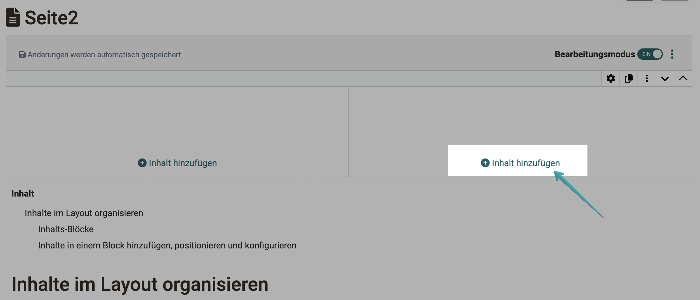
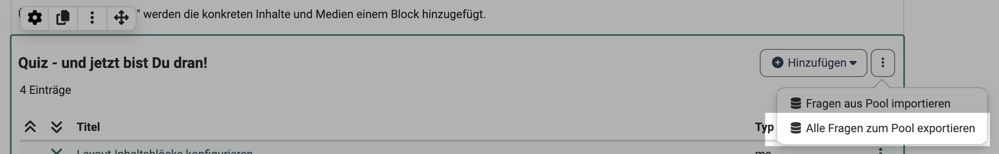
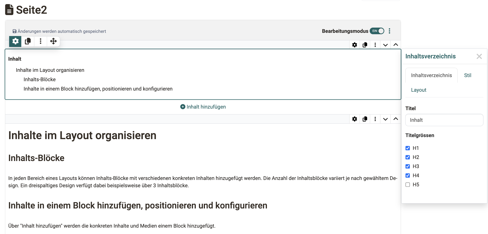
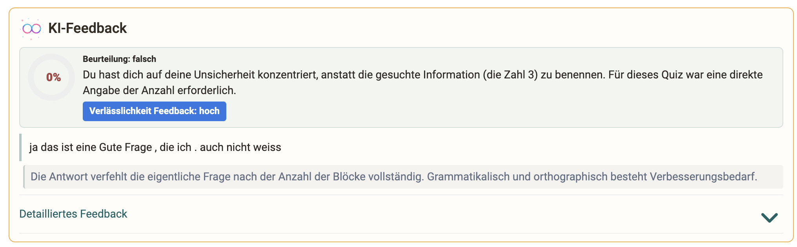
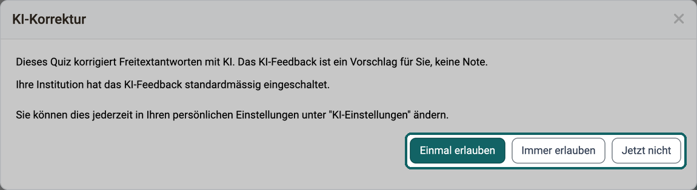
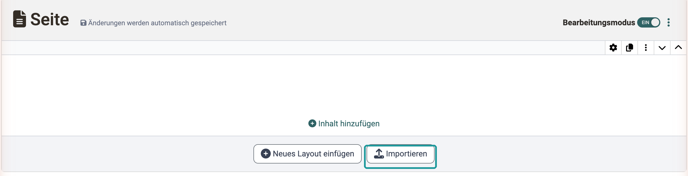
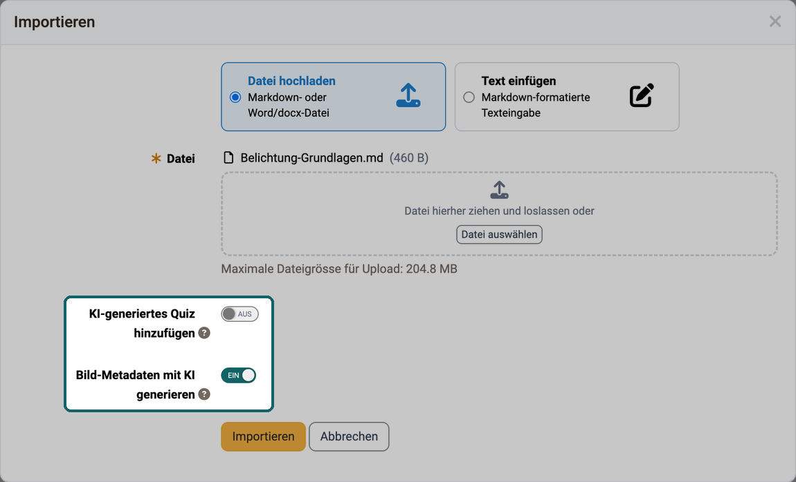
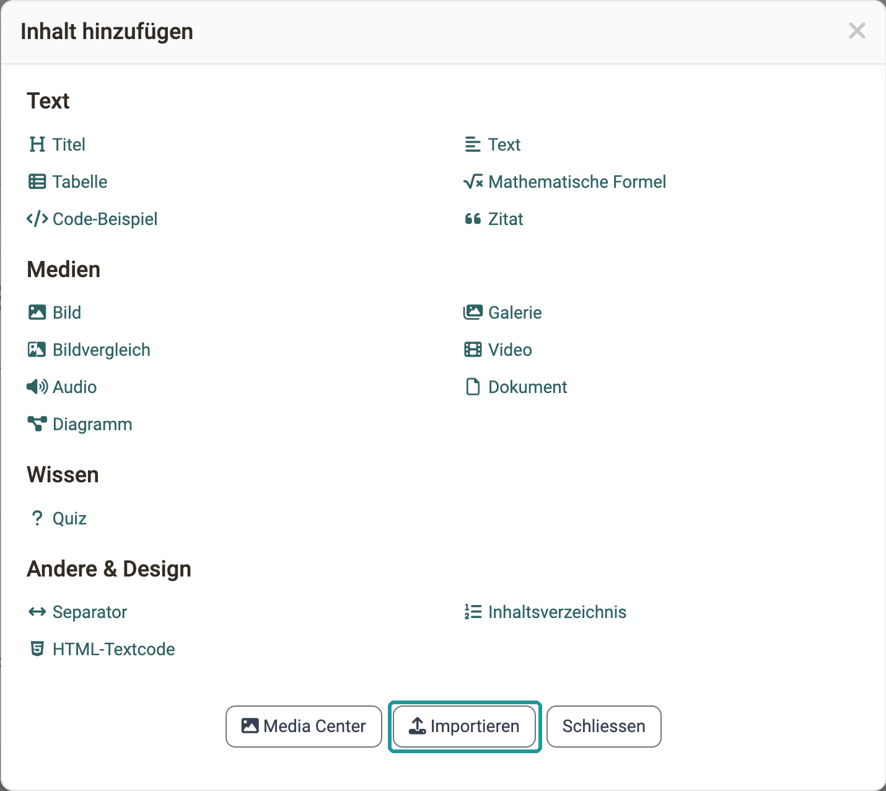
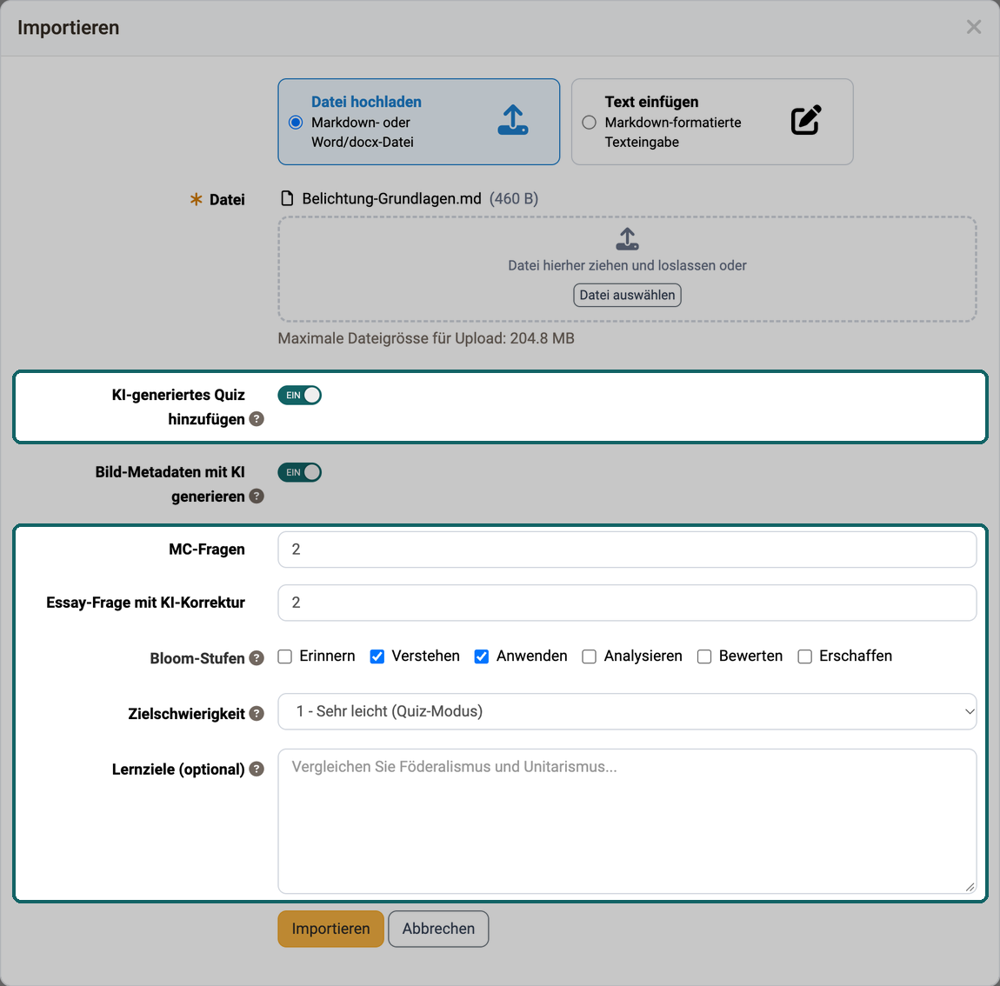

# Content Editor

## Was ist der Content Editor? {: #content_editor}

Der Content Editor ermöglicht es basierend auf einem selbst gewählten Layout verschiedene Inhaltselemente in eine Seite einzufügen und so eine Inhaltsseite optimiert für Mobilgeräte zu gestalten. OpenOlat speichert Ihre Änderungen automatisch.

Der Content Editor wird an verschiedenen Stellen in OpenOlat verwendet. Wer ihn nutzt, hängt vom Ort ab: im Kursbaustein "Seite" die Besitzer:innen des Kurses und berechtigte Betreuer:innen, in der Lernressource "Formular" deren Besitzer:innen, im Portfolio die Besitzer:innen der Mappe.

{ class="shadow lightbox" title="Content Editor im Bearbeitungsmodus" }

!!! note "Hinweis"

    Neben dem Content Editor existiert in OpenOlat noch der HTML-Editor "TinyMCE", der z.B. im [Kursbaustein "HTML-Seite"](../learningresources/Course_Element_HTML_Page.de.md) verwendet wird. 

## Wo kommt der Content Editor zum Einsatz? {: #content_editor_use}

Der Content Editor wird im [Kursbaustein Seite](../learningresources/Course_Element_Page.de.md), in der [Lernressource "Formular"](../learningresources/Form.de.md) und im ["Portfolio 2.0"](../area_modules/The_portfolio_editor_17_1.de.md) verwendet.

### Kursbaustein Seite [:octicons-tag-16:{ title="ab Release 18.0.0 (OO-6966)" }](https://track.frentix.com/issue/OO-6966){:target="_blank"} {: #course_element_page}

Im Kursbaustein "Seite" öffnen Sie den Content Editor auf zwei Wegen: im Kurseditor im Tab "Seiteninhalt" mit "Seite editieren", oder bei geschlossenem Kurseditor direkt im Kursbaustein, indem Sie den Bearbeitungsmodus einschalten. Den Kurseditor erreichen Sie unter: `Kurs > Administration > Kurseditor`.

**Bei geschlossenem Kurseditor:**

{ class="shadow lightbox" title="Kursbaustein Seite im Kurs" }

Der Schalter "Bearbeitungsmodus" schaltet die Bearbeitung der Seite ein und aus.

**Im Kurseditor:**

{ class="shadow lightbox" title="Kursbaustein Seite im Kurseditor" }

Im Tab "Seiteninhalt" legen Sie unter "Berechtigungen" fest, ob neben den Kursbesitzer:innen auch Betreuer:innen die Seite bei geschlossenem Kurseditor bearbeiten dürfen: Option "Seite editieren" für "Betreuer:innen". Mit "Erweiterte Konfiguration anzeigen" vergeben Sie das Recht zusätzlich an einzelne Rollen, Gruppen oder Benutzer:innen, auf Wunsch mit Beginn und Ende.

{ class="shadow lightbox" title="Tab Seiteninhalt des Kursbausteins Seite" }

Die Medien-Inhalte des [Kursbausteins "Seite"](../learningresources/Course_Element_Page.de.md) (Bilder, Audio, Video, Diagramme, Zitate, Dokumente usw.) speichert OpenOlat im [Media Center](../personal_menu/Media_Center.de.md), nicht im Ablageordner des Kurses wie beim [Kursbaustein "HTML-Seite"](../learningresources/Course_Element_HTML_Page.de.md).

Auch die Medien einer Portfolio-Mappe liegen im Media Center. Die Lernressource "Formular" speichert Bilder dagegen in der Lernressource selbst.

[Zum Seitenanfang ^](#content_editor)

---

### Lernressource Formular {: #form}

Der Content Editor wird auch in der [Lernressource Formular](../learningresources/Form.de.md) und allen Elementen die die Lernressource Formular nutzen verwendet. 

Die angezeigten Optionen zum Einfügen von Inhalt sind an das Formular angepasst, z.B. stehen hier verschiedene Fragetypen zur Auswahl.

{ class="shadow lightbox" title="Dialog Inhalt hinzufügen im Formulareditor" }

[Zum Seitenanfang ^](#content_editor)

---

### E-Portfolio [:octicons-tag-16:{ title="ab Release 11.0 (OO-2057)" }](https://track.frentix.com/issue/OO-2057){:target="_blank"} {: #portfolio}

Auch für Einträge in [Mappen](../area_modules/My_portfolio_binders.de.md), die sowohl kursunabhängig als auch in Verbindung mit [Portfoliovorlagen](../learningresources/Portfolio_template_Creation.de.md) und [Portfolioaufgaben](../learningresources/Course_Element_Portfolio_Task.de.md) verwendet werden können, wird der Content Editor verwendet.

{ class="shadow lightbox" title="Layout-Vorlagen einer Portfolio-Mappe" }

[Portfolio >](../area_modules/The_portfolio_editor_17_1.de.md)

[Zum Seitenanfang ^](#content_editor)

---

## Layout im Content Editor [:octicons-tag-16:{ title="ab Release 17.1.0 (OO-6199)" }](https://track.frentix.com/issue/OO-6199){:target="_blank"} {: #content_editor_layout}

Bevor Sie Inhalte im Content Editor einfügen können, fügen Sie mit "Neues Layout einfügen" ein Layout hinzu. Das Layout dient als Raster, das die Anordnung der Inhalte (Blöcke) bestimmt.

Es stehen verschiedene Layouts zur Auswahl, die sich durch unterschiedlich angeordnete Felder unterscheiden. Sie können auf einer Seite auch mehrere Layouts kombinieren.

Falls nötig, lässt sich das Layout später jederzeit ändern. Klicken Sie dazu auf das Zahnrad-Symbol (Einstellungen bearbeiten) des Layouts und wählen Sie ein neues Layout aus.

{ class="shadow lightbox" title="Inspektor eines Layouts" }

Sind mehrere Layouts vorhanden, können Sie die Reihenfolge der Layouts ändern. 
Zum Verschieben eines gesamten Layouts verwenden Sie die Pfeile.

{ class="shadow lightbox" title="Layout einer Seite im Bearbeitungsmodus" }

### Layout löschen [:octicons-tag-16:{ title="ab Release 21.0 (OO-9407)" }](https://track.frentix.com/issue/OO-9407){:target="_blank"} {: #delete_layout}

Über das 3-Punkte-Menü eines Layouts lässt sich jedes Layout der Seite löschen, auch das erste. Beim Löschen entscheiden Sie, was mit dem Inhalt geschieht: "Alles löschen" entfernt das Layout mitsamt seinem Inhalt, "Nur das Layout löschen und den Inhalt verschieben" übernimmt den Inhalt in das angrenzende Layout. Wird das letzte Layout einer Seite gelöscht, weist der Dialog darauf hin, dass das Layout und sein gesamter Inhalt gelöscht werden; die Seite erhält anschliessend automatisch wieder ein leeres Standard-Layout. Ist nur noch ein einziges leeres Layout vorhanden, ist die Aktion "Löschen" deaktiviert.

[Zum Seitenanfang ^](#content_editor)

---

## Inhalte im Layout organisieren {: #organize_content}

### Inhalts-Blöcke {: #content_blocks}

In jeden Bereich eines Layouts können Inhalts-Blöcke mit verschiedenen konkreten Inhalten hinzugefügt werden. Die Anzahl der Inhaltsblöcke hängt vom gewählten Layout ab. Ein dreispaltiges Layout hat zum Beispiel 3 Inhaltsblöcke.

### Inhalte in einem Block hinzufügen, positionieren und konfigurieren {: #add_content}

Über "Inhalt hinzufügen" werden die konkreten Inhalte und Medien einem Block hinzugefügt. Der Link erscheint in jedem Bereich eines Layouts, so dass Sie den Inhalt genau dort einfügen, wo er stehen soll.

{ class="shadow lightbox" title="Bereiche eines Layouts im Content Editor" }

Der Dialog "Inhalt hinzufügen" listet die verfügbaren Inhaltstypen nach den Bereichen "Text", "Medien", "Wissen" sowie "Andere & Design" auf. Am unteren Rand führen zwei Schaltflächen direkt zum [Media Center](#media_center) und zum [Import](#import_position).

Fahren Sie im Bearbeitungsmodus mit der Maus über einen Block, wird dieser hervorgehoben [:octicons-tag-16:{ title="ab Release 20.2.0 (OO-8966)" }](https://track.frentix.com/issue/OO-8966){:target="_blank"}. Das hilft, einzelne Blöcke auseinanderzuhalten, wenn mehrere gleichartige Elemente aufeinander folgen.

Sobald ein hinzugefügter Inhalt angeklickt/markiert worden ist, erscheint ein Popup-Fenster, in dem Eigenschaften dieses Inhalts eingestellt werden können. Das ist der sogenannte ["Inspektor"](#inspector). 

Das Inspektor-Popup lässt sich auch mit dem Zahnrad-Icon des Inhalts ein- und ausblenden.

{ class="shadow lightbox" title="Inspektor eines Video-Blocks" }

**Menüs**

Die Werkzeugleiste eines markierten Blocks umfasst vier Symbole: das Zahnrad für den Inspektor, ein Symbol zum Duplizieren, ein 3-Punkte-Menü und ein Fadenkreuz. Über das 3-Punkte-Menü fügen Sie weitere Inhaltselemente davor oder danach ein, verschieben das Element nach oben oder unten und löschen es. Über das Fadenkreuz verschieben Sie das markierte Element per Drag & Drop an eine andere Position, in einen anderen Inhalts-Block oder in ein anderes Layout.

Ein Block lässt sich mit der Aktion "Duplizieren" kopieren, sowohl als Kurzaktion am Block selbst als auch über das 3-Punkte-Menü [:octicons-tag-16:{ title="ab Release 20.1.0 (OO-7709)" }](https://track.frentix.com/issue/OO-7709){:target="_blank"}.

{ class="shadow lightbox" title="Werkzeugleiste eines Inhaltsblocks" }

[Zum Seitenanfang ^](#content_editor)

---

### Generelle Formatierungen für alle Inhaltsblöcke - Der Inspektor [:octicons-tag-16:{ title="ab Release 17.1.0 (OO-6198)" }](https://track.frentix.com/issue/OO-6198){:target="_blank"} {: #inspector}

#### Abstand {: #spacing}

Einheitliche Abstände zwischen den Feldern eines Layouts (Inhaltsblöcken) machen eine Seite übersichtlich. Unter "Abstand" stehen zur Wahl:

* Kein Abstand
* S (klein)
* M (mittel)
* L (gross)
* XL (extragross)
* Benutzerdefiniert

=== "S (kleiner Abstand)"

    { class="shadow lightbox" title="kleiner Abstand" }

=== "M (mittlerer Abstand)"

    { class="shadow lightbox" title="mittlerer Abstand" }

=== "XL (extra-grosser Abstand)"

    { class="shadow lightbox" title="extra-grosser Abstand" }

#### Hintergrund {: #background}

Im Inspektor eines Layouts legen Sie im Tab "Stil" unter "Hintergrund" den Hintergrund des Layouts fest [:octicons-tag-16:{ title="ab Release 18.2.5 (OO-7641)" }](https://track.frentix.com/issue/OO-7641){:target="_blank"}. Neben "Kein Hintergrund" steht eine vordefinierte Farbliste zur Auswahl, mit der sich einzelne Layouts farblich voneinander abheben lassen.

#### Hinweis-Box {: #alert_box}

Layouts und verschiedene Inhaltsblöcke können als formatierte Hinweis-Box dargestellt werden [:octicons-tag-16:{ title="ab Release 18.2.3 (OO-7138)" }](https://track.frentix.com/issue/OO-7138){:target="_blank"}. Bei Auswahl eines vordefinierten Hinweis-Typs hebt die Box Informationen mit der passenden Farbe und dem passenden Icon hervor. Zur Auswahl stehen die Typen "Notiz", "Information", "Tipp", "Wichtig", "Warnung", "Fehler" und "Erfolg". Mit dem Typ "Benutzerdefiniert" gestalten Sie Farbe und Icon der Box selbst. Im Feld "Titel" geben Sie der Box eine Überschrift, "Mit Icon" blendet das Icon ein, und "Einklappbar" macht die Box einklappbar.

{ class="shadow lightbox" title="Tab Stil im Inspektor eines Layouts" }

Beispiel:

{ class="shadow lightbox" title="Hinweis-Boxen auf einer Seite" }

[Zum Seitenanfang ^](#content_editor)

---

### Anker {: #anchors}

Jedes Titel-Element einer Seite erhält automatisch einen Anker, also ein Sprungziel, über das sich direkt zu diesem Abschnitt springen lässt [:octicons-tag-16:{ title="ab Release 21.0 (OO-9411)" }](https://track.frentix.com/issue/OO-9411){:target="_blank"}. Andere Inhaltstypen erhalten keinen Anker.

Sie müssen dafür nichts einstellen. Die Anker werden auf der Seite nicht angezeigt und lassen sich auch nicht einzeln kopieren. Genutzt werden sie vom Element Inhaltsverzeichnis, das die Titel der Seite auflistet und über diese Anker als Sprungmarken verlinkt. Je mehr Titel-Elemente eine Seite gliedern, desto brauchbarer wird das Inhaltsverzeichnis. 
[Zum Inhaltsverzeichnis >](#table_of_contents)

[Zum Seitenanfang ^](#content_editor)

---

## Inhaltstypen {: #content_types}

Bitte beachten Sie, dass nicht in jedem Content Editor *alle* Elemente zur Verfügung stehen. 

{ class="shadow lightbox" title="Dialog Inhalt hinzufügen" }

### Titel {: #title}

Für das Element "Titel" wählen Sie im Inspektor unter "Grösse" eine der vordefinierten Stufen h1 bis h6.

Jeder Titel erhält zusätzlich einen [Anker](#anchors). Genutzt wird dieser ausschliesslich vom Element ["Inhaltsverzeichnis"](#table_of_contents), das die Titel auflistet und über ihre Anker verlinkt. Ausserhalb des Inhaltsverzeichnisses lassen sich die Anker nicht ansteuern.

{ class="shadow lightbox" title="Inspektor eines Titel-Blocks" }

### Text {: #text}

Mit dem Element "Text" fügen Sie formatierten Fliesstext ein. Die Formatierungsleiste bietet unter anderem Schriftschnitt, Ausrichtung, Schriftgrösse, Farben, Listen, Links und Formeln. Im Inspektor legen Sie unter "Spalten" fest, in wie vielen Spalten der Text erscheint.

{ class="shadow lightbox" title="Formatierungsleiste eines Text-Blocks" }

### Tabelle {: #table}

Mit dem Element "Tabelle" stellen Sie Inhalte in Zeilen und Spalten dar. Im Inspektor legen Sie unter "Zeile" und "Spalte" die Anzahl Zeilen und Spalten fest und bestimmen, ob die Tabelle eine "Kopfzeile" oder eine "Kopfspalte" hat. Unter "Zeilenstil" wählen Sie die Darstellung der Zeilen. Über und unter der Tabelle können Sie eine Tabellenüberschrift und eine Tabellenunterschrift eintragen.

{ class="shadow lightbox" title="Inspektor eines Tabellen-Blocks" }

### Mathematische Formel [:octicons-tag-16:{ title="ab Release 16.2.0 (OO-6070)" }](https://track.frentix.com/issue/OO-6070){:target="_blank"} {: #formula}

Für mathematische Formeln steht ein spezieller kleiner Editor zur Verfügung.

{ class="shadow lightbox" title="Formeleditor" }

Dieses Textelement existiert nicht im Formulareditor. 

### Code-Beispiel [:octicons-tag-16:{ title="ab Release 18.2.0 (OO-7140)" }](https://track.frentix.com/issue/OO-7140){:target="_blank"} {: #code}

Der Block "Code-Beispiel" zeigt Text in einer Schrift mit festen Abständen und nummerierten Zeilen. Das hilft bei technischen Lerninhalten wie Programmierbeispielen. Beim Anlegen des Blocks wählen Sie die Programmiersprache. Teilnehmende kopieren den Code direkt in die Zwischenablage, um ihn weiterzuverwenden.

{ class="shadow lightbox" title="Code-Beispiele auf einer Seite" }

Dieses Textelement existiert nicht im Formulareditor. 

### Zitat {: #quote}

Wird ein Text als Zitat erfasst, hat er automatisch eine vordefinierte Formatierung. Die Zitate werden wie Audios oder Videos als wiederverwendbare Objekte im Media Center gespeichert.

Dieses Textelement existiert nicht im Formulareditor. 

[Zum Seitenanfang ^](#content_editor)

---

!!! info "Bereich Medien"

    Statt des Bereichs Medien mit den zugehörigen Inhaltselementen gibt es im [Formulareditor](../learningresources/Form_Editor.de.md) die Bereiche "Fragetypen" und "Organisatorisch" mit entsprechenden Inhaltselementen. 

### Bild {: #image}

Alle im Media Center verfügbaren Bilder können eingebunden werden. Neue Bilder lassen sich hochladen und werden automatisch im Media Center abgelegt. Unterstützt werden die Bildformate png, jpg, gif und svg [:octicons-tag-16:{ title="svg ab Release 20.3.0 (OO-9350)" }](https://track.frentix.com/issue/OO-9350){:target="_blank"}.

Ist im [KI-Modul](../../manual_admin/administration/External_Tools_AI.de.md) die KI-Funktion "Bildbeschreibungs-Generator" eingeschaltet, ergänzt OpenOlat Titel, Beschreibung, Alternativtext und Tags eines neu hochgeladenen Bildes im Hintergrund mit KI, sofern die KI-Bildbeschreibungen für Sie eingeschaltet sind, siehe [Tab KI-Einstellungen](../personal_menu/Settings.de.md#tab_ai_settings). Mehr dazu: [Metadaten mit KI generieren](Media_Center_Items.de.md#metadata_ai)

### Galerie [:octicons-tag-16:{ title="ab Release 19.0.0 (OO-7142)" }](https://track.frentix.com/issue/OO-7142){:target="_blank"} {: #gallery}

Mehrere Bilder können in einem Galerie-Element durchgeblättert werden (Slideshow), in einem Raster dargestellt werden (Spalten und Zeilen von Autor:innen definierbar) oder mit Vorschau dargestellt werden (1 Bild gross, die übrigen Bilder als verkleinerte Vorschaubilder). Im Inspektor kann das Erscheinungsbild der Galerie variiert werden. Die Bilder entstammen dem Media Center. 

{ class="shadow lightbox" title="Galerie in drei Darstellungen" }

### Bildvergleich [:octicons-tag-16:{ title="ab Release 19.0.0 (OO-7143)" }](https://track.frentix.com/issue/OO-7143){:target="_blank"} {: #image_comparison}

Zwei übereinander liegende Bilder können durch einen Schieberegler überblendet werden.

{ class="shadow lightbox" title="Bildvergleich auf einer Seite" }

### Audio {: #audio}

Audios können direkt in OpenOlat neu aufgenommen, hochgeladen oder aus den bereits vorhandenen Audios ausgewählt werden.

{ class="shadow lightbox" title="Dialog Audio auswählen" }

### Video [:octicons-tag-16:{ title="ab Release 18.0 (OO-7001)" }](https://track.frentix.com/issue/OO-7001){:target="_blank"} {: #video}

Im Block "Video" können auch Videos per URL eingebunden werden. 
Unterstützt werden die Video-Formate MP4 und m3u8 sowie die Plattformen YouTube, Vimeo, Panopto und nanoo.tv. Auch die Aufzeichnung neuer Videos direkt in OpenOlat ist möglich.

### Dokument [:octicons-tag-16:{ title="ab Release 14.0 (OO-3943)" }](https://track.frentix.com/issue/OO-3943){:target="_blank"} {: #document}

Hier können Dokumente in verschiedenen Formaten (z.B. PDF- oder Word-Dateien) per Drag & Drop hochgeladen, aus dem Media Center ausgewählt oder in bestimmten Formaten direkt erstellt werden. Die Medien werden automatisch im Media Center abgelegt.

Über das Inspektor-Menü haben Sie ebenfalls Zugriff auf das Media Center, um den Dokumenten zusätzliche Informationen hinzuzufügen und weitere Freigaben zu definieren. Eine Datei, die zunächst nur für einen Inhaltsblock vorgesehen war, kann dadurch auch anderweitig genutzt oder von anderen OpenOlat-Benutzer:innen bearbeitet werden.

Zusätzlich besteht im Bereich "Share" die Möglichkeit, für neu erstellte oder hochgeladene Dokumente direkt eine Freigabe zu erteilen.

{ class="shadow lightbox" title="Dialog Dokument hinzufügen" }

### Diagramm (draw.io) [:octicons-tag-16:{ title="ab Release 18.1.0 (OO-7092)" }](https://track.frentix.com/issue/OO-7092){:target="_blank"} {: #diagram}

Es können bereits vorhandene Diagramme aus dem Media Center geladen werden oder direkt neue Diagramme mit draw.io erstellt werden. Wenn Sie als Einzelperson die Datei bearbeiten, findet die Bearbeitung auf dem OpenOlat-Server statt, im Kollaborationsmodus auf einem externen Server. 

{ class="shadow lightbox" title="draw.io Editor" }

[Zum Seitenanfang ^](#content_editor)

---

!!! info "Bereich Wissen"

    Dieser Bereich existiert nur im Content Editor des Kursbausteins Seite.

### Quiz [:octicons-tag-16:{ title="ab Release 19.0.0 (OO-7145)" }](https://track.frentix.com/issue/OO-7145){:target="_blank"} {: #quiz}

Mit diesem Inhaltselement können automatisiert auswertbare Quizfragen in eine Seite eingebunden werden. Sie haben die Möglichkeit, neue Fragen zu erstellen oder bestehende Fragen aus dem Fragenpool hinzuzufügen. Zu jeder Frage lassen sich zudem Feedbacks ergänzen, auch mit Bildern und Videos.

Diese kleinen Quizfragen sollen die Auseinandersetzung mit den Inhalten fördern, vergeben jedoch keine Punkte. Für bewertbare Quizfragen nutzen Sie bitte die Kursbausteine ["Test"](../learningresources/Course_Element_Test.de.md) oder ["Selbsttest"](../learningresources/Course_Element_Self_Test.de.md).

Umgekehrt ist das Quiz-Element der einzige Ort, an dem Lernende ein [KI-Feedback zu Freitextantworten](#ai_feedback) erhalten.

{ class="shadow lightbox" title="Quiz auf einer Seite" }

Über das 3-Punkte-Menü des Quiz-Elements tauschen Sie Fragen mit dem [Fragenpool](../area_modules/Question_Bank.de.md) aus. "Fragen aus Pool importieren" übernimmt bestehende Fragen in das Quiz, "Alle Fragen zum Pool exportieren" schreibt umgekehrt sämtliche Fragen des Quiz in den Fragenpool. So lassen sich Fragen, die direkt auf der Seite entstanden sind, für andere Kurse und Tests weiterverwenden.

{ class="shadow lightbox" title="3-Punkte-Menü eines Quiz" }

[Zum Seitenanfang ^](#content_editor)

---

### Separator {: #separator}

Ein Separator ist eine Linie (optisches Gestaltungselement) zur Trennung von Inhalten.

### Inhaltsverzeichnis {: #table_of_contents}

Das Element "Inhaltsverzeichnis" macht lange Seiten übersichtlich: Es listet die Titel der Seite als anklickbare Sprungmarken auf und führt mit einem Klick direkt zum jeweiligen Abschnitt [:octicons-tag-16:{ title="ab Release 21.0 (OO-9411)" }](https://track.frentix.com/issue/OO-9411){:target="_blank"}. Erfasst werden die Titel, die auf der Seite nach dem Inhaltsverzeichnis folgen, bis zum nächsten Titel gleicher oder höherer Stufe. So lässt sich ein Verzeichnis für die ganze Seite oder nur für ein einzelnes Kapitel erstellen. Im Inspektor legen Sie unter "Titelgrössen" fest, welche Titelstufen (H1 bis H5) im Verzeichnis erscheinen; standardmässig sind H1 bis H4 ausgewählt. Wird das Inhaltsverzeichnis als Hinweis-Box dargestellt, dient sein Titel als Titel der Box.

{ class="shadow lightbox" title="Inhaltsverzeichnis auf einer Seite" }

Sie fügen das Element über "Inhalt hinzufügen" im Bereich "Andere & Design" ein. Beim Einfügen trägt es den Titel "Inhalt", den Sie im Inspektor überschreiben können.

Bleibt das Verzeichnis leer, erscheint der Hinweis "Keine Titel nach dieser Position gefunden". Das Element steht dann unterhalb der Titel, die es auflisten soll, oder die gewählten Titelgrössen passen nicht zu den vorhandenen Titeln. Verschieben Sie es vor die gewünschten Titel oder passen Sie die Titelgrössen im Inspektor an.

Dieses Element existiert nicht im Formulareditor.

### HTML-Textcode {: #html}

Das Element "HTML-Textcode" gibt es nur im Content Editor des Kursbausteins Seite. Es übernimmt ähnliche Funktionen wie das Element "Text" und bietet zusätzlich weitere Menüs und Möglichkeiten.

[Zum Seitenanfang ^](#content_editor)

---

## KI-Feedback zu Freitextantworten {: #ai_feedback}

Ist im [KI-Modul](../../manual_admin/administration/External_Tools_AI.de.md) die KI-Funktion "Essay Bewertung" konfiguriert, lassen sich einem Quiz auch Freitextfragen hinzufügen [:octicons-tag-16:{ title="ab Release 21.0 (OO-9497)" }](https://track.frentix.com/issue/OO-9497){:target="_blank"}. Beantworten Lernende eine solche Frage, können sie unter "KI-Feedback" ein formatives Feedback zu ihrer Antwort abrufen. Das Feedback vergibt keine Punkte und dient der Selbsteinschätzung.

Diese Auswertung gibt es nur im Quiz-Element einer Seite. In den Kursbausteinen "Test" und "Selbsttest" wird das Bewertungskit einer Freitextfrage nicht ausgeführt, auch wenn die Frage aus dem Fragenpool stammt. Wie Sie das Bewertungskit einer Frage festlegen, steht im Kapitel [KI-Bewertung einer Freitextfrage bearbeiten](../area_modules/Question_Bank_Create_Questions.de.md#ai_grading).

Eingeleitet wird es durch die "Beurteilung" der Antwort mit den Stufen "sehr gut", "gut", "mittelmässig", "ungenügend" und "falsch", ergänzt um eine kurze Gesamteinschätzung. Die Angabe "Verlässlichkeit Feedback" mit den Werten "hoch", "mittel" und "niedrig" zeigt, wie verlässlich die KI ihre eigene Einschätzung einstuft.

Unter "Detailliertes Feedback" lassen sich weitere Abschnitte aufklappen: "Was gut gelungen ist", "Was fehlt noch" und "Nächster Schritt", dazu die abgedeckten und die fehlenden Punkte der Antwort sowie unter "Sprache" Rückmeldungen zu "Grammatik" und "Rechtschreibung". Der Bereich erscheint nur, wenn die KI dazu etwas beizutragen hat.

Je nach eingesetztem KI-Modell dauert die Bewertung einige Sekunden bis mehrere Minuten. Die Seite informiert währenddessen gestuft über den Fortschritt: zuerst wartet sie auf die KI-Korrektur, nach kurzer Zeit weist sie darauf hin, die Seite geöffnet zu lassen, und danach darauf, dass die Bewertung mit diesem Modell mehrere Minuten dauern kann. Sobald das Ergebnis bereit ist, aktualisiert sich die Seite selbst. Überschreitet die Bewertung die im [KI-Modul](../../manual_admin/administration/External_Tools_AI.de.md#ai_function_limits) eingestellte Wartezeit, bricht OpenOlat sie ab und meldet dies [:octicons-tag-16:{ title="ab Release 21.0.2 (OO-9677)" }](https://track.frentix.com/issue/OO-9677){:target="_blank"}.

Zu lange Antworten weist OpenOlat schon vor der Bewertung zurück. Die zulässige Wortzahl legt die System-Administration im KI-Modul fest, standardmässig 400 Wörter. Die Meldung an die Lernenden nennt den eingestellten Wert.

{ class="shadow lightbox" title="KI-Feedback zu einer Freitextantwort im Quiz" }

### Einwilligung zur KI-Korrektur [:octicons-tag-16:{ title="ab Release 21.1 (OO-9784)" }](https://track.frentix.com/issue/OO-9784){:target="_blank"} {: #ai_consent}

Bevor die KI Freitextantworten von Lernenden korrigiert, fragt OpenOlat sie um Erlaubnis. Nach einem Klick auf "Quiz starten" erscheint über der ersten Frage der Dialog "KI-Korrektur", sofern das Quiz mindestens eine Freitextfrage mit KI-Bewertung enthält und die Person im Tab "KI-Einstellungen" ihrer persönlichen Einstellungen keine Wahl gespeichert hat. Der Dialog sagt, dass das Quiz Freitextantworten mit KI korrigiert und dass das KI-Feedback ein Vorschlag ist, keine Note. Ausserdem nennt er die Vorgabe der Institution.

{ class="shadow lightbox" title="Dialog KI-Korrektur beim Start eines Quiz · 2026.10.20" }

* **"Einmal erlauben"**: Die KI korrigiert die Antworten in diesem Versuch. OpenOlat speichert nichts.
* **"Immer erlauben"**: Die KI korrigiert die Antworten, und OpenOlat speichert im Tab "KI-Einstellungen" die Wahl "Ein". Der Dialog erscheint danach nicht mehr.
* **"Jetzt nicht"**: In diesem Versuch erscheint kein KI-Feedback. OpenOlat speichert nichts. Wer den Dialog mit dem Kreuz oben rechts oder mit der Escape-Taste schliesst, wählt ebenfalls "Jetzt nicht".

Hervorgehoben ist "Einmal erlauben", wenn die Vorgabe der Administration "ein" lautet, sonst "Jetzt nicht". Solange nichts gespeichert ist, erscheint der Dialog bei jedem neuen Versuch wieder, auch nach einem Klick auf "Neuer Versuch". Ohne Erlaubnis beantworten Lernende die Freitextfragen wie gewohnt, es erscheint nur kein KI-Feedback.

"Immer erlauben" machen Lernende rückgängig, indem sie im Tab "KI-Einstellungen" wieder "Vorgabe" wählen. Dort lässt sich das KI-Feedback auch ganz ausschalten. Sie finden den Tab unter: 
`Persönliches Menü > Einstellungen > Tab "KI-Einstellungen"` 
Mehr dazu: [Tab KI-Einstellungen](../personal_menu/Settings.de.md#tab_ai_settings)

[Zum Seitenanfang ^](#content_editor)

---

## Import von Markdown- und Word-Dateien [:octicons-tag-16:{ title="ab Release 20.3.0 (OO-9290)" }](https://track.frentix.com/issue/OO-9290){:target="_blank"} {: #markdown}

!!! info "Wichtig"

    Markdown ist ein verbreitetes Textformat, das viele Werkzeuge und KI-Anwendungen ausgeben. Überschriften, Listen und Tabellen sind darin als einfache Zeichen festgehalten, deshalb bleibt die Struktur eines Textes beim Import erhalten.

Markdown-Dateien und Word-Dokumente importieren Sie direkt in den Content Editor. So übernehmen Sie Inhalte aus externen Werkzeugen, Textdateien oder KI-Anwendungen, ohne sie von Hand nachzuformatieren. OpenOlat überführt den Inhalt automatisch in Blöcke der Seite.

Klicken Sie zum Import auf den Button "Importieren" am unteren Rand des Content Editors.

{ class="shadow lightbox" title="Button Importieren im Content Editor" }

Im Import-Dialog wählen Sie zwischen zwei Varianten:

{ class="shadow lightbox" title="Dialog Importieren im Content Editor · 2026.10.20" }

**A) Datei hochladen:** Unterstützt werden:

* Markdown-Dateien (.md, .markdown, .txt)
* ZIP-Archive bis maximal 50 MB (Ein ZIP-Archiv muss genau eine Markdown-Datei enthalten und kann zusätzlich die darin relativ referenzierten Bilddateien mitliefern.)
* Word-Dokumente (.docx) bis maximal 200 MB [:octicons-tag-16:{ title="Word-Import ab Release 21.0 (OO-9415)" }](https://track.frentix.com/issue/OO-9415){:target="_blank"}.

**B) Text einfügen:** Markdown-formatierter Text wird direkt in das Eingabefeld eingefügt, z.B. aus der Zwischenablage. Lokale Bildpfade werden in diesem Modus nicht unterstützt.

Darunter stehen, je nach Konfiguration des KI-Moduls, die Schalter "KI-generiertes Quiz hinzufügen" und "Bild-Metadaten mit KI generieren". Was sie bewirken, beschreiben die Abschnitte [KI-Fragen beim Import erzeugen](#import_ai_quiz) und [Bilder beim Import](#import_images).

!!! info "Word-Dokumente importieren"
    Word-Dokumente werden beim Import automatisch in Markdown umgewandelt und durchlaufen anschliessend dieselbe Verarbeitung wie Markdown-Dateien. Formatierungen wie hochgestellter, tiefgestellter, unterstrichener und hervorgehobener Text bleiben dabei ebenso erhalten wie Tabellen und eingebettete Bilder. Beim Hochladen einer .docx-Datei zeigt OpenOlat einen Hinweis an, da nicht alle Word-Funktionen übernommen werden können. Prüfen Sie die importierten Inhalte deshalb sorgfältig.

### Umwandlung der Elemente {: #import_conversion}

Die Markdown-Elemente werden beim Import wie folgt in Blöcke des Content Editors umgewandelt:

| Markdown-Element | Block im Content Editor |
|------------------|-------------------------|
| Überschrift (Ebene 1 bis 6, `#` bis `######`) | [Titel](#title) in der entsprechenden Grösse (H1 bis H6) |
| Absatz | [Text](#text) |
| Trennlinie (`---`) | [Separator](#separator) |
| Codeblock | [Code-Beispiel](#code) (mit erkannter Programmiersprache) |
| Blockzitat `>` | Text mit [Hinweis-Box](#alert_box) |
| GitHub-Admonition (z.B. `> [!WARNING]`) | Text mit Hinweis-Box des passenden Typs |
| Liste (Aufzählung oder nummeriert) | Text mit Liste |
| Tabelle | [Tabelle](#table) |
| Bild | [Bild](#image) (Ablage im [Media Center](#media_center)) |
| Mathematischer Block (`$$...$$`) | [Mathematische Formel](#formula) |
| Inline-Formatierung ``, ``, `<u>`, `<mark>` oder `==Text==` | Text mit erhaltener Formatierung [:octicons-tag-16:{ title="ab Release 21.0 (OO-9400)" }](https://track.frentix.com/issue/OO-9400){:target="_blank"} |
| Bildgrösse `{width=300 height=200}` direkt nach dem Bild | Bild in der angegebenen Anzeigegrösse |
| Tabelle mit fetter erster Zeile bzw. erster Spalte | Tabelle mit Zeilen- bzw. Spaltenüberschrift |
| MkDocs-Admonition `!!! info "Titel"` | Text mit Hinweis-Box des passenden Typs |
| YAML-Metadatenblock am Dokumentanfang, durch `---` eingefasst | Wird erkannt und entfernt, die Seite beginnt direkt mit dem Inhalt [:octicons-tag-16:{ title="ab Release 21.0 (OO-9402)" }](https://track.frentix.com/issue/OO-9402){:target="_blank"} |

Die Titelgrösse steuert zugleich, welche importierten Titel das Element ["Inhaltsverzeichnis"](#table_of_contents) erfasst und als Sprungmarken verlinkt.

!!! note "Markdown-Erweiterungen"
    Zusätzlich werden die Markdown-Erweiterungen für durchgestrichenen Text, Task-Listen und Fussnoten unterstützt. GitHub-Admonitions der Typen NOTE, TIP, IMPORTANT, WARNING, CAUTION, INFO, SUCCESS und ERROR erhalten eine Hinweis-Box mit passendem Typ und Icon; bei MkDocs-Admonitions kommen weitere Typen wie ABSTRACT, HINT, QUESTION, ATTENTION, DANGER, BUG oder EXAMPLE hinzu. Ein Admonition-Titel in Anführungszeichen wird übernommen, ein leerer Titel `""` blendet die Titelzeile aus, ohne Titelangabe erscheint die Standardbezeichnung des Typs. HTML-Blöcke werden aus Sicherheitsgründen nicht übernommen; der Import schliesst mit einer entsprechenden Warnung ab.

### Bilder beim Import {: #import_images}

Bilder legt OpenOlat beim Import direkt im [Media Center](#media_center) ab. Eine Duplikatsprüfung verhindert, dass dasselbe Bild mehrfach im Media Center landet, ohne dass Sie als Autor:in etwas tun müssen.

Bilder mit absoluten URLs lädt OpenOlat beim Import herunter. Steht in der System-Administration unter `Administration > Login > Sicherheit > Tab "Medien-Server"` der Modus auf "Konfigurieren", gilt das nur für die dort freigegebenen Domänen. Ein Bild einer anderen Domäne lädt der Import nicht und meldet es als Warnung, siehe [Tab Medien-Server](../../manual_admin/administration/Login_Security.de.md#tab_mediaserver). Auch direkt im Markdown eingebettete Base64-Bilder (Data-URIs) werden übernommen.

Ist im [KI-Modul](../../manual_admin/administration/External_Tools_AI.de.md) die KI-Funktion "Bildbeschreibungs-Generator" eingeschaltet, steht im Import-Dialog der Schalter "Bild-Metadaten mit KI generieren". Ist er eingeschaltet, erzeugt OpenOlat für die importierten Bilder Titel, Beschreibung, Alternativtext und Tags im Hintergrund mit KI [:octicons-tag-16:{ title="ab Release 20.3.0 (OO-9356)" }](https://track.frentix.com/issue/OO-9356){:target="_blank"}. Dabei überträgt OpenOlat eine verkleinerte Version jedes Bildes an den KI-Dienst. Ist er ausgeschaltet, erzeugt OpenOlat keine Metadaten mit KI.

Beim Öffnen des Dialogs steht der Schalter so, wie die KI-Bildbeschreibungen für Sie eingestellt sind: nach Ihrer Wahl im [Tab KI-Einstellungen](../personal_menu/Settings.de.md#tab_ai_settings), ohne eigene Wahl nach der Vorgabe der Administration. Sie können ihn für jeden Import einzeln umstellen. Die Umstellung gilt nur für diesen Import, OpenOlat speichert sie nicht. 
[Details zu Metadaten mit KI >](Media_Center_Items.de.md#metadata_ai)

### Import an einer bestimmten Position {: #import_position}

Der Button "Importieren" steht zusätzlich im Dialog "Inhalt hinzufügen" zur Verfügung [:octicons-tag-16:{ title="ab Release 21.0 (OO-9423)" }](https://track.frentix.com/issue/OO-9423){:target="_blank"}. Beim Import über diesen Dialog wird der Inhalt genau dort eingefügt, wo Sie gerade arbeiten: im jeweiligen Inhalts-Block bzw. vor oder nach dem Element, über das der Dialog geöffnet wurde. Beim Import über den Button am unteren Rand des Content Editors werden die Inhalte am Seitenende eingefügt.

{ class="shadow lightbox" title="Dialog Inhalt hinzufügen" }

### KI-Fragen beim Import erzeugen {: #import_ai_quiz}

Ist das [KI-Modul](../../manual_admin/administration/External_Tools_AI.de.md) mit den KI-Funktionen "Essay Fragen Generator" und "Essay Bewertung" konfiguriert, steht im Import-Dialog zusätzlich der Schalter "KI-generiertes Quiz hinzufügen" [:octicons-tag-16:{ title="ab Release 21.0 (OO-9497)" }](https://track.frentix.com/issue/OO-9497){:target="_blank"}. Beim Öffnen des Dialogs ist er eingeschaltet. OpenOlat erzeugt dann aus dem importierten Inhalt Fragen und fügt sie als [Quiz-Element](#quiz) am Seitenende an. Möchten Sie keine Fragen erzeugen lassen, schalten Sie ihn vor dem Import aus. Über die Felder "MC-Fragen" und "Essay-Frage mit KI-Korrektur" legen Sie fest, wie viele Fragen je Typ erzeugt werden (bis zu fünf pro Typ).

Drei weitere Felder steuern, welche Fragen entstehen. Unter "Bloom-Stufen" wählen Sie, welche kognitiven Stufen die Fragen abdecken sollen: "Erinnern", "Verstehen", "Anwenden", "Analysieren", "Bewerten" und "Erschaffen". Die "Zielschwierigkeit" reicht von "1 - Sehr leicht (Quiz-Modus)" bis "5 - Sehr schwer"; mit "Keine Präferenz" wird die Schwierigkeit je Frage zufällig gewählt. Im Feld "Lernziele (optional)" erfassen Sie ein Lernziel pro Zeile, um die Fragen inhaltlich zu fokussieren.

{ class="shadow lightbox" title="Dialog Importieren mit KI-generiertem Quiz · 2026.10.20" }

Wie lang der importierte Text für die Fragengenerierung sein darf, gibt die System-Administration im [KI-Modul](../../manual_admin/administration/External_Tools_AI.de.md#ai_function_limits) vor, standardmässig 60000 Zeichen.

Die Generierung läuft im Hintergrund und kann eine Minute dauern; das Quiz-Element erscheint, sobald die Fragen bereit sind. Prüfen Sie die erzeugten Fragen anschliessend auf inhaltliche Korrektheit. Im E-Portfolio steht die KI-Fragengenerierung nicht zur Verfügung.

[Zum Seitenanfang ^](#content_editor)

---

## Media Center [:octicons-tag-16:{ title="ab Release 11.0 (OO-2299)" }](https://track.frentix.com/issue/OO-2299){:target="_blank"} {: #media_center}

Im Content Editor des Kursbausteins Seite und des Portfolios führt im Dialog "Inhalt hinzufügen" ein eigener Button "Media Center" zu Ihren Medien. Er ist ein weiterer Weg, unabhängig von der Art des Mediums auf Ihre Dateien zuzugreifen.

Mit Klick auf den Button öffnen Sie die Dateien Ihres Media Centers. Hier wählen Sie Dateien aus, erstellen neue oder laden sie hoch.

{ class="shadow lightbox" title="Menü Mediendatei hinzufügen" }

[Media Center (Persönliche Werkzeuge) >](../personal_menu/Media_Center.de.md) 
[Ausführliche Informationen zum Media Center (Basiskonzept) >](Media_Center_Concept.de.md)

[Zum Seitenanfang ^](#content_editor)

---

## Weiterführende Informationen {: #further_information}

**Auf dieser Seite erwähnt** 
[Kursbaustein "HTML-Seite" >](../learningresources/Course_Element_HTML_Page.de.md) 
[Kursbaustein "Seite" >](../learningresources/Course_Element_Page.de.md) 
[Formulare - Übersicht >](../learningresources/Form.de.md) 
[Der Portfolio Editor >](../area_modules/The_portfolio_editor_17_1.de.md) 
[Persönliche Werkzeuge: Das Media Center >](../personal_menu/Media_Center.de.md) 
[Meine Mappen >](../area_modules/My_portfolio_binders.de.md) 
[Portfoliovorlage: Erstellung >](../learningresources/Portfolio_template_Creation.de.md) 
[Kursbaustein "Portfolioaufgabe" >](../learningresources/Course_Element_Portfolio_Task.de.md) 
[Der Formulareditor >](../learningresources/Form_Editor.de.md) 
[Externe Werkzeuge: KI-Modul >](../../manual_admin/administration/External_Tools_AI.de.md) 
[Persönliche Konfiguration: Einstellungen >](../personal_menu/Settings.de.md) 
[Media Center: Informationen und Einstellungen zu Einzelmedien >](Media_Center_Items.de.md) 
[Kursbaustein "Test" >](../learningresources/Course_Element_Test.de.md) 
[Kursbaustein "Selbsttest" >](../learningresources/Course_Element_Self_Test.de.md) 
[Fragenpool: Übersicht >](../area_modules/Question_Bank.de.md) 
[Fragenpool: Fragen erstellen >](../area_modules/Question_Bank_Create_Questions.de.md) 
[Sicherheit >](../../manual_admin/administration/Login_Security.de.md) 
[Media Center: Konzept >](Media_Center_Concept.de.md)

**Weiterführend** 
[Mit Tabellen arbeiten >](Table_Concept.de.md) 
[Matheformel >](Math_formula.de.md) 
[Barrierefreiheit: Grundsätze >](Accessibility_Principals.de.md)

[Zum Seitenanfang ^](#content_editor)
