# Content Editor

## What is the Content Editor? {: #content_editor}

The Content Editor lets you insert various content elements into a page based on a layout of your choice and thus design a content page optimised for mobile devices. OpenOlat saves your changes automatically.

The Content Editor is used in several places in OpenOlat. Who uses it depends on the place: in the course element "Page" the owners of the course and authorised coaches, in the learning resource "Form" its owners, in the portfolio the owners of the binder.

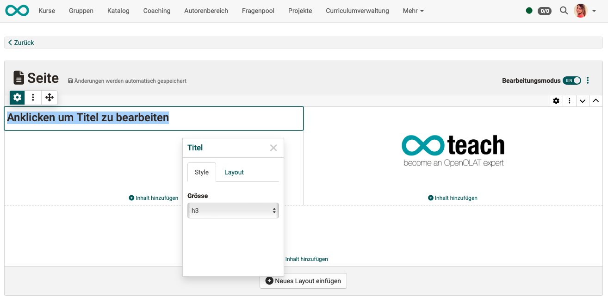{ class="shadow lightbox" title="Content Editor in edit mode" }

!!! note "Note"

    Besides the Content Editor, OpenOlat also has the HTML editor "TinyMCE", which is used in the [course element "HTML page"](../learningresources/Course_Element_HTML_Page.md), for example.

## Where is the Content Editor used? {: #content_editor_use}

The Content Editor is used in the [course element Page](../learningresources/Course_Element_Page.md), in the [learning resource "Form"](../learningresources/Form.md) and in the ["Portfolio 2.0"](../area_modules/The_portfolio_editor_17_1.md).

### Course element page [:octicons-tag-16:{ title="from Release 18.0.0 (OO-6966)" }](https://track.frentix.com/issue/OO-6966){:target="_blank"} {: #course_element_page}

In the course element "Page" you open the Content Editor in two ways: in the course editor in the tab "Page content" with "Edit page", or with the course editor closed directly in the course element by switching on the edit mode. You reach the course editor under: `Course > Administration > Course editor`.

**When the course editor is closed:**

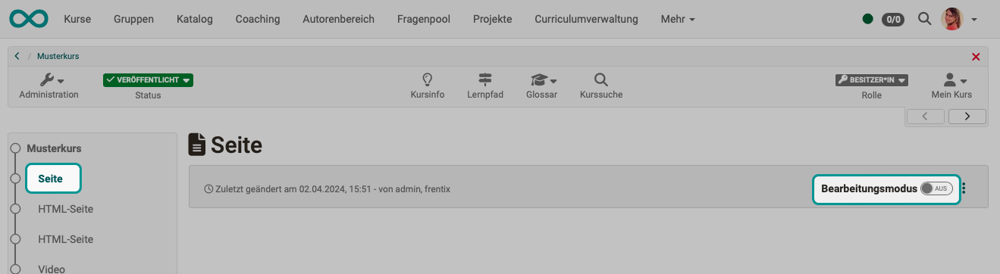{ class="shadow lightbox" title="Course element Page in the course" }

The switch "Edit mode" turns editing of the page on and off.

**In the course editor:**

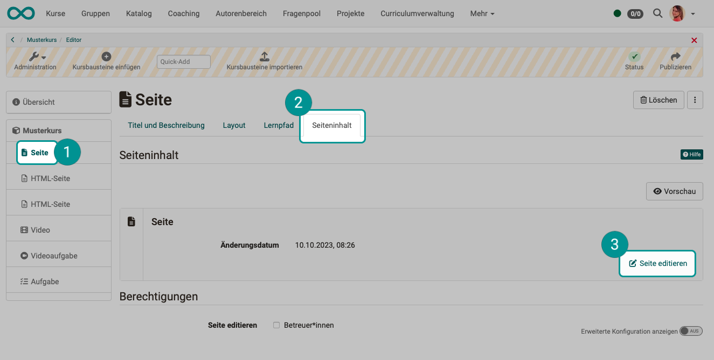{ class="shadow lightbox" title="Course element Page in the course editor" }

In the tab "Page content" you define under "Rights" whether, in addition to course owners, coaches may also edit the page when the course editor is closed: option "Edit page" for "Coach". With "Show advanced configuration" you additionally grant the right to individual roles, groups or users, optionally with a start and end.

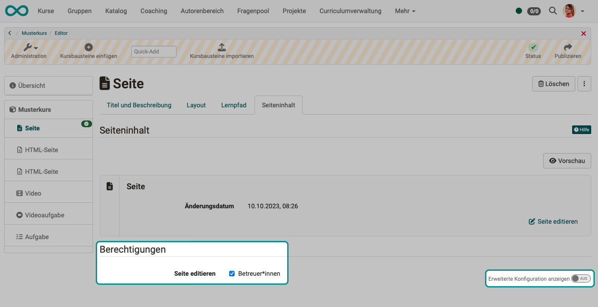{ class="shadow lightbox" title="Page content tab of the course element Page" }

OpenOlat stores the media content of the [Course Element "Page"](../learningresources/Course_Element_Page.md) (images, audio, video, diagrams, citations, documents, etc.) in the [Media Center](../personal_menu/Media_Center.md), not in the course’s storage folder as with the [Course Element "HTML Page"](../learningresources/Course_Element_HTML_Page.md).

The media of a portfolio binder are also stored in the Media Center. The learning resource "Form", by contrast, stores images in the learning resource itself.

[To the top of the page ^](#content_editor)

---

### Learning resource form {: #form}

The Content Editor is also used in the [learning resource Form](../learningresources/Form.md) and in all elements that use the learning resource Form.

The displayed options for inserting content are adapted to the form, e.g. different question types are available here.

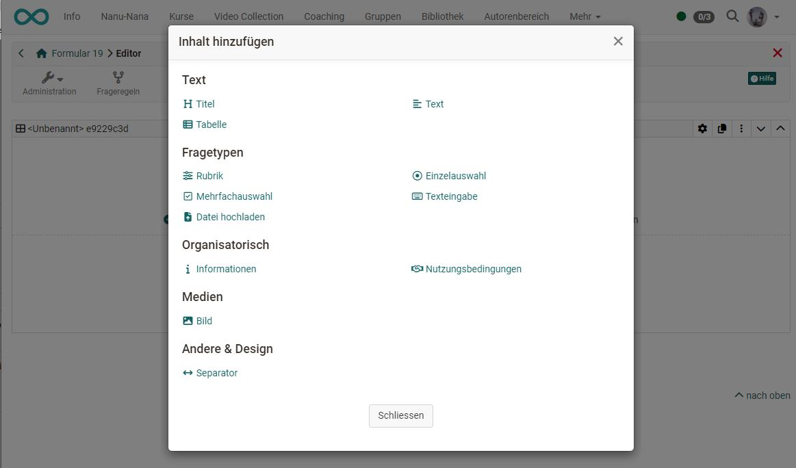{ class="shadow lightbox" title="Add content dialogue in the form editor" }

[To the top of the page ^](#content_editor)

---

### E-portfolio [:octicons-tag-16:{ title="from Release 11.0 (OO-2057)" }](https://track.frentix.com/issue/OO-2057){:target="_blank"} {: #portfolio}

The Content Editor is also used for entries in [binders](../area_modules/My_portfolio_binders.md), which can be used both independently of a course and in conjunction with [portfolio templates](../learningresources/Portfolio_template_Creation.md) and [portfolio tasks](../learningresources/Course_Element_Portfolio_Task.md).

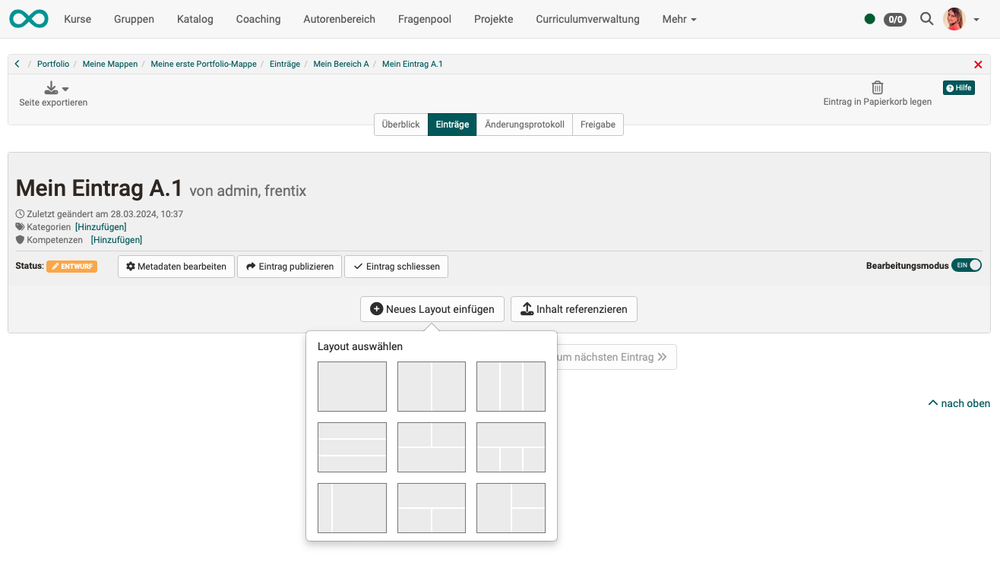{ class="shadow lightbox" title="Layout templates of a portfolio binder" }

[Portfolio >](../area_modules/The_portfolio_editor_17_1.md)

[To the top of the page ^](#content_editor)

---

## Layout in the content editor [:octicons-tag-16:{ title="from Release 17.1.0 (OO-6199)" }](https://track.frentix.com/issue/OO-6199){:target="_blank"} {: #content_editor_layout}

Before you can insert content in the Content Editor, you add a layout with "Add a new layout". The layout serves as a grid that determines the arrangement of the content (blocks).

There are various layouts to choose from, which differ in the way the fields are arranged. You can also combine several layouts on one page.

If necessary, the layout can be changed later at any time. To do this, click on the gear icon (Edit settings) of the layout and select a new layout.

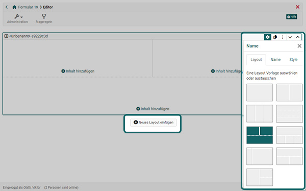{ class="shadow lightbox" title="Inspector of a layout" }

If several layouts exist, you can change the order of the layouts. Use the arrows to move an entire layout.

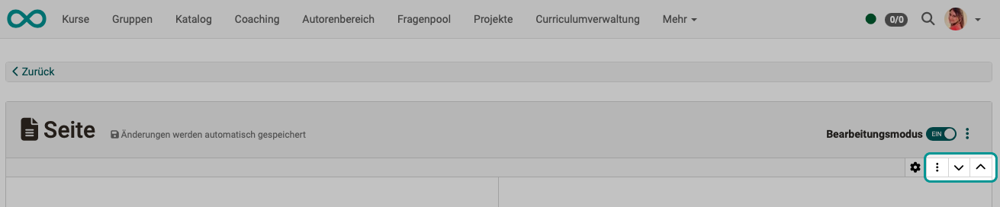{ class="shadow lightbox" title="Layout of a page in edit mode" }

### Deleting a layout [:octicons-tag-16:{ title="from Release 21.0 (OO-9407)" }](https://track.frentix.com/issue/OO-9407){:target="_blank"} {: #delete_layout}

Every layout on a page can be deleted via the layout's three-dot menu, including the first one. When deleting, you decide what happens to the content: "Delete everything" removes the layout together with its content, "Only delete the layout and move the content" moves the content to the adjacent layout. When the last layout of a page is deleted, the dialog points out that the layout and all its content will be deleted; the page then automatically receives an empty default layout again. If only a single empty layout is left, the "Delete" action is disabled.

[To the top of the page ^](#content_editor)

---

## Organizing content in the layout {: #organize_content}

### Content blocks {: #content_blocks}

Content blocks with various specific types of content can be added to each section of a layout. The number of content blocks depends on the selected layout. For example, a three-column layout has 3 content blocks.

### Adding, positioning and configuring content in a block {: #add_content}

Use "Add content" to add specific content and media to a block. The link appears in every section of a layout, so you can insert the content exactly where it belongs.

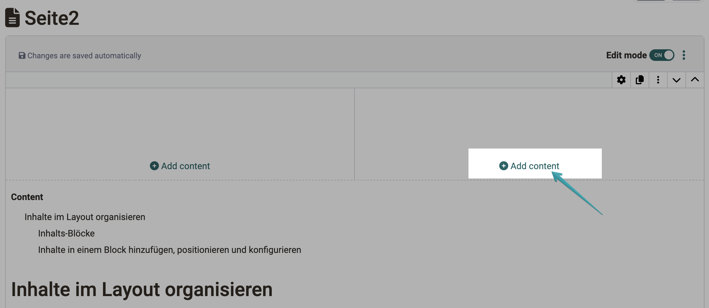{ class="shadow lightbox" title="Areas of a layout in the Content Editor" }

The "Add content" dialog lists the available content types grouped into the sections "Text", "Media", "Knowledge" and "Other & design". At the bottom, two buttons lead directly to the [Media Center](#media_center) and to the [import](#import_position).

When you hover over a block with the mouse in edit mode, that block is highlighted [:octicons-tag-16:{ title="from Release 20.2.0 (OO-8966)" }](https://track.frentix.com/issue/OO-8966){:target="_blank"}. This helps you tell blocks apart when several similar elements follow one another.

As soon as you click or select a piece of added content, a pop-up window appears where you can configure the properties of that content. This is called the ["Inspector"](#inspector).

You can also show or hide the Inspector pop-up using the gear icon next to the content.

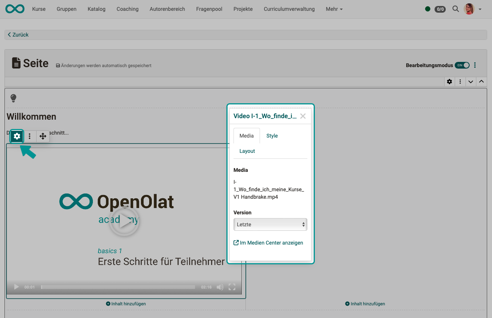{ class="shadow lightbox" title="Inspector of a video block" }

**Menus**

The toolbar of a selected block comprises four icons: the gear for the Inspector, an icon to duplicate, a three-dot menu and a crosshair. The three-dot menu lets you add further content elements before or after the element, move the element up or down, and delete it. The crosshair lets you drag and drop the selected element to a different position, into a different content block, or into a different layout.

A block can be copied with the "Duplicate" action, both as a short action on the block itself and via the three-dot menu [:octicons-tag-16:{ title="from Release 20.1.0 (OO-7709)" }](https://track.frentix.com/issue/OO-7709){:target="_blank"}.

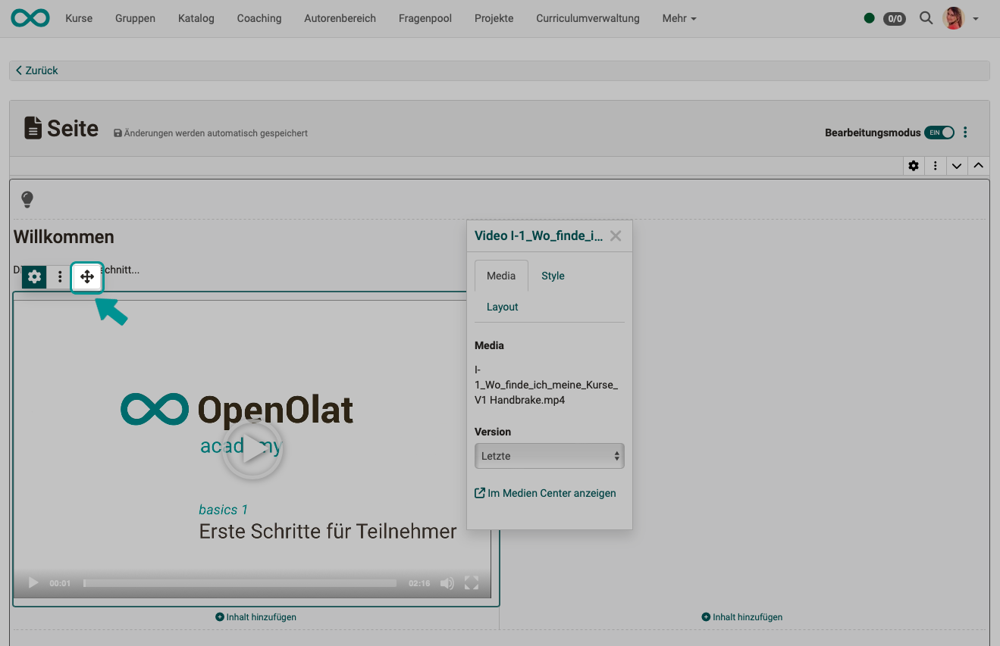{ class="shadow lightbox" title="Toolbar of a content block" }

[To the top of the page ^](#content_editor)

---

### General formatting for all content blocks - The Inspector [:octicons-tag-16:{ title="from Release 17.1.0 (OO-6198)" }](https://track.frentix.com/issue/OO-6198){:target="_blank"} {: #inspector}

#### Spacing {: #spacing}

Consistent spacing between the fields of a layout (content blocks) makes a page easy to read. Under "Spacing" you can choose:

* No spacing
* S (small)
* M (medium)
* L (large)
* XL (extra large)
* Custom

=== "S (small spacing)"

    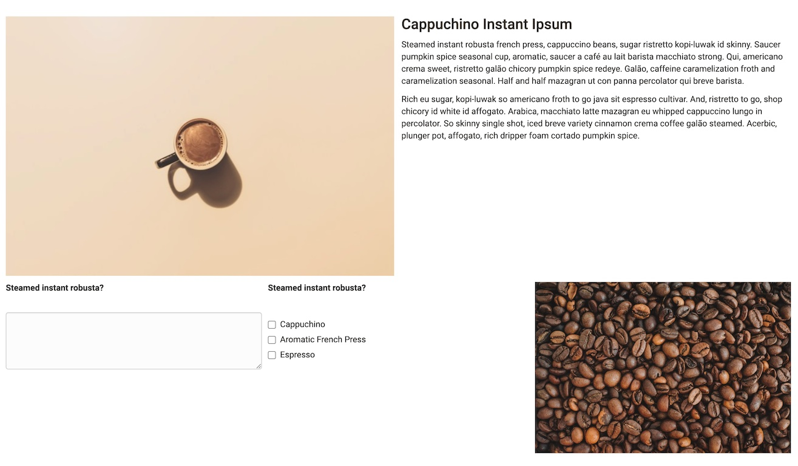{ class="shadow lightbox" title="small spacing" }

=== "M (medium spacing)"

    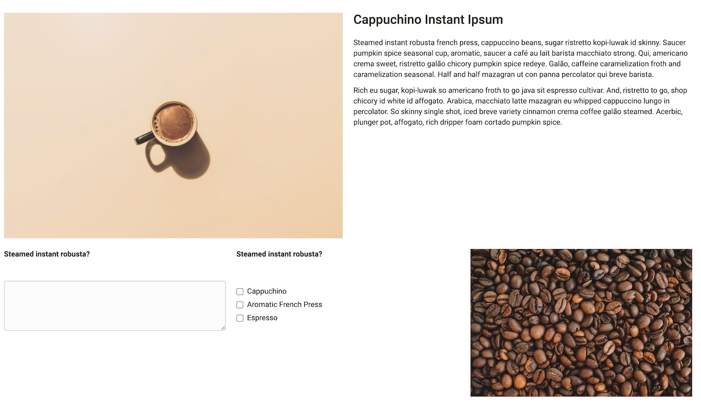{ class="shadow lightbox" title="medium spacing" }

=== "XL (extra large spacing)"

    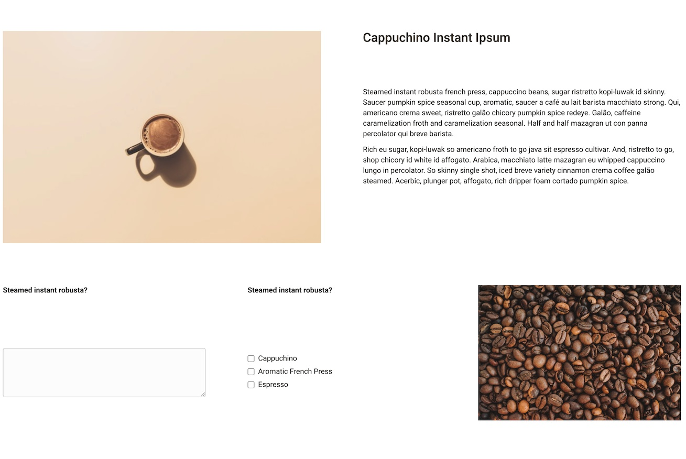{ class="shadow lightbox" title="extra large spacing" }

#### Background {: #background}

In the inspector of a layout you define the background of the layout in the tab "Style" under "Background" [:octicons-tag-16:{ title="from Release 18.2.5 (OO-7641)" }](https://track.frentix.com/issue/OO-7641){:target="_blank"}. Besides "None", a predefined colour list is available, letting you set individual layouts apart visually.

#### Alert box {: #alert_box}

Layouts and various content blocks can be displayed as a formatted alert box [:octicons-tag-16:{ title="from Release 18.2.3 (OO-7138)" }](https://track.frentix.com/issue/OO-7138){:target="_blank"}. When a predefined type is selected, the box highlights information with the matching colour and the matching icon. The types "Note", "Info", "Tip", "Important", "Warning", "Error" and "Success" are available. With the type "Custom" you design the colour and icon of the box yourself. In the field "Title" you give the box a heading, "With icon" shows the icon, and "Collapsible" makes the box collapsible.

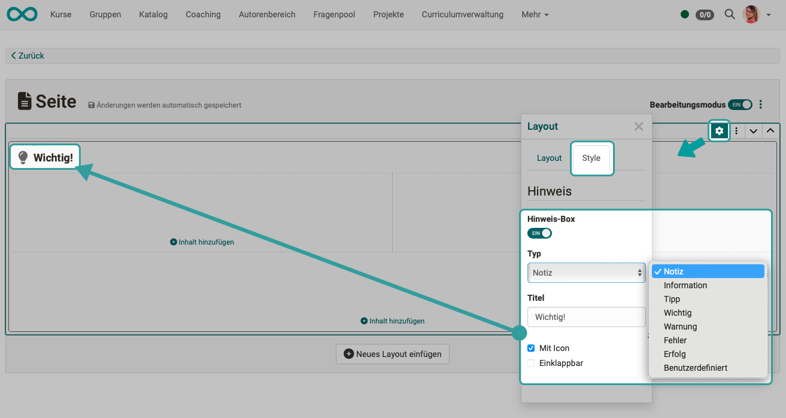{ class="shadow lightbox" title="Style tab in the inspector of a layout" }

Example:

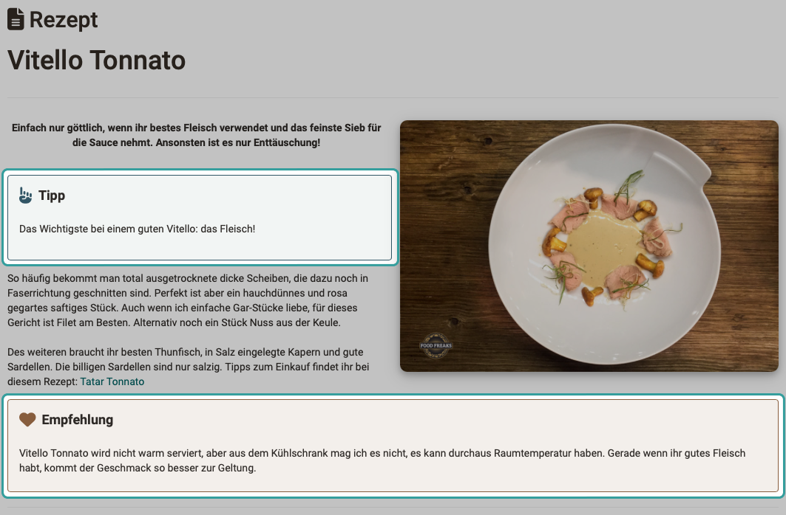{ class="shadow lightbox" title="Alert boxes on a page" }

[To the top of the page ^](#content_editor)

---

### Anchors {: #anchors}

Every title element on a page automatically receives an anchor, that is a jump target that leads directly to this section [:octicons-tag-16:{ title="from Release 21.0 (OO-9411)" }](https://track.frentix.com/issue/OO-9411){:target="_blank"}. Other content types do not receive an anchor.

You do not need to configure anything for this. The anchors are not shown on the page and cannot be copied individually either. They are used by the ["Table of contents"](#table_of_contents) element, which lists the titles of the page and links them via these anchors as jump marks. The more title elements structure a page, the more useful the table of contents becomes. 
[To the table of contents >](#table_of_contents)

[To the top of the page ^](#content_editor)

---

## Content types {: #content_types}

Please note that not *all* elements are available in every content editor. 

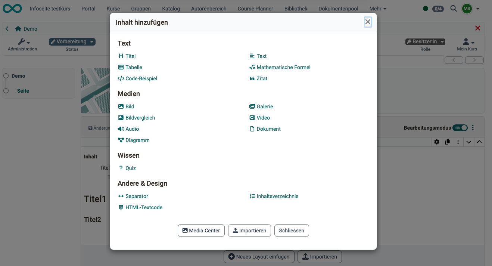{ class="shadow lightbox" title="Add content dialogue" }

### Title {: #title}

For the element "Title" you select one of the predefined levels h1 to h6 under "Size" in the inspector.

Every title additionally receives an [anchor](#anchors). It is used exclusively by the ["Table of contents"](#table_of_contents) element, which lists the titles and links them via their anchors. Outside the table of contents, the anchors cannot be addressed.

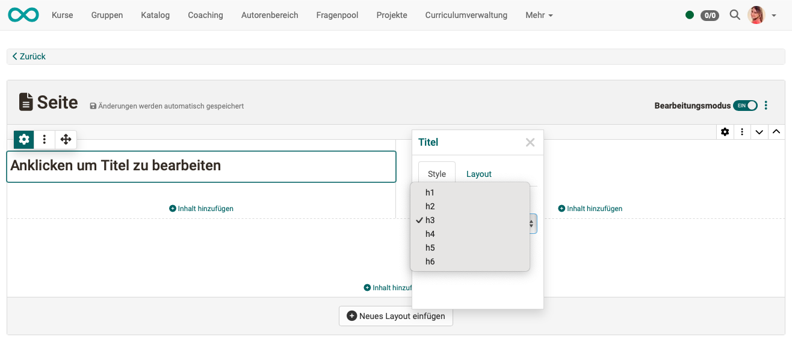{ class="shadow lightbox" title="Inspector of a title block" }

### Text {: #text}

With the element "Text" you insert formatted running text. The formatting bar offers, among other things, font style, alignment, font size, colours, lists, links and formulas. In the inspector you define under "Columns" in how many columns the text appears.

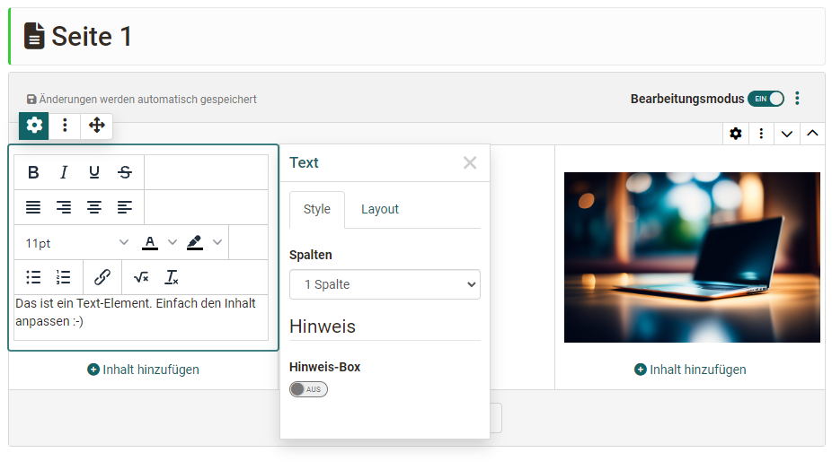{ class="shadow lightbox" title="Formatting bar of a text block" }

### Table {: #table}

With the element "Table" you present content in rows and columns. In the inspector you define the number of rows and columns under "Row" and "Column" and whether the table has a "Row header" or a "Column header". Under "Row style" you choose how the rows are displayed. Above and below the table you can enter a table title and a table caption.

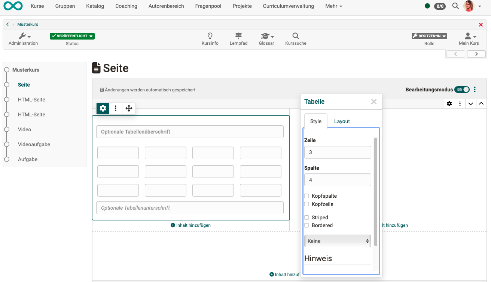{ class="shadow lightbox" title="Inspector of a table block" }

### Math formula [:octicons-tag-16:{ title="from Release 16.2.0 (OO-6070)" }](https://track.frentix.com/issue/OO-6070){:target="_blank"} {: #formula}

A special small editor is available for mathematical formulas.

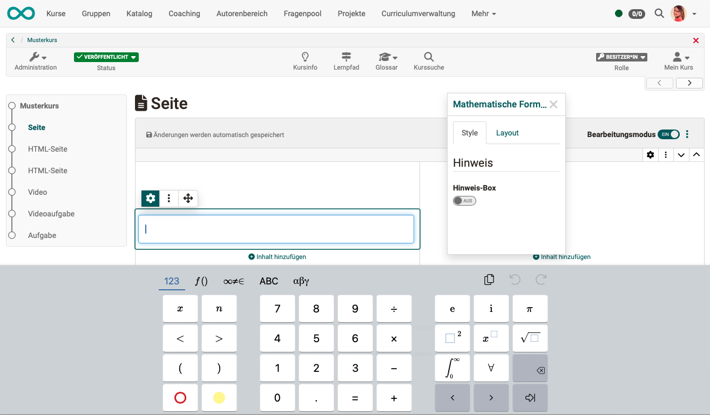{ class="shadow lightbox" title="Formula editor" }

This text element does not exist in the form editor. 

### Code example [:octicons-tag-16:{ title="from Release 18.2.0 (OO-7140)" }](https://track.frentix.com/issue/OO-7140){:target="_blank"} {: #code}

The block "Code example" shows text in a font with fixed spacing and numbered lines. This helps with technical learning content such as programming examples. When creating the block, you select the programming language. Participants copy the code directly to the clipboard to reuse it.

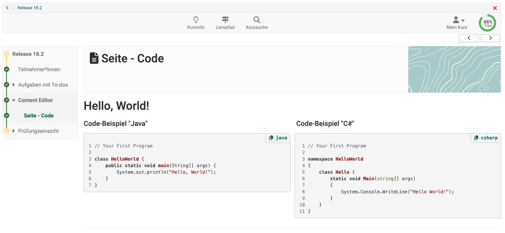{ class="shadow lightbox" title="Code examples on a page" }

This text element does not exist in the form editor. 

### Citation {: #quote}

If a text is entered as a citation, it automatically has a predefined formatting. Citations are saved as reusable objects in the Media Center, just like audio or videos.

This text element does not exist in the form editor. 

[To the top of the page ^](#content_editor)

---

!!! info "Section Media"

    Instead of the "Media" section and its associated content elements, the [form editor](../learningresources/Form_Editor.md) includes the "Question Types" and "Organizational" sections with their corresponding content elements. 

### Image {: #image}

All images available in the Media Center can be integrated. New images can be uploaded and are then stored in the Media Center. The image formats png, jpg, gif and svg are supported [:octicons-tag-16:{ title="svg from Release 20.3.0 (OO-9350)" }](https://track.frentix.com/issue/OO-9350){:target="_blank"}.

If the AI feature "Image Description Generator" is switched on in the [AI module](../../manual_admin/administration/External_Tools_AI.md), OpenOlat adds title, description, alternative text and tags of a newly uploaded image in the background with AI, provided the AI image descriptions are switched on for you, see [Tab AI settings](../personal_menu/Settings.md#tab_ai_settings). More about this: [Generate metadata with AI](Media_Center_Items.md#metadata_ai)

### Gallery [:octicons-tag-16:{ title="from Release 19.0.0 (OO-7142)" }](https://track.frentix.com/issue/OO-7142){:target="_blank"} {: #gallery}

Several images can be scrolled through in a gallery element (slideshow), displayed in a grid (columns and rows definable by author) or displayed with preview (1 image large, the remaining images as reduced preview images). The appearance of the gallery can be varied in the inspector. The images come from the Media Center. 

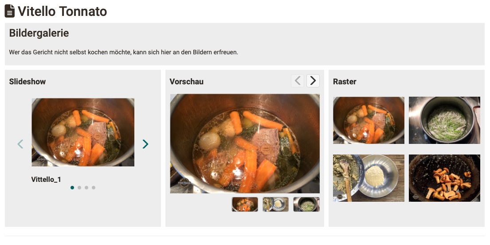{ class="shadow lightbox" title="Gallery in three display modes" }

### Image comparison [:octicons-tag-16:{ title="from Release 19.0.0 (OO-7143)" }](https://track.frentix.com/issue/OO-7143){:target="_blank"} {: #image_comparison}

Two superimposed images can be cross-faded using a slider.

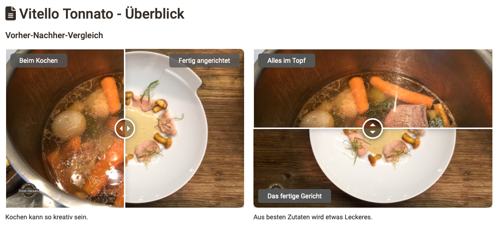{ class="shadow lightbox" title="Image comparison on a page" }

### Audio {: #audio}

Audio can be recorded directly in OpenOlat, uploaded or selected from existing audio.

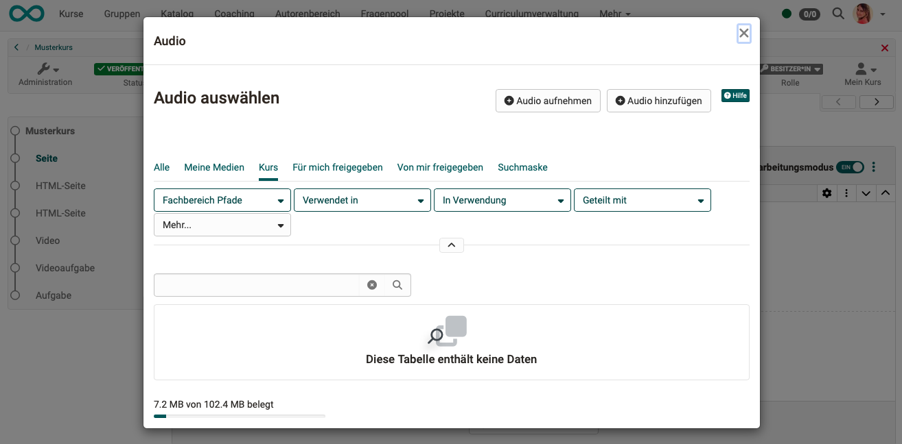{ class="shadow lightbox" title="Select audio dialogue" }

### Video [:octicons-tag-16:{ title="from Release 18.0 (OO-7001)" }](https://track.frentix.com/issue/OO-7001){:target="_blank"} {: #video}

Videos can also be integrated via URL in the block "Video". 
The video formats MP4 and m3u8 as well as the platforms YouTube, Vimeo, Panopto and nanoo.tv are supported. It is also possible to record new videos directly in OpenOlat.

### Document [:octicons-tag-16:{ title="from Release 14.0 (OO-3943)" }](https://track.frentix.com/issue/OO-3943){:target="_blank"} {: #document}

Here, you can upload documents in various formats (e.g., PDF or Word files) using drag-and-drop, select them from the Media Center, or create them directly in specific formats. The media files are automatically saved in the Media Center.

You can also access the Media Center via the Inspector menu to add additional information to documents and define further sharing options. This allows a file that was initially intended for a single content block to be used for other purposes or edited by other OpenOlat users.

In addition, the "Share" section allows you to share newly created or uploaded documents directly.

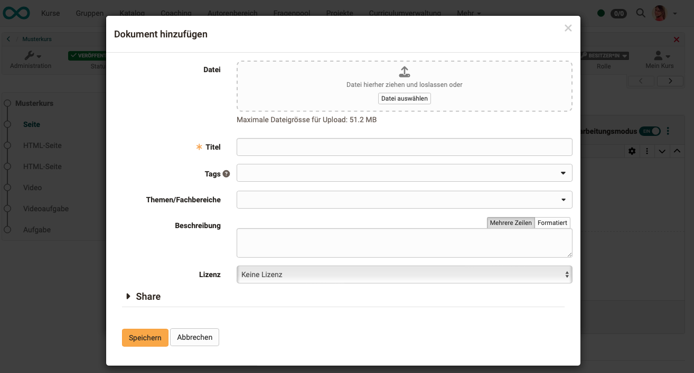{ class="shadow lightbox" title="Add document dialogue" }

### Diagram (draw.io) [:octicons-tag-16:{ title="from Release 18.1.0 (OO-7092)" }](https://track.frentix.com/issue/OO-7092){:target="_blank"} {: #diagram}

Existing diagrams can be loaded from the Media Center or new diagrams can be created directly with draw.io. If you edit the file as an individual, the editing takes place on the OpenOlat server, in collaboration mode on an external server. 

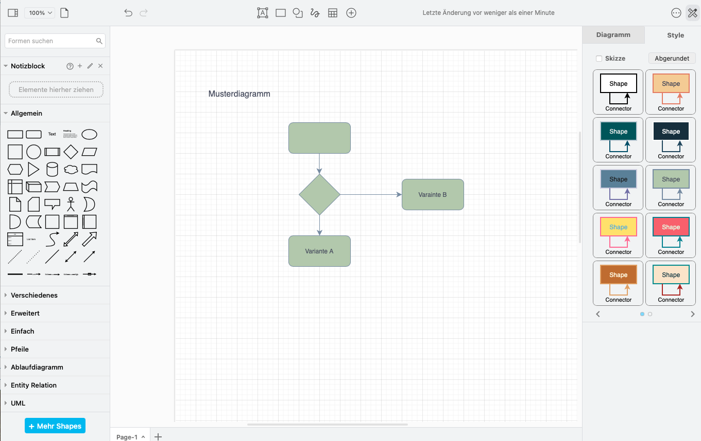{ class="shadow lightbox" title="draw.io editor" }

[To the top of the page ^](#content_editor)

---

!!! info "Section Knowledge"

    This section is available only in the Content Editor of the course element "Page".

### Quiz [:octicons-tag-16:{ title="from Release 19.0.0 (OO-7145)" }](https://track.frentix.com/issue/OO-7145){:target="_blank"} {: #quiz}

This content element allows you to embed quiz questions that can be automatically graded into a page. You can create new questions or add existing ones from the question bank. You can also add feedback to each question, including images and videos.

These short quiz questions are intended to encourage engagement with the course content, but they do not award points. For graded quizzes, please use the course elements ["Test"](../learningresources/Course_Element_Test.md) or ["Self-test"](../learningresources/Course_Element_Self_Test.md).

Conversely, the quiz element is the only place where learners receive [AI feedback on free-text answers](#ai_feedback).

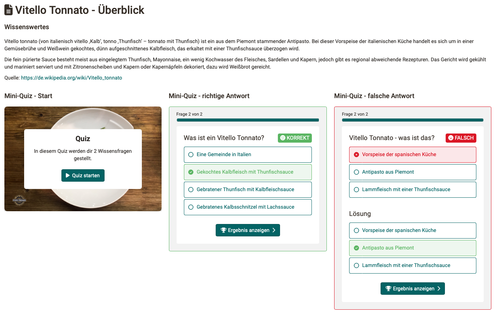{ class="shadow lightbox" title="Quiz on a page" }

Via the three-dot menu of the quiz element you exchange questions with the [question bank](../area_modules/Question_Bank/index.md). "Import questions from pool" adds existing questions to the quiz, "Export all questions to pool" writes all questions of the quiz to the question bank. This lets you reuse questions created directly on the page in other courses and tests.

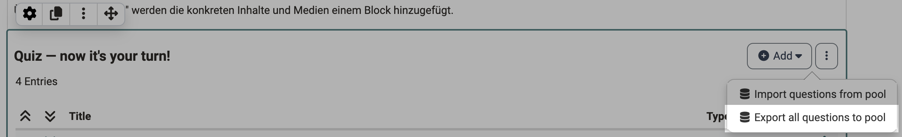{ class="shadow lightbox" title="3-dot menu of a quiz" }

[To the top of the page ^](#content_editor)

---

### Separator {: #separator}

A separator is a line (visual design element) used to separate content.

### Table of contents {: #table_of_contents}

The "Table of contents" element makes long pages easy to navigate: it lists the titles of the page as clickable jump marks and takes you directly to the respective section with one click [:octicons-tag-16:{ title="from Release 21.0 (OO-9411)" }](https://track.frentix.com/issue/OO-9411){:target="_blank"}. It captures the titles that follow the table of contents on the page, up to the next title of the same or a higher level. This allows you to create a table of contents for the whole page or for a single chapter only. In the inspector, "Title sizes" defines which title levels (H1 to H5) appear in the list; H1 to H4 are selected by default. If the table of contents is displayed as an alert box, its title serves as the box title.

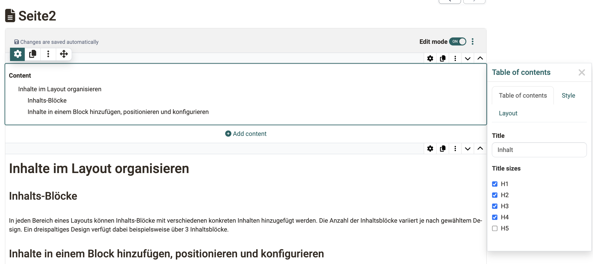{ class="shadow lightbox" title="Table of contents on a page" }

You insert the element via "Add content" in the "Other & design" section. When inserted, it carries the title "Contents", which you can overwrite in the Inspector.

If the table of contents stays empty, the hint "No titles found after this position" appears. The element is then placed below the titles it is meant to list, or the selected title sizes do not match the existing titles. Move it before the titles you want, or adjust the title sizes in the Inspector.

This element does not exist in the form editor.

### HTML text code {: #html}

The element "HTML text code" is available only in the Content Editor of the course element Page. It performs similar functions to the element "Text" and offers additional menus and options.

[To the top of the page ^](#content_editor)

---

## AI feedback on free-text answers {: #ai_feedback}

If the [AI module](../../manual_admin/administration/External_Tools_AI.md) has the AI feature "Essay Grading" configured, essay questions can also be added to a quiz [:octicons-tag-16:{ title="from Release 21.0 (OO-9497)" }](https://track.frentix.com/issue/OO-9497){:target="_blank"}. When learners answer such a question, they can request formative feedback on their answer under "AI feedback". The feedback does not award points and serves for self-assessment.

This evaluation exists only in the quiz element of a page. In the course elements "Test" and "Self-test" the grading kit of an essay question is not executed, even if the question comes from the question bank. How you define the grading kit of a question is described in the chapter [Edit the AI grading of an essay question](../area_modules/Question_Bank_Create_Questions.md#ai_grading).

It opens with the "Assessment" of the answer, ranging over "very good", "good", "mediocre", "insufficient" and "wrong", together with a short overall appraisal. The "Feedback reliability" indicator with the values "high", "medium" and "low" shows how reliable the AI rates its own assessment.

Under "Detailed feedback" further sections can be expanded: "What went well", "What is missing" and "Next step", plus the points the answer covers and those it misses, and under "Language" feedback on "Grammar" and "Spelling". The area only appears when the AI has something to contribute.

Depending on the AI model in use, grading takes a few seconds up to several minutes. Meanwhile the page reports progress in stages: first it waits for the AI correction, after a short while it points out that the page should be kept open, and after that it states that grading with this model can take several minutes. As soon as the result is ready, the page updates itself. If grading exceeds the waiting time configured in the [AI module](../../manual_admin/administration/External_Tools_AI.md#ai_function_limits), OpenOlat cancels it and reports this [:octicons-tag-16:{ title="from Release 21.0.2 (OO-9677)" }](https://track.frentix.com/issue/OO-9677){:target="_blank"}.

OpenOlat rejects answers that are too long before grading starts. The permitted number of words is set by the system administration in the AI module, 400 words by default. The message to the learners states the configured value.

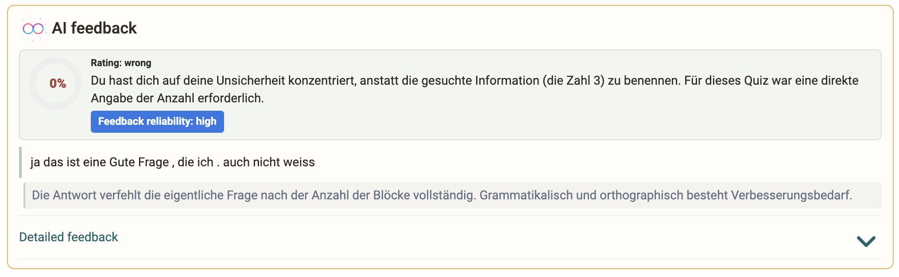{ class="shadow lightbox" title="AI feedback on a free-text answer in a quiz" }

### Consent to the AI correction [:octicons-tag-16:{ title="from Release 21.1 (OO-9784)" }](https://track.frentix.com/issue/OO-9784){:target="_blank"} {: #ai_consent}

Before the AI corrects free-text answers of learners, OpenOlat asks them for permission. After a click on "Start quiz", the dialog "AI correction" appears above the first question, provided the quiz contains at least one free-text question with AI grading and the person has not stored a choice in the tab "AI settings" of their personal settings. The dialog says that the quiz corrects free-text answers with AI and that the AI feedback is a suggestion, not a grade. It also names the default of the institution.

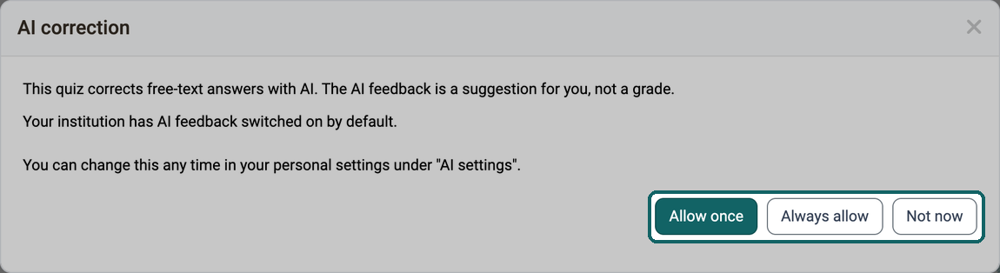{ class="shadow lightbox" title="AI correction dialogue at the start of a quiz · 2026.10.20" }

* **"Allow once"**: The AI corrects the answers in this attempt. OpenOlat stores nothing.
* **"Always allow"**: The AI corrects the answers, and OpenOlat stores the choice "On" in the tab "AI settings". The dialog does not appear any more after that.
* **"Not now"**: No AI feedback appears in this attempt. OpenOlat stores nothing. Closing the dialog with the cross at the top right or with the Escape key also selects "Not now".

"Allow once" is highlighted if the default of the administration is "on", otherwise "Not now". As long as nothing is stored, the dialog appears again in every new attempt, also after a click on "New attempt". Without permission, learners answer the free-text questions as usual, only no AI feedback appears.

Learners undo "Always allow" by selecting "Default" again in the tab "AI settings". There the AI feedback can also be switched off completely. You find the tab under: 
`Personal menu > System settings > Tab "AI settings"` 
More about this: [Tab AI settings](../personal_menu/Settings.md#tab_ai_settings)

[To the top of the page ^](#content_editor)

---

## Importing Markdown and Word files [:octicons-tag-16:{ title="from Release 20.3.0 (OO-9290)" }](https://track.frentix.com/issue/OO-9290){:target="_blank"} {: #markdown}

!!! info "Important"

    Markdown is a widely used text format that many tools and AI applications output. Headings, lists and tables are recorded in it as simple characters, so the structure of a text is preserved during import.

You import Markdown files and Word documents directly into the Content Editor. This way you take over content from external tools, text files or AI applications without reformatting it by hand. OpenOlat automatically converts the content into blocks of the page.

To import, click the button "Import" at the bottom of the Content Editor.

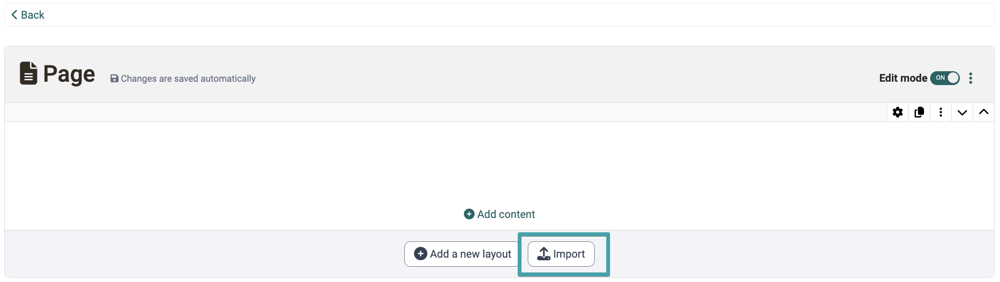{ class="shadow lightbox" title="Import button in the Content Editor" }

In the import dialogue you choose between two options:

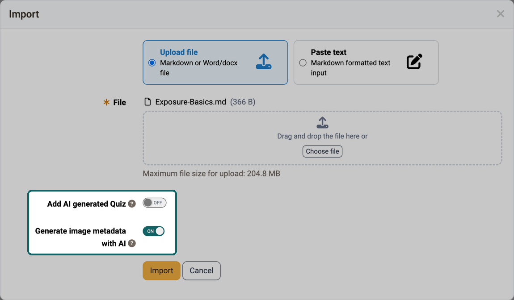{ class="shadow lightbox" title="Import dialogue in the Content Editor · 2026.10.20" }

**A) Upload file:** The following are supported:

* Markdown files (.md, .markdown, .txt)
* ZIP archives up to a maximum of 50 MB (A ZIP archive must contain exactly one markdown file and can additionally include the image files referenced relatively within it.)
* Word documents (.docx) up to a maximum of 200 MB [:octicons-tag-16:{ title="Word import from Release 21.0 (OO-9415)" }](https://track.frentix.com/issue/OO-9415){:target="_blank"}.

**B) Paste text:** Markdown-formatted text is pasted directly into the input field, e.g. from the clipboard. Local image paths are not supported in this mode.

Below, depending on the configuration of the AI module, the switches "Add AI generated Quiz" and "Generate image metadata with AI" appear. What they do is described in the sections [Generate AI questions on import](#import_ai_quiz) and [Images during import](#import_images).

!!! info "Importing Word documents"
    Word documents are automatically converted to Markdown during import and then processed in the same way as Markdown files. Formatting such as superscript, subscript, underlined and highlighted text is preserved, as are tables and embedded images. When uploading a .docx file, OpenOlat displays a notice because not all Word features can be imported. Therefore, please review the imported content carefully.

### Conversion of the elements {: #import_conversion}

During import, the markdown elements are converted into blocks of the Content Editor as follows:

| Markdown element | Block in the Content Editor |
|------------------|-----------------------------|
| Heading (level 1 to 6, `#` to `######`) | [Title](#title) in the corresponding size (H1 to H6) |
| Paragraph | [Text](#text) |
| Horizontal rule (`---`) | [Separator](#separator) |
| Code block | [Code example](#code) (with detected programming language) |
| Blockquote `>` | Text with [alert box](#alert_box) |
| GitHub admonition (e.g. `> [!WARNING]`) | Text with alert box of the matching type |
| List (bulleted or numbered) | Text with list |
| Table | [Table](#table) |
| Image | [Image](#image) (stored in the [Media Center](#media_center)) |
| Math block (`$$...$$`) | [Math formula](#formula) |
| Inline formatting ``, ``, `<u>`, `<mark>` or `==text==` | Text with preserved formatting [:octicons-tag-16:{ title="from Release 21.0 (OO-9400)" }](https://track.frentix.com/issue/OO-9400){:target="_blank"} |
| Image size `{width=300 height=200}` directly after the image | Image in the specified display size |
| Table with bold first row or first column | Table with row or column headers |
| MkDocs admonition `!!! info "Title"` | Text with alert box of the matching type |
| YAML front matter block at the top of the document, enclosed in `---` | Detected and removed, the page starts directly with the content [:octicons-tag-16:{ title="from Release 21.0 (OO-9402)" }](https://track.frentix.com/issue/OO-9402){:target="_blank"} |

The title size also determines which imported titles the ["Table of contents"](#table_of_contents) element captures and links as jump marks.

!!! note "Markdown extensions"
    In addition, the markdown extensions for strikethrough text, task lists and footnotes are supported. GitHub admonitions of the types NOTE, TIP, IMPORTANT, WARNING, CAUTION, INFO, SUCCESS and ERROR receive an alert box with the matching type and icon; MkDocs admonitions add further types such as ABSTRACT, HINT, QUESTION, ATTENTION, DANGER, BUG or EXAMPLE. An admonition title in quotation marks is applied, an empty title `""` hides the title line, and without a title the default label of the type is shown. HTML blocks are not imported for security reasons; the import finishes with a corresponding warning.

### Images during import {: #import_images}

During import, OpenOlat stores images directly in the [Media Center](#media_center). A duplicate check prevents the same image from being stored in the Media Center several times, without you as an author having to do anything.

OpenOlat downloads images with absolute URLs during import. If the mode under `Administration > Login > Security > Tab "Media server"` in the system administration is set to "Configure", this only applies to the domains enabled there. The import does not download an image from another domain and reports it as a warning, see [Tab Media server](../../manual_admin/administration/Login_Security.md#tab_mediaserver). Base64 images embedded directly in the markdown (data URIs) are also imported.

If the AI feature "Image Description Generator" is switched on in the [AI module](../../manual_admin/administration/External_Tools_AI.md), the import dialog shows the switch "Generate image metadata with AI". If it is switched on, OpenOlat generates title, description, alternative text and tags for the imported images in the background with AI [:octicons-tag-16:{ title="from Release 20.3.0 (OO-9356)" }](https://track.frentix.com/issue/OO-9356){:target="_blank"}. OpenOlat transmits a reduced version of each image to the AI service. If it is switched off, OpenOlat does not generate metadata with AI.

When the dialog opens, the switch is set the way the AI image descriptions are set for you: according to your choice in the [Tab AI settings](../personal_menu/Settings.md#tab_ai_settings), without a choice of your own according to the default of the administration. You can change it for each import individually. The change only applies to this import, OpenOlat does not store it. 
[Details on metadata with AI >](Media_Center_Items.md#metadata_ai)

### Importing at a specific position {: #import_position}

The "Import" button is additionally available in the dialog "Add content" [:octicons-tag-16:{ title="from Release 21.0 (OO-9423)" }](https://track.frentix.com/issue/OO-9423){:target="_blank"}. When importing via this dialog, the content is inserted exactly where you are working: in the respective content block, or before or after the element from which the dialog was opened. When importing via the button at the bottom of the Content Editor, the content is inserted at the end of the page.

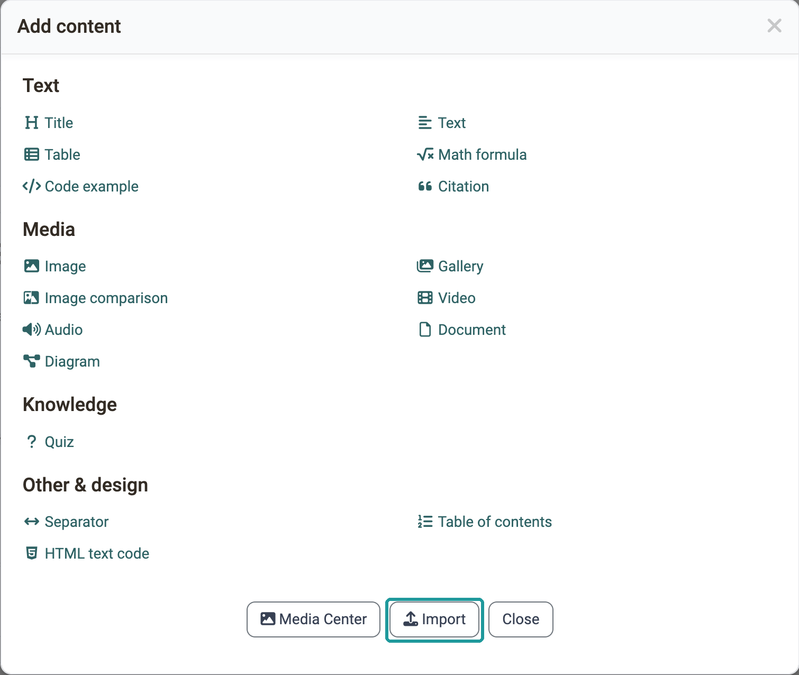{ class="shadow lightbox" title="Add content dialogue" }

### Generate AI questions on import {: #import_ai_quiz}

If the [AI module](../../manual_admin/administration/External_Tools_AI.md) is configured with the AI features "Essay Question Generator" and "Essay Grading", the import dialog additionally shows the switch "Add AI generated Quiz" [:octicons-tag-16:{ title="from Release 21.0 (OO-9497)" }](https://track.frentix.com/issue/OO-9497){:target="_blank"}. It is switched on when the dialog opens. OpenOlat then generates questions from the imported content and appends them as a [quiz element](#quiz) at the end of the page. If you do not want questions to be generated, switch it off before the import. Via the "MC question" and "Essay question with AI correction" fields you define how many questions of each type are generated (up to five per type).

Three further fields steer which questions are created. Under "Bloom levels" you choose which cognitive levels the questions should cover: "Remember", "Understand", "Apply", "Analyse", "Evaluate" and "Create". The "Target difficulty" ranges from "1 - Very easy (Quiz mode)" to "5 - Very hard"; with "No preference" the difficulty is chosen at random per question. In the "Learning objectives (optional)" field you enter one learning objective per line to focus the questions in terms of content.

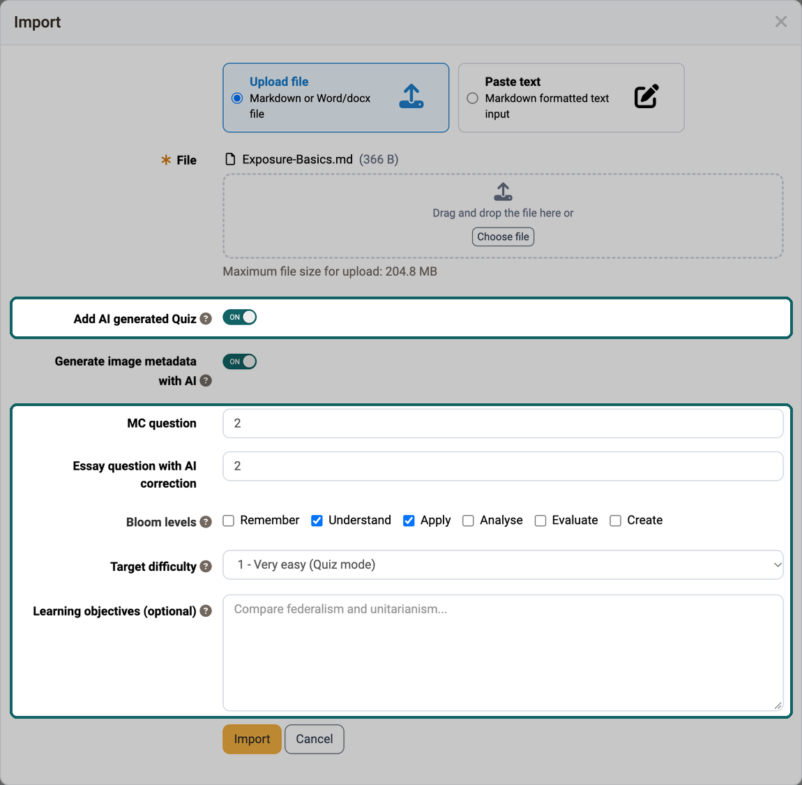{ class="shadow lightbox" title="Import dialogue with AI generated quiz · 2026.10.20" }

How long the imported text for question generation may be is set by the system administration in the [AI module](../../manual_admin/administration/External_Tools_AI.md#ai_function_limits), 60000 characters by default.

Generation runs in the background and can take a minute; the quiz element appears once the questions are ready. Check the generated questions for correctness afterwards. AI question generation is not available in the e-portfolio.

[To the top of the page ^](#content_editor)

---

## Media Center [:octicons-tag-16:{ title="from Release 11.0 (OO-2299)" }](https://track.frentix.com/issue/OO-2299){:target="_blank"} {: #media_center}

In the Content Editor of the course element Page and of the portfolio, a separate button "Media Center" in the dialog "Add content" leads to your media. It is an additional way to access your files, regardless of the type of media.

Click the button to open the files in your Media Center. Here, you select files, create new ones or upload them.

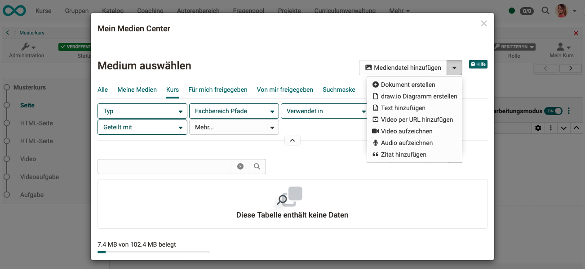{ class="shadow lightbox" title="Add media file menu" }

[Media Center (User tools) >](../personal_menu/Media_Center.md) 
[Detailed information about the Media Center (Basic concept) >](Media_Center_Concept.md)

[To the top of the page ^](#content_editor)

---

## Further information {: #further_information}

**Mentioned on this page** 
[Course Element "HTML page" >](../learningresources/Course_Element_HTML_Page.md) 
[Course Element "Page" >](../learningresources/Course_Element_Page.md) 
[Forms - Overview >](../learningresources/Form.md) 
[The Portfolio Editor >](../area_modules/The_portfolio_editor_17_1.md) 
[User tools: Media Center >](../personal_menu/Media_Center.md) 
[My binders >](../area_modules/My_portfolio_binders.md) 
[Portfolio template: Creation >](../learningresources/Portfolio_template_Creation.md) 
[Course Element "Portfolio Task" >](../learningresources/Course_Element_Portfolio_Task.md) 
[The form editor >](../learningresources/Form_Editor.md) 
[External tools: AI module >](../../manual_admin/administration/External_Tools_AI.md) 
[Personal Configuration: Settings >](../personal_menu/Settings.md) 
[Information and settings for items in the Media Center >](Media_Center_Items.md) 
[Course Element "Test" >](../learningresources/Course_Element_Test.md) 
[Course Element "Self-test" >](../learningresources/Course_Element_Self_Test.md) 
[Question Bank: Overview >](../area_modules/Question_Bank/index.md) 
[Question Bank: Create Questions >](../area_modules/Question_Bank_Create_Questions.md) 
[Security >](../../manual_admin/administration/Login_Security.md) 
[Media Center Concept >](Media_Center_Concept.md)

**Further reading** 
[Working with tables >](Table_Concept.md) 
[Math formula >](Math_formula.md) 
[Accessibility: Basic principles >](Accessibility_Principals.md)

[To the top of the page ^](#content_editor)
