# Inhalt hinzufügen {: #content_types}

Im Bearbeitungsmodus steht in jedem Bereich eines Layouts der Link "Inhalt hinzufügen". Er öffnet den gleichnamigen Dialog, mit dem Sie Texte, Bilder, Videos, Dokumente und weitere Inhalte einfügen. Diese Seite beschreibt die Inhaltstypen nach den Gruppen des Dialogs, "Text", "Medien", "Wissen" sowie "Andere & Design", und den Button "Media Center". Wo Sie den Content Editor öffnen und wer ihn nutzt, beschreibt die Seite [Content Editor](index.de.md).

Die Eigenschaften eines Inhalts stellen Sie im Inspektor ein, dem Fenster, das sich beim Anklicken des Inhalts öffnet. Wie Sie Inhalte im Layout anordnen und was der Inspektor für alle Inhalte bietet, beschreibt die Seite [Layout](Editor_Layout.de.md#inspector).

Welche Elemente zur Verfügung stehen, hängt davon ab, wo Sie den Content Editor nutzen.

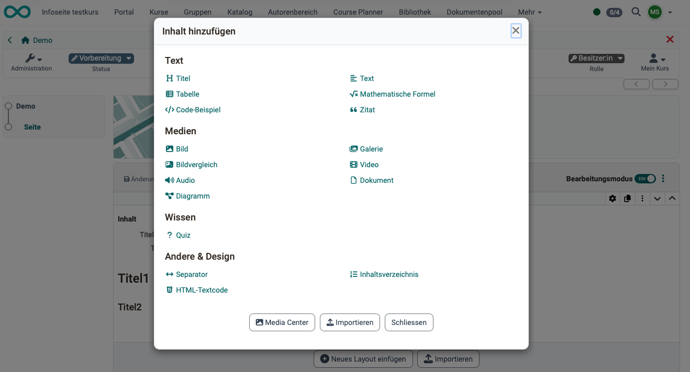{ class="shadow lightbox" title="Dialog Inhalt hinzufügen" }

## Titel {: #title}

Für das Element "Titel" wählen Sie im Inspektor unter "Grösse" eine der vordefinierten Stufen h1 bis h6.

Jeder Titel erhält zusätzlich einen [Anker](Editor_Layout.de.md#anchors). Genutzt wird dieser ausschliesslich vom Element ["Inhaltsverzeichnis"](#table_of_contents), das die Titel auflistet und über ihre Anker verlinkt. Ausserhalb des Inhaltsverzeichnisses lassen sich die Anker nicht ansteuern.

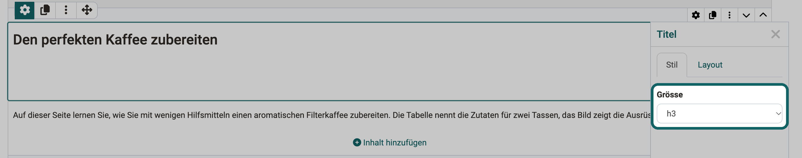{ class="shadow lightbox" title="Inspektor eines Titel-Blocks im Kursbaustein Seite · 2026.11.10" }

## Text {: #text}

Mit dem Element "Text" fügen Sie formatierten Fliesstext ein. Die Formatierungsleiste bietet unter anderem Schriftschnitt, Ausrichtung, Schriftgrösse, Farben, Listen, Links und Formeln. Im Inspektor legen Sie unter "Spalten" fest, in wie vielen Spalten der Text erscheint.

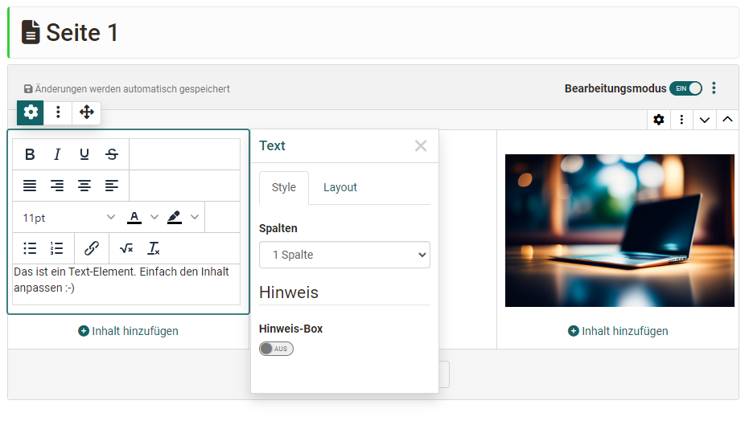{ class="shadow lightbox" title="Formatierungsleiste eines Text-Blocks" }

## Tabelle [:octicons-tag-16:{ title="ab Release 13.0 (OO-3619)" }](https://track.frentix.com/issue/OO-3619){:target="_blank"} {: #table}

Mit dem Element "Tabelle" stellen Sie Inhalte in Zeilen und Spalten dar. Im Inspektor legen Sie unter "Zeile" und "Spalte" die Anzahl Zeilen und Spalten fest und bestimmen, ob die Tabelle eine "Kopfzeile" oder eine "Kopfspalte" hat. Unter "Zeilenstil" wählen Sie die Darstellung der Zeilen. Über und unter der Tabelle können Sie eine Tabellenüberschrift und eine Tabellenunterschrift eintragen.

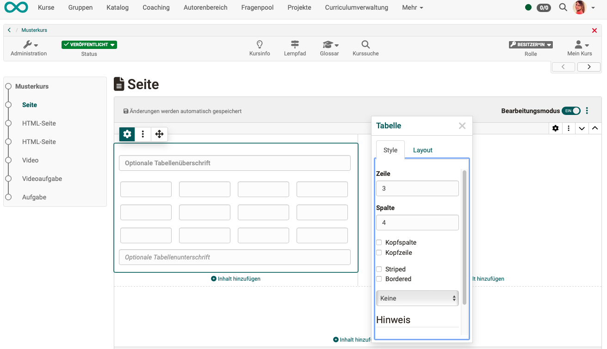{ class="shadow lightbox" title="Inspektor eines Tabellen-Blocks" }

## Mathematische Formel [:octicons-tag-16:{ title="ab Release 16.2.0 (OO-6070)" }](https://track.frentix.com/issue/OO-6070){:target="_blank"} {: #formula}

Für mathematische Formeln steht ein spezieller kleiner Editor zur Verfügung.

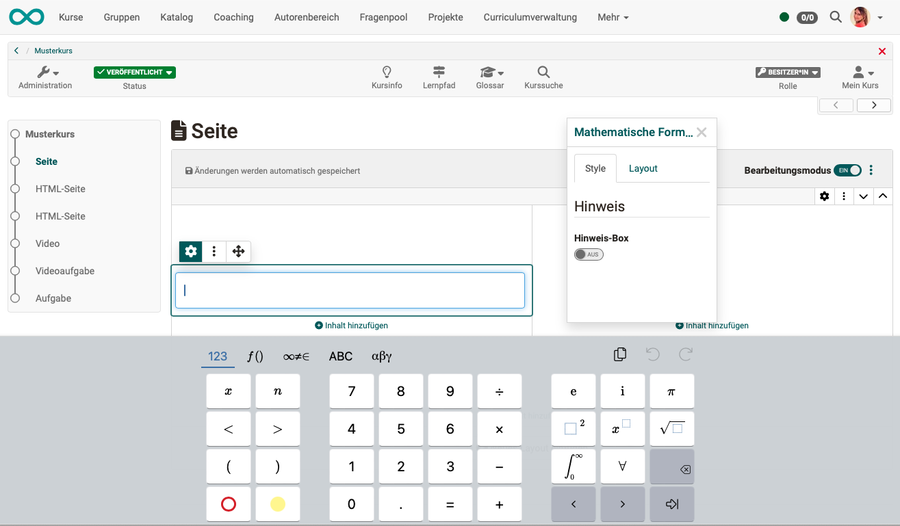{ class="shadow lightbox" title="Formeleditor" }

Dieses Textelement existiert nicht im Formulareditor. 

## Code-Beispiel [:octicons-tag-16:{ title="ab Release 18.2.0 (OO-7140)" }](https://track.frentix.com/issue/OO-7140){:target="_blank"} {: #code}

Der Block "Code-Beispiel" zeigt Text in einer Schrift mit festen Abständen und nummerierten Zeilen. Das hilft bei technischen Lerninhalten wie Programmierbeispielen. Beim Anlegen des Blocks wählen Sie die Programmiersprache. Teilnehmende kopieren den Code direkt in die Zwischenablage, um ihn weiterzuverwenden.

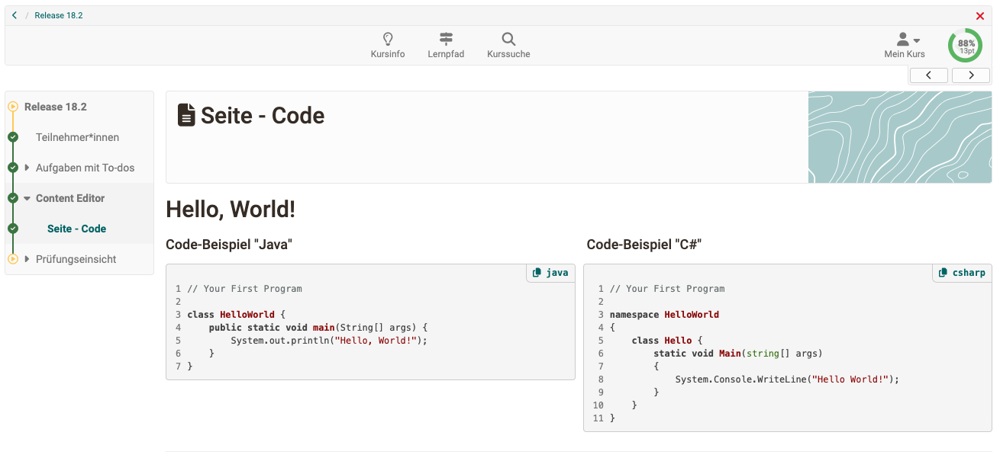{ class="shadow lightbox" title="Code-Beispiele auf einer Seite" }

Dieses Textelement existiert nicht im Formulareditor. 

## Zitat [:octicons-tag-16:{ title="ab Release 11.0 (OO-2300)" }](https://track.frentix.com/issue/OO-2300){:target="_blank"} {: #quote}

Ein Zitat erhält automatisch eine vordefinierte Formatierung. OpenOlat speichert Zitate wie Audios und Videos als wiederverwendbare Objekte im Media Center.

Dieses Textelement existiert nicht im Formulareditor. 

[Zum Seitenanfang ^](#content_types)

---

!!! info "Gruppe Medien"

    Statt der Gruppe "Medien" mit den zugehörigen Inhaltselementen gibt es im [Formulareditor](../../learningresources/Form_Editor/index.de.md) die Gruppen "Fragetypen" und "Organisatorisch" mit entsprechenden Inhaltselementen. 

## Bild [:octicons-tag-16:{ title="ab Release 11.0 (OO-2298)" }](https://track.frentix.com/issue/OO-2298){:target="_blank"} {: #image}

Sie binden jedes Bild aus dem Media Center ein oder laden ein neues hoch. OpenOlat legt neue Bilder automatisch im Media Center ab. Unterstützt werden die Bildformate png, jpg, gif und svg [:octicons-tag-16:{ title="svg ab Release 20.3.0 (OO-9350)" }](https://track.frentix.com/issue/OO-9350){:target="_blank"}.

Ist in der System-Administration im [KI-Modul](../../../manual_admin/administration/External_Tools_AI.de.md) die KI-Funktion "Bildbeschreibungs-Generator" eingeschaltet, ergänzt OpenOlat Titel, Beschreibung, Alternativtext und Tags eines neu hochgeladenen Bildes im Hintergrund mit KI, sofern die KI-Bildbeschreibungen für Sie eingeschaltet sind, siehe [Tab KI-Einstellungen](../../personal_menu/Settings.de.md#tab_ai_settings). Die KI-Funktion liegt unter: `Administration > Externe Werkzeuge > KI-Modul > Tab "KI-Funktionen"`. Mehr dazu: [Metadaten mit KI generieren](../Media_Center_Items.de.md#metadata_ai)

## Galerie [:octicons-tag-16:{ title="ab Release 19.0.0 (OO-7142)" }](https://track.frentix.com/issue/OO-7142){:target="_blank"} {: #gallery}

Das Galerie-Element zeigt mehrere Bilder als Slideshow zum Durchblättern, in einem Raster (Spalten und Zeilen legen Autor:innen fest) oder mit Vorschau (ein Bild gross, die übrigen als verkleinerte Vorschaubilder). Das Erscheinungsbild der Galerie wählen Sie im Inspektor. Die Bilder stammen aus dem Media Center.

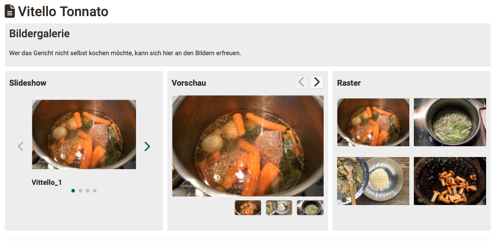{ class="shadow lightbox" title="Galerie in drei Darstellungen" }

## Bildvergleich [:octicons-tag-16:{ title="ab Release 19.0.0 (OO-7143)" }](https://track.frentix.com/issue/OO-7143){:target="_blank"} {: #image_comparison}

Der Bildvergleich legt zwei Bilder übereinander. Ein Schieberegler blendet zwischen ihnen über.

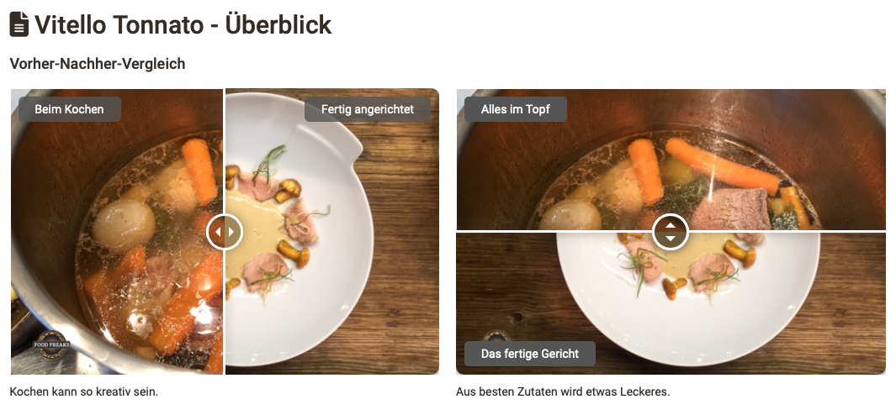{ class="shadow lightbox" title="Bildvergleich auf einer Seite" }

## Audio [:octicons-tag-16:{ title="ab Release 18.1.1 (OO-7366)" }](https://track.frentix.com/issue/OO-7366){:target="_blank"} {: #audio}

Ein Audio nehmen Sie direkt in OpenOlat auf, laden es hoch oder wählen ein vorhandenes Audio aus.

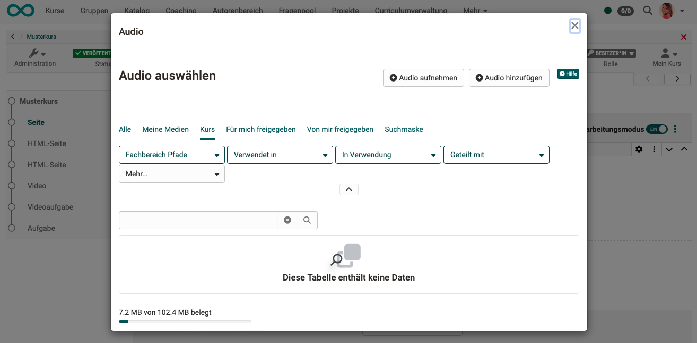{ class="shadow lightbox" title="Dialog Audio auswählen" }

## Video [:octicons-tag-16:{ title="ab Release 18.0 (OO-7001)" }](https://track.frentix.com/issue/OO-7001){:target="_blank"} {: #video}

Im Block "Video" binden Sie Videos auch per URL ein. 
OpenOlat unterstützt die Video-Formate MP4 und m3u8 sowie die Plattformen YouTube, Vimeo, Panopto und nanoo.tv. Neue Videos zeichnen Sie direkt in OpenOlat auf.

## Dokument [:octicons-tag-16:{ title="ab Release 14.0 (OO-3943)" }](https://track.frentix.com/issue/OO-3943){:target="_blank"} {: #document}

Dokumente in verschiedenen Formaten, etwa PDF- oder Word-Dateien, laden Sie per Drag & Drop hoch, wählen sie aus dem Media Center aus oder erstellen sie in bestimmten Formaten direkt. OpenOlat legt die Medien automatisch im Media Center ab.

Über das Inspektor-Menü haben Sie ebenfalls Zugriff auf das Media Center, um den Dokumenten zusätzliche Informationen hinzuzufügen und weitere Freigaben zu definieren. Eine Datei, die zunächst nur für einen Inhaltsblock vorgesehen war, kann dadurch auch anderweitig genutzt oder von anderen OpenOlat-Benutzer:innen bearbeitet werden.

Zusätzlich besteht im Bereich "Share" die Möglichkeit, für neu erstellte oder hochgeladene Dokumente direkt eine Freigabe zu erteilen.

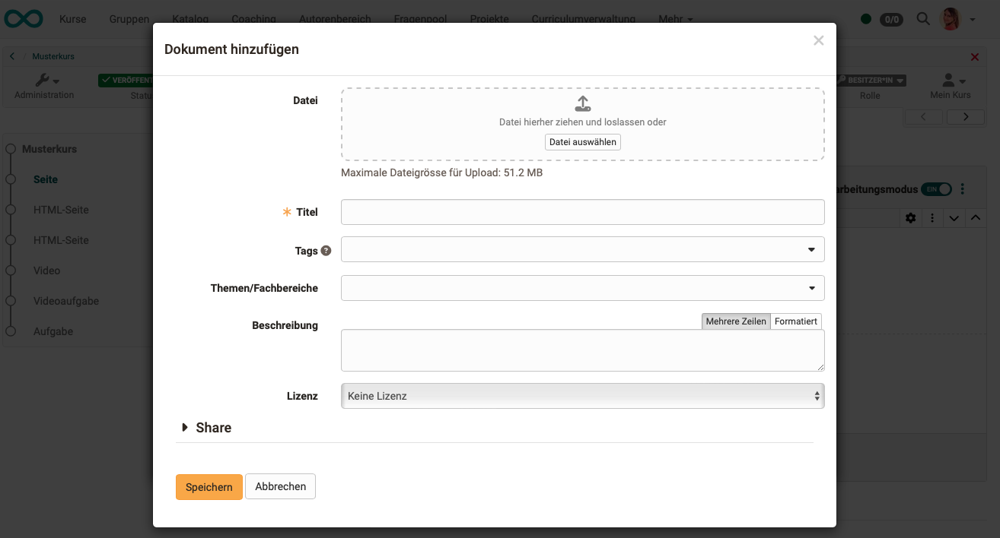{ class="shadow lightbox" title="Dialog Dokument hinzufügen" }

## Diagramm (draw.io) [:octicons-tag-16:{ title="ab Release 18.1.0 (OO-7092)" }](https://track.frentix.com/issue/OO-7092){:target="_blank"} {: #diagram}

Sie laden ein vorhandenes Diagramm aus dem Media Center oder erstellen direkt ein neues mit draw.io. Wenn Sie als Einzelperson die Datei bearbeiten, findet die Bearbeitung auf dem OpenOlat-Server statt, im Kollaborationsmodus auf einem externen Server. 

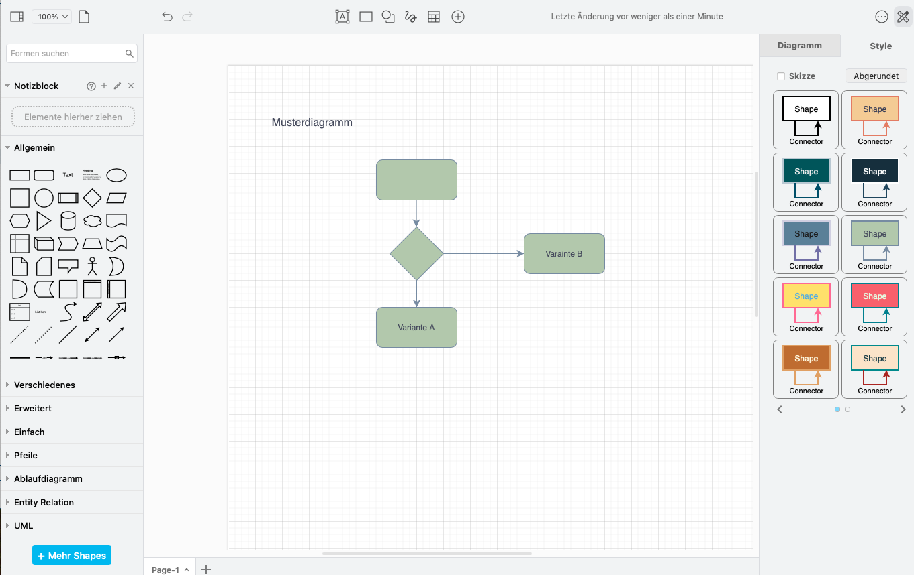{ class="shadow lightbox" title="draw.io Editor" }

[Zum Seitenanfang ^](#content_types)

---

!!! info "Gruppe Wissen"

    Diese Gruppe gibt es nur im Content Editor des Kursbausteins Seite.

## Quiz [:octicons-tag-16:{ title="ab Release 19.0.0 (OO-7145)" }](https://track.frentix.com/issue/OO-7145){:target="_blank"} {: #quiz}

Mit dem Element "Quiz" binden Sie Fragen, die OpenOlat sofort auswertet, in eine Seite ein. Wie Sie Fragen erstellen und Lernenden ein KI-Feedback auf Freitextantworten geben, beschreibt die Seite [Quiz und KI-Feedback](Editor_Quiz.de.md).

[Zum Seitenanfang ^](#content_types)

---

## Separator {: #separator}

Ein Separator ist eine Linie (optisches Gestaltungselement) zur Trennung von Inhalten.

## Inhaltsverzeichnis {: #table_of_contents}

Das Element "Inhaltsverzeichnis" macht lange Seiten übersichtlich: Es listet die Titel der Seite als anklickbare Sprungmarken auf und führt mit einem Klick direkt zum jeweiligen Abschnitt [:octicons-tag-16:{ title="ab Release 21.0 (OO-9411)" }](https://track.frentix.com/issue/OO-9411){:target="_blank"}. Erfasst werden die Titel, die auf der Seite nach dem Inhaltsverzeichnis folgen, bis zum nächsten Titel gleicher oder höherer Stufe. So lässt sich ein Verzeichnis für die ganze Seite oder nur für ein einzelnes Kapitel erstellen. Im Inspektor legen Sie unter "Titelgrössen" fest, welche Titelstufen (H1 bis H5) im Verzeichnis erscheinen; standardmässig sind H1 bis H4 ausgewählt. Wird das Inhaltsverzeichnis als Hinweis-Box dargestellt, dient sein Titel als Titel der Box.

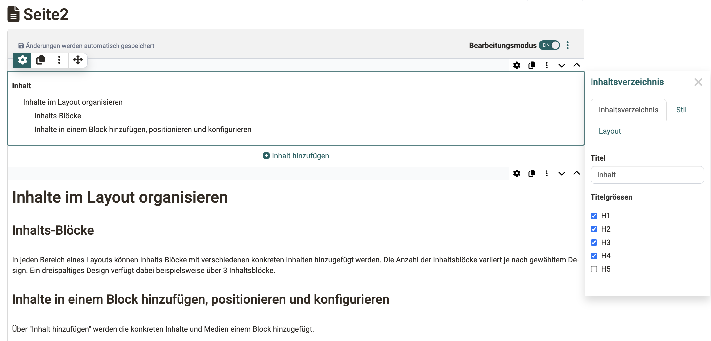{ class="shadow lightbox" title="Inhaltsverzeichnis auf einer Seite" }

Sie fügen das Element über "Inhalt hinzufügen" in der Gruppe "Andere & Design" ein. Beim Einfügen trägt es den Titel "Inhalt", den Sie im Inspektor überschreiben können.

Bleibt das Verzeichnis leer, erscheint der Hinweis "Keine Titel nach dieser Position gefunden". Das Element steht dann unterhalb der Titel, die es auflisten soll, oder die gewählten Titelgrössen passen nicht zu den vorhandenen Titeln. Verschieben Sie es vor die gewünschten Titel oder passen Sie die Titelgrössen im Inspektor an.

Dieses Element existiert nicht im Formulareditor.

## HTML-Textcode {: #html}

Das Element "HTML-Textcode" gibt es nur im Content Editor des Kursbausteins Seite. Es übernimmt ähnliche Funktionen wie das Element "Text" und bietet zusätzlich weitere Menüs und Möglichkeiten.

[Zum Seitenanfang ^](#content_types)

---

## Media Center [:octicons-tag-16:{ title="ab Release 11.0 (OO-2299)" }](https://track.frentix.com/issue/OO-2299){:target="_blank"} {: #media_center}

Im Content Editor des Kursbausteins Seite und des Portfolios führt im Dialog "Inhalt hinzufügen" ein eigener Button "Media Center" zu Ihren Medien. Er ist ein weiterer Weg, unabhängig von der Art des Mediums auf Ihre Dateien zuzugreifen.

Mit Klick auf den Button öffnen Sie die Dateien Ihres Media Centers. Hier wählen Sie Dateien aus, erstellen neue oder laden sie hoch.

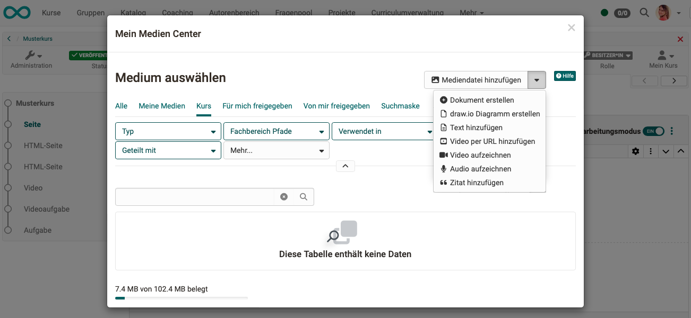{ class="shadow lightbox" title="Menü Mediendatei hinzufügen" }

[Media Center (Persönliche Werkzeuge) >](../../personal_menu/Media_Center.de.md) 
[Ausführliche Informationen zum Media Center (Basiskonzept) >](../Media_Center_Concept/index.de.md)

[Zum Seitenanfang ^](#content_types)

---

## Weiterführende Informationen {: #further_information}

**Auf dieser Seite erwähnt** 
[Content Editor >](index.de.md) 
[Layout >](Editor_Layout.de.md) 
[Der Formulareditor >](../../learningresources/Form_Editor/index.de.md) 
[Externe Werkzeuge: KI-Modul >](../../../manual_admin/administration/External_Tools_AI.de.md) 
[Persönliche Konfiguration: Einstellungen >](../../personal_menu/Settings.de.md) 
[Media Center: Informationen und Einstellungen zu Einzelmedien >](../Media_Center_Items.de.md) 
[Quiz und KI-Feedback >](Editor_Quiz.de.md) 
[Persönliche Werkzeuge: Das Media Center >](../../personal_menu/Media_Center.de.md) 
[Media Center: Konzept >](../Media_Center_Concept/index.de.md)

**Weiterführend** 
[Importieren >](Editor_Import.de.md) 
[Mit Tabellen arbeiten >](../Table_Concept.de.md) 
[Mathematische Formel >](../Math_formula.de.md)

[Zum Seitenanfang ^](#content_types)
