# Add content {: #content_types}

In edit mode, every area of a layout shows the link "Add content". It opens the dialog of the same name, in which you insert texts, images, videos, documents and other content. This page describes the content types by the groups of the dialog, "Text", "Media", "Knowledge" and "Other & design", and the button "Media Center". Where you open the Content Editor and who uses it is described on the page [Content Editor](index.md).

You set the properties of a piece of content in the inspector, the window that opens when you click the content. How you arrange content in the layout and what the inspector offers for all content is described on the page [Layout](Editor_Layout.md#inspector).

Which elements are available depends on where you use the Content Editor.

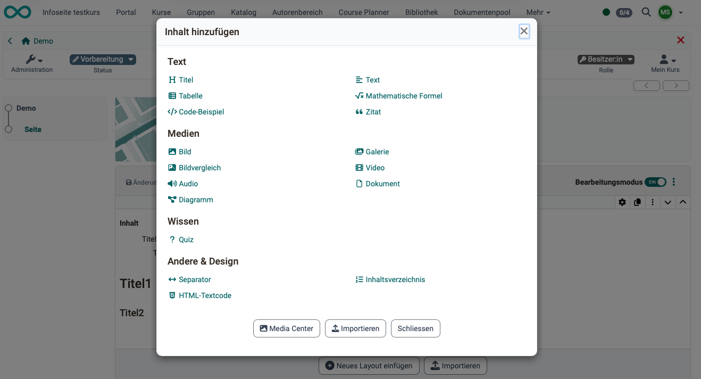{ class="shadow lightbox" title="Add content dialogue" }

## Title {: #title}

For the element "Title" you select one of the predefined levels h1 to h6 under "Size" in the inspector.

Every title additionally receives an [anchor](Editor_Layout.md#anchors). It is used exclusively by the ["Table of contents"](#table_of_contents) element, which lists the titles and links them via their anchors. Outside the table of contents, the anchors cannot be addressed.

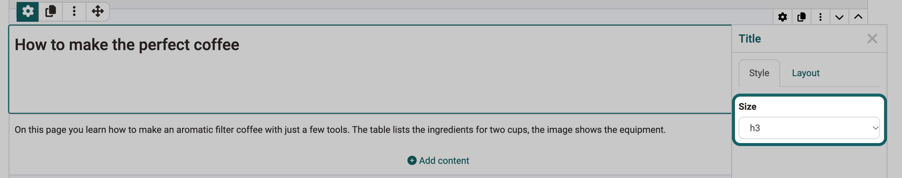{ class="shadow lightbox" title="Inspector of a title block in the course element Page · 2026.11.10" }

## Text {: #text}

With the element "Text" you insert formatted running text. The formatting bar offers, among other things, font style, alignment, font size, colours, lists, links and formulas. In the inspector you define under "Columns" in how many columns the text appears.

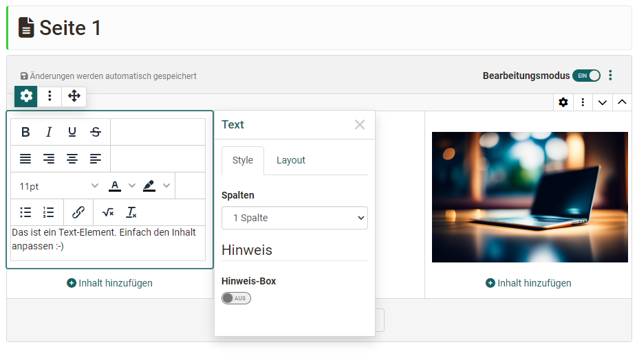{ class="shadow lightbox" title="Formatting bar of a text block" }

## Table [:octicons-tag-16:{ title="from Release 13.0 (OO-3619)" }](https://track.frentix.com/issue/OO-3619){:target="_blank"} {: #table}

With the element "Table" you present content in rows and columns. In the inspector you define the number of rows and columns under "Row" and "Column" and whether the table has a "Row header" or a "Column header". Under "Row style" you choose how the rows are displayed. Above and below the table you can enter a table title and a table caption.

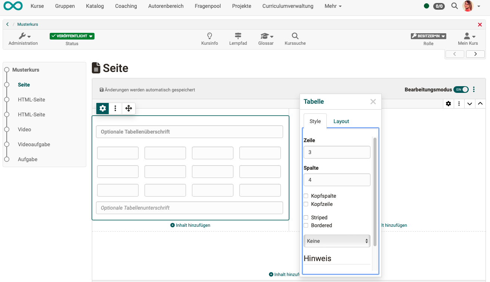{ class="shadow lightbox" title="Inspector of a table block" }

## Math formula [:octicons-tag-16:{ title="from Release 16.2.0 (OO-6070)" }](https://track.frentix.com/issue/OO-6070){:target="_blank"} {: #formula}

A special small editor is available for mathematical formulas.

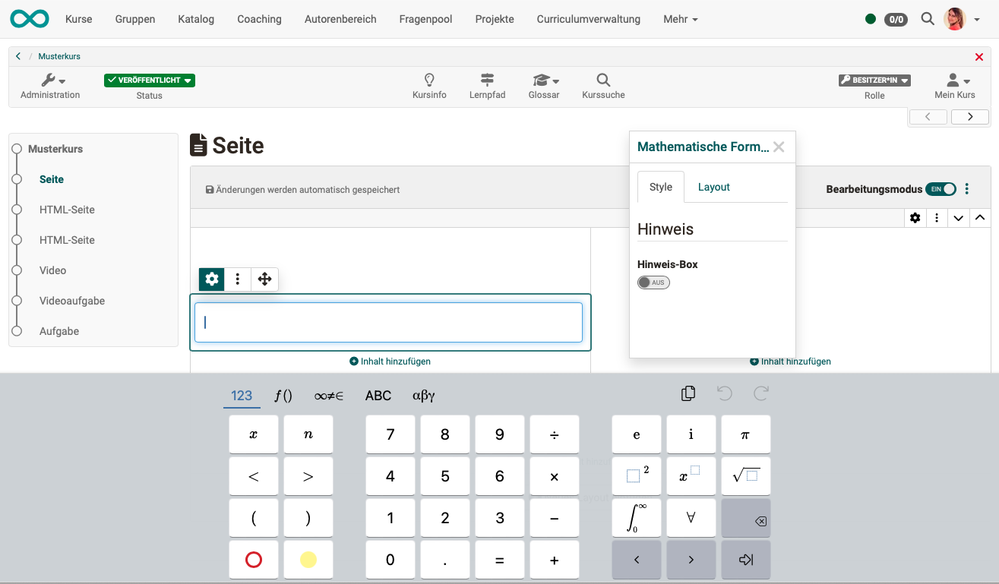{ class="shadow lightbox" title="Formula editor" }

This text element does not exist in the form editor. 

## Code example [:octicons-tag-16:{ title="from Release 18.2.0 (OO-7140)" }](https://track.frentix.com/issue/OO-7140){:target="_blank"} {: #code}

The block "Code example" shows text in a font with fixed spacing and numbered lines. This helps with technical learning content such as programming examples. When creating the block, you select the programming language. Participants copy the code directly to the clipboard to reuse it.

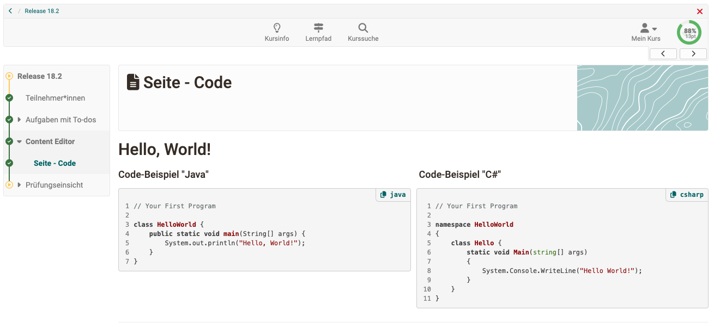{ class="shadow lightbox" title="Code examples on a page" }

This text element does not exist in the form editor. 

## Citation [:octicons-tag-16:{ title="from Release 11.0 (OO-2300)" }](https://track.frentix.com/issue/OO-2300){:target="_blank"} {: #quote}

A citation automatically receives a predefined formatting. OpenOlat saves citations as reusable objects in the Media Center, just like audio and videos.

This text element does not exist in the form editor. 

[To the top of the page ^](#content_types)

---

!!! info "Group Media"

    Instead of the group "Media" and its associated content elements, the [form editor](../../learningresources/Form_Editor/index.md) includes the groups "Question type" and "Organisational" with their corresponding content elements. 

## Image [:octicons-tag-16:{ title="from Release 11.0 (OO-2298)" }](https://track.frentix.com/issue/OO-2298){:target="_blank"} {: #image}

You embed any image from the Media Center or upload a new one. OpenOlat stores new images automatically in the Media Center. The image formats png, jpg, gif and svg are supported [:octicons-tag-16:{ title="svg from Release 20.3.0 (OO-9350)" }](https://track.frentix.com/issue/OO-9350){:target="_blank"}.

If the AI feature "Image Description Generator" is switched on in the [AI module](../../../manual_admin/administration/External_Tools_AI.md) of the system administration, OpenOlat adds title, description, alternative text and tags of a newly uploaded image in the background with AI, provided the AI image descriptions are switched on for you, see [Tab AI settings](../../personal_menu/Settings.md#tab_ai_settings). The AI feature is located under: `Administration > External tools > AI module > Tab "AI features"`. More about this: [Generate metadata with AI](../Media_Center_Items.md#metadata_ai)

## Gallery [:octicons-tag-16:{ title="from Release 19.0.0 (OO-7142)" }](https://track.frentix.com/issue/OO-7142){:target="_blank"} {: #gallery}

The gallery element shows several images as a slideshow to scroll through, in a grid (authors define the columns and rows) or with preview (one image large, the others as reduced preview images). You choose the appearance of the gallery in the inspector. The images come from the Media Center.

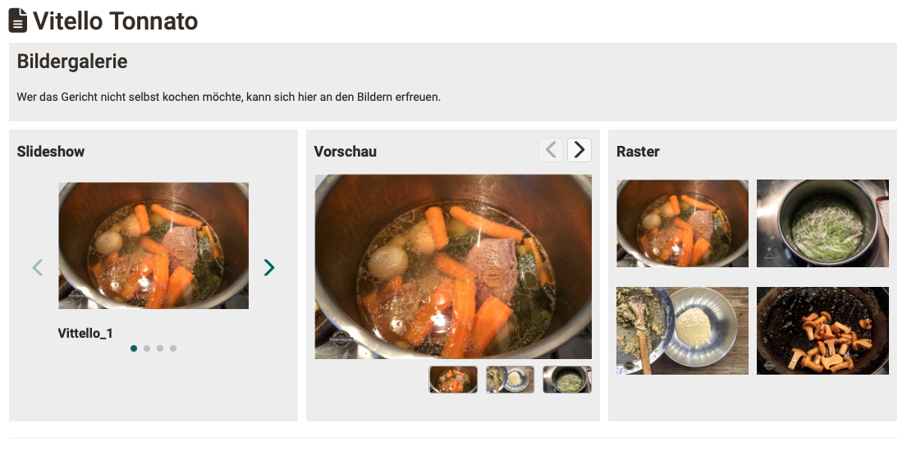{ class="shadow lightbox" title="Gallery in three display modes" }

## Image comparison [:octicons-tag-16:{ title="from Release 19.0.0 (OO-7143)" }](https://track.frentix.com/issue/OO-7143){:target="_blank"} {: #image_comparison}

The image comparison places two images on top of each other. A slider cross-fades between them.

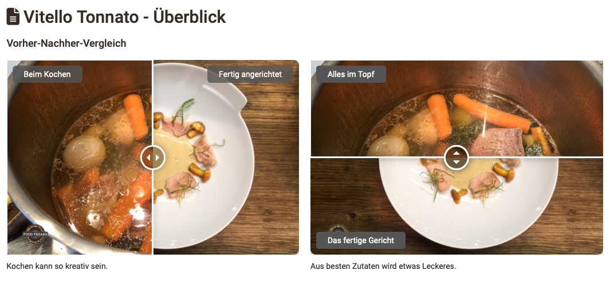{ class="shadow lightbox" title="Image comparison on a page" }

## Audio [:octicons-tag-16:{ title="from Release 18.1.1 (OO-7366)" }](https://track.frentix.com/issue/OO-7366){:target="_blank"} {: #audio}

You record an audio directly in OpenOlat, upload it or select an existing audio.

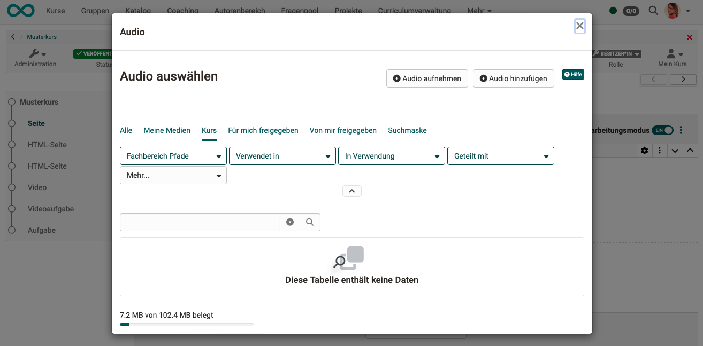{ class="shadow lightbox" title="Select audio dialogue" }

## Video [:octicons-tag-16:{ title="from Release 18.0 (OO-7001)" }](https://track.frentix.com/issue/OO-7001){:target="_blank"} {: #video}

In the block "Video" you also embed videos via URL. 
OpenOlat supports the video formats MP4 and m3u8 as well as the platforms YouTube, Vimeo, Panopto and nanoo.tv. You record new videos directly in OpenOlat.

## Document [:octicons-tag-16:{ title="from Release 14.0 (OO-3943)" }](https://track.frentix.com/issue/OO-3943){:target="_blank"} {: #document}

You upload documents in various formats, for example PDF or Word files, via drag-and-drop, select them from the Media Center or create them directly in specific formats. OpenOlat stores the media automatically in the Media Center.

You can also access the Media Center via the Inspector menu to add additional information to documents and define further sharing options. This allows a file that was initially intended for a single content block to be used for other purposes or edited by other OpenOlat users.

In addition, the "Share" section allows you to share newly created or uploaded documents directly.

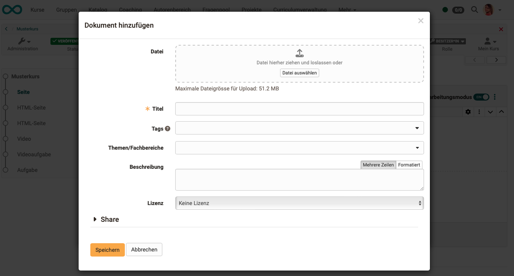{ class="shadow lightbox" title="Add document dialogue" }

## Diagram (draw.io) [:octicons-tag-16:{ title="from Release 18.1.0 (OO-7092)" }](https://track.frentix.com/issue/OO-7092){:target="_blank"} {: #diagram}

You load an existing diagram from the Media Center or create a new one directly with draw.io. If you edit the file as an individual, the editing takes place on the OpenOlat server, in collaboration mode on an external server. 

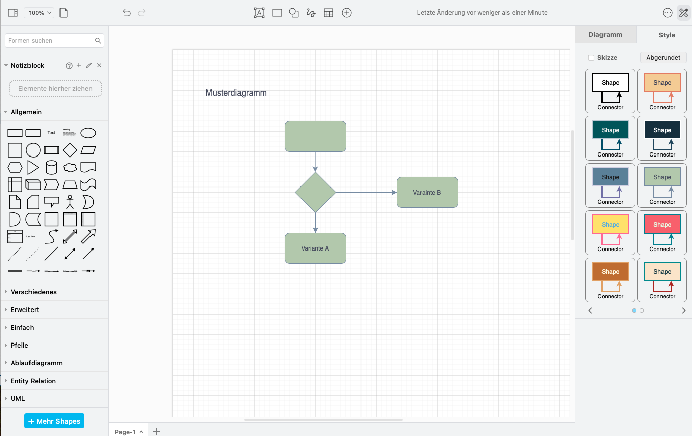{ class="shadow lightbox" title="draw.io editor" }

[To the top of the page ^](#content_types)

---

!!! info "Group Knowledge"

    This group is available only in the Content Editor of the course element "Page".

## Quiz [:octicons-tag-16:{ title="from Release 19.0.0 (OO-7145)" }](https://track.frentix.com/issue/OO-7145){:target="_blank"} {: #quiz}

With the element "Quiz" you embed questions that OpenOlat evaluates immediately into a page. How you create questions and give learners AI feedback on free-text answers is described on the page [Quiz and AI feedback](Editor_Quiz.md).

[To the top of the page ^](#content_types)

---

## Separator {: #separator}

A separator is a line (visual design element) used to separate content.

## Table of contents {: #table_of_contents}

The "Table of contents" element makes long pages easy to navigate: it lists the titles of the page as clickable jump marks and takes you directly to the respective section with one click [:octicons-tag-16:{ title="from Release 21.0 (OO-9411)" }](https://track.frentix.com/issue/OO-9411){:target="_blank"}. It captures the titles that follow the table of contents on the page, up to the next title of the same or a higher level. This allows you to create a table of contents for the whole page or for a single chapter only. In the inspector, "Title sizes" defines which title levels (H1 to H5) appear in the list; H1 to H4 are selected by default. If the table of contents is displayed as an alert box, its title serves as the box title.

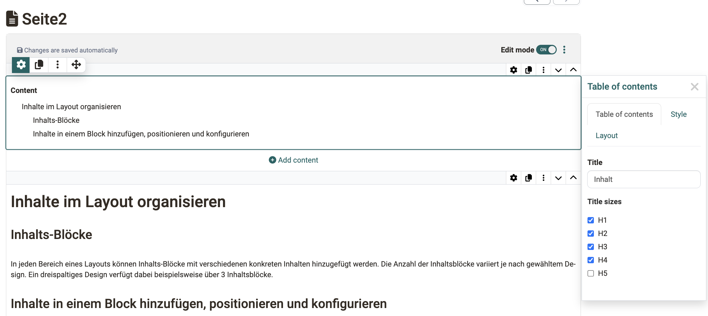{ class="shadow lightbox" title="Table of contents on a page" }

You insert the element via "Add content" in the group "Other & design". When inserted, it carries the title "Contents", which you can overwrite in the Inspector.

If the table of contents stays empty, the hint "No titles found after this position" appears. The element is then placed below the titles it is meant to list, or the selected title sizes do not match the existing titles. Move it before the titles you want, or adjust the title sizes in the Inspector.

This element does not exist in the form editor.

## HTML text code {: #html}

The element "HTML text code" is available only in the Content Editor of the course element Page. It performs similar functions to the element "Text" and offers additional menus and options.

[To the top of the page ^](#content_types)

---

## Media Center [:octicons-tag-16:{ title="from Release 11.0 (OO-2299)" }](https://track.frentix.com/issue/OO-2299){:target="_blank"} {: #media_center}

In the Content Editor of the course element Page and of the portfolio, a separate button "Media Center" in the dialog "Add content" leads to your media. It is an additional way to access your files, regardless of the type of media.

Click the button to open the files in your Media Center. Here, you select files, create new ones or upload them.

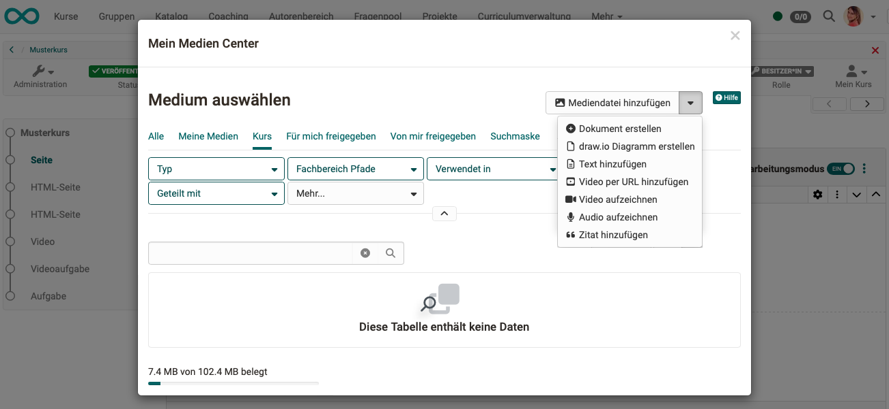{ class="shadow lightbox" title="Add media file menu" }

[Media Center (User tools) >](../../personal_menu/Media_Center.md) 
[Detailed information about the Media Center (Basic concept) >](../Media_Center_Concept/index.md)

[To the top of the page ^](#content_types)

---

## Further information {: #further_information}

**Mentioned on this page** 
[Content Editor >](index.md) 
[Layout >](Editor_Layout.md) 
[The form editor >](../../learningresources/Form_Editor/index.md) 
[External tools: AI module >](../../../manual_admin/administration/External_Tools_AI.md) 
[Personal Configuration: Settings >](../../personal_menu/Settings.md) 
[Information and settings for items in the Media Center >](../Media_Center_Items.md) 
[Quiz and AI feedback >](Editor_Quiz.md) 
[User tools: Media Center >](../../personal_menu/Media_Center.md) 
[Media Center Concept >](../Media_Center_Concept/index.md)

**Further reading** 
[Import >](Editor_Import.md) 
[Working with tables >](../Table_Concept.md) 
[Math formula >](../Math_formula.md)

[To the top of the page ^](#content_types)
