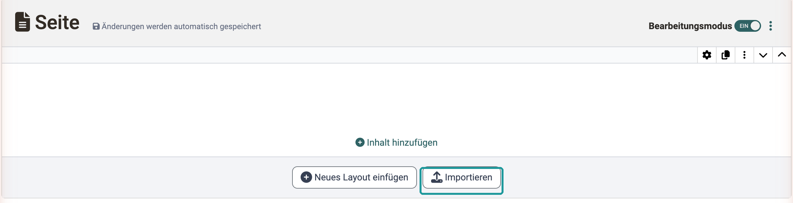
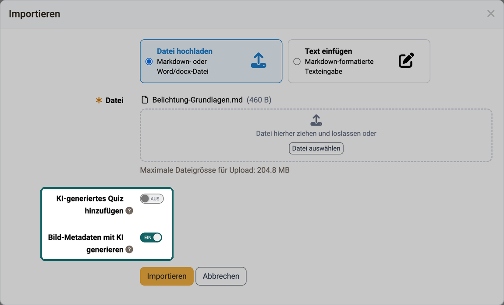
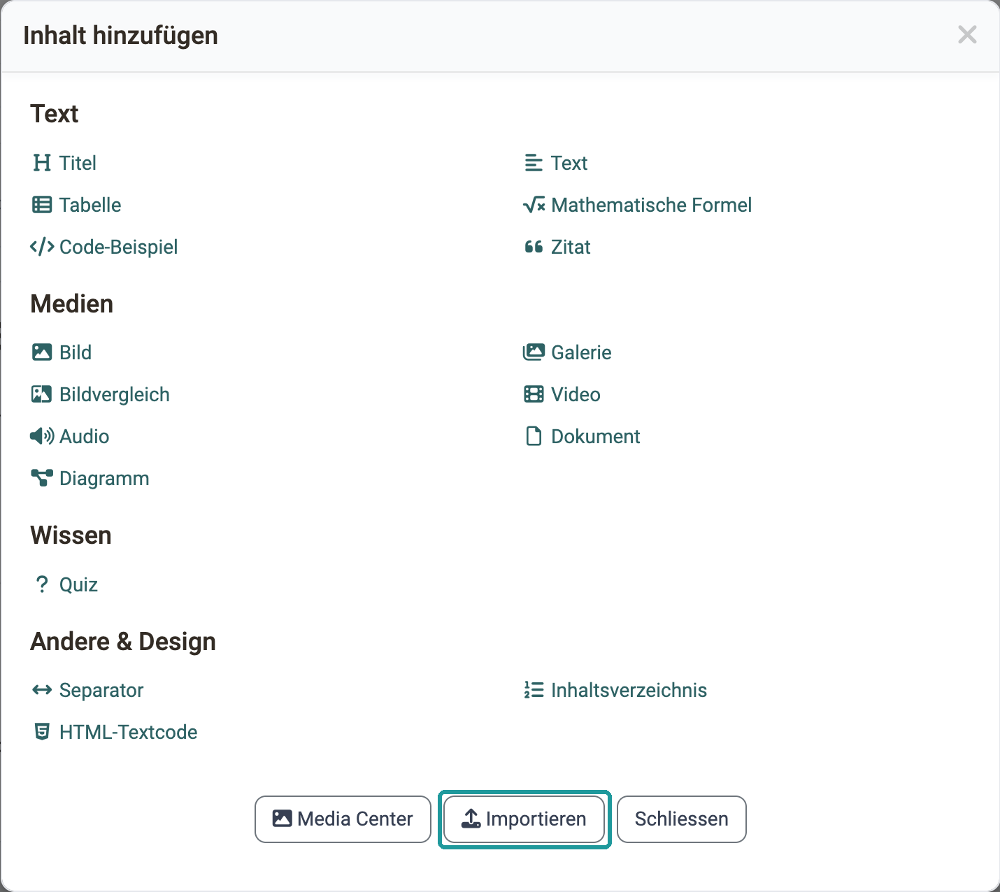
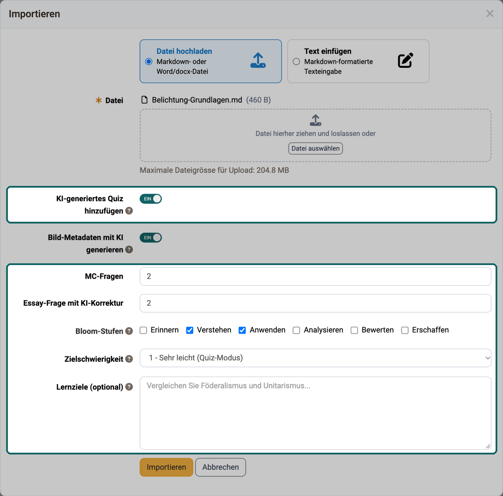

# Importieren [:octicons-tag-16:{ title="ab Release 20.3.0 (OO-9290)" }](https://track.frentix.com/issue/OO-9290){:target="_blank"} {: #markdown}

Markdown-Dateien und Word-Dokumente importieren Sie direkt in den Content Editor. So übernehmen Sie Inhalte aus externen Werkzeugen, Textdateien oder KI-Anwendungen, ohne sie von Hand nachzuformatieren. OpenOlat überführt den Inhalt automatisch in Blöcke der Seite. Ohne Import bauen Sie eine Seite Stück für Stück mit ["Inhalt hinzufügen"](Editor_Add_Content.de.md) auf. Wo Sie den Content Editor öffnen und wer ihn nutzt, beschreibt die Seite [Content Editor](index.de.md).

!!! info "Wichtig"

    Markdown ist ein verbreitetes Textformat, das viele Werkzeuge und KI-Anwendungen ausgeben. Überschriften, Listen und Tabellen sind darin als einfache Zeichen festgehalten, deshalb bleibt die Struktur eines Textes beim Import erhalten.

Klicken Sie zum Import auf den Button "Importieren" am unteren Rand des Content Editors.

{ class="shadow lightbox" title="Button Importieren im Content Editor" }

Im Import-Dialog wählen Sie zwischen zwei Varianten:

{ class="shadow lightbox" title="Dialog Importieren im Content Editor · 2026.10.20" }

**A) Datei hochladen:** Unterstützt werden:

* Markdown-Dateien (.md, .markdown, .txt)
* ZIP-Archive bis maximal 50 MB (Ein ZIP-Archiv muss genau eine Markdown-Datei enthalten und kann zusätzlich die darin relativ referenzierten Bilddateien mitliefern.)
* Word-Dokumente (.docx) bis maximal 200 MB [:octicons-tag-16:{ title="Word-Import ab Release 21.0 (OO-9415)" }](https://track.frentix.com/issue/OO-9415){:target="_blank"}.

**B) Text einfügen:** Sie fügen Markdown-formatierten Text direkt in das Eingabefeld ein, etwa aus der Zwischenablage. Lokale Bildpfade unterstützt dieser Modus nicht.

Darunter stehen, je nach Konfiguration des KI-Moduls, die Schalter "KI-generiertes Quiz hinzufügen" und "Bild-Metadaten mit KI generieren". Was sie bewirken, beschreiben die Abschnitte [KI-Fragen beim Import erzeugen](#import_ai_quiz) und [Bilder beim Import](#import_images).

!!! info "Word-Dokumente importieren"
    OpenOlat wandelt Word-Dokumente beim Import automatisch in Markdown um. Danach durchlaufen sie dieselbe Verarbeitung wie Markdown-Dateien. Formatierungen wie hochgestellter, tiefgestellter, unterstrichener und hervorgehobener Text bleiben dabei ebenso erhalten wie Tabellen und eingebettete Bilder. Beim Hochladen einer .docx-Datei zeigt OpenOlat einen Hinweis an, da nicht alle Word-Funktionen übernommen werden können. Prüfen Sie die importierten Inhalte deshalb sorgfältig.

## Umwandlung der Elemente {: #import_conversion}

Beim Import wandelt OpenOlat die Markdown-Elemente so in Blöcke des Content Editors um:

| Markdown-Element | Block im Content Editor |
|------------------|-------------------------|
| Überschrift (Ebene 1 bis 6, `#` bis `######`) | [Titel](Editor_Add_Content.de.md#title) in der entsprechenden Grösse (H1 bis H6) |
| Absatz | [Text](Editor_Add_Content.de.md#text) |
| Trennlinie (`---`) | [Separator](Editor_Add_Content.de.md#separator) |
| Codeblock | [Code-Beispiel](Editor_Add_Content.de.md#code) (mit erkannter Programmiersprache) |
| Blockzitat `>` | Text mit [Hinweis-Box](Editor_Layout.de.md#alert_box) |
| GitHub-Admonition (z.B. `> [!WARNING]`) | Text mit Hinweis-Box des passenden Typs |
| Liste (Aufzählung oder nummeriert) | Text mit Liste |
| Tabelle | [Tabelle](Editor_Add_Content.de.md#table) |
| Bild | [Bild](Editor_Add_Content.de.md#image) (Ablage im [Media Center](Editor_Add_Content.de.md#media_center)) |
| Mathematischer Block (`$$...$$`) | [Mathematische Formel](Editor_Add_Content.de.md#formula) |
| Inline-Formatierung ``, ``, `<u>`, `<mark>` oder `==Text==` | Text mit erhaltener Formatierung [:octicons-tag-16:{ title="ab Release 21.0 (OO-9400)" }](https://track.frentix.com/issue/OO-9400){:target="_blank"} |
| Bildgrösse `{width=300 height=200}` direkt nach dem Bild | Bild in der angegebenen Anzeigegrösse |
| Tabelle mit fetter erster Zeile bzw. erster Spalte | Tabelle mit Zeilen- bzw. Spaltenüberschrift |
| MkDocs-Admonition `!!! info "Titel"` | Text mit Hinweis-Box des passenden Typs |
| YAML-Metadatenblock am Dokumentanfang, durch `---` eingefasst | Wird erkannt und entfernt, die Seite beginnt direkt mit dem Inhalt [:octicons-tag-16:{ title="ab Release 21.0 (OO-9402)" }](https://track.frentix.com/issue/OO-9402){:target="_blank"} |

Die Titelgrösse steuert zugleich, welche importierten Titel das Element ["Inhaltsverzeichnis"](Editor_Add_Content.de.md#table_of_contents) erfasst und als Sprungmarken verlinkt.

!!! note "Markdown-Erweiterungen"
    Zusätzlich werden die Markdown-Erweiterungen für durchgestrichenen Text, Task-Listen und Fussnoten unterstützt. GitHub-Admonitions der Typen NOTE, TIP, IMPORTANT, WARNING, CAUTION, INFO, SUCCESS und ERROR erhalten eine Hinweis-Box mit passendem Typ und Icon; bei MkDocs-Admonitions kommen weitere Typen wie ABSTRACT, HINT, QUESTION, ATTENTION, DANGER, BUG oder EXAMPLE hinzu. Ein Admonition-Titel in Anführungszeichen wird übernommen, ein leerer Titel `""` blendet die Titelzeile aus, ohne Titelangabe erscheint die Standardbezeichnung des Typs. HTML-Blöcke übernimmt der Import aus Sicherheitsgründen nicht; er schliesst mit einer entsprechenden Warnung ab.

## Bilder beim Import {: #import_images}

Bilder legt OpenOlat beim Import direkt im [Media Center](Editor_Add_Content.de.md#media_center) ab. Eine Duplikatsprüfung verhindert, dass dasselbe Bild mehrfach im Media Center landet, ohne dass Sie als Autor:in etwas tun müssen.

Bilder mit absoluten URLs lädt OpenOlat beim Import herunter. Steht in der System-Administration unter `Administration > Login > Sicherheit > Tab "Medien-Server"` der Modus auf "Konfigurieren", gilt das nur für die dort freigegebenen Domänen. Ein Bild einer anderen Domäne lädt der Import nicht und meldet es als Warnung, siehe [Tab Medien-Server](../../../manual_admin/administration/Login_Security.de.md#tab_mediaserver). Auch direkt im Markdown eingebettete Base64-Bilder (Data-URIs) werden übernommen.

Ist in der System-Administration im [KI-Modul](../../../manual_admin/administration/External_Tools_AI.de.md) die KI-Funktion "Bildbeschreibungs-Generator" eingeschaltet, steht im Import-Dialog der Schalter "Bild-Metadaten mit KI generieren". Ist er eingeschaltet, erzeugt OpenOlat für die importierten Bilder Titel, Beschreibung, Alternativtext und Tags im Hintergrund mit KI [:octicons-tag-16:{ title="ab Release 20.3.0 (OO-9356)" }](https://track.frentix.com/issue/OO-9356){:target="_blank"}. Dabei überträgt OpenOlat eine verkleinerte Version jedes Bildes an den KI-Dienst. Ist er ausgeschaltet, erzeugt OpenOlat keine Metadaten mit KI. Die KI-Funktion liegt unter: `Administration > Externe Werkzeuge > KI-Modul > Tab "KI-Funktionen"`.

Beim Öffnen des Dialogs steht der Schalter so, wie die KI-Bildbeschreibungen für Sie eingestellt sind: nach Ihrer Wahl im [Tab KI-Einstellungen](../../personal_menu/Settings.de.md#tab_ai_settings), ohne eigene Wahl nach der Vorgabe der Administration. Sie können ihn für jeden Import einzeln umstellen. Die Umstellung gilt nur für diesen Import, OpenOlat speichert sie nicht. 
[Details zu Metadaten mit KI >](../Media_Center_Items.de.md#metadata_ai)

## Import an einer bestimmten Position {: #import_position}

Der Button "Importieren" steht zusätzlich im Dialog "Inhalt hinzufügen" zur Verfügung [:octicons-tag-16:{ title="ab Release 21.0 (OO-9423)" }](https://track.frentix.com/issue/OO-9423){:target="_blank"}. Über diesen Dialog fügt der Import den Inhalt genau dort ein, wo Sie gerade arbeiten: im jeweiligen Bereich des Layouts oder vor oder nach dem Inhaltselement, über das Sie den Dialog geöffnet haben. Über den Button am unteren Rand des Content Editors landen die Inhalte am Seitenende.

{ class="shadow lightbox" title="Dialog Inhalt hinzufügen" }

## KI-Fragen beim Import erzeugen [:octicons-tag-16:{ title="ab Release 21.0 (OO-9497)" }](https://track.frentix.com/issue/OO-9497){:target="_blank"} {: #import_ai_quiz}

Ist in der System-Administration im [KI-Modul](../../../manual_admin/administration/External_Tools_AI.de.md) die KI-Funktion "Essay Fragen Generator" konfiguriert, steht im Import-Dialog zusätzlich der Schalter "KI-generiertes Quiz hinzufügen". Beim Öffnen des Dialogs ist er eingeschaltet. Die KI erzeugt die Fragen dann aus dem importierten Text, dem Lerntext: dem Text, den Ihre Lernenden durcharbeiten. OpenOlat fügt die Fragen als [Quiz-Element](Editor_Quiz.de.md#quiz) direkt nach dem importierten Inhalt ein. Möchten Sie keine Fragen erzeugen lassen, schalten Sie ihn vor dem Import aus. Über die Felder "MC-Fragen" und "Essay-Frage mit KI-Korrektur" legen Sie fest, wie viele Fragen je Typ erzeugt werden (bis zu fünf pro Typ). Die Multiple-Choice-Fragen entstehen nur, wenn zusätzlich die KI-Funktion "MC Fragen Generator" konfiguriert ist. Das KI-Feedback zu den Freitextfragen liefert die KI-Funktion "Essay Bewertung". Alle drei KI-Funktionen liegen unter: `Administration > Externe Werkzeuge > KI-Modul > Tab "KI-Funktionen"`.

Drei weitere Felder steuern, welche Fragen entstehen. Unter "Bloom-Stufen" wählen Sie, welche kognitiven Stufen die Fragen abdecken sollen: "Erinnern", "Verstehen", "Anwenden", "Analysieren", "Bewerten" und "Erschaffen". Die "Zielschwierigkeit" reicht von "1 - Sehr leicht (Quiz-Modus)" bis "5 - Sehr schwer"; mit "Keine Präferenz" wählt OpenOlat die Schwierigkeit je Frage zufällig. Im Feld "Lernziele (optional)" erfassen Sie ein Lernziel pro Zeile, um die Fragen inhaltlich zu fokussieren.

{ class="shadow lightbox" title="Dialog Importieren mit KI-generiertem Quiz · 2026.10.20" }

Wie lang der importierte Lerntext für die Fragengenerierung sein darf, gibt die System-Administration im [KI-Modul](../../../manual_admin/administration/External_Tools_AI.de.md#ai_function_limits) vor, standardmässig 60000 Zeichen. Sind "MC Fragen Generator" und "Essay Fragen Generator" beide aktiv, gilt der kleinere der beiden Werte. Einen längeren Text weist der Dialog zurück.

Die Generierung läuft im Hintergrund und kann eine Minute dauern. Bis dahin steht an der Stelle ein Quiz-Element mit dem Titel "Bitte warten, Quiz Fragen werden per KI erzeugt.", danach erscheinen darin die Fragen. Prüfen Sie die erzeugten Fragen anschliessend auf inhaltliche Korrektheit. Im E-Portfolio steht die KI-Fragengenerierung nicht zur Verfügung.

[Zum Seitenanfang ^](#markdown)

---

## Weiterführende Informationen {: #further_information}

**Auf dieser Seite erwähnt** 
[Inhalt hinzufügen >](Editor_Add_Content.de.md) 
[Content Editor >](index.de.md) 
[Layout >](Editor_Layout.de.md) 
[Sicherheit >](../../../manual_admin/administration/Login_Security.de.md) 
[Externe Werkzeuge: KI-Modul >](../../../manual_admin/administration/External_Tools_AI.de.md) 
[Persönliche Konfiguration: Einstellungen >](../../personal_menu/Settings.de.md) 
[Media Center: Informationen und Einstellungen zu Einzelmedien >](../Media_Center_Items.de.md) 
[Quiz und KI-Feedback >](Editor_Quiz.de.md)

**Weiterführend** 
[Media Center: Konzept >](../Media_Center_Concept/index.de.md)

[Zum Seitenanfang ^](#markdown)
