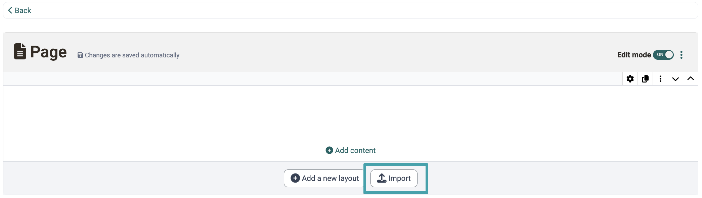
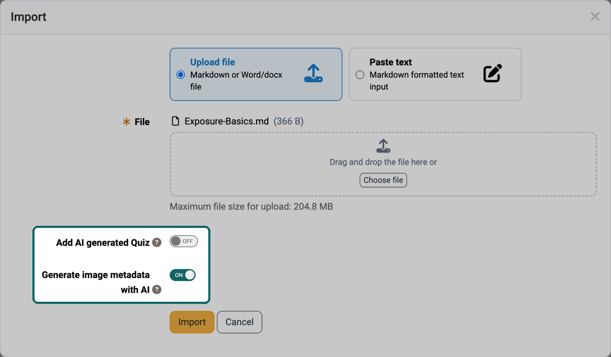
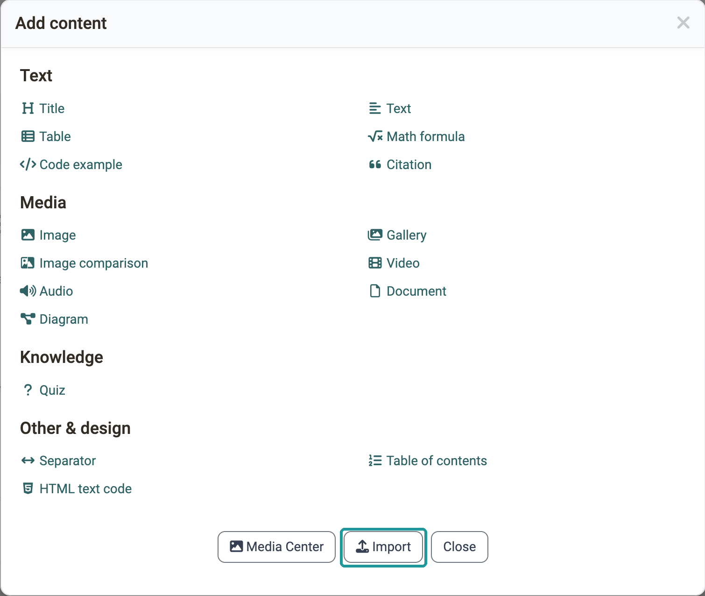
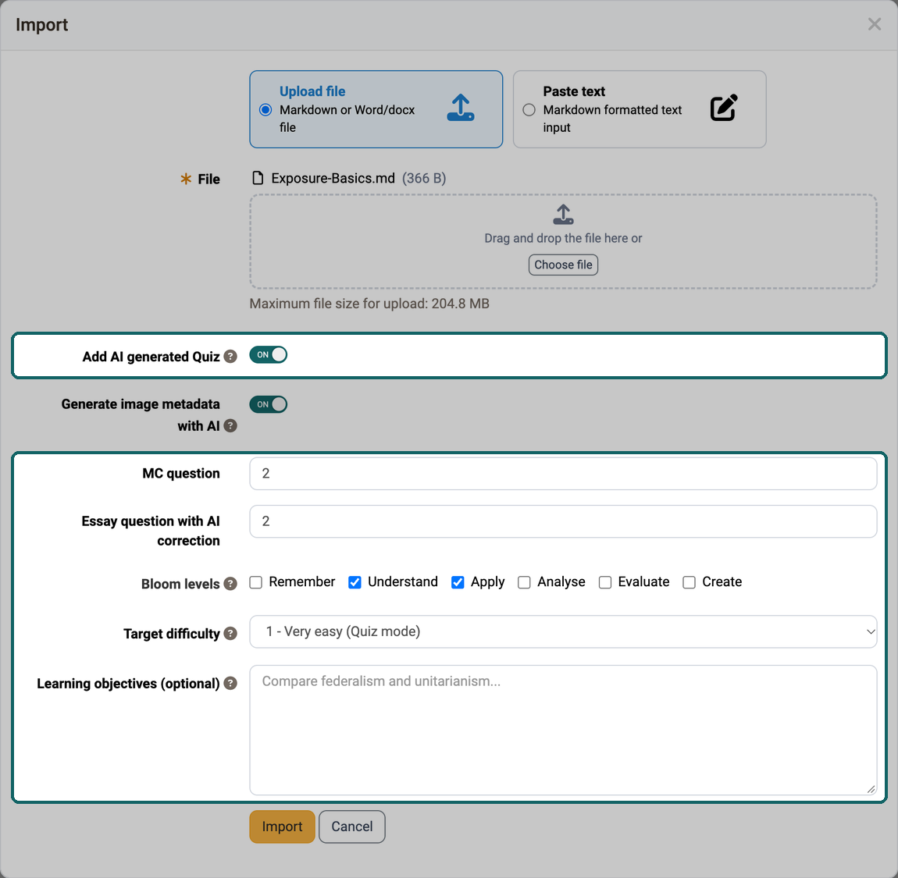

# Import [:octicons-tag-16:{ title="from Release 20.3.0 (OO-9290)" }](https://track.frentix.com/issue/OO-9290){:target="_blank"} {: #markdown}

You import Markdown files and Word documents directly into the Content Editor. This way you take over content from external tools, text files or AI applications without reformatting it by hand. OpenOlat automatically converts the content into blocks of the page. Without importing, you build up a page piece by piece with ["Add content"](Editor_Add_Content.md). Where you open the Content Editor and who uses it is described on the page [Content Editor](index.md).

!!! info "Important"

    Markdown is a widely used text format that many tools and AI applications output. Headings, lists and tables are recorded in it as simple characters, so the structure of a text is preserved during import.

To import, click the button "Import" at the bottom of the Content Editor.

{ class="shadow lightbox" title="Import button in the Content Editor" }

In the import dialogue you choose between two options:

{ class="shadow lightbox" title="Import dialogue in the Content Editor · 2026.10.20" }

**A) Upload file:** The following are supported:

* Markdown files (.md, .markdown, .txt)
* ZIP archives up to a maximum of 50 MB (A ZIP archive must contain exactly one markdown file and can additionally include the image files referenced relatively within it.)
* Word documents (.docx) up to a maximum of 200 MB [:octicons-tag-16:{ title="Word import from Release 21.0 (OO-9415)" }](https://track.frentix.com/issue/OO-9415){:target="_blank"}.

**B) Paste text:** You paste Markdown-formatted text directly into the input field, for example from the clipboard. This mode does not support local image paths.

Below, depending on the configuration of the AI module, the switches "Add AI generated Quiz" and "Generate image metadata with AI" appear. What they do is described in the sections [Generate AI questions on import](#import_ai_quiz) and [Images during import](#import_images).

!!! info "Importing Word documents"
    OpenOlat automatically converts Word documents to Markdown during import. After that, they are processed in the same way as Markdown files. Formatting such as superscript, subscript, underlined and highlighted text is preserved, as are tables and embedded images. When uploading a .docx file, OpenOlat displays a notice because not all Word features can be imported. Therefore, please review the imported content carefully.

## Conversion of the elements {: #import_conversion}

During import, OpenOlat converts the markdown elements into blocks of the Content Editor as follows:

| Markdown element | Block in the Content Editor |
|------------------|-----------------------------|
| Heading (level 1 to 6, `#` to `######`) | [Title](Editor_Add_Content.md#title) in the corresponding size (H1 to H6) |
| Paragraph | [Text](Editor_Add_Content.md#text) |
| Horizontal rule (`---`) | [Separator](Editor_Add_Content.md#separator) |
| Code block | [Code example](Editor_Add_Content.md#code) (with detected programming language) |
| Blockquote `>` | Text with [alert box](Editor_Layout.md#alert_box) |
| GitHub admonition (e.g. `> [!WARNING]`) | Text with alert box of the matching type |
| List (bulleted or numbered) | Text with list |
| Table | [Table](Editor_Add_Content.md#table) |
| Image | [Image](Editor_Add_Content.md#image) (stored in the [Media Center](Editor_Add_Content.md#media_center)) |
| Math block (`$$...$$`) | [Math formula](Editor_Add_Content.md#formula) |
| Inline formatting ``, ``, `<u>`, `<mark>` or `==text==` | Text with preserved formatting [:octicons-tag-16:{ title="from Release 21.0 (OO-9400)" }](https://track.frentix.com/issue/OO-9400){:target="_blank"} |
| Image size `{width=300 height=200}` directly after the image | Image in the specified display size |
| Table with bold first row or first column | Table with row or column headers |
| MkDocs admonition `!!! info "Title"` | Text with alert box of the matching type |
| YAML front matter block at the top of the document, enclosed in `---` | Detected and removed, the page starts directly with the content [:octicons-tag-16:{ title="from Release 21.0 (OO-9402)" }](https://track.frentix.com/issue/OO-9402){:target="_blank"} |

The title size also determines which imported titles the ["Table of contents"](Editor_Add_Content.md#table_of_contents) element captures and links as jump marks.

!!! note "Markdown extensions"
    In addition, the markdown extensions for strikethrough text, task lists and footnotes are supported. GitHub admonitions of the types NOTE, TIP, IMPORTANT, WARNING, CAUTION, INFO, SUCCESS and ERROR receive an alert box with the matching type and icon; MkDocs admonitions add further types such as ABSTRACT, HINT, QUESTION, ATTENTION, DANGER, BUG or EXAMPLE. An admonition title in quotation marks is applied, an empty title `""` hides the title line, and without a title the default label of the type is shown. The import does not take over HTML blocks for security reasons; it finishes with a corresponding warning.

## Images during import {: #import_images}

During import, OpenOlat stores images directly in the [Media Center](Editor_Add_Content.md#media_center). A duplicate check prevents the same image from being stored in the Media Center several times, without you as an author having to do anything.

OpenOlat downloads images with absolute URLs during import. If the mode under `Administration > Login > Security > Tab "Media server"` in the system administration is set to "Configure", this only applies to the domains enabled there. The import does not download an image from another domain and reports it as a warning, see [Tab Media server](../../../manual_admin/administration/Login_Security.md#tab_mediaserver). Base64 images embedded directly in the markdown (data URIs) are also imported.

If the AI feature "Image Description Generator" is switched on in the [AI module](../../../manual_admin/administration/External_Tools_AI.md) of the system administration, the import dialog shows the switch "Generate image metadata with AI". If it is switched on, OpenOlat generates title, description, alternative text and tags for the imported images in the background with AI [:octicons-tag-16:{ title="from Release 20.3.0 (OO-9356)" }](https://track.frentix.com/issue/OO-9356){:target="_blank"}. OpenOlat transmits a reduced version of each image to the AI service. If it is switched off, OpenOlat does not generate metadata with AI. The AI feature is located under: `Administration > External tools > AI module > Tab "AI features"`.

When the dialog opens, the switch is set the way the AI image descriptions are set for you: according to your choice in the [Tab AI settings](../../personal_menu/Settings.md#tab_ai_settings), without a choice of your own according to the default of the administration. You can change it for each import individually. The change only applies to this import, OpenOlat does not store it. 
[Details on metadata with AI >](../Media_Center_Items.md#metadata_ai)

## Importing at a specific position {: #import_position}

The "Import" button is additionally available in the dialog "Add content" [:octicons-tag-16:{ title="from Release 21.0 (OO-9423)" }](https://track.frentix.com/issue/OO-9423){:target="_blank"}. Via this dialog, the import inserts the content exactly where you are working: in the respective area of the layout, or before or after the content element from which you opened the dialog. Via the button at the bottom of the Content Editor, the content ends up at the end of the page.

{ class="shadow lightbox" title="Add content dialogue" }

## Generate AI questions on import [:octicons-tag-16:{ title="from Release 21.0 (OO-9497)" }](https://track.frentix.com/issue/OO-9497){:target="_blank"} {: #import_ai_quiz}

If the AI feature "Essay Question Generator" is configured in the [AI module](../../../manual_admin/administration/External_Tools_AI.md) of the system administration, the import dialog additionally shows the switch "Add AI generated Quiz". It is switched on when the dialog opens. The AI then generates the questions from the imported text, the source text: the text your learners work through. OpenOlat inserts the questions as a [quiz element](Editor_Quiz.md#quiz) directly after the imported content. If you do not want questions to be generated, switch it off before the import. Via the "MC question" and "Essay question with AI correction" fields you define how many questions of each type are generated (up to five per type). The multiple-choice questions are only created if the AI feature "MC Question Generator" is configured as well. The AI feedback on the essay questions comes from the AI feature "Essay Grading". All three AI features are located under: `Administration > External tools > AI module > Tab "AI features"`.

Three further fields steer which questions are created. Under "Bloom levels" you choose which cognitive levels the questions should cover: "Remember", "Understand", "Apply", "Analyse", "Evaluate" and "Create". The "Target difficulty" ranges from "1 - Very easy (Quiz mode)" to "5 - Very hard"; with "No preference" OpenOlat chooses the difficulty at random per question. In the "Learning objectives (optional)" field you enter one learning objective per line to focus the questions in terms of content.

{ class="shadow lightbox" title="Import dialogue with AI generated quiz · 2026.10.20" }

How long the imported source text for question generation may be is set by the system administration in the [AI module](../../../manual_admin/administration/External_Tools_AI.md#ai_function_limits), 60000 characters by default. If "MC Question Generator" and "Essay Question Generator" are both active, the smaller of the two values applies. The dialog rejects a longer text.

Generation runs in the background and can take a minute. Until then, a quiz element with the title "Please wait, quiz questions are being generated by AI." stands at this position; after that, the questions appear in it. Check the generated questions for correctness afterwards. AI question generation is not available in the e-portfolio.

[To the top of the page ^](#markdown)

---

## Further information {: #further_information}

**Mentioned on this page** 
[Add content >](Editor_Add_Content.md) 
[Content Editor >](index.md) 
[Layout >](Editor_Layout.md) 
[Security >](../../../manual_admin/administration/Login_Security.md) 
[External tools: AI module >](../../../manual_admin/administration/External_Tools_AI.md) 
[Personal Configuration: Settings >](../../personal_menu/Settings.md) 
[Information and settings for items in the Media Center >](../Media_Center_Items.md) 
[Quiz and AI feedback >](Editor_Quiz.md)

**Further reading** 
[Media Center Concept >](../Media_Center_Concept/index.md)

[To the top of the page ^](#markdown)
