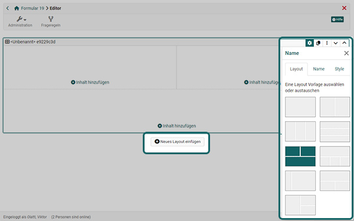
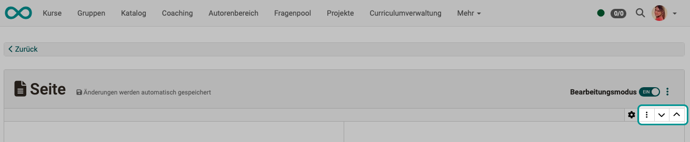
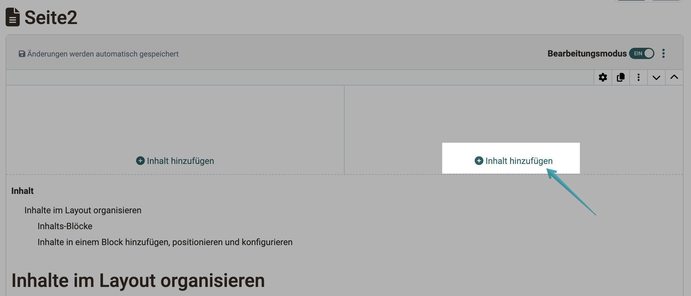
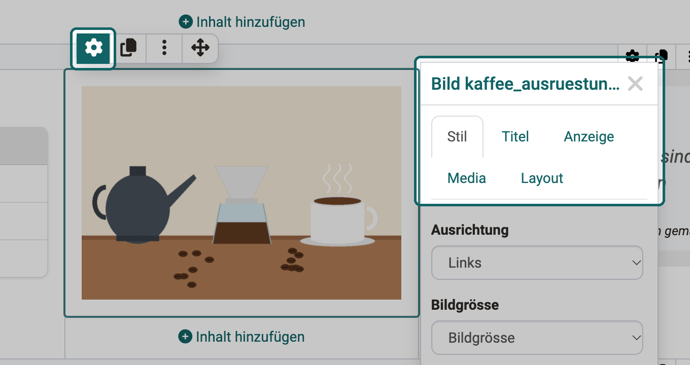
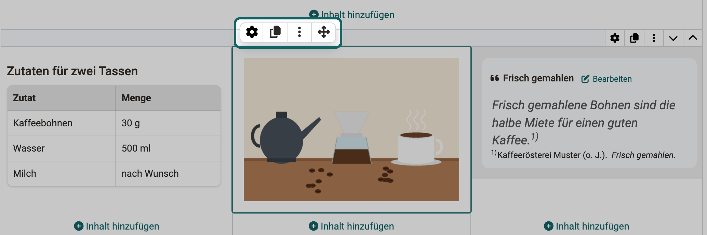
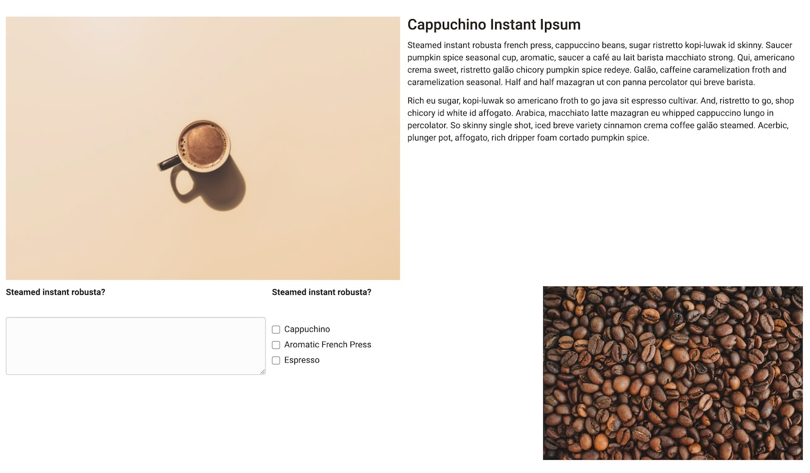
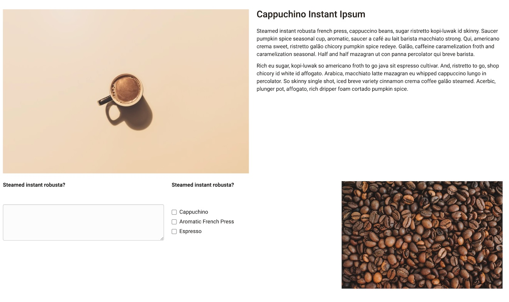
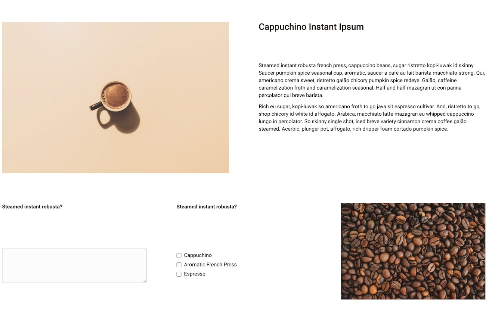
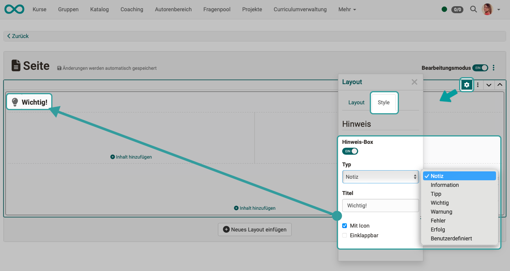
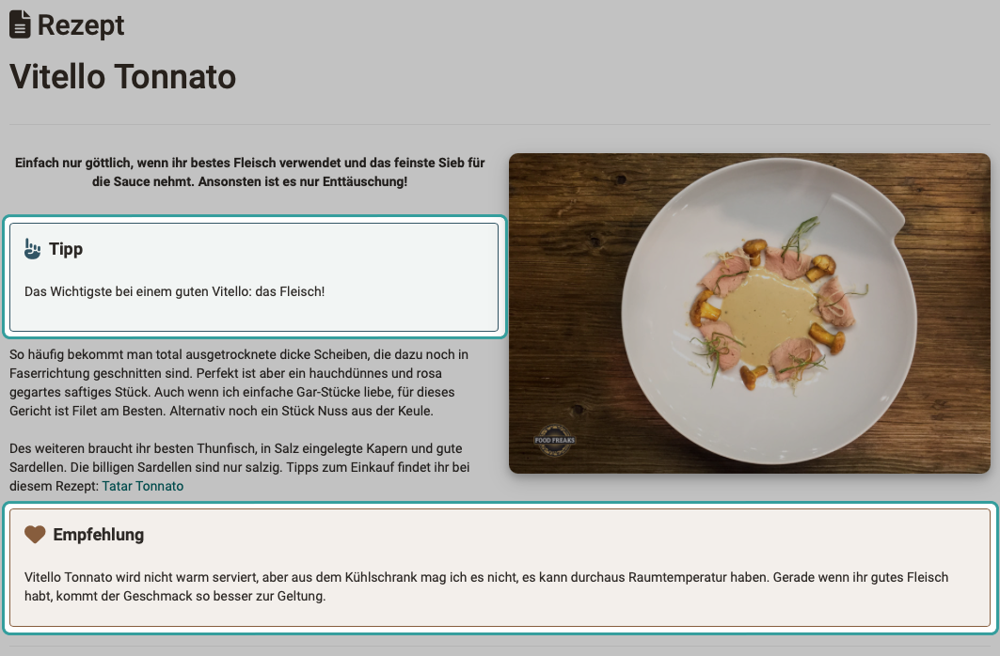

# Layout [:octicons-tag-16:{ title="ab Release 17.1.0 (OO-6199)" }](https://track.frentix.com/issue/OO-6199){:target="_blank"} {: #content_editor_layout}

Bevor Sie Inhalte im Content Editor einfügen können, fügen Sie mit "Neues Layout einfügen" ein Layout hinzu. Das Layout dient als Raster: Es teilt die Seite in Bereiche, in die Sie die Inhaltselemente einfügen. Den Button "Neues Layout einfügen" finden Sie im Bearbeitungsmodus am unteren Rand des Content Editors. Wo Sie den Content Editor öffnen und wer ihn nutzt, beschreibt die Seite [Content Editor](index.de.md).

Es stehen verschiedene Layoutvorlagen zur Auswahl, die die Bereiche unterschiedlich anordnen, etwa "1 Spalte", "2 Spalten" oder "1 Zeile oben, 3 Spalten unten". Sie können auf einer Seite auch mehrere Layouts kombinieren.

Falls nötig, lässt sich das Layout später jederzeit ändern. Klicken Sie dazu auf das Zahnrad-Symbol (Einstellungen bearbeiten) des Layouts. Es öffnet neben dem Layout den Inspektor, das Einstellungsfenster des Content Editors. Wählen Sie dort ein neues Layout aus.

{ class="shadow lightbox" title="Inspektor eines Layouts" }

Sind mehrere Layouts vorhanden, können Sie die Reihenfolge der Layouts ändern. Zum Verschieben eines gesamten Layouts verwenden Sie die Pfeile.

{ class="shadow lightbox" title="Layout einer Seite im Bearbeitungsmodus" }

## Layout löschen [:octicons-tag-16:{ title="ab Release 21.0 (OO-9407)" }](https://track.frentix.com/issue/OO-9407){:target="_blank"} {: #delete_layout}

Über das 3-Punkte-Menü eines Layouts lässt sich jedes Layout der Seite löschen, auch das erste. Beim Löschen entscheiden Sie, was mit dem Inhalt geschieht: "Alles löschen" entfernt das Layout mitsamt seinem Inhalt, "Nur das Layout löschen und den Inhalt verschieben" verschiebt den Inhalt in das Layout darüber, beim obersten Layout in das Layout darunter. Wird das letzte Layout einer Seite gelöscht, weist der Dialog darauf hin, dass das Layout und sein gesamter Inhalt gelöscht werden; die Seite erhält anschliessend automatisch wieder ein leeres Standard-Layout. Ist nur noch ein einziges leeres Layout vorhanden, ist die Aktion "Löschen" deaktiviert.

[Zum Seitenanfang ^](#content_editor_layout)

---

## Inhalte im Layout organisieren {: #organize_content}

### Bereiche und Inhaltselemente {: #content_blocks}

Jedes Layout besteht aus Bereichen: Die Vorlage "3 Spalten" hat zum Beispiel drei Bereiche nebeneinander. In jeden Bereich fügen Sie ein oder mehrere Inhaltselemente ein, etwa einen Titel, einen Text und ein Bild. Dieses Handbuch nennt ein Inhaltselement auch Block, zum Beispiel Bild-Block.

### Inhalte in einem Bereich hinzufügen, positionieren und konfigurieren {: #add_content}

Mit "Inhalt hinzufügen" fügen Sie Inhalte und Medien in einen Bereich ein. Der Link erscheint in jedem Bereich eines Layouts, so dass Sie den Inhalt genau dort einfügen, wo er stehen soll.

{ class="shadow lightbox" title="Bereiche eines Layouts im Content Editor" }

Der Dialog "Inhalt hinzufügen" listet die verfügbaren Inhaltstypen in den Gruppen "Text", "Medien", "Wissen" sowie "Andere & Design" auf. Am unteren Rand führen zwei Schaltflächen direkt zum [Media Center](Editor_Add_Content.de.md#media_center) und zum [Import](Editor_Import.de.md#import_position).

Fahren Sie im Bearbeitungsmodus mit der Maus über einen Block, wird dieser hervorgehoben [:octicons-tag-16:{ title="ab Release 20.2.0 (OO-8966)" }](https://track.frentix.com/issue/OO-8966){:target="_blank"}. Das hilft, einzelne Blöcke auseinanderzuhalten, wenn mehrere gleichartige Elemente aufeinander folgen.

Klicken Sie einen Inhalt an, erscheint ein Popup-Fenster, in dem Sie seine Eigenschaften einstellen: der ["Inspektor"](#inspector).

Das Inspektor-Popup lässt sich auch mit dem Zahnrad-Icon des Inhalts ein- und ausblenden.

{ class="shadow lightbox" title="Inspektor eines Bild-Blocks im Kursbaustein Seite · 2026.11.10" }

**Menüs**

Die Werkzeugleiste eines markierten Blocks umfasst vier Symbole: das Zahnrad für den Inspektor, ein Symbol zum Duplizieren, ein 3-Punkte-Menü und ein Pfeilkreuz ("Inhalt umziehen"). Über das 3-Punkte-Menü fügen Sie weitere Inhaltselemente davor oder danach ein, duplizieren das Element und löschen es. Über das Pfeilkreuz verschieben Sie das markierte Element per Drag & Drop an eine andere Position, in einen anderen Bereich oder in ein anderes Layout.

Ein Block lässt sich mit der Aktion "Duplizieren" kopieren, sowohl als Kurzaktion am Block selbst als auch über das 3-Punkte-Menü [:octicons-tag-16:{ title="ab Release 20.1.0 (OO-7709)" }](https://track.frentix.com/issue/OO-7709){:target="_blank"}.

{ class="shadow lightbox" title="Werkzeugleiste eines Inhaltsblocks im Kursbaustein Seite · 2026.11.10" }

[Zum Seitenanfang ^](#content_editor_layout)

---

### Layouts und Inhaltselemente formatieren: der Inspektor [:octicons-tag-16:{ title="ab Release 17.1.0 (OO-6198)" }](https://track.frentix.com/issue/OO-6198){:target="_blank"} {: #inspector}

#### Abstand {: #spacing}

Einheitliche Abstände zwischen den Bereichen eines Layouts machen eine Seite übersichtlich. Unter "Abstand" stehen zur Wahl:

* Kein Abstand
* S (klein)
* M (mittel)
* L (gross)
* XL (extragross)
* Benutzerdefiniert

=== "S (kleiner Abstand)"

    { class="shadow lightbox" title="kleiner Abstand" }

=== "M (mittlerer Abstand)"

    { class="shadow lightbox" title="mittlerer Abstand" }

=== "XL (extra-grosser Abstand)"

    { class="shadow lightbox" title="extra-grosser Abstand" }

#### Hintergrund {: #background}

Im Inspektor eines Layouts legen Sie im Tab "Stil" unter "Hintergrund" den Hintergrund des Layouts fest [:octicons-tag-16:{ title="ab Release 18.2.5 (OO-7641)" }](https://track.frentix.com/issue/OO-7641){:target="_blank"}. Neben "Kein Hintergrund" steht eine vordefinierte Farbliste zur Auswahl, mit der sich einzelne Layouts farblich voneinander abheben lassen.

#### Hinweis-Box {: #alert_box}

Layouts und verschiedene Inhaltselemente können als formatierte Hinweis-Box dargestellt werden [:octicons-tag-16:{ title="ab Release 18.2.3 (OO-7138)" }](https://track.frentix.com/issue/OO-7138){:target="_blank"}. Bei Auswahl eines vordefinierten Hinweis-Typs hebt die Box Informationen mit der passenden Farbe und dem passenden Icon hervor. Zur Auswahl stehen die Typen "Notiz", "Information", "Tipp", "Wichtig", "Warnung", "Fehler" und "Erfolg". Mit dem Typ "Benutzerdefiniert" gestalten Sie Farbe und Icon der Box selbst. Im Feld "Titel" geben Sie der Box eine Überschrift, "Mit Icon" blendet das Icon ein, und "Einklappbar" macht die Box einklappbar.

{ class="shadow lightbox" title="Tab Stil im Inspektor eines Layouts" }

Beispiel:

{ class="shadow lightbox" title="Hinweis-Boxen auf einer Seite" }

[Zum Seitenanfang ^](#content_editor_layout)

---

### Anker [:octicons-tag-16:{ title="ab Release 21.0 (OO-9411)" }](https://track.frentix.com/issue/OO-9411){:target="_blank"} {: #anchors}

Jedes Titel-Element einer Seite erhält automatisch einen Anker, also ein Sprungziel, über das sich direkt zu diesem Abschnitt springen lässt. Andere Inhaltstypen erhalten keinen Anker.

Sie müssen dafür nichts einstellen. Die Anker werden auf der Seite nicht angezeigt und lassen sich auch nicht einzeln kopieren. Genutzt werden sie vom Element Inhaltsverzeichnis, das die Titel der Seite auflistet und über diese Anker als Sprungmarken verlinkt. Je mehr Titel-Elemente eine Seite gliedern, desto brauchbarer wird das Inhaltsverzeichnis. 
[Zum Inhaltsverzeichnis >](Editor_Add_Content.de.md#table_of_contents)

[Zum Seitenanfang ^](#content_editor_layout)

---

## Weiterführende Informationen {: #further_information}

**Auf dieser Seite erwähnt** 
[Content Editor >](index.de.md) 
[Inhalt hinzufügen >](Editor_Add_Content.de.md) 
[Importieren >](Editor_Import.de.md)

**Weiterführend** 
[Quiz und KI-Feedback >](Editor_Quiz.de.md) 
[Barrierefreiheit: Grundsätze >](../Accessibility_Principals.de.md)

[Zum Seitenanfang ^](#content_editor_layout)
