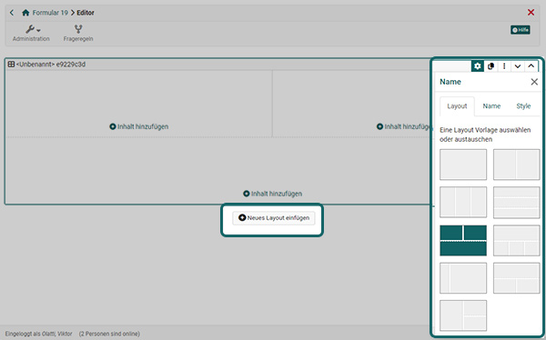
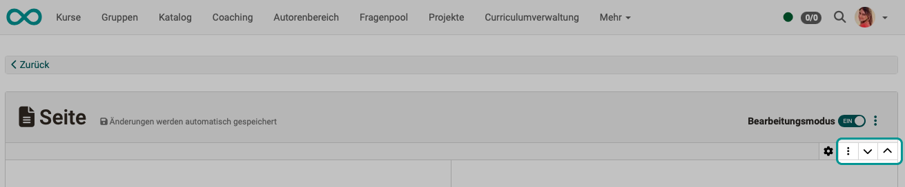
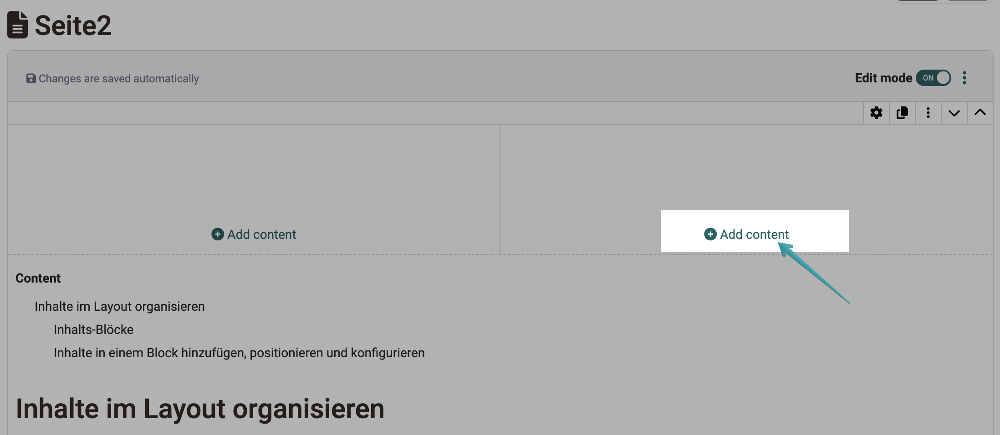
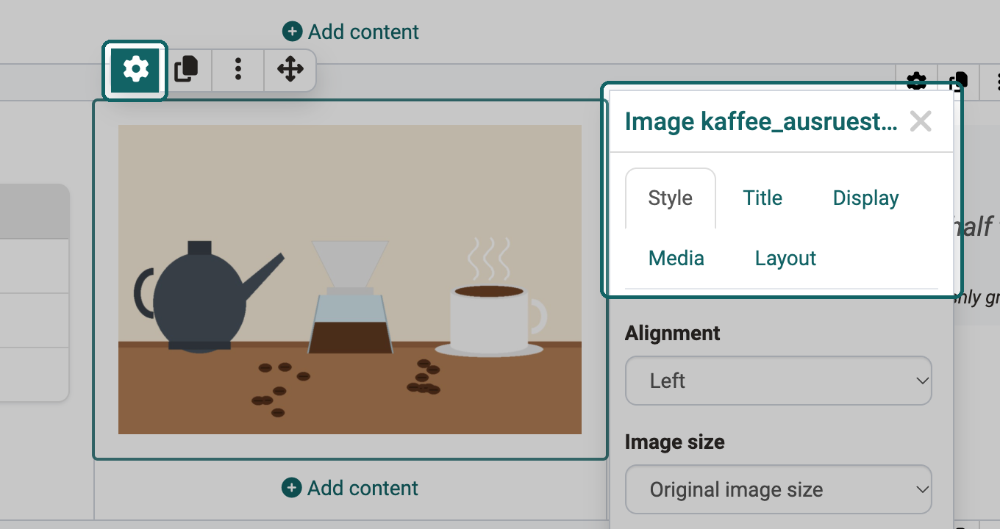
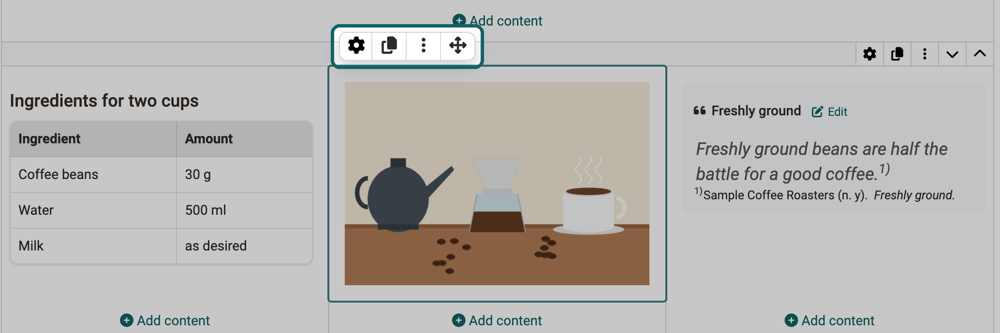
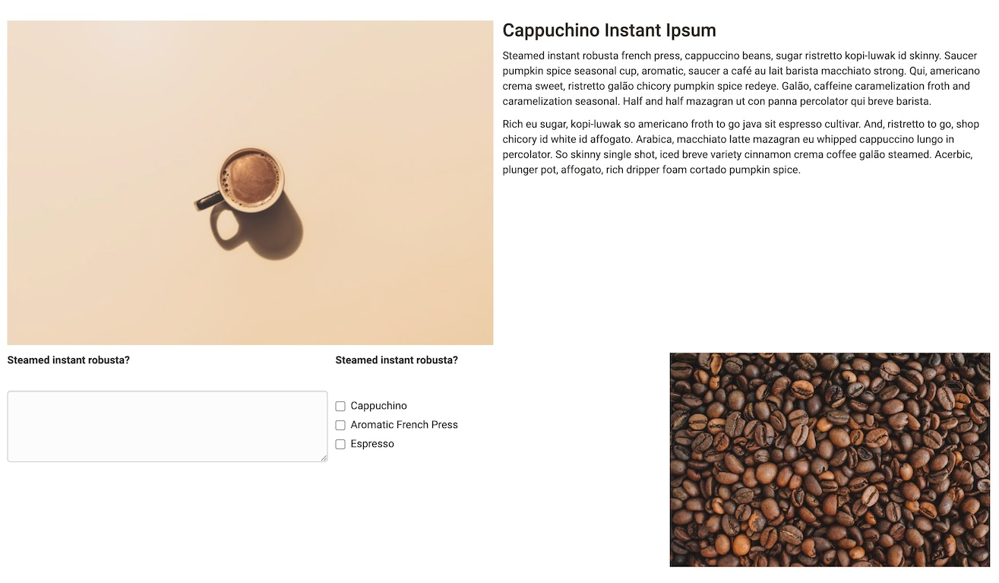
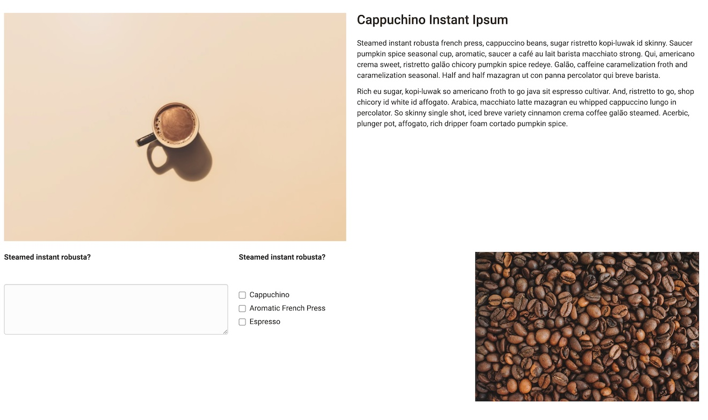
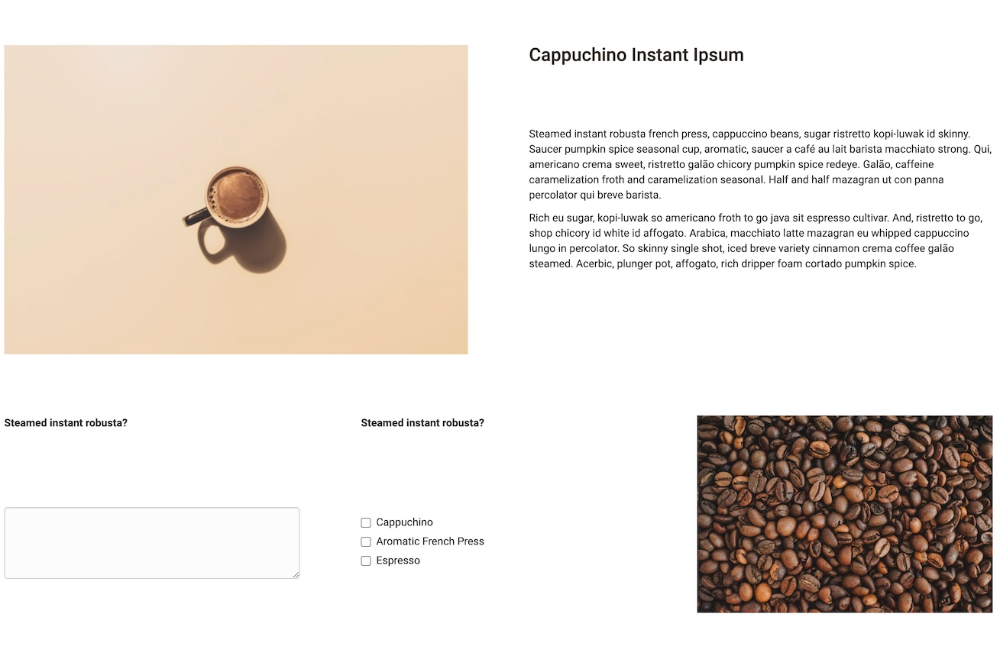
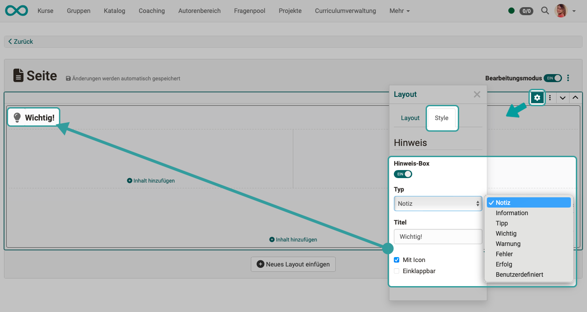
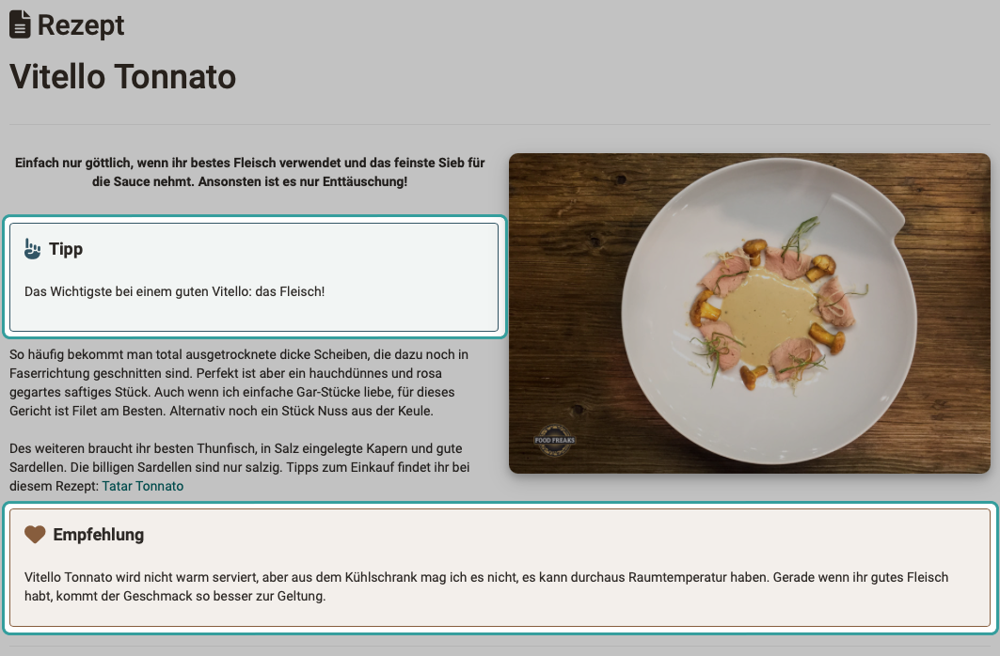

# Layout [:octicons-tag-16:{ title="from Release 17.1.0 (OO-6199)" }](https://track.frentix.com/issue/OO-6199){:target="_blank"} {: #content_editor_layout}

Before you can insert content in the Content Editor, you add a layout with "Add a new layout". The layout serves as a grid: it divides the page into areas into which you insert the content elements. You find the button "Add a new layout" in edit mode at the bottom of the Content Editor. Where you open the Content Editor and who uses it is described on the page [Content Editor](index.md).

There are various layout templates to choose from, which arrange the areas differently, for example "1 column", "2 columns" or "1 row on top, 3 columns below". You can also combine several layouts on one page.

If necessary, the layout can be changed later at any time. To do this, click on the gear icon (Edit settings) of the layout. It opens the inspector next to the layout, the settings window of the Content Editor. Select a new layout there.

{ class="shadow lightbox" title="Inspector of a layout" }

If several layouts exist, you can change the order of the layouts. Use the arrows to move an entire layout.

{ class="shadow lightbox" title="Layout of a page in edit mode" }

## Deleting a layout [:octicons-tag-16:{ title="from Release 21.0 (OO-9407)" }](https://track.frentix.com/issue/OO-9407){:target="_blank"} {: #delete_layout}

Every layout on a page can be deleted via the layout's three-dot menu, including the first one. When deleting, you decide what happens to the content: "Delete everything" removes the layout together with its content, "Only delete the layout and move the content" moves the content to the layout above, or for the topmost layout to the layout below. When the last layout of a page is deleted, the dialog points out that the layout and all its content will be deleted; the page then automatically receives an empty default layout again. If only a single empty layout is left, the "Delete" action is disabled.

[To the top of the page ^](#content_editor_layout)

---

## Organizing content in the layout {: #organize_content}

### Areas and content elements {: #content_blocks}

Every layout consists of areas: the template "3 columns", for example, has three areas side by side. Into each area you insert one or more content elements, for example a title, a text and an image. This manual also calls a content element a block, for example image block.

### Adding, positioning and configuring content in an area {: #add_content}

With "Add content" you insert content and media into an area. The link appears in every area of a layout, so you can insert the content exactly where it belongs.

{ class="shadow lightbox" title="Areas of a layout in the Content Editor" }

The "Add content" dialog lists the available content types in the groups "Text", "Media", "Knowledge" and "Other & design". At the bottom, two buttons lead directly to the [Media Center](Editor_Add_Content.md#media_center) and to the [import](Editor_Import.md#import_position).

When you hover over a block with the mouse in edit mode, that block is highlighted [:octicons-tag-16:{ title="from Release 20.2.0 (OO-8966)" }](https://track.frentix.com/issue/OO-8966){:target="_blank"}. This helps you tell blocks apart when several similar elements follow one another.

If you click on a piece of content, a pop-up window appears in which you set its properties: the ["Inspector"](#inspector).

You can also show or hide the Inspector pop-up using the gear icon next to the content.

{ class="shadow lightbox" title="Inspector of an image block in the course element Page · 2026.11.10" }

**Menus**

The toolbar of a selected block comprises four icons: the gear for the Inspector, an icon to duplicate, a three-dot menu and an arrow cross ("Drag content"). The three-dot menu lets you add further content elements before or after the element, duplicate the element, and delete it. The arrow cross lets you drag and drop the selected element to a different position, into a different area, or into a different layout.

A block can be copied with the "Duplicate" action, both as a short action on the block itself and via the three-dot menu [:octicons-tag-16:{ title="from Release 20.1.0 (OO-7709)" }](https://track.frentix.com/issue/OO-7709){:target="_blank"}.

{ class="shadow lightbox" title="Toolbar of a content block in the course element Page · 2026.11.10" }

[To the top of the page ^](#content_editor_layout)

---

### Formatting layouts and content elements: the Inspector [:octicons-tag-16:{ title="from Release 17.1.0 (OO-6198)" }](https://track.frentix.com/issue/OO-6198){:target="_blank"} {: #inspector}

#### Spacing {: #spacing}

Consistent spacing between the areas of a layout makes a page easy to read. Under "Spacing" you can choose:

* No spacing
* S (small)
* M (medium)
* L (large)
* XL (extra large)
* Custom

=== "S (small spacing)"

    { class="shadow lightbox" title="small spacing" }

=== "M (medium spacing)"

    { class="shadow lightbox" title="medium spacing" }

=== "XL (extra large spacing)"

    { class="shadow lightbox" title="extra large spacing" }

#### Background {: #background}

In the inspector of a layout you define the background of the layout in the tab "Style" under "Background" [:octicons-tag-16:{ title="from Release 18.2.5 (OO-7641)" }](https://track.frentix.com/issue/OO-7641){:target="_blank"}. Besides "None", a predefined colour list is available, letting you set individual layouts apart visually.

#### Alert box {: #alert_box}

Layouts and various content elements can be displayed as a formatted alert box [:octicons-tag-16:{ title="from Release 18.2.3 (OO-7138)" }](https://track.frentix.com/issue/OO-7138){:target="_blank"}. When a predefined type is selected, the box highlights information with the matching colour and the matching icon. The types "Note", "Info", "Tip", "Important", "Warning", "Error" and "Success" are available. With the type "Custom" you design the colour and icon of the box yourself. In the field "Title" you give the box a heading, "With icon" shows the icon, and "Collapsible" makes the box collapsible.

{ class="shadow lightbox" title="Style tab in the inspector of a layout" }

Example:

{ class="shadow lightbox" title="Alert boxes on a page" }

[To the top of the page ^](#content_editor_layout)

---

### Anchors [:octicons-tag-16:{ title="from Release 21.0 (OO-9411)" }](https://track.frentix.com/issue/OO-9411){:target="_blank"} {: #anchors}

Every title element on a page automatically receives an anchor, that is a jump target that leads directly to this section. Other content types do not receive an anchor.

You do not need to configure anything for this. The anchors are not shown on the page and cannot be copied individually either. They are used by the ["Table of contents"](Editor_Add_Content.md#table_of_contents) element, which lists the titles of the page and links them via these anchors as jump marks. The more title elements structure a page, the more useful the table of contents becomes. 
[To the table of contents >](Editor_Add_Content.md#table_of_contents)

[To the top of the page ^](#content_editor_layout)

---

## Further information {: #further_information}

**Mentioned on this page** 
[Content Editor >](index.md) 
[Add content >](Editor_Add_Content.md) 
[Import >](Editor_Import.md)

**Further reading** 
[Quiz and AI feedback >](Editor_Quiz.md) 
[Accessibility: Basic principles >](../Accessibility_Principals.md)

[To the top of the page ^](#content_editor_layout)
