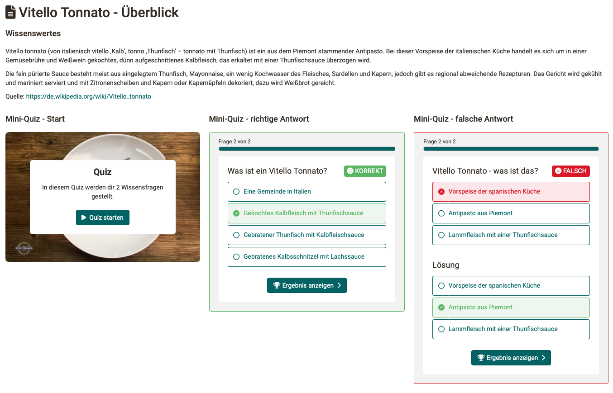
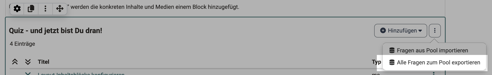
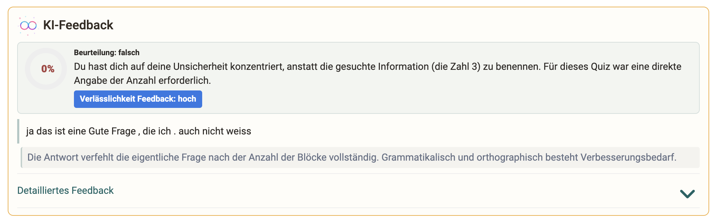
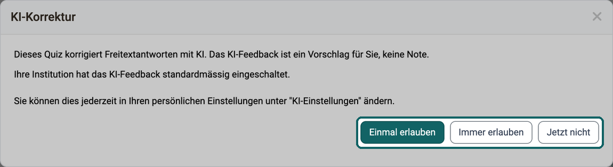

# Quiz und KI-Feedback {: #quiz_ai_feedback}

Mit dem Element "Quiz" stellen Sie Lernenden im [Kursbaustein "Seite"](../../learningresources/Course_Element_Page.de.md) Fragen zum Inhalt, die OpenOlat sofort auswertet. Sie fügen das Quiz wie jeden anderen Inhalt über ["Inhalt hinzufügen"](Editor_Add_Content.de.md) ein, in der Gruppe "Wissen". Bei einer Freitextfrage kann zusätzlich die KI den Lernenden eine Rückmeldung auf ihre Antwort geben. Dafür braucht es drei Dinge: Die Administration hat die KI-Funktion eingerichtet, die Frage hat ein Bewertungskit, also eine Musterantwort und die Kriterien, nach denen die KI die Antwort beurteilt, und die Lernenden stimmen der KI-Korrektur zu. Diese Seite beschreibt das Quiz-Element, das KI-Feedback und die Einwilligung zur KI-Korrektur.

## Quiz [:octicons-tag-16:{ title="ab Release 19.0.0 (OO-7145)" }](https://track.frentix.com/issue/OO-7145){:target="_blank"} {: #quiz}

Mit dem Element "Quiz" binden Sie Quizfragen, die OpenOlat automatisch auswertet, in eine Seite ein. Sie haben die Möglichkeit, neue Fragen zu erstellen oder bestehende Fragen aus dem Fragenpool hinzuzufügen. Zu jeder Frage lassen sich zudem Feedbacks ergänzen, auch mit Bildern und Videos.

Die Quizfragen fördern die Auseinandersetzung mit den Inhalten und vergeben keine Punkte. Für bewertete Fragen nutzen Sie die Kursbausteine ["Test"](../../learningresources/Course_Element_Test/index.de.md) oder ["Selbsttest"](../../learningresources/Course_Element_Self_Test.de.md).

Zugleich ist das Quiz-Element der einzige Ort, an dem Lernende ein [KI-Feedback zu Freitextantworten](#ai_feedback) erhalten.

{ class="shadow lightbox" title="Quiz auf einer Seite" }

Über das 3-Punkte-Menü des Quiz-Elements tauschen Sie Fragen mit dem [Fragenpool](../../area_modules/Question_Bank/index.de.md) aus. "Fragen aus Pool importieren" übernimmt bestehende Fragen in das Quiz, "Alle Fragen zum Pool exportieren" schreibt umgekehrt sämtliche Fragen des Quiz in den Fragenpool. So lassen sich Fragen, die direkt auf der Seite entstanden sind, für andere Kurse und Tests weiterverwenden.

{ class="shadow lightbox" title="3-Punkte-Menü eines Quiz" }

[Zum Seitenanfang ^](#quiz_ai_feedback)

---

## KI-Feedback zu Freitextantworten {: #ai_feedback}

Stellen Sie Lernenden im Quiz eine offene Frage, erhalten sie zu ihrer Antwort sofort eine Rückmeldung der KI, ohne dass Sie jede Antwort selbst lesen. Senden Lernende ihre Antwort mit "Überprüfen" ab, erscheint im Block "KI-Feedback" ein formatives Feedback [:octicons-tag-16:{ title="ab Release 21.0 (OO-9497)" }](https://track.frentix.com/issue/OO-9497){:target="_blank"}. Das Feedback vergibt keine Punkte und dient der Selbsteinschätzung.

Den Fragetyp "Freitext" bietet das Quiz an, wenn in der System-Administration im [KI-Modul](../../../manual_admin/administration/External_Tools_AI.de.md) die KI-Funktion "Essay Bewertung" konfiguriert ist: `Administration > Externe Werkzeuge > KI-Modul > Tab "KI-Funktionen"`.

Diese Auswertung gibt es nur im Quiz-Element einer Seite. In den Kursbausteinen "Test" und "Selbsttest" wird das Bewertungskit einer Freitextfrage nicht ausgeführt, auch wenn die Frage aus dem Fragenpool stammt. Wie Sie das Bewertungskit einer Frage festlegen, steht im Kapitel [KI-Feedback einer Freitextfrage bearbeiten](../../area_modules/Question_Bank_Create_Questions.de.md#ai_grading). Den ganzen Weg von der Freitextfrage bis zum Feedback der Lernenden zeigt die Anleitung [Wie gebe ich Lernenden KI-Feedback auf Freitextantworten im Quiz?](../../../manual_how-to/ai_essay/ai_essay.de.md)

Das Feedback beginnt mit der "Beurteilung" der Antwort in den Stufen "sehr gut", "gut", "mittelmässig", "ungenügend" und "falsch", ergänzt um eine kurze Gesamteinschätzung. Daneben steht der geschätzte Erfüllungsgrad der Antwort in Prozent. Die Angabe "Verlässlichkeit Feedback" mit den Werten "hoch", "mittel" und "niedrig" zeigt, wie verlässlich die KI ihre eigene Einschätzung einstuft.

Unter "Detailliertes Feedback" lassen sich weitere Abschnitte aufklappen: "Was gut gelungen ist", "Was fehlt noch" und "Nächster Schritt", dazu die abgedeckten und die fehlenden Punkte der Antwort sowie unter "Sprache" Rückmeldungen zu "Grammatik" und "Rechtschreibung". Der Bereich erscheint nur, wenn die KI dazu etwas beizutragen hat.

Je nach eingesetztem KI-Modell dauert die Bewertung einige Sekunden bis mehrere Minuten. Die Seite informiert währenddessen gestuft über den Fortschritt: zuerst wartet sie auf die KI-Korrektur, nach kurzer Zeit weist sie darauf hin, die Seite geöffnet zu lassen, und danach darauf, dass die Bewertung mit diesem Modell mehrere Minuten dauern kann. Sobald das Ergebnis bereit ist, aktualisiert sich die Seite selbst. Überschreitet die Bewertung die im [KI-Modul](../../../manual_admin/administration/External_Tools_AI.de.md#ai_function_limits) eingestellte Wartezeit, bricht OpenOlat sie ab und meldet dies [:octicons-tag-16:{ title="ab Release 21.0.2 (OO-9677)" }](https://track.frentix.com/issue/OO-9677){:target="_blank"}.

Die zulässige Wortzahl für das KI-Feedback legt die System-Administration im KI-Modul fest, standardmässig 400 Wörter. Bei längeren Antworten erhalten Lernende statt des KI-Feedbacks eine Meldung mit dem eingestellten Wert. Die Antwort bleibt gespeichert.

{ class="shadow lightbox" title="KI-Feedback zu einer Freitextantwort im Quiz" }

### Einwilligung zur KI-Korrektur [:octicons-tag-16:{ title="ab Release 21.1 (OO-9784)" }](https://track.frentix.com/issue/OO-9784){:target="_blank"} {: #ai_consent}

Bevor die KI Freitextantworten von Lernenden korrigiert, fragt OpenOlat sie um Erlaubnis. Nach einem Klick auf "Quiz starten" erscheint über der ersten Frage der Dialog "KI-Korrektur", sofern das Quiz mindestens eine Freitextfrage mit Bewertungskit enthält und die Person im Tab "KI-Einstellungen" ihrer persönlichen Einstellungen keine Wahl gespeichert hat. Der Dialog sagt, dass das Quiz Freitextantworten mit KI korrigiert und dass das KI-Feedback ein Vorschlag ist, keine Note. Ausserdem nennt er die Vorgabe der Institution.

{ class="shadow lightbox" title="Dialog KI-Korrektur beim Start eines Quiz · 2026.10.20" }

* **"Einmal erlauben"**: Die KI korrigiert die Antworten in diesem Versuch. OpenOlat speichert nichts.
* **"Immer erlauben"**: Die KI korrigiert die Antworten, und OpenOlat speichert im Tab "KI-Einstellungen" die Wahl "Ein". Der Dialog erscheint danach nicht mehr.
* **"Jetzt nicht"**: In diesem Versuch erscheint kein KI-Feedback. OpenOlat speichert nichts. Wer den Dialog mit dem Kreuz oben rechts oder mit der Escape-Taste schliesst, wählt ebenfalls "Jetzt nicht".

Hervorgehoben ist "Einmal erlauben", wenn die Vorgabe der Administration "ein" lautet, sonst "Jetzt nicht". Solange nichts gespeichert ist, erscheint der Dialog bei jedem neuen Versuch wieder, auch nach einem Klick auf "Neuer Versuch". Ohne Erlaubnis beantworten Lernende die Freitextfragen wie gewohnt, es erscheint nur kein KI-Feedback.

"Immer erlauben" machen Lernende rückgängig, indem sie im Tab "KI-Einstellungen" wieder "Vorgabe (ein)" oder "Vorgabe (aus)" wählen. Mit "Aus" schalten sie das KI-Feedback dort ganz aus. Sie finden den Tab unter: 
`Persönliches Menü > Einstellungen > Tab "KI-Einstellungen"` 
Mehr dazu: [Tab KI-Einstellungen](../../personal_menu/Settings.de.md#tab_ai_settings)

[Zum Seitenanfang ^](#quiz_ai_feedback)

---

## Weiterführende Informationen {: #further_information}

**Auf dieser Seite erwähnt** 
[Kursbaustein "Seite" >](../../learningresources/Course_Element_Page.de.md) 
[Inhalt hinzufügen >](Editor_Add_Content.de.md) 
[Kursbaustein "Test" >](../../learningresources/Course_Element_Test/index.de.md) 
[Kursbaustein "Selbsttest" >](../../learningresources/Course_Element_Self_Test.de.md) 
[Fragenpool: Übersicht >](../../area_modules/Question_Bank/index.de.md) 
[Externe Werkzeuge: KI-Modul >](../../../manual_admin/administration/External_Tools_AI.de.md) 
[Fragenpool: Fragen erstellen >](../../area_modules/Question_Bank_Create_Questions.de.md) 
["Wie gebe ich Lernenden KI-Feedback auf Freitextantworten im Quiz?" >](../../../manual_how-to/ai_essay/ai_essay.de.md) 
[Persönliche Konfiguration: Einstellungen >](../../personal_menu/Settings.de.md)

**Weiterführend** 
[Content Editor >](index.de.md) 
[Importieren >](Editor_Import.de.md)

[Zum Seitenanfang ^](#quiz_ai_feedback)
