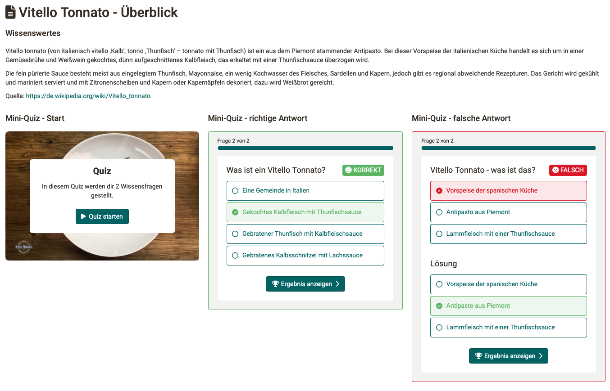
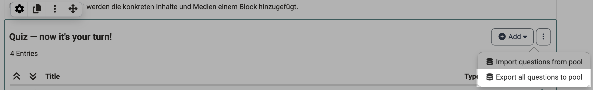
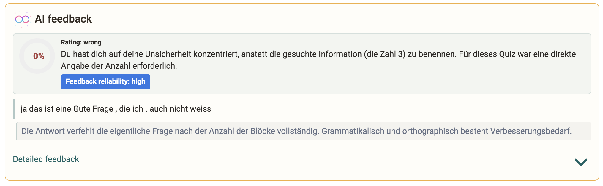
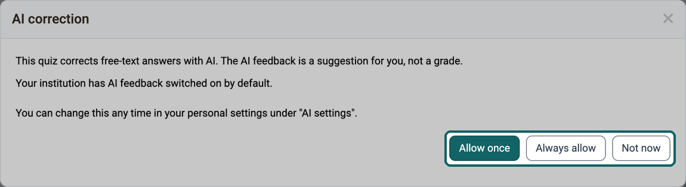

# Quiz and AI feedback {: #quiz_ai_feedback}

With the element "Quiz" you ask learners questions about the content in the [course element "Page"](../../learningresources/Course_Element_Page.md), which OpenOlat evaluates immediately. You insert the quiz like any other content via ["Add content"](Editor_Add_Content.md), in the group "Knowledge". For a free-text question, the AI can additionally give learners feedback on their answer. This requires three things: the administration has set up the AI feature, the question has a grading kit, that is a model answer and the criteria by which the AI assesses the answer, and the learners consent to the AI correction. This page describes the quiz element, the AI feedback and the consent to the AI correction.

## Quiz [:octicons-tag-16:{ title="from Release 19.0.0 (OO-7145)" }](https://track.frentix.com/issue/OO-7145){:target="_blank"} {: #quiz}

With the element "Quiz" you embed quiz questions that OpenOlat grades automatically into a page. You can create new questions or add existing ones from the question bank. You can also add feedback to each question, including images and videos.

The quiz questions encourage engagement with the content and do not award points. For graded questions, use the course elements ["Test"](../../learningresources/Course_Element_Test/index.md) or ["Self-test"](../../learningresources/Course_Element_Self_Test.md).

At the same time, the quiz element is the only place where learners receive [AI feedback on free-text answers](#ai_feedback).

{ class="shadow lightbox" title="Quiz on a page" }

Via the three-dot menu of the quiz element you exchange questions with the [question bank](../../area_modules/Question_Bank/index.md). "Import questions from pool" adds existing questions to the quiz, "Export all questions to pool" writes all questions of the quiz to the question bank. This lets you reuse questions created directly on the page in other courses and tests.

{ class="shadow lightbox" title="3-dot menu of a quiz" }

[To the top of the page ^](#quiz_ai_feedback)

---

## AI feedback on free-text answers {: #ai_feedback}

If you ask learners an open question in the quiz, they receive an immediate response from the AI to their answer, without you reading every answer yourself. When learners submit their answer with "Check", formative feedback appears in the "AI feedback" block [:octicons-tag-16:{ title="from Release 21.0 (OO-9497)" }](https://track.frentix.com/issue/OO-9497){:target="_blank"}. The feedback does not award points and serves for self-assessment.

The quiz offers the question type "Essay" if the AI feature "Essay Grading" is configured in the [AI module](../../../manual_admin/administration/External_Tools_AI.md) of the system administration: `Administration > External tools > AI module > Tab "AI features"`.

This evaluation exists only in the quiz element of a page. In the course elements "Test" and "Self-test" the grading kit of an essay question is not executed, even if the question comes from the question bank. How you define the grading kit of a question is described in the chapter [Edit the AI feedback of an essay question](../../area_modules/Question_Bank_Create_Questions.md#ai_grading). The whole path from the essay question to the feedback for learners is shown in the instructions [How do I give learners AI feedback on free-text answers in a quiz?](../../../manual_how-to/ai_essay/ai_essay.md)

The feedback begins with the "Assessment" of the answer in the levels "very good", "good", "mediocre", "insufficient" and "wrong", together with a short overall appraisal. Next to it is the estimated score of the answer in percent. The "Feedback reliability" indicator with the values "high", "medium" and "low" shows how reliable the AI rates its own assessment.

Under "Detailed feedback" further sections can be expanded: "What went well", "What is missing" and "Next step", plus the points the answer covers and those it misses, and under "Language" feedback on "Grammar" and "Spelling". The area only appears when the AI has something to contribute.

Depending on the AI model in use, grading takes a few seconds up to several minutes. Meanwhile the page reports progress in stages: first it waits for the AI correction, after a short while it points out that the page should be kept open, and after that it states that grading with this model can take several minutes. As soon as the result is ready, the page updates itself. If grading exceeds the waiting time configured in the [AI module](../../../manual_admin/administration/External_Tools_AI.md#ai_function_limits), OpenOlat cancels it and reports this [:octicons-tag-16:{ title="from Release 21.0.2 (OO-9677)" }](https://track.frentix.com/issue/OO-9677){:target="_blank"}.

The permitted number of words for the AI feedback is set by the system administration in the AI module, 400 words by default. For longer answers, learners receive a message with the configured value instead of the AI feedback. The answer remains saved.

{ class="shadow lightbox" title="AI feedback on a free-text answer in a quiz" }

### Consent to the AI correction [:octicons-tag-16:{ title="from Release 21.1 (OO-9784)" }](https://track.frentix.com/issue/OO-9784){:target="_blank"} {: #ai_consent}

Before the AI corrects free-text answers of learners, OpenOlat asks them for permission. After a click on "Start quiz", the dialog "AI correction" appears above the first question, provided the quiz contains at least one free-text question with a grading kit and the person has not stored a choice in the tab "AI settings" of their personal settings. The dialog says that the quiz corrects free-text answers with AI and that the AI feedback is a suggestion, not a grade. It also names the default of the institution.

{ class="shadow lightbox" title="AI correction dialogue at the start of a quiz · 2026.10.20" }

* **"Allow once"**: The AI corrects the answers in this attempt. OpenOlat stores nothing.
* **"Always allow"**: The AI corrects the answers, and OpenOlat stores the choice "On" in the tab "AI settings". The dialog does not appear any more after that.
* **"Not now"**: No AI feedback appears in this attempt. OpenOlat stores nothing. Closing the dialog with the cross at the top right or with the Escape key also selects "Not now".

"Allow once" is highlighted if the default of the administration is "on", otherwise "Not now". As long as nothing is stored, the dialog appears again in every new attempt, also after a click on "New attempt". Without permission, learners answer the free-text questions as usual, only no AI feedback appears.

Learners undo "Always allow" by selecting "Default (on)" or "Default (off)" again in the tab "AI settings". With "Off" they switch the AI feedback off completely there. You find the tab under: 
`Personal menu > System settings > Tab "AI settings"` 
More about this: [Tab AI settings](../../personal_menu/Settings.md#tab_ai_settings)

[To the top of the page ^](#quiz_ai_feedback)

---

## Further information {: #further_information}

**Mentioned on this page** 
[Course Element "Page" >](../../learningresources/Course_Element_Page.md) 
[Add content >](Editor_Add_Content.md) 
[Course Element "Test" >](../../learningresources/Course_Element_Test/index.md) 
[Course Element "Self-test" >](../../learningresources/Course_Element_Self_Test.md) 
[Question Bank: Overview >](../../area_modules/Question_Bank/index.md) 
[External tools: AI module >](../../../manual_admin/administration/External_Tools_AI.md) 
[Question Bank: Create Questions >](../../area_modules/Question_Bank_Create_Questions.md) 
["How do I give learners AI feedback on free-text answers in a quiz?" >](../../../manual_how-to/ai_essay/ai_essay.md) 
[Personal Configuration: Settings >](../../personal_menu/Settings.md)

**Further reading** 
[Content Editor >](index.md) 
[Import >](Editor_Import.md)

[To the top of the page ^](#quiz_ai_feedback)
