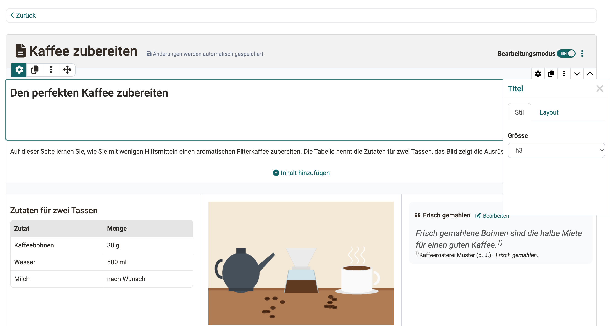
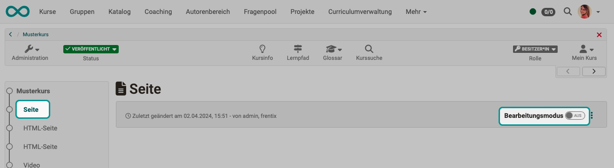
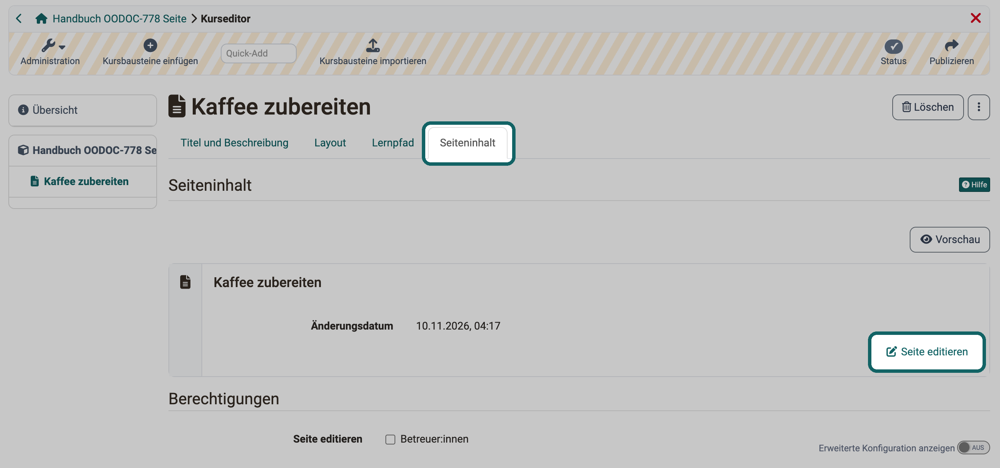
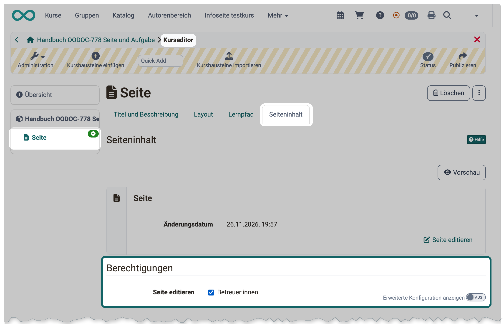
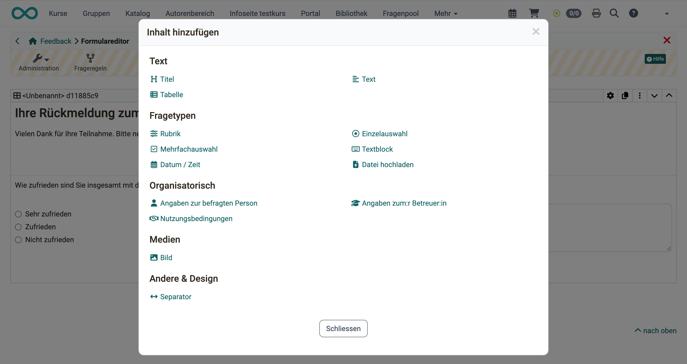
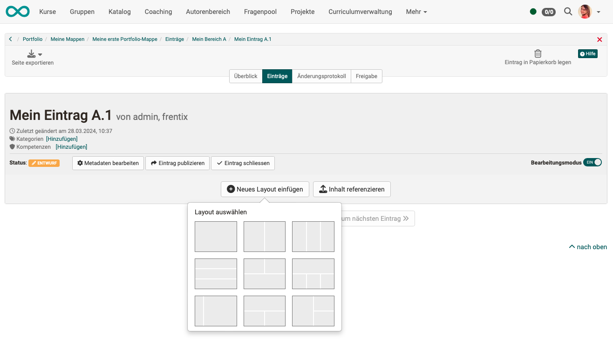

# Content Editor

## Was ist der Content Editor? {: #content_editor}

Mit dem Content Editor gestalten Sie eine Seite aus verschiedenen Inhaltselementen, angeordnet nach einem Layout, das Sie selbst wählen. Die Seite ist für Mobilgeräte optimiert. OpenOlat speichert Ihre Änderungen automatisch.

Der Content Editor wird an verschiedenen Stellen in OpenOlat verwendet. Wer ihn nutzt, hängt vom Ort ab: im Kursbaustein "Seite" die Besitzer:innen des Kurses und berechtigte Betreuer:innen, in der Lernressource "Formular" deren Besitzer:innen, im Portfolio die Besitzer:innen der Mappe.

{ class="shadow lightbox" title="Content Editor im Kursbaustein Seite · 2026.11.10" }

!!! note "Hinweis"

    Neben dem Content Editor existiert in OpenOlat noch der HTML-Editor "TinyMCE", der z.B. im [Kursbaustein "HTML-Seite"](../../learningresources/Course_Element_HTML_Page.de.md) verwendet wird. 

## Aufgaben im Content Editor {: #tasks}

Für jede Aufgabe im Content Editor gibt es eine eigene Seite:

| Thema | Wozu |
|---|---|
| [Layout](Editor_Layout.de.md) | Eine Seite in Bereiche gliedern, Inhalte darin anordnen und Abstände, Hintergrund und Hinweis-Boxen festlegen. |
| [Inhalt hinzufügen](Editor_Add_Content.de.md) | Texte, Bilder, Videos, Dokumente und weitere Inhalte einfügen, auch aus Ihrem Media Center, der Ablage für Ihre Mediendateien. |
| [Quiz und KI-Feedback](Editor_Quiz.de.md) | Im Kursbaustein "Seite" Lernenden Fragen zum Inhalt stellen und ihnen eine Rückmeldung der KI auf Freitextantworten geben. |
| [Importieren](Editor_Import.de.md) | Eine Markdown- oder Word-Datei in eine Seite übernehmen und, sofern die KI-Funktion eingerichtet ist, Fragen von der KI erzeugen lassen. |

[Zum Seitenanfang ^](#content_editor)

---

## Wo kommt der Content Editor zum Einsatz? {: #content_editor_use}

Der Content Editor wird im [Kursbaustein Seite](../../learningresources/Course_Element_Page.de.md), in der [Lernressource "Formular"](../../learningresources/Form/index.de.md) und im ["Portfolio 2.0"](../../area_modules/The_portfolio_editor_17_1.de.md) verwendet.

### Kursbaustein Seite [:octicons-tag-16:{ title="ab Release 18.0.0 (OO-6966)" }](https://track.frentix.com/issue/OO-6966){:target="_blank"} {: #course_element_page}

Im Kursbaustein "Seite" öffnen Sie den Content Editor auf zwei Wegen: im Kurseditor im Tab "Seiteninhalt" mit "Seite editieren", oder bei geschlossenem Kurseditor direkt im Kursbaustein, indem Sie den Bearbeitungsmodus einschalten. Den Kurseditor erreichen Sie unter: `Kurs > Administration > Kurseditor`.

**Bei geschlossenem Kurseditor:**

{ class="shadow lightbox" title="Kursbaustein Seite im Kurs" }

Der Schalter "Bearbeitungsmodus" schaltet die Bearbeitung der Seite ein und aus.

**Im Kurseditor:**

{ class="shadow lightbox" title="Kursbaustein Seite im Kurseditor" }

Im Tab "Seiteninhalt" legen Sie unter "Berechtigungen" fest, ob neben den Kursbesitzer:innen auch Betreuer:innen die Seite bei geschlossenem Kurseditor bearbeiten dürfen: Option "Seite editieren" für "Betreuer:innen". Mit "Erweiterte Konfiguration anzeigen" vergeben Sie das Recht zusätzlich an einzelne Rollen, Gruppen oder Benutzer:innen, auf Wunsch mit Beginn und Ende.

{ class="shadow lightbox" title="Tab Seiteninhalt des Kursbausteins Seite im Kurseditor · 2026.11.26" }

Die Medien-Inhalte des [Kursbausteins "Seite"](../../learningresources/Course_Element_Page.de.md) (Bilder, Audio, Video, Diagramme, Zitate, Dokumente usw.) speichert OpenOlat im [Media Center](../../personal_menu/Media_Center.de.md), nicht im Ablageordner des Kurses wie beim [Kursbaustein "HTML-Seite"](../../learningresources/Course_Element_HTML_Page.de.md).

Auch die Medien einer Portfolio-Mappe liegen im Media Center. Die Lernressource "Formular" speichert Bilder dagegen in der Lernressource selbst.

[Zum Seitenanfang ^](#content_editor)

---

### Lernressource Formular {: #form}

Auch die Fragen und Texte einer [Lernressource Formular](../../learningresources/Form/index.de.md) stellen Sie im Content Editor zusammen, unter: `Formular > Administration > Formulareditor`. Das gilt für jedes Formular, auch für eines, das Sie später in einen [Kursbaustein "Formular"](../../learningresources/Course_Element_Form.de.md) oder ["Umfrage"](../../learningresources/Course_Element_Survey.de.md) einbinden.

Der Dialog "Inhalt hinzufügen" ist an das Formular angepasst: Neben "Text", "Medien" und "Andere & Design" bietet er die Gruppen "Fragetypen" und "Organisatorisch". Welche Elemente ein Formular aufnimmt, beschreibt die Seite [Formular-Elemente](../../learningresources/Form_Elements/index.de.md).

{ class="shadow lightbox" title="Dialog Inhalt hinzufügen im Formulareditor" }

[Zum Seitenanfang ^](#content_editor)

---

### Portfolio 2.0 [:octicons-tag-16:{ title="ab Release 11.0 (OO-2057)" }](https://track.frentix.com/issue/OO-2057){:target="_blank"} {: #portfolio}

Im Portfolio 2.0, Ihrem persönlichen Bereich für Mappen, gestalten Sie die Einträge in Ihren [Mappen](../../area_modules/My_portfolio_binders.de.md) mit dem Content Editor, ob die Mappe kursunabhängig ist oder aus einer [Portfoliovorlage](../../learningresources/Portfolio_template_Creation.de.md) oder [Portfolioaufgabe](../../learningresources/Course_Element_Portfolio_Task.de.md) stammt. Ein Eintrag beginnt wie jede Seite mit einem Layout, das Sie über "Neues Layout einfügen" wählen.

{ class="shadow lightbox" title="Layout-Vorlagen einer Portfolio-Mappe" }

[Der Portfolio Editor >](../../area_modules/The_portfolio_editor_17_1.de.md)

[Zum Seitenanfang ^](#content_editor)

---

## Weiterführende Informationen {: #further_information}

**Weiterführend** 
[Media Center: Konzept >](../Media_Center_Concept/index.de.md) 
[Barrierefreiheit: Grundsätze >](../Accessibility_Principals.de.md)

[Zum Seitenanfang ^](#content_editor)
