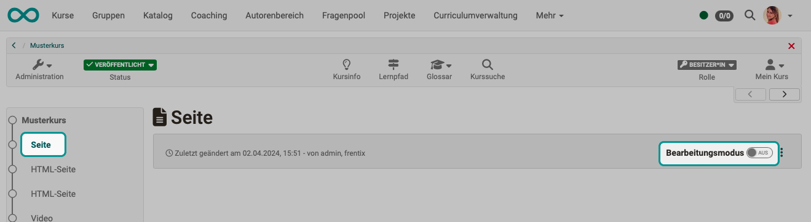
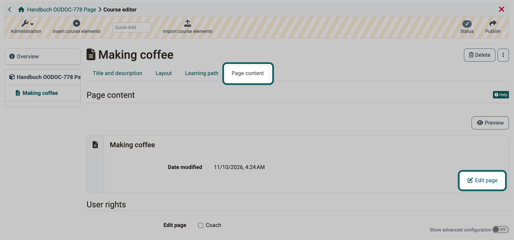
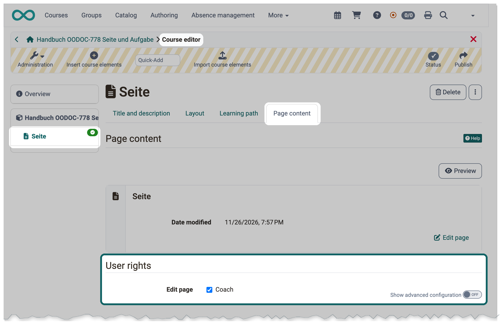
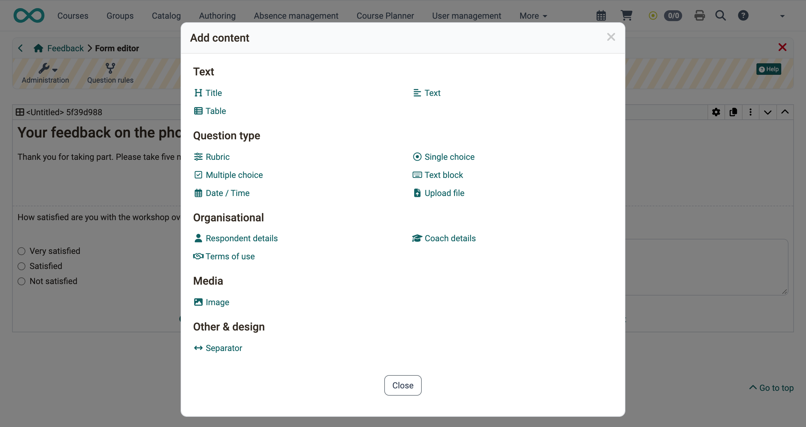
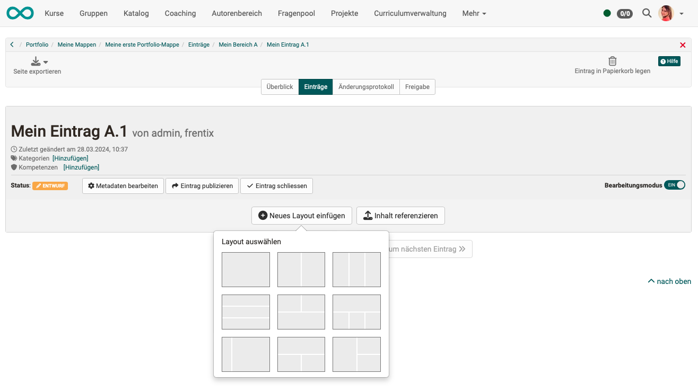

# Content Editor

## What is the Content Editor? {: #content_editor}

With the Content Editor you design a page from various content elements, arranged according to a layout you choose yourself. The page is optimised for mobile devices. OpenOlat saves your changes automatically.

The Content Editor is used in several places in OpenOlat. Who uses it depends on the place: in the course element "Page" the owners of the course and authorised coaches, in the learning resource "Form" its owners, in the portfolio the owners of the binder.

{ class="shadow lightbox" title="Content Editor in the course element Page · 2026.11.10" }

!!! note "Note"

    Besides the Content Editor, OpenOlat also has the HTML editor "TinyMCE", which is used in the [course element "HTML page"](../../learningresources/Course_Element_HTML_Page.md), for example.

## Tasks in the Content Editor {: #tasks}

Each task in the Content Editor has its own page:

| Topic | Purpose |
|---|---|
| [Layout](Editor_Layout.md) | Divide a page into areas, arrange content in them and set spacing, background and alert boxes. |
| [Add content](Editor_Add_Content.md) | Insert texts, images, videos, documents and other content, also from your Media Center, the store for your media files. |
| [Quiz and AI feedback](Editor_Quiz.md) | Ask learners questions about the content in the course element "Page" and give them AI feedback on free-text answers. |
| [Import](Editor_Import.md) | Take over a Markdown or Word file into a page and, if the AI feature is set up, let the AI generate questions. |

[To the top of the page ^](#content_editor)

---

## Where is the Content Editor used? {: #content_editor_use}

The Content Editor is used in the [course element Page](../../learningresources/Course_Element_Page.md), in the [learning resource "Form"](../../learningresources/Form/index.md) and in the ["Portfolio 2.0"](../../area_modules/The_portfolio_editor_17_1.md).

### Course element page [:octicons-tag-16:{ title="from Release 18.0.0 (OO-6966)" }](https://track.frentix.com/issue/OO-6966){:target="_blank"} {: #course_element_page}

In the course element "Page" you open the Content Editor in two ways: in the course editor in the tab "Page content" with "Edit page", or with the course editor closed directly in the course element by switching on the edit mode. You reach the course editor under: `Course > Administration > Course editor`.

**When the course editor is closed:**

{ class="shadow lightbox" title="Course element Page in the course" }

The switch "Edit mode" turns editing of the page on and off.

**In the course editor:**

{ class="shadow lightbox" title="Course element Page in the course editor" }

In the tab "Page content" you define under "Rights" whether, in addition to course owners, coaches may also edit the page when the course editor is closed: option "Edit page" for "Coach". With "Show advanced configuration" you additionally grant the right to individual roles, groups or users, optionally with a start and end.

{ class="shadow lightbox" title="Page content tab of the course element Page in the course editor · 2026.11.26" }

OpenOlat stores the media content of the [course element "Page"](../../learningresources/Course_Element_Page.md) (images, audio, video, diagrams, citations, documents, etc.) in the [Media Center](../../personal_menu/Media_Center.md), not in the course’s storage folder as with the [course element "HTML page"](../../learningresources/Course_Element_HTML_Page.md).

The media of a portfolio binder are also stored in the Media Center. The learning resource "Form", by contrast, stores images in the learning resource itself.

[To the top of the page ^](#content_editor)

---

### Learning resource form {: #form}

You also put together the questions and texts of a [learning resource Form](../../learningresources/Form/index.md) in the Content Editor, under: `Form > Administration > Form editor`. This applies to every form, including one you later embed in a [course element "Form"](../../learningresources/Course_Element_Form.md) or ["Survey"](../../learningresources/Course_Element_Survey.md).

The dialog "Add content" is adapted to the form: besides "Text", "Media" and "Other & design" it offers the groups "Question type" and "Organisational". Which elements a form holds is described on the page [Form elements](../../learningresources/Form_Elements/index.md).

{ class="shadow lightbox" title="Add content dialog in the form editor" }

[To the top of the page ^](#content_editor)

---

### Portfolio 2.0 [:octicons-tag-16:{ title="from Release 11.0 (OO-2057)" }](https://track.frentix.com/issue/OO-2057){:target="_blank"} {: #portfolio}

In Portfolio 2.0, your personal area for binders, you design the entries in your [binders](../../area_modules/My_portfolio_binders.md) with the Content Editor, whether the binder is independent of a course or comes from a [portfolio template](../../learningresources/Portfolio_template_Creation.md) or a [portfolio task](../../learningresources/Course_Element_Portfolio_Task.md). Like every page, an entry starts with a layout that you select via "Add a new layout".

{ class="shadow lightbox" title="Layout templates of a portfolio binder" }

[The Portfolio Editor >](../../area_modules/The_portfolio_editor_17_1.md)

[To the top of the page ^](#content_editor)

---

## Further information {: #further_information}

**Further reading** 
[Media Center Concept >](../Media_Center_Concept/index.md) 
[Accessibility: Basic principles >](../Accessibility_Principals.md)

[To the top of the page ^](#content_editor)
