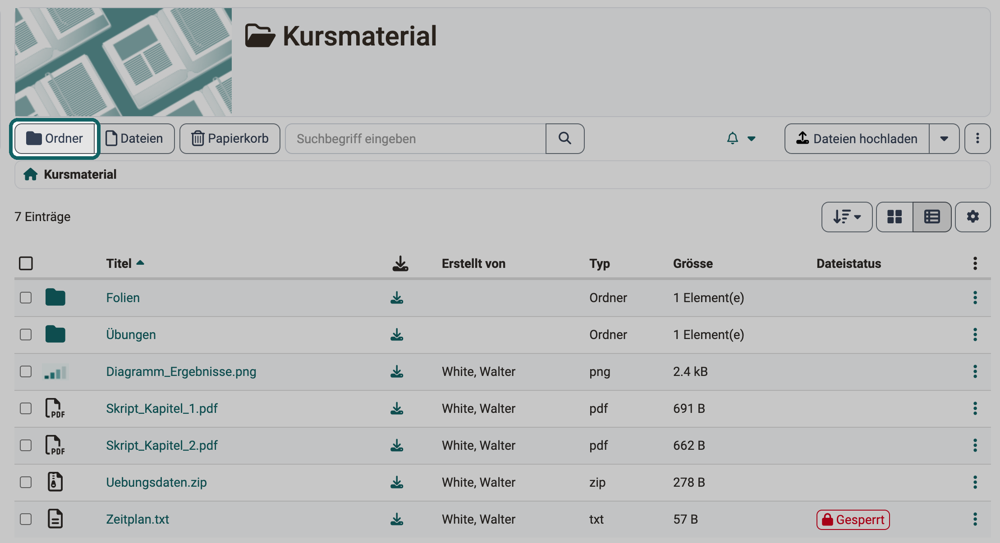
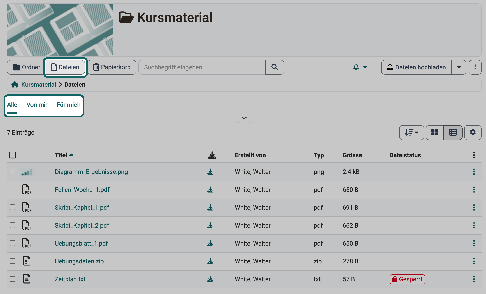

# Ordnerkonzept {: #folders}

Die Ordnerkomponente ist überall in OpenOlat im Einsatz, wo Dateien abgelegt werden. Diese Seite zeigt die verschiedenen Ordner und die Arbeit mit Dateien. [:octicons-tag-16:{ title="ab Release 19.0 (OO-7700)" }](https://track.frentix.com/issue/OO-7700){:target="_blank"}

## Die verschiedenen Ordner {: #folder_types}

### Persönlicher Ordner {: #personal_folder}

Den persönlichen Ordner finden Sie bei den persönlichen Werkzeugen im [persönlichen Menü](../personal_menu/index.de.md), im [File Hub](../personal_menu/File_Hub.de.md).

Er bietet die Möglichkeit, individuelle Dateien unabhängig von Kursen oder Ressourcenordnern abzulegen.

Der persönliche Ordner hat einen privaten und einen öffentlichen Bereich. Dateien im privaten Ordner sind nur für die jeweilige Person sichtbar, während Dateien im öffentlichen Bereich über die Visitenkarte von allen Benutzer:innen im System gelesen und heruntergeladen werden können.

!!! tip "Tipp"

    Um sich die Visitenkarten anderer OpenOlat-Benutzer:innen anzuschauen, wählen Sie "Personensuche" im persönlichen Menü und suchen die gewünschte Person über die Suchmaske.

[Zu den Details der persönlichen Dateien >](../personal_menu/File_Hub.de.md#personal_files) 
[Zu den Details des File Hubs >](../personal_menu/File_Hub.de.md) 
[Zum Seitenanfang ^](#folders)

### Ablageordner {: #storage_folder}

Im Ablageordner eines Kurses legen Sie die Dateien ab, die Sie im Kurs verwenden.

Sie öffnen ihn im Kurs über `Kurs > Administration > Dateien > Ablageordner` oder über den [File Hub](../personal_menu/File_Hub.de.md) unter "Kurse". Wählen Sie dort den passenden Kurs aus.

In den Ablageordner laden Sie zum Beispiel Dateien hoch, die Sie später im Kurs von einer Seite aus verlinken.

[Zu den Details >](../learningresources/Storage_folder.de.md) 
[Zum Seitenanfang ^](#folders)

### Ressourcenordner {: #resource_folder}

Verwenden Sie dieselben Dateien in mehreren Kursen, laden Sie sie in einen Ressourcenordner hoch. So bearbeiten Sie sie an einer einzigen Stelle.

Um den Ressourcenordner in einem Kurs zu nutzen, binden Sie ihn im Kurs über `Kurs > Administration > Einstellungen > Tab "Optionen"` ein. Anschliessend finden Sie im Ablageordner des Kurses den Ordner "_sharedfolder" mit den Dateien des Ressourcenordners. Pro Kurs ist ein Ressourcenordner möglich.

Der kursübergreifende Ressourcenordner ist eine Lernressource. Er ist deshalb auch im Autorenbereich aufgelistet und kann dort bearbeitet werden.

[Zu den Details >](../learningresources/Resource_Folder.de.md) 
[Zum Seitenanfang ^](#folders)

### Kursbaustein "Ordner" {: #course_element_folder}

Der [Kursbaustein "Ordner"](../learningresources/Course_Element_Folder.de.md) ist eine Ablagemöglichkeit innerhalb eines Kurses. Betreuer:innen und Besitzer:innen des Kurses können dort Dateien zum Download bereitstellen. Teilnehmende des Kurses können bei Bedarf ebenfalls das Upload-Recht erhalten.

[Zu den Details >](../learningresources/Course_Element_Folder.de.md) 
[Zum Seitenanfang ^](#folders)

### Kursbaustein "Teilnehmer:innen Ordner" {: #course_element_participant_folder}

Der [Kursbaustein "Teilnehmer:innen Ordner"](../learningresources/Course_Element_Participant_Folder.de.md) ermöglicht einen Dateiaustausch zwischen einzelnen Teilnehmenden und Betreuenden. Dafür stehen zwei Unterordner zur Verfügung. Zum einen ist dies der "Teilnehmer:innen Abgabeordner", über den Teilnehmende Dateien an Betreuer:innen abgeben können. Zum anderen der "Betreuer:innen Rückgabeordner", in welchem die Betreuer:innen Dateien an alle Teilnehmer:innen gleichzeitig oder individuell zurückgeben können.

[Zu den Details >](../learningresources/Course_Element_Participant_Folder.de.md) 
[Zum Seitenanfang ^](#folders)

### Ordner im Kursbaustein "Aufgabe" bzw. "Gruppenaufgabe" {: #course_element_task}

Innerhalb des Workflows eines [Kursbausteins "Aufgabe"](../learningresources/Course_Element_Task.de.md) und ["Gruppenaufgabe"](../learningresources/Course_Element_Grouptask.de.md) werden verschiedene Dokumente von Betreuenden oder Teilnehmenden hoch- und heruntergeladen: Aufgabenstellung, abgegebene Dokumente, zurückgegebene Dokumente, überarbeitete Dokumente und Musterlösung. Für alle Dateien stehen innerhalb des Kursbausteins Ordner zur Verfügung, die nur innerhalb des Kursbausteins zugänglich sind.

[Zu den Details >](../learningresources/Course_Element_Task.de.md#workflow) 
[Zum Seitenanfang ^](#folders)

### Ordner für Mitglieder einer Gruppe (Gruppenordner) {: #group_folder}

Innerhalb einer Gruppe können Gruppenmitglieder Dokumente im gemeinsamen Gruppenordner austauschen. Dort können Dateien hochgeladen, erstellt und heruntergeladen werden. Eine weitere Strukturierung mit Unterordnern ist ebenfalls möglich.

Auch über den [File Hub](../personal_menu/File_Hub.de.md) kann auf Gruppenordner zugegriffen werden. Der File Hub erkennt automatisch, ob Sie Mitglied einer Gruppe sind und welche Gruppenordner Ihnen deshalb im File Hub angezeigt werden.

Der Zugriff auf einen Gruppenordner ist in jedem Fall an die Mitgliedschaft in der betreffenden Gruppe gebunden.

[Zu den Details >](../groups/Using_Group_Tools.de.md) 
[Zum Seitenanfang ^](#folders)

### Ordner für Betreuer:innen (Unterlagen Betreuer:innen) {: #coach_folder}

Innerhalb eines Kurses kann ein Ordner eingerichtet werden, der nur für die Betreuer:innen dieses Kurses zugänglich ist. Dort können z.B. Dokumente ausgetauscht werden oder einfach Dateien zum Kurs abgelegt werden, die den Teilnehmer:innen nicht zugänglich sein sollen.

Eingerichtet wird dieser Ordner unter `Kurs > Administration > Einstellungen > Tab "Optionen" > Abschnitt "Einstellungen Betreuer:innen"`. Es kann ein Unterordner aus dem Ablageordner des Kurses verwendet werden oder ein Ordner automatisch neu erstellt werden (`_coachdocuments`).

Geöffnet werden kann der Ordner anschliessend unter `Kurs > Administration > Unterlagen Betreuer:innen`. Auch via [File Hub](../personal_menu/File_Hub.de.md) kann durch Auswahl des Kurses auf den Ordner zugegriffen werden.

[Zu den Details >](../learningresources/Course_Settings_Options.de.md#einstellungen-betreuerinnen) 
[Zum Seitenanfang ^](#folders)

### Kursarchiv {: #archive}

Wird ein ganzer Kurs archiviert oder nur aus einigen Kursbausteinen ein Teilarchiv erstellt, ist dieses Archiv im [File Hub](../personal_menu/File_Hub.de.md) im Ordner "Kursarchiv" abgelegt.

[Zu den Details >](../learningresources/Course_Archiving.de.md) 
[Zum Seitenanfang ^](#folders)

### Dokumentenpool {: #documentpool}

Auch der Dokumentenpool ist im File Hub als Ordner angezeigt, in dem unterschiedliche Dateien abgelegt werden. Allerdings werden hier zu den Dateien Metadaten hinzugefügt (z.B. Taxonomie). Es ist also keine reine Dateiablage in einem Filesystem, obwohl z.B. über WebDAV Dateien in den Dokumentenpool übertragen werden können.

[Zu den Details >](../basic_concepts/File_Hub_Concept.de.md#document_pool) 
[Zum Seitenanfang ^](#folders)

## Ansicht {: #view}

Mit den Buttons "Ordner" und "Dateien" über der Liste schalten Sie um zwischen der hierarchischen Ansicht mit Ordnern und der reinen Dateiansicht. In der Dateiansicht stehen zusätzlich die Filter-Tabs "Von mir" und "Für mich" zur Verfügung.

=== "Hierarchische Ansicht mit Ordnern"

    { class="shadow lightbox" title="Kursbaustein Ordner im Kurs · 2026.11.03" }

=== "Nur Dateien in der Ansicht"

    { class="shadow lightbox" title="Kursbaustein Ordner im Kurs · 2026.11.03" }

!!! tip "Tipp"

    Im Krümelpfad unter den Buttons ist jederzeit ersichtlich, in welchem Ordner Sie sich gerade befinden. Durch Klick auf einen Abschnitt im Krümelpfad springen Sie direkt zu dieser Ebene.

## Suche [:octicons-tag-16:{ title="ab Release 19.0 (OO-7552)" }](https://track.frentix.com/issue/OO-7552) {: #search}

Die Suchfunktion in Ordnern sucht nach

* Dateinamen,
* Beschreibung und
* Ersteller

im aktuellen Ordner mit seinen Unterordnern. Es ist keine Volltextsuche, also keine Suche z.B. innerhalb von Word-Dateien.

## Dateistatus {: #status}

Ob jemand eine Datei gerade bearbeitet oder ob sie gesperrt ist, sehen Sie in der Spalte "Dateistatus". Ist die Spalte nicht sichtbar, blenden Sie sie über das Zahnrad-Icon ein.

Bearbeitet jemand eine Datei gerade, trägt sie den Status "Wird gerade bearbeitet".

Den Status "Gesperrt" setzen Sie in den [Metadaten](Search_General.de.md#metadata). Die Metadaten bearbeiten Sie unter den drei Punkten am Ende einer Zeile.

Eine neu hochgeladene Datei trägt zunächst das Label "Neu". So finden Sie sie sofort wieder, um sie zum Beispiel zu verschieben oder zu kopieren. Das Label sieht nur die Person, die die Datei hochgeladen hat. Es verschwindet, sobald sie den Ordner einmal verlassen hat.

## Mit Dateien arbeiten {: #work_with_files}

### Aktionen via Menü

Um Dateien zu verschieben, zu kopieren, herunterzuladen, zu packen (zippen) oder zu löschen, öffnen Sie das Menü unter den drei Punkten am Ende einer Zeile (rechter Rand einer Liste).

### Drag & Drop [:octicons-tag-16:{ title="ab Release 19.0 (OO-7491)" }](https://track.frentix.com/issue/OO-7491)

Dateien ziehen Sie auch per Drag & Drop mit der Maus auf ein markiertes Zielfeld.

### Multi-File-Upload

Sie können auch mehrere Dateien auswählen und gemeinsam auf das Zielfeld ziehen.

### Massenaktionen

Sobald in einer Liste mindestens eine Checkbox am Zeilenbeginn ausgewählt ist, erscheinen über der Liste Buttons mit verfügbaren Optionen (herunterladen, verschieben, usw.).

Markieren Sie die Checkbox in der Kopfzeile, werden alle Listeneinträge ausgewählt und markiert. Dadurch können schnell mehrere Einträge gleichzeitig bearbeitet werden.

### HTML-Dateien öffnen [:octicons-tag-16:{ title="ab Release 21.0 (OO-7554)" }](https://track.frentix.com/issue/OO-7554){:target="_blank"} {: #open_html}

Wenn Sie in einem Ordner auf eine HTML-Datei klicken, öffnet OpenOlat sie je nach Ihrem Recht im Ordner zum Bearbeiten oder nur zum Ansehen:

- **Mit Schreibrecht** öffnet sich die Datei im HTML-Editor in einem neuen Browserfenster.
- **Mit reinem Leserecht** öffnet sich eine Vorschau der Datei in einer Lightbox über der aktuellen Seite.

Die Vorschau in der Lightbox liefert die Datei über eine eigene Inhaltsdomäne aus, also über eine zweite Webadresse neben der Adresse, unter der Sie OpenOlat aufrufen. HTML-Code und Skripte aus der Datei erhalten so keinen Zugriff auf die OpenOlat-Sitzung (Session) der Person, die die Datei ansieht.

Die Vorschau in der Lightbox setzt eine Inhaltsdomäne voraus, die Administrator:innen eingerichtet haben. Ohne Inhaltsdomäne öffnet sich eine HTML-Datei auch bei reinem Leserecht in einem neuen Browserfenster. Wie die Inhaltsdomäne eingerichtet wird, beschreibt der englischsprachige [Installation guide](../../manual_admin/installation/installGuide.md#recommended-content-domain-for-user-provided-content).

## Papierkorb [:octicons-tag-16:{ title="ab Release 19.0 (OO-7541)" }](https://track.frentix.com/issue/OO-7541) {: #paper_basket}

Die Dateien im Papierkorb können automatisch nach einer bestimmten Zeit gelöscht werden. Die Verbleibdauer im Papierkorb und das automatische Löschen wird von Administrator:innen eingerichtet.

!!! note "Hinweis"

    Die Ordnerkomponente wird in folgenden OpenOlat-Bereichen verwendet:

    - Ressourcenordner (shared folder)
    - Ablageordner des Kurses
    - Kursarchiv
    - Bibliothek
    - Projekt
    - Kollaborationstools der Gruppen
    - Taxonomie / Lost & Found
    - Kursbaustein "Teilnehmer:innen Ordner"

## Weiterführende Informationen {: #further_information}

**Auf dieser Seite erwähnt** 
[Persönliches Menü >](../personal_menu/index.de.md) 
[Persönliche Werkzeuge: File Hub >](../personal_menu/File_Hub.de.md) 
[Ablageordner >](../learningresources/Storage_folder.de.md) 
[Ressourcenordner >](../learningresources/Resource_Folder.de.md) 
[Kursbaustein "Ordner" >](../learningresources/Course_Element_Folder.de.md) 
[Kursbaustein "Teilnehmer:innen Ordner" >](../learningresources/Course_Element_Participant_Folder.de.md) 
[Kursbaustein "Aufgabe" >](../learningresources/Course_Element_Task.de.md) 
[Kursbaustein "Gruppenaufgabe" >](../learningresources/Course_Element_Grouptask.de.md) 
[Gruppenwerkzeuge nutzen >](../groups/Using_Group_Tools.de.md) 
[Kurseinstellungen - Tab Optionen >](../learningresources/Course_Settings_Options.de.md) 
[Kursadministration - Archivierung & Reports >](../learningresources/Course_Archiving.de.md) 
[Konzept des File Hub >](File_Hub_Concept.de.md) 
[Allgemeines zur Suche >](Search_General.de.md) 
[Installation guide >](../../manual_admin/installation/installGuide.md)

**Weiterführend** 
[Unterlagen Betreuer:innen >](../learningresources/Coach_Files.de.md) 
[Mit welchen Ordnern kann ich Dokumente anbieten? >](../../manual_how-to/folders/folders.de.md) 
[Suche im File Hub >](Search_in_FileHub.de.md) 
[Einsatz von WebDAV >](Using_WebDAV.de.md)

[Zum Seitenanfang ^](#folders)
