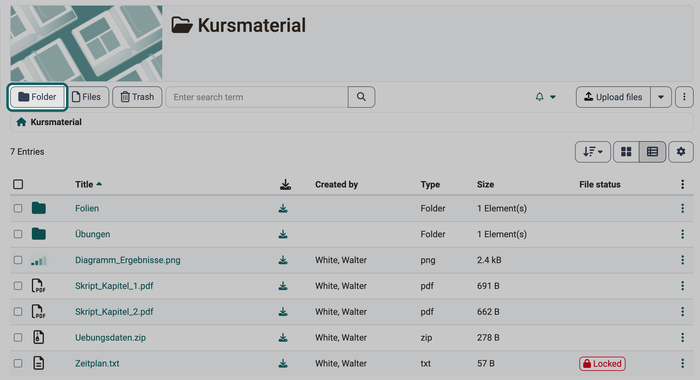
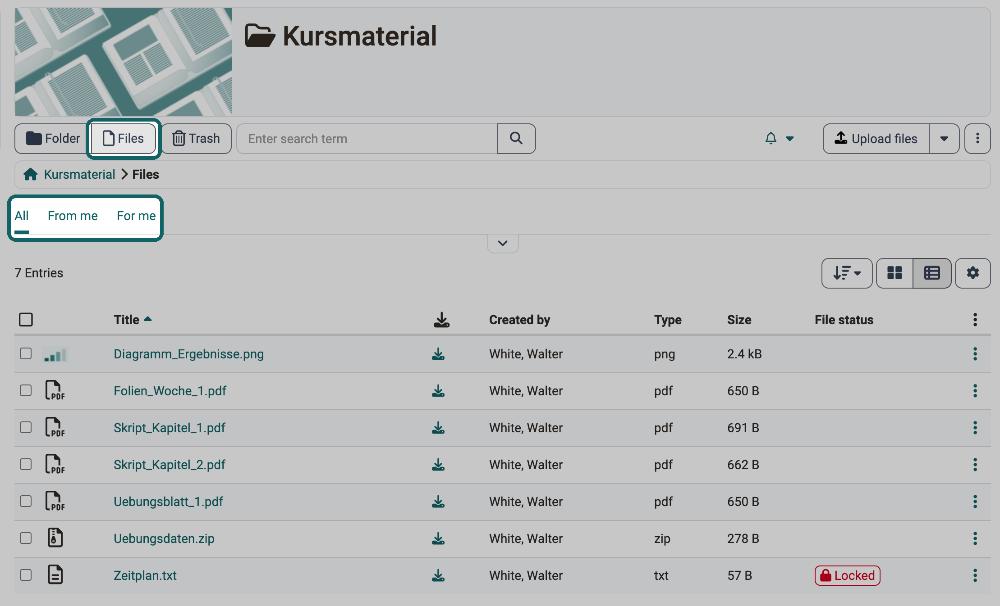

# Folder concept {: #folders}

Wherever files are stored in OpenOlat, folders look the same and work the same way. This page shows the different folders and how to work with files. [:octicons-tag-16:{ title="from Release 19.0 (OO-7700)" }](https://track.frentix.com/issue/OO-7700){:target="_blank"}

## Different folder types {: #folder_types}

### Personal folder {: #personal_folder}

The personal folder can be found in the user tools in the [personal menu](../personal_menu/index.md), in the [File Hub](../personal_menu/File_Hub.md).

It offers the option of storing individual files independently of courses or resource folders.

The personal folder has a private and a public area. Files in the private folder are only visible to the respective person, while files in the public area can be read and downloaded by all users in the system via the visiting card.

!!! tip "Tip"

    To view the visiting cards of other OpenOlat users, select "Other users" in the personal menu and search for the desired person using the search mask.

[See the details about the personal files >](../personal_menu/File_Hub.md#personal_files) 
[See the details about the File Hub >](../personal_menu/File_Hub.md) 
[To the top of the page ^](#folders)

### Storage folder {: #storage_folder}

In the storage folder of a course, you store the files you use in the course.

You open it in the course via `Course > Administration > Files > Storage folder` or via the [File Hub](../personal_menu/File_Hub.md) under "Courses". Select the appropriate course there.

To the storage folder you upload, for example, files that you later link from a page in the course.

[See the details >](../learningresources/Storage_folder.md) 
[To the top of the page ^](#folders)

### Resource folder {: #resource_folder}

If you use the same files in several courses, upload them to a resource folder. This way you edit them in one single place.

To use the resource folder in a course, integrate it in the course via `Course > Administration > Settings > Tab "Options"`. You then find the folder "_sharedfolder" with the files of the resource folder in the storage folder of the course. One resource folder is possible per course.

The cross-course resource folder is a learning resource. It is therefore also listed in Authoring and can be edited there.

[See the details >](../learningresources/Resource_Folder.md) 
[To the top of the page ^](#folders)

### Course element "Folder" {: #course_element_folder}

The [course element "Folder"](../learningresources/Course_Element_Folder.md) is a storage option within a course. Coaches and owners of the course can make files available for download there. Participants of the course can also be granted the upload right if required.

[See the details >](../learningresources/Course_Element_Folder.md) 
[To the top of the page ^](#folders)

### Course element "Participant folder" {: #course_element_participant_folder}

The [course element "Participant folder"](../learningresources/Course_Element_Participant_Folder.md) enables the exchange of files between individual participants and coaches. Two subfolders are available for this purpose. One is the "Participant Drop Box", which participants can use to submit files to coaches. The other is the "Coach Return Box", in which the coaches can return files to all participants simultaneously or individually.

[See the details >](../learningresources/Course_Element_Participant_Folder.md) 
[To the top of the page ^](#folders)

### Folder in the course element "Task" or "Group task" {: #course_element_task}

Within the workflow of a [course element "Task"](../learningresources/Course_Element_Task/index.md) and ["Group task"](../learningresources/Course_Element_Grouptask.md), various documents are uploaded and downloaded by coaches or participants: assignment, submitted documents, returned documents, revised documents and sample solution. Folders are available for all files within the course element, which are only accessible within the course element.

[See the details >](../learningresources/Course_Element_Task/Task_Setup.md#workflow) 
[To the top of the page ^](#folders)

### Folder for members of a group (group folder) {: #group_folder}

Within a group, group members can exchange documents in the shared group folder. Files can be uploaded, created and downloaded there. Further structuring with subfolders is also possible.

Group folders can also be accessed via the [File Hub](../personal_menu/File_Hub.md). The File Hub automatically recognizes whether you are a member of a group and which group folders are therefore displayed in the File Hub.

Access to a group folder is always linked to membership of the relevant group.

[See the details >](../groups/Using_Group_Tools.md) 
[To the top of the page ^](#folders)

### Folder for coaches (Coach files) {: #coach_folder}

A folder can be set up within a course that is only accessible to the coaches of this course. Documents can be exchanged there, for example, or files relating to the course that should not be accessible to participants can simply be stored there.

This folder is set up under `Course > Administration > Settings > Tab "Options" > Section "Coach settings"`. A subfolder from the storage folder of the course can be used or a new folder can be created automatically (`_coachdocuments`).

The folder can then be opened under `Course > Administration > Coach files`. The folder can also be accessed via the [File Hub](../personal_menu/File_Hub.md) by selecting the course.

[See the details >](../learningresources/Course_Settings_Options.md#coach-settings) 
[To the top of the page ^](#folders)

### Course archive {: #archive}

If an entire course is archived or only a partial archive is created from some course elements, this archive is stored in the [File Hub](../personal_menu/File_Hub.md) in the folder "Course archive".

[See the details >](../learningresources/Course_Archiving/index.md) 
[To the top of the page ^](#folders)

### Document pool {: #documentpool}

The document pool is also displayed in the File Hub as a folder in which different files are stored. However, metadata is added to the files here (e.g. taxonomy). It is therefore not a pure file storage in a file system, although files can be transferred to the document pool via WebDAV, for example.

[See the details >](../basic_concepts/File_Hub_Concept.md#document_pool) 
[To the top of the page ^](#folders)

## View {: #view}

Use the buttons "Folder" and "Files" above the list to switch between the hierarchical view with folders and the pure file view. In the file view, the filter tabs "From me" and "For me" are also available.

=== "Hierarchical view with folders"

    { class="shadow lightbox" title="Course element Folder in the course · 2026.11.03" }

=== "Only files in the view"

    { class="shadow lightbox" title="Course element Folder in the course · 2026.11.03" }

!!! tip "Tip"

    In the breadcrumb below the buttons, you can always see which folder you are currently in. Click on a section in the breadcrumb to jump directly to this level.

## Search [:octicons-tag-16:{ title="from Release 19.0 (OO-7552)" }](https://track.frentix.com/issue/OO-7552) {: #search}

The search function in folders searches for

* file names,
* description and
* creator

in the current folder and its subfolders. It is not a full-text search, i.e. no search within Word files, for example.

## File status {: #status}

Whether someone is currently editing a file or whether it is locked, you see in the column "File status". If the column is not visible, show it using the gear icon.

If someone is currently editing a file, it has the status "Currently being edited".

You set the status "Locked" in the [metadata](Search_General/index.md#metadata). You edit the metadata under the three dots at the end of a line.

A newly uploaded file first has the label "New". This way you find it again immediately, for example to move or copy it. Only the person who uploaded the file sees the label. It disappears as soon as this person has left the folder once.

## Working with files {: #work_with_files}

### Actions via menu

To move, copy, download, pack (zip) or delete files, open the menu under the three dots at the end of a line (right-hand edge of a list).

### Drag & Drop [:octicons-tag-16:{ title="from Release 19.0 (OO-7491)" }](https://track.frentix.com/issue/OO-7491)

You also drag files with the mouse onto a highlighted target field using Drag & Drop.

### Multi-file upload

You can also select several files and drag them together onto the target field.

### Mass actions

As soon as at least one checkbox is selected at the beginning of a line in a list, buttons with available options (download, move, etc.) appear above the list.

If you select the checkbox in the header, all list entries are selected and highlighted. This allows you to quickly edit several entries at the same time.

### Opening HTML files [:octicons-tag-16:{ title="from Release 21.0 (OO-7554)" }](https://track.frentix.com/issue/OO-7554){:target="_blank"} {: #open_html}

!!! info "Contact"
    The preview of an HTML file in a lightbox, a window above the current page, requires a content domain (separate address for content). The content domain is part of the server configuration. For a change, contact your organisation.

When you click an HTML file in a folder, OpenOlat opens it for editing or for viewing only, depending on your access in the folder:

- **With write access**, the file opens in the HTML editor in a new browser window.
- **With read-only access**, a preview of the file opens in a lightbox above the current page.

The preview in the lightbox delivers the file through the [content domain](Content_Domain.md). HTML code and scripts from the file therefore have no access to your OpenOlat session.

Without a content domain, an HTML file opens in a new browser window even with read-only access.

## Trash [:octicons-tag-16:{ title="from Release 19.0 (OO-7541)" }](https://track.frentix.com/issue/OO-7541) {: #paper_basket}

The files in the trash can be deleted automatically after a certain period of time. System administrators define the retention period in the trash and the automatic deletion in the system administration: `Administration > Core functions > Files and folders`.

!!! note "Note"

    Folders as described here are available in the following areas of OpenOlat:

    - Resource folder (shared folder)
    - Storage folder of the course
    - Course archive
    - Library
    - Project
    - Collaboration tools of the groups
    - Taxonomy / Lost & Found
    - Course element "Participant folder"

## Further information {: #further_information}

**Mentioned on this page** 
[Personal menu and general components >](../personal_menu/index.md) 
[User tools: File Hub >](../personal_menu/File_Hub.md) 
[Storage folder >](../learningresources/Storage_folder.md) 
[Resource folder >](../learningresources/Resource_Folder.md) 
[Course Element "Folder" >](../learningresources/Course_Element_Folder.md) 
[Course Element "Participant folder" >](../learningresources/Course_Element_Participant_Folder.md) 
[Course Element "Task" >](../learningresources/Course_Element_Task/index.md) 
[Course Element "Group Task" >](../learningresources/Course_Element_Grouptask.md) 
[Using Group Tools >](../groups/Using_Group_Tools.md) 
[Course Settings - Tab Options >](../learningresources/Course_Settings_Options.md) 
[Course Administration: Archiving & Reports >](../learningresources/Course_Archiving/index.md) 
[File Hub Concept >](File_Hub_Concept.md) 
[General information on the search >](Search_General/index.md) 
[Content domain >](Content_Domain.md)

**Further reading** 
[Coach files >](../learningresources/Coach_Files.md) 
[Which folders can I use to provide documents? >](../../manual_how-to/folders/folders.md) 
[Search in the File Hub >](Search_in_FileHub.md) 
[Using WebDAV >](Using_WebDAV.md)

[To the top of the page ^](#folders)
