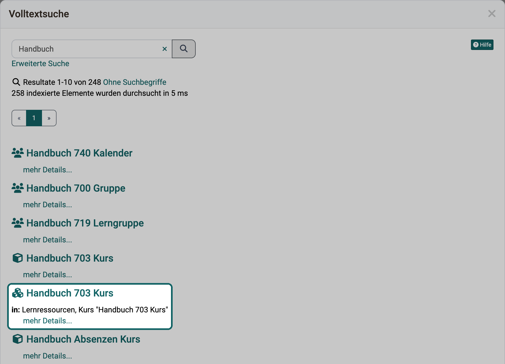
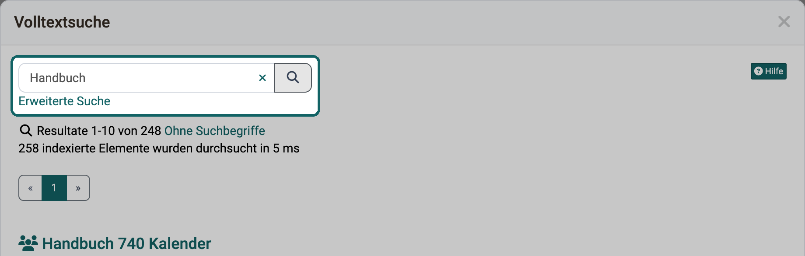
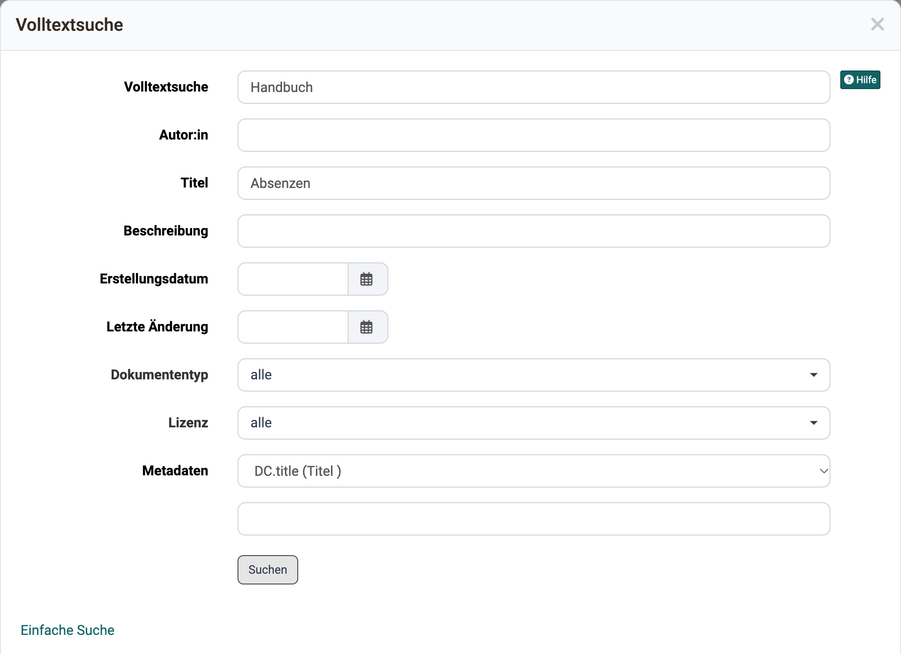
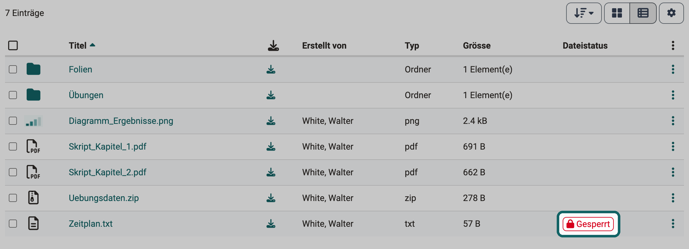

# :o_icon_o_icon_search: Volltextsuche {: #full_text_search}

Mit der Volltextsuche finden Sie einen Begriff in ganz OpenOlat, auch im Text von Dokumenten. Sie sucht in den Inhalten von Kursen und Gruppen, beispielsweise in Forumsbeiträgen, PDF- und Word-Dateien. Die Volltextsuche öffnen Sie mit dem Lupen-Symbol oben rechts in der Hauptnavigation: Suchbegriff eingeben und mit der Eingabetaste bestätigen. Die Treffer erscheinen im Dialog "Volltextsuche". Personendaten wie Profile, Visitenkarten oder persönliche Ordner indexiert die Volltextsuche nicht.

Das Lupen-Symbol erscheint, wenn die Suche für Ihre OpenOlat-Instanz eingeschaltet ist. Die Suche ist Teil der Serverkonfiguration, siehe [Globale Suche](Search_Global.de.md#activation). Für eine Änderung wenden Sie sich an Ihre Organisation.

:octicons-device-camera-video-24: **Video-Einführung**: [Suchfunktion](<https://www.youtube.com/embed/GlUCyVl11ic>){:target="_blank"}

Liegt ein Treffer in einem Kurs, nennt die Zeile "in:" unter seinem Titel den Kurs als Fundort. Mit "mehr Details..." unter einem Treffer klappen Sie weitere Angaben auf, etwa Autor:in, letzte Änderung, Typ und Beschreibung. Über der Trefferliste blendet der Link "Ohne Suchbegriffe" die Textausschnitte mit den hervorgehobenen Suchbegriffen aus, der Link "Mit Suchbegriffen" blendet sie wieder ein.

{ class="shadow lightbox" title="Dialog Volltextsuche · 2026.11.06" }

Sie finden über die Volltextsuche immer nur diejenigen Kursinhalte, auf die Sie Zugriff haben.

## Erweiterte Suche {: #advanced_search}

Liefert die Volltextsuche zu viele Treffer, verfeinern Sie die Suche mit der erweiterten Suche. Sie öffnen sie im Dialog "Volltextsuche" mit dem Link "Erweiterte Suche" unter dem Suchfeld.

{ class="shadow lightbox" title="Dialog Volltextsuche · 2026.11.06" }

{ class="shadow lightbox" title="Erweiterte Suche im Dialog Volltextsuche · 2026.11.06" }

In der erweiterten Suche stehen die Felder "Volltextsuche", "Autor:in", "Titel", "Beschreibung", "Erstellungsdatum", "Letzte Änderung", "Dokumententyp", "Lizenz" und "Metadaten" zur Verfügung. Das Feld "Lizenz" erscheint, wenn auf Ihrer OpenOlat-Instanz Lizenzen eingeschaltet sind. Im Feld "Dokumententyp" wählen Sie einen oder mehrere Typen aus, zum Beispiel "PDF-Datei" oder "Forum". Steht dort "alle", sucht die erweiterte Suche in allen Typen.

Die Suchfelder sind mit dem booleschen AND-Operator verknüpft. Füllen Sie zum Beispiel die Felder "Titel" und "Autor:in" aus, findet die Suche nur Dokumente, die beide Begriffe im jeweiligen Feld enthalten.

Ausnahme: Das Feld "Volltextsuche" sucht über alle Felder.

Aus der Ergebnisliste können Sie direkt auf den Lerninhalt mit dem gefundenen Suchbegriff springen.

Mit dem Link "Einfache Suche" unter dem Formular wechseln Sie zurück zum einzelnen Suchfeld.

!!! info "Wichtig"

    Neben der Volltextsuche über das gesamte OpenOlat gibt es auch eine [Kurssuche](Search_in_Course.de.md), welche pro Kurs in der Toolbar aktiviert werden kann. Die Einstellung aktivieren Sie unter `Kurs > Administration > Einstellungen` im Tab "[Toolbar](../learningresources/Course_Settings.de.md#toolbar)". Die Kurssuche durchsucht nur den entsprechenden Kurs.

## Suchsyntax {: #syntax}

Mit der folgenden Syntax grenzen Sie Ihre Suchanfrage genauer ein.

**Einzelne Begriffe**, z.B. _OpenOlat_

**Mehrere Begriffe** im Suchfeld sind immer mit dem ODER-Operator verknüpft.

**Suche mittels Wildcards (Platzhalter):** Um nach bestimmten Wortfragmenten zu suchen, verwenden Sie Wildcards.

  * Das Fragezeichen in einem Suchbegriff steht für einen beliebigen, einzelnen Buchstaben. Mit der Sucheingabe _te?t_ finden Sie zum Beispiel alle Dokumente, die die Wörter "test", "text" usw. enthalten.
  * Der Stern in einem Suchbegriff steht für eine beliebige Anzahl von beliebigen Buchstaben. Mit der Sucheingabe _Test*_ finden Sie zum Beispiel alle Dokumente, die Wörter enthalten, die mit "Test" beginnen. Der Stern kann auch innerhalb eines Suchbegriffes stehen: _Te*t_

**Erweiterte Suche:** In der erweiterten Suche sind die verschiedenen Suchfelder mit dem AND-Operator verknüpft.

## Metadaten {: #metadata}

Metadaten helfen, ein Dokument zu erkennen und in der Suche zu finden. Metadaten oder _Metainformationen_ sind Daten, die Informationen über Merkmale anderer Daten enthalten, aber nicht diese Daten selbst. Sie beschreiben eine Datei mit ergänzenden Informationen wie zum Beispiel einem Titel, dem Urheber oder dem Herausgeber. So ist besser erkennbar, um was für ein Dokument es sich handelt. Das ist besonders nützlich, wenn der Titel eines Dokuments nicht in den Dateinamen passt, weil er zu lang ist oder spezielle Zeichen enthält.

Sie können jede Datei und auch ganze Lernressourcen mit Metadaten versehen. Die Metadaten sind optional und müssen nicht ausgefüllt werden. Sie orientieren sich am [Dublin Core Simple Standard](https://de.wikipedia.org/wiki/Dublin_Core). Einige Metadaten lassen sich nicht ändern: der Name der Person, die das Dokument hochgeladen hat, die Grösse des Dokuments, der Zeitpunkt, zu dem das Dokument hochgeladen wurde, und der Dateityp. Informationen wie z.B. den ursprünglichen Verfasser, den Titel, eine Beschreibung, die Quelle oder die Sprache können Sie manuell eingeben.

Die Volltextsuche indexiert die Metadaten. Sie finden Dokumente deshalb auch über die Begriffe, die in ihren Metadaten stehen.

**Datei sperren:** Wählen Sie in den Metadaten einer Datei beim Feld "Gesperrt" die Option "Gesperrt", damit andere Benutzer:innen die Datei weder überschreiben noch löschen oder verschieben können. Gesperrte Dateien tragen in der Dateiliste in der Spalte "Dateistatus" die Markierung "Gesperrt" mit einem Schloss. Für Ordner gibt es diese Option nicht.

{ class="shadow lightbox" title="Dateiliste eines Ordners · 2026.11.03" }

Das Feld "Externer Link zu dieser Ressource" in den Metadaten zeigt einen Link, mit dem Sie auch ausserhalb von OpenOlat direkt auf die Datei verlinken.

## Suchergebnisse [:octicons-tag-16:{ title="ab Release 20.1 (OO-8767)" }](https://track.frentix.com/issue/OO-8767) {: #search_results}

In Ihren Suchergebnissen erscheinen:

* Daten / Dokumente aus Kursen, in denen Sie Mitglied sind und auf die Sie als Kursmitglied Zugriff haben
* Daten / Dokumente aus Kursen, die unter `Kurs > Administration > Einstellungen > Freigabe` wie folgt konfiguriert sind: "Ohne Buchung" oder "Frei verfügbar"
* Daten / Dokumente aus Gruppen, in denen Sie Mitglied sind
* Dokumente aus dem Dokumentenpool und der Bibliothek, auf die Sie Zugriff haben

## Weiterführende Informationen {: #further_information}

[Globale Suche >](Search_Global.de.md) 
[Suche in einem Kurs >](Search_in_Course.de.md) 
[Kurseinstellungen >](../learningresources/Course_Settings.de.md) 
[Dublin Core (Wikipedia) >](https://de.wikipedia.org/wiki/Dublin_Core) 
[Allgemeines zur Suche >](Search_General.de.md) 
[Suche im File Hub >](Search_in_FileHub.de.md)

**youtube** 
[Suchfunktion](<https://www.youtube.com/embed/GlUCyVl11ic>)

[Zum Seitenanfang ^](#full_text_search)
