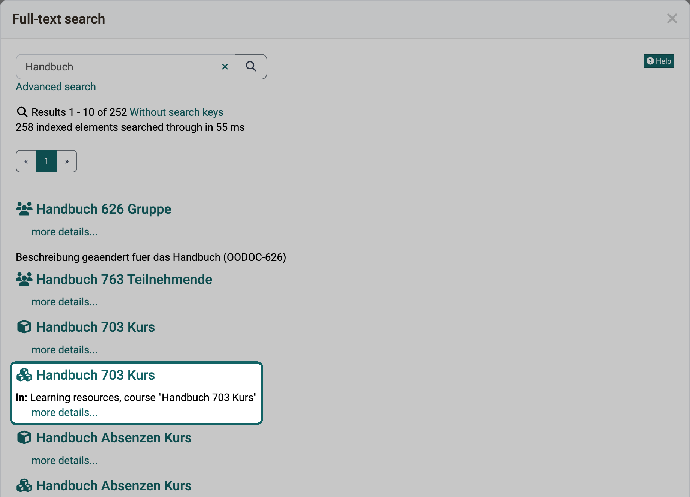
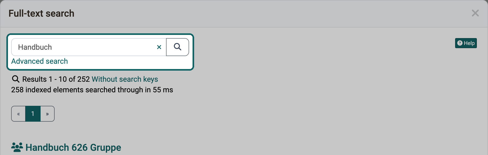
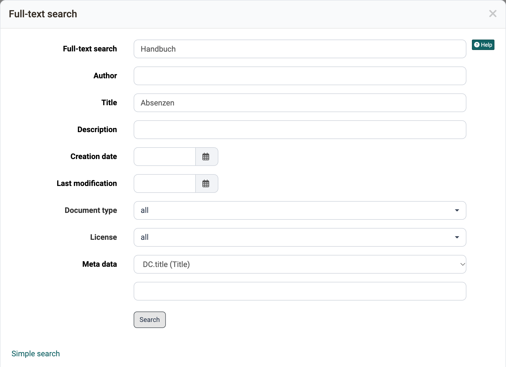
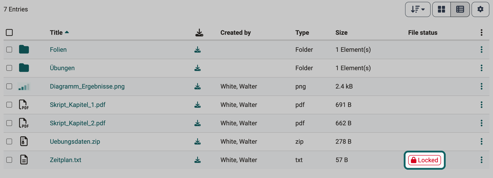

# :o_icon_o_icon_search: Full-text search {: #full_text_search}

With the full-text search, you find a term anywhere in OpenOlat, including the text of documents. It searches the content of courses and groups, for example forum posts, PDF and Word files. You open the full-text search with the magnifying glass icon at the top right of the main navigation: enter a search term and confirm with the Enter key. The hits appear in the dialog "Full-text search". The full-text search does not index personal data such as profiles, visiting cards or personal folders.

The magnifying glass icon appears when the search is switched on for your OpenOlat instance. The search is part of the server configuration, see [Global search](Search_Global.md#activation). For a change, contact your organisation.

:octicons-device-camera-video-24: **Video introduction (German)**: [Suchfunktion](<https://www.youtube.com/embed/GlUCyVl11ic>){:target="_blank"}

If a hit lies in a course, the line "in:" below its title names the course as the location. With "more details..." below a hit, you expand further information, such as author, last modification, type and description. Above the result list, the link "Without search keys" hides the text excerpts with the highlighted search terms, and the link "With search keys" shows them again.

{ class="shadow lightbox" title="Dialog Full-text search · 2026.11.06" }

You will only get search results of the course contents you have access to.

## Advanced search {: #advanced_search}

If the full-text search returns too many hits, refine it with the advanced search. You open it in the dialog "Full-text search" with the link "Advanced search" below the search field.

{ class="shadow lightbox" title="Dialog Full-text search · 2026.11.06" }

{ class="shadow lightbox" title="Advanced search in the dialog Full-text search · 2026.11.06" }

The advanced search offers the fields "Full-text search", "Author", "Title", "Description", "Creation date", "Last modification", "Document type", "License" and "Meta data". The field "License" appears when licenses are switched on for your OpenOlat instance. In the field "Document type", you select one or more types, for example "PDF file" or "Forum". If it shows "all", the advanced search covers all types.

The search fields are linked with the Boolean AND operator. If you fill in the fields "Title" and "Author", for example, the search only finds documents that contain both terms in the respective field.

Exception: The field "Full-text search" searches across all fields.

From the result list, you can jump directly to the learning content with the search term found.

With the link "Simple search" below the form, you switch back to the single search field.

!!! info "Important"

    Besides the full-text search across the whole of OpenOlat, there is also a [course search](Search_in_Course.md), which can be activated for each course in the toolbar. You activate the setting under `Course > Administration > Settings` in the tab "[Toolbar](../learningresources/Course_Settings.md#toolbar)". The course search searches only the corresponding course.

## Search syntax {: #syntax}

With the following syntax, you narrow down your search query.

**Individual terms**, e.g. _OpenOlat_

**Multiple terms** in the search field are always linked with the OR operator.

**Search using wildcards:** To search for specific word fragments, use wildcards.

  * The question mark in a search term stands for any single letter. For example, by entering _te?t_ you will find all documents containing the words "test", "text" etc.
  * The asterisk in a search term stands for any number of letters. For example, if you enter the search term _Test*_, you will find all documents containing words beginning with "Test". The asterisk can also appear within a search term: _Te*t_

**Advanced search:** In the advanced search, the various search fields are linked with the AND operator.

## Metadata {: #metadata}

Metadata helps you recognize a document and find it in the search. Metadata or _meta information_ is data that contains information about the characteristics of other data, but not the data itself. It describes a file with additional information such as a title, the author or the publisher. This makes it easier to recognize what kind of document it is. This is particularly useful if the title of a document does not fit into the file name because it is too long or contains special characters.

You can add metadata to each file and also to complete learning resources. The metadata is optional and does not have to be filled in. It is based on the [Dublin Core Simple Standard](https://en.wikipedia.org/wiki/Dublin_Core). Some metadata cannot be changed: the name of the person who uploaded the document, the size of the document, the time at which the document was uploaded and the file type. You can enter information such as the original author, the title, a description, the source or the language manually.

The full-text search indexes the metadata. You therefore also find documents via the terms in their metadata.

**Lock file:** In the metadata of a file, select the option "Locked" in the field "Locked" so that other users can neither overwrite, delete nor move the file. Locked files show the label "Locked" with a lock in the column "File status" of the file list. This option does not exist for folders.

{ class="shadow lightbox" title="File list of a folder · 2026.11.03" }

The field "External link to this resource" in the metadata shows a link with which you can also link directly to the file from outside OpenOlat.

## Search results [:octicons-tag-16:{ title="from Release 20.1 (OO-8767)" }](https://track.frentix.com/issue/OO-8767) {: #search_results}

Your search results contain:

* Data / documents from courses in which you are a member and to which you have access as a course member
* Data / documents from courses that are configured as follows under `Course > Administration > Settings > Share`: "Without booking" or "Freely available"
* Data / documents from groups in which you are a member
* Documents from the document pool and the library to which you have access

## Further information {: #further_information}

[Global search >](Search_Global.md) 
[Search in a course >](Search_in_Course.md) 
[Course Settings >](../learningresources/Course_Settings.md) 
[Dublin Core (Wikipedia) >](https://en.wikipedia.org/wiki/Dublin_Core) 
[General information on the search >](Search_General.md) 
[Search in the File Hub >](Search_in_FileHub.md)

**youtube** 
[Suchfunktion](<https://www.youtube.com/embed/GlUCyVl11ic>)

[To the top of the page ^](#full_text_search)
