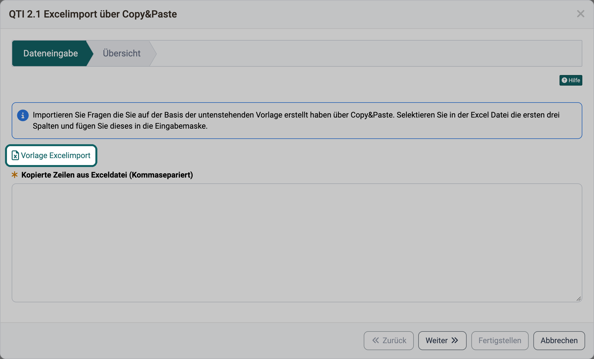

# Importvorlagen {: #import_templates}

Wer viele Konten, Fragen, Termine oder Themen auf einmal anlegt, erfasst sie in einer Tabelle und importiert sie in OpenOlat. Der Import liest die Spalten in einer festen Reihenfolge. Damit Ihre Tabelle von Anfang an stimmt, bietet jeder Import eine Vorlage zum Herunterladen an. Diese Seite zeigt, wo Sie die Vorlagen finden und welche Vorlage sich an Ihre Instanz anpasst.

## Wo Sie eine Vorlage finden {: #where_to_find}

Sie möchten Daten importieren und brauchen die passende Tabelle: Die Vorlage erhalten Sie immer im Import-Assistenten des jeweiligen Bereichs, meist im ersten Schritt neben dem Feld, in das Sie die Zeilen einfügen oder die Datei hochladen. Die Beschriftung des Links unterscheidet sich je Bereich, zum Beispiel "Excel-Vorlage herunterladen", "Vorlage Excelimport" oder "Excel Vorlage". Die [Übersicht](#overview) unten nennt für jede Vorlage den Klickweg und die Beschriftung.

Am Beispiel des Fragenimports im Fragenpool: Der Link "Vorlage Excelimport" steht im ersten Schritt direkt über dem Feld für die kopierten Zeilen.

{ class="shadow lightbox" title="Schritt Dateneingabe im QTI 2.1 Excelimport des Fragenpools · 2026.10.27" }

Das Handbuch bietet die Vorlagen nicht als Datei an. Eine Kopie im Handbuch passt bei den Vorlagen, die OpenOlat für Ihre Instanz erstellt, nicht zu deren Konfiguration. Bei den Beispieldateien veraltet sie mit dem nächsten Release.

[Zum Seitenanfang ^](#import_templates)

## Zwei Arten von Vorlagen {: #template_types}

Ob Sie eine Vorlage nach einer Änderung neu herunterladen sollten, hängt von ihrer Art ab. OpenOlat bietet zwei Arten an: Vorlagen, die OpenOlat für Ihre Instanz erstellt, und Beispieldateien, die mit OpenOlat ausgeliefert werden.

### Vorlagen, die OpenOlat für Ihre Instanz erstellt {: #generated_templates}

Diese Vorlagen erstellt OpenOlat selbst, wenn Sie den Import öffnen oder den Link anklicken. Die Vorlage enthält dann die Spalten, die der Import auf Ihrer Instanz erwartet:

- **Konten importieren**: Die Spalten folgen den Benutzer:innen-Attributen, also den Feldern eines Kontos wie Vorname oder E-Mail, die Ihre Instanz für den Import vorsieht. Die Spalten der Pflichtfelder tragen einen Stern (*).
- **Taxonomieebenen importieren**: Die Spaltennamen erscheinen in der Sprache Ihrer Benutzeroberfläche. Für die Hintergrund- und Teaserbilder der Taxonomieebenen gibt es zusätzlich eine ZIP-Vorlage mit der Ordnerstruktur.
- **Standorte importieren** im Modul Kontaktverfolgung: Die Spaltennamen erscheinen in der Sprache Ihrer Benutzeroberfläche.
- **Themen importieren** im Kursbaustein "Themenbörse": Die Excel-Vorlage enthält die Spalten der benutzerdefinierten Felder vom Eingabetyp "Text". Die ZIP-Vorlage für die Dateien enthält einen Ordner je bestehendem Thema, darin je einen Ordner für Teaser-Bild, Teaser-Video und jedes benutzerdefinierte Feld vom Eingabetyp "Datei".

So erhalten Sie immer die Spalten, die Ihre Instanz verlangt. Ändert die Administration die Benutzer:innen-Attribute oder ändern Sie die benutzerdefinierten Felder einer Themenbörse, laden Sie die Vorlage vor dem nächsten Import neu herunter.

### Beispieldateien, die mit OpenOlat ausgeliefert werden {: #example_files}

Diese Vorlagen sind feste Dateien, die mit dem Release von OpenOlat ausgeliefert werden. Sie zeigen mit Beispieldaten das Format, das der Import dieser Version liest:

- **Fragen importieren** im Fragenpool und im Testeditor: Beispielfragen zu allen zehn Fragetypen des Excelimports und ein Beispiel für die Metadaten einer Frage.
- **Termine importieren** im Kurs und im Course Planner: eine Tabelle mit englischer Kopfzeile und drei Beispielterminen.
- **Importieren** im Course Planner: ein Produkt mit zwei Durchführungen samt Elementen, Kursen, Templates und Terminen, dazu Mitgliedschaften und Konten.

Ändert ein Release den Import, ändert sich die Beispieldatei mit. Die Datei, die Ihre Instanz anbietet, passt deshalb immer zu deren Version.

[Zum Seitenanfang ^](#import_templates)

## Übersicht {: #overview}

Sie suchen die Vorlage für einen bestimmten Import: Die Tabelle nennt für jede Vorlage, wo Sie sie in OpenOlat finden, wer den Import starten kann und welche Handbuchseite den Import beschreibt.

Vorlage | Wo in OpenOlat | Art | Datei | Beschreibung im Handbuch
---|---|---|---|---
Konten | `Benutzerverwaltung > Konten importieren > Import von Benutzer:innen starten` Schritt "Datenbeispiele und Daten einfügen", Link "Excel-Vorlage herunterladen" Für Administrator:innen, Benutzerverwalter:innen und Rollenverwalter:innen | von OpenOlat für Ihre Instanz erstellt | UserImportExample.xlsx | [Konten importieren](../../manual_admin/usermanagement/Create_User.de.md#import_accounts)
Taxonomieebenen | In der System-Administration: `Administration > Module > Taxonomie > "Ihre Taxonomie" > Tab Ebenen > Drei-Punkte-Menü > Taxonomieebenen importieren` Schritt "Daten einfügen", Bereich "Taxonomiestruktur importieren", neben "Vorlage" der Link "Download Excel-Vorlage" Für Administrator:innen und Systemadministrator:innen | von OpenOlat für Ihre Instanz erstellt | TaxonomyLevelsImportTemplate.xls | [Taxonomie importieren](../../manual_admin/administration/Modules_Taxonomy.de.md#import)
Bilder der Taxonomieebenen | wie Taxonomieebenen Bereich "Hintergrund-/Teaserbild importieren", neben "Vorlage" der Link "Download .zip-Vorlage" | von OpenOlat für Ihre Instanz erstellt | ZIP-Datei | [Nur Hintergrund-/Teaserbild importieren/hinzufügen](../../manual_admin/administration/Modules_Taxonomy.de.md#import_add_media)
Standorte der Kontaktverfolgung | In der System-Administration: `Administration > Module > Kontaktverfolgung > Tab Standorte > Standorte importieren` Schritt "Daten eingeben", neben "Vorlage" der Link "Download Excel Vorlage" Für Administrator:innen und Systemadministrator:innen | von OpenOlat für Ihre Instanz erstellt | ContactTracingImportTemplate.xls | [Standorte importieren](../../manual_admin/administration/Modules_Contact_Tracing.de.md#import_locations)
Themen der Themenbörse | `Kurs > Administration > Kurseditor > Kursbaustein "Themenbörse" > Tab Themen > Pfeil neben "Thema hinzufügen" > Themen importieren` Schritt "Themen", Bereich "Themen", neben "Vorlage" der Link "topic_import_template.xlsx" Für Kursbesitzer:innen, in der Kursansicht auch für Betreuer:innen mit dem Recht "Thema bearbeiten" | von OpenOlat für Ihre Instanz erstellt | topic_import_template.xlsx | [Themen importieren](../learningresources/Course_Element_Topic_Broker.de.md#topic_broker_import_topics)
Dateien der Themen | wie Themen der Themenbörse Bereich "Dateien", neben "Vorlage" der Link "files_import_template.zip" | von OpenOlat für Ihre Instanz erstellt | files_import_template.zip | [Themen importieren](../learningresources/Course_Element_Topic_Broker.de.md#topic_broker_import_topics)
Fragen (QTI 2.1 Excelimport) | `Fragenpool > Mein Fragenpool > Meine Fragen > Import > QTI 2.1 Excelimport über Copy&Paste` oder `Test > Administration > Testeditor > Elemente hinzufügen > Fragen aus Excel importieren` Schritt "Dateneingabe", Link "Vorlage Excelimport" Im Fragenpool für Autor:innen, Poolverwalter:innen und Administrator:innen | mit OpenOlat ausgeliefert | ImportExample.xlsx | [Nutzung der Datei "Vorlage Excelimport"](../area_modules/Question_Bank_Import_Questions.de.md#excelimport)
Termine | `Kurs > Administration > Termine und Absenzen > Tab Termine > Pfeil neben "Termin hinzufügen" > Termine importieren` oder `Course Planner > Durchführungen > "Ihre Durchführung" > Tab Termine > Pfeil neben "Termin hinzufügen" > Termine importieren` Schritt "Dateneingabe", Link "Vorlage Excelimport" Im Kurs für Kursbesitzer:innen, im Course Planner unter anderem für Kursplaner:innen | mit OpenOlat ausgeliefert | ImportLectureBlockExample.xlsx | [Termine importieren](../learningresources/Events_and_absences.de.md#import_events) [Wie erstelle ich neue Termine?](../area_modules/Course_Planner_Events.de.md#create_events)
Produkte, Durchführungen und Mitgliedschaften im Course Planner | `Course Planner > Mehr-Menü (⋮) > Importieren` Schritt "Datei auswählen", unter "Importbeispiel" der Link "Excel Vorlage" Für Kursplaner:innen und Administrator:innen | mit OpenOlat ausgeliefert | ProductsExample.xlsx | [Schritt 1: Datei auswählen](../area_modules/Course_Planner_Import_Export.de.md#step1)

[Zum Seitenanfang ^](#import_templates)

## Weiterführende Informationen {: #further_information}

**Auf dieser Seite erwähnt** 
[Konto erstellen >](../../manual_admin/usermanagement/Create_User.de.md) 
[Modul Taxonomie >](../../manual_admin/administration/Modules_Taxonomy.de.md) 
[Modul Kontaktverfolgung >](../../manual_admin/administration/Modules_Contact_Tracing.de.md) 
[Kursbaustein "Themenbörse" >](../learningresources/Course_Element_Topic_Broker.de.md) 
[Fragenpool: Fragen importieren >](../area_modules/Question_Bank_Import_Questions.de.md) 
[Termine und Absenzen >](../learningresources/Events_and_absences.de.md) 
[Course Planner: Termine >](../area_modules/Course_Planner_Events.de.md) 
[Course Planner: Import / Export >](../area_modules/Course_Planner_Import_Export.de.md)

**Weiterführend** 
[Course Planner: Import/Export - Referenz >](../area_modules/Course_Planner_Import_Export_Reference.de.md) 
[Course Planner: Produkte >](../area_modules/Course_Planner_Products.de.md) 
[Test Fragetypen >](../learningresources/Test_question_types.de.md)

[Zum Seitenanfang ^](#import_templates)
