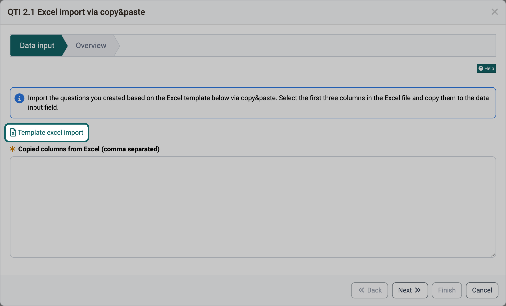

# Import templates {: #import_templates}

Anyone who creates many accounts, questions, events or topics at once enters them in a table and imports them into OpenOlat. The import reads the columns in a fixed order. So that your table is right from the start, every import offers a template for download. This page shows where you find the templates and which template adapts to your instance.

## Where to find a template {: #where_to_find}

You want to import data and need the matching table: you always get the template in the import wizard of the respective area, usually in the first step next to the field into which you paste the rows or upload the file. The label of the link differs per area, for example "Download Excel template", "Template excel import" or "Excel template". The [overview](#overview) below names the click path and the label for each template.

Using the question import in the question bank as an example: the link "Template excel import" is in the first step, directly above the field for the copied rows.

{ class="shadow lightbox" title="Data input step of the QTI 2.1 Excel import in the question bank · 2026.10.27" }

The manual does not offer the templates as files. For the templates that OpenOlat creates for your instance, a copy in the manual would not match its configuration. For the example files, it would become outdated with the next release.

[To the top of the page ^](#import_templates)

## Two kinds of templates {: #template_types}

Whether you should download a template again after a change depends on its kind. OpenOlat offers two kinds: templates that OpenOlat creates for your instance, and example files that are delivered with OpenOlat.

### Templates that OpenOlat creates for your instance {: #generated_templates}

OpenOlat creates these templates itself when you open the import or click the link. The template then contains the columns that the import expects on your instance:

- **Import accounts**: The columns follow the user properties, that is the fields of an account such as first name or e-mail, that your instance provides for the import. The columns of the mandatory fields carry an asterisk (*).
- **Import taxonomy levels**: The column names appear in the language of your user interface. For the background and teaser images of the taxonomy levels there is also a ZIP template with the folder structure.
- **Import locations** in the Contact tracing module: The column names appear in the language of your user interface.
- **Import topics** in the course element "Topic broker": The Excel template contains the columns of the custom fields with the input type "Text". The ZIP template for the files contains one folder per existing topic, in it one folder each for teaser image, teaser video and every custom field with the input type "File".

This way you always get the columns that your instance requires. If the administration changes the user properties or you change the custom fields of a topic broker, download the template again before the next import.

### Example files delivered with OpenOlat {: #example_files}

These templates are fixed files that are delivered with the OpenOlat release. With example data, they show the format that the import of this version reads:

- **Import questions** in the question bank and in the test editor: example questions for all ten question types of the Excel import and an example of the metadata of a question.
- **Import events** in the course and in the Course Planner: a table with an English header row and three example events.
- **Import** in the Course Planner: a product with two implementations including elements, courses, templates and events, plus memberships and accounts.

If a release changes the import, the example file changes with it. The file that your instance offers therefore always matches its version.

[To the top of the page ^](#import_templates)

## Overview {: #overview}

You are looking for the template for a specific import: the table names for each template where you find it in OpenOlat, who can start the import and which manual page describes the import.

Template | Where in OpenOlat | Kind | File | Description in the manual
---|---|---|---|---
Accounts | `User management > Import accounts > Start user import` Step "View examples and insert data", link "Download Excel template" For administrators, user managers and roles managers | created by OpenOlat for your instance | UserImportExample.xlsx | [Import accounts](../../manual_admin/usermanagement/Create_User.md#import_accounts)
Taxonomy levels | In the system administration: `Administration > Modules > Taxonomy > "your taxonomy" > Tab Levels > Three-dot menu > Import taxonomy levels` Step "Insert data", section "Import taxonomy structure", next to "Template" the link "Download Excel template" For administrators and system administrators | created by OpenOlat for your instance | TaxonomyLevelsImportTemplate.xls | [Import taxonomy](../../manual_admin/administration/Modules_Taxonomy.md#import)
Images of the taxonomy levels | as for taxonomy levels Section "Import background/teaser images", next to "Template" the link "Download .zip-Template" | created by OpenOlat for your instance | ZIP file | [Import/add background/teaser image only](../../manual_admin/administration/Modules_Taxonomy.md#import_add_media)
Contact tracing locations | In the system administration: `Administration > Modules > Contact tracing > Tab Locations > Import locations` Step "Insert data", next to "Template" the link "Download Excel template" For administrators and system administrators | created by OpenOlat for your instance | ContactTracingImportTemplate.xls | [Import locations](../../manual_admin/administration/Modules_Contact_Tracing.md#import_locations)
Topics of the topic broker | `Course > Administration > Course editor > Course element "Topic broker" > Tab Topics > Arrow next to "Create topic" > Import topics` Step "Topics", section "Topics", next to "Template" the link "topic_import_template.xlsx" For course owners, in the course view also for coaches with the right "Edit topic" | created by OpenOlat for your instance | topic_import_template.xlsx | [Import topics](../learningresources/Course_Element_Topic_Broker.md#topic_broker_import_topics)
Files of the topics | as for topics of the topic broker Section "Files", next to "Template" the link "files_import_template.zip" | created by OpenOlat for your instance | files_import_template.zip | [Import topics](../learningresources/Course_Element_Topic_Broker.md#topic_broker_import_topics)
Questions (QTI 2.1 Excel import) | `Question bank > My question bank > My questions > Import > QTI 2.1 Excel import via copy&paste` or `Test > Administration > Test editor > Add elements > Import questions from Excel` Step "Data input", link "Template excel import" In the question bank for authors, question bank managers and administrators | delivered with OpenOlat | ImportExample.xlsx | [Usage of the file "Excel Import Template"](../area_modules/Question_Bank_Import_Questions.md#excelimport)
Events | `Course > Administration > Events and Absences > Tab Events > Arrow next to "Add event" > Import events` or `Course Planner > Implementations > "your implementation" > Tab Events > Arrow next to "Add event" > Import events` Step "Data input", link "Template excel import" In the course for course owners, in the Course Planner among others for course planners | delivered with OpenOlat | ImportLectureBlockExample.xlsx | [Import events](../learningresources/Events_and_absences.md#import_events) [How do I create new events?](../area_modules/Course_Planner_Events.md#create_events)
Products, implementations and memberships in the Course Planner | `Course Planner > More-menu (⋮) > Import` Step "Select file", under "Import example" the link "Excel template" For course planners and administrators | delivered with OpenOlat | ProductsExample.xlsx | [Step 1: Select file](../area_modules/Course_Planner_Import_Export.md#step1)

[To the top of the page ^](#import_templates)

## Further information {: #further_information}

**Mentioned on this page** 
[Create account >](../../manual_admin/usermanagement/Create_User.md) 
[Module Taxonomy >](../../manual_admin/administration/Modules_Taxonomy.md) 
[Module Contact Tracing >](../../manual_admin/administration/Modules_Contact_Tracing.md) 
[Course Element "Topic Broker" >](../learningresources/Course_Element_Topic_Broker.md) 
[Question Bank: Import Questions >](../area_modules/Question_Bank_Import_Questions.md) 
[Events and absences >](../learningresources/Events_and_absences.md) 
[Course Planner: Events >](../area_modules/Course_Planner_Events.md) 
[Course Planner: Import / Export >](../area_modules/Course_Planner_Import_Export.md)

**Further reading** 
[Course Planner: Import/Export - Reference >](../area_modules/Course_Planner_Import_Export_Reference.md) 
[Course Planner: Products >](../area_modules/Course_Planner_Products.md) 
[Test question types >](../learningresources/Test_question_types.md)

[To the top of the page ^](#import_templates)
