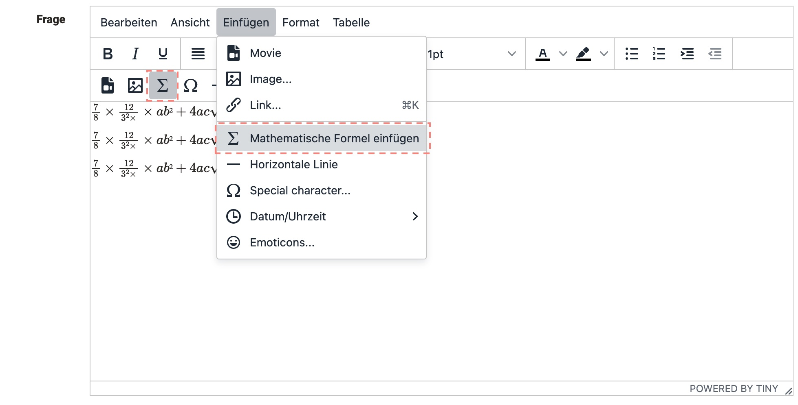
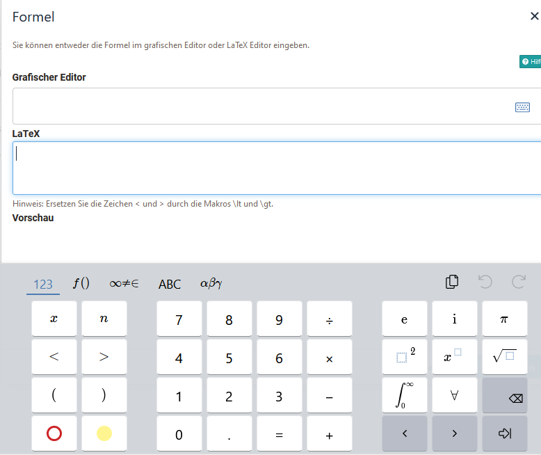
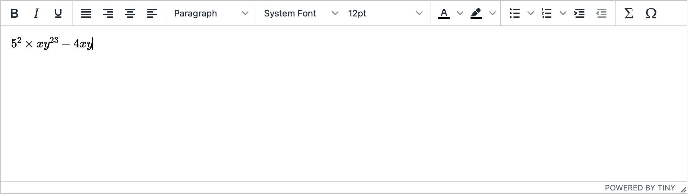
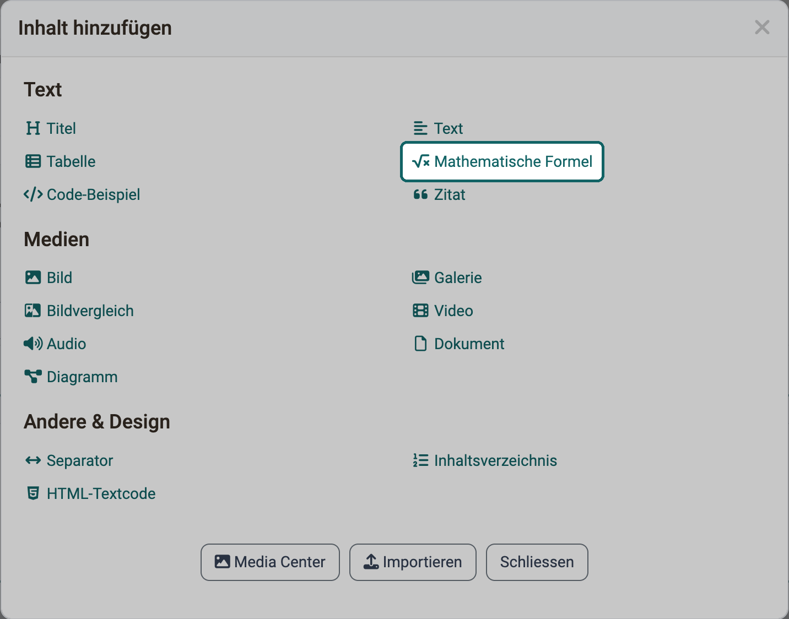
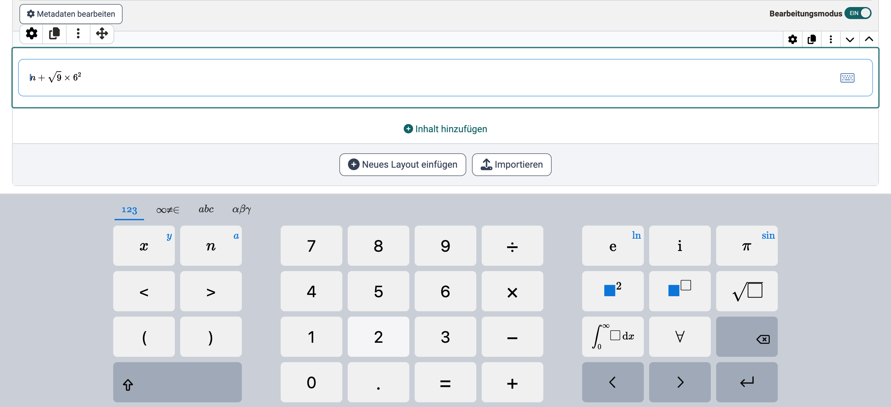

# Mathematische Formel {: #formula}

Eine Formel in einer Testfrage, einem Forumsbeitrag oder einem Portfolio-Eintrag setzen Sie in OpenOlat mit einem grafischen Editor zusammen, ohne LaTeX beherrschen zu müssen. Wie Sie den Editor öffnen, hängt vom Ort ab: in Texten mit HTML-Editor über das Menü des HTML-Editors, in Portfolio-Einträgen über den Content Editor.

## Einfügen einer Formel per HTML-Editor {: #insert_via_html}

In Texten, die Sie mit dem HTML-Editor bearbeiten, fügen Sie die Formel über den Dialog "Formel" ein. Dort sehen Sie das Ergebnis in einer Vorschau, bevor es im Text steht.

1. Klicken Sie im Menü des HTML-Editors auf `Einfügen > Mathematische Formel einfügen`. Zeigt die Werkzeugleiste das Summenzeichen Σ, öffnet ein Klick darauf denselben Dialog.

    { class="shadow lightbox" title="HTML-Editor einer Testfrage" }

2. Geben Sie die Formel im grafischen Editor oder im LaTeX-Feld ein. Weitere Informationen zur Verwendung des grafischen Editors finden Sie hier: [CortexJS keybindings](https://cortexjs.io/mathlive/reference/keybindings/).

    { class="shadow lightbox" title="Dialog Formel" }

3. Schliessen Sie den Dialog "Formel" mit "Speichern". Die Formel steht danach gesetzt im Text.

    { class="shadow lightbox" title="Text im HTML-Editor" }

Mathematische Formeln fügen Sie per HTML-Editor zum Beispiel in folgenden Kursbausteinen und Lernressourcen ein:

* Kursbaustein "HTML-Seite"
* Kursbaustein "Aufgabe" und "Gruppenaufgabe" (HTML)
* Kursbaustein "Forum"
* Lernressource "CP-Lerninhalt"
* Lernressource "Blog"
* Lernressource "Test"

!!! info "Wichtig"

    Wortzählung bei Aufgaben: Die mathematische Formel zählt als ein Wort, unabhängig von Länge und Komplexität.

## Einfügen einer Formel per Content Editor im Portfolio 2.0 [:octicons-tag-16:{ title="ab Release 16.2 (OO-6070)" }](https://track.frentix.com/issue/OO-6070) {: #insert_formula}

In einem Portfolio-Eintrag steht die Formel als eigenes Inhaltselement zwischen Texten und Bildern. Sie geben sie direkt im Inhaltselement ein, eine eingeblendete Tastatur mit Zahlen, Operatoren und Funktionen hilft bei Zeichen, die auf der normalen Tastatur fehlen.

1. Öffnen oder erstellen Sie einen Portfolio-Eintrag und schalten Sie den "Bearbeitungsmodus" ein.

2. Klicken Sie auf "Neues Layout einfügen" und wählen Sie ein Layout. Hat der Eintrag schon ein Layout, fügen Sie die Formel dort ein.

3. Klicken Sie im Layout auf "Inhalt hinzufügen".

    { class="shadow lightbox" title="Dialog Inhalt hinzufügen im Portfolio-Eintrag · 2026.11.10" }

4. Wählen Sie "Mathematische Formel".

5. Der grafische Formeleditor öffnet sich im neuen Inhaltselement. Erstellen Sie Ihre Formel.

    { class="shadow lightbox" title="Inhaltselement Mathematische Formel im Portfolio-Eintrag · 2026.11.10" }

## Weiterführende Informationen {: #further_information}

[CortexJS keybindings >](https://cortexjs.io/mathlive/reference/keybindings/) 
[Content Editor >](Content_Editor.de.md) 
[Kursbaustein "HTML-Seite" >](../learningresources/Course_Element_HTML_Page.de.md) 
[Persönliche Werkzeuge: Portfolio 2.0 >](../personal_menu/Portfolio/index.de.md)

[Zum Seitenanfang ^](#formula)
