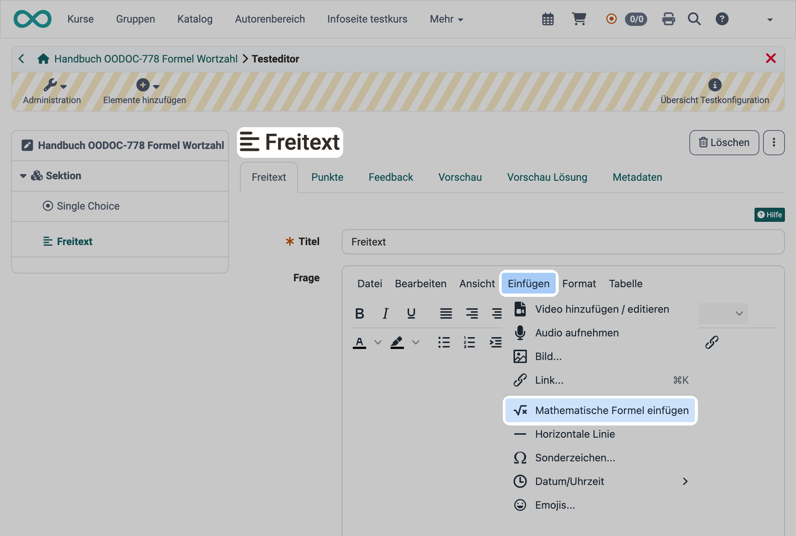
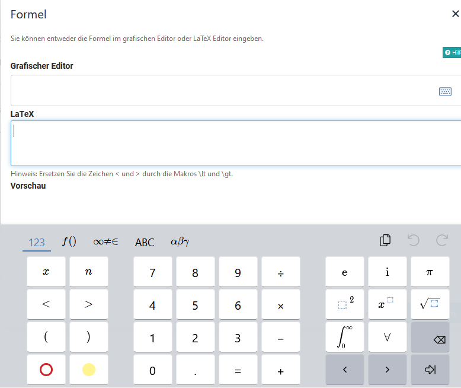
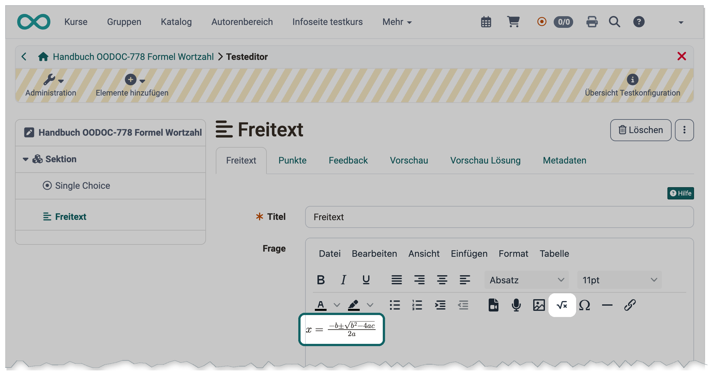
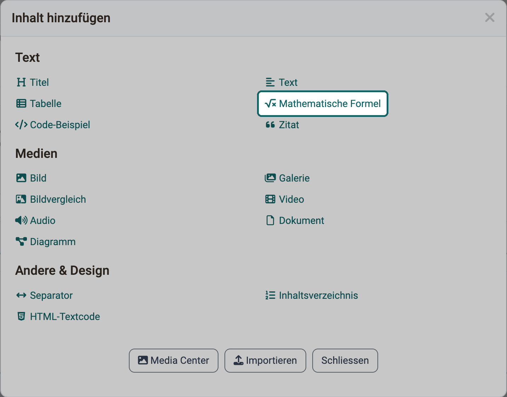
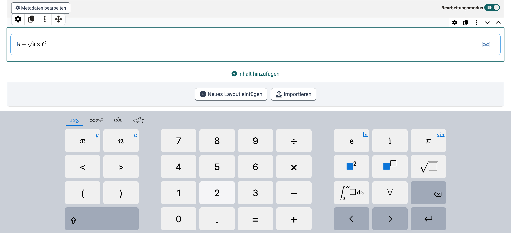

# Mathematische Formel {: #formula}

Eine Formel in einer Testfrage, einem Forumsbeitrag, einer Seite im Kurs oder einem Portfolio-Eintrag setzen Sie in OpenOlat mit einem grafischen Editor zusammen, ohne LaTeX beherrschen zu müssen. Wie Sie den Editor öffnen, hängt vom Ort ab: in Texten mit HTML-Editor über das Menü des HTML-Editors, im Kursbaustein "Seite" und in Portfolio-Einträgen über den [Content Editor](Content_Editor/index.de.md).

## Einfügen einer Formel per HTML-Editor {: #insert_via_html}

In Texten, die Sie mit dem HTML-Editor bearbeiten, fügen Sie die Formel über den Dialog "Formel" ein. Dort sehen Sie das Ergebnis in einer Vorschau, bevor es im Text steht.

1. Klicken Sie im Menü des HTML-Editors auf `Einfügen > Mathematische Formel einfügen`. In manchen HTML-Editoren zeigt die Werkzeugleiste zusätzlich das Wurzelsymbol √x mit dem Tooltip "Mathematische Formel einfügen"; ein Klick darauf öffnet denselben Dialog.

    { class="shadow lightbox" title="HTML-Editor einer Testfrage im Testeditor · 2026.11.26" }

2. Geben Sie die Formel im grafischen Editor oder im LaTeX-Feld ein. Weitere Informationen zur Verwendung des grafischen Editors finden Sie hier: [CortexJS keybindings](https://cortexjs.io/mathlive/reference/keybindings/). Im LaTeX-Feld schreiben Sie die Zeichen < und > als Makros `\lt` und `\gt`.

    { class="shadow lightbox" title="Dialog Formel" }

3. Schliessen Sie den Dialog "Formel" mit "Speichern". Die Formel steht danach gesetzt im Text.

    { class="shadow lightbox" title="HTML-Editor einer Testfrage im Testeditor · 2026.11.26" }

Mathematische Formeln fügen Sie per HTML-Editor zum Beispiel in folgenden Kursbausteinen und Lernressourcen ein:

* Kursbaustein "HTML-Seite"
* Kursbaustein "Aufgabe" und "Gruppenaufgabe": in einem HTML-Dokument, das Sie im Schritt ["Abgabe"](../learningresources/Course_Element_Task/Task_Participants.de.md#process_task_solution) unter `Dokument erstellen > Mehr Formate anzeigen > HTML-Dokument (.html)` anlegen. Der HTML-Editor öffnet sich danach in einem neuen Tab.
* Kursbaustein "Forum"
* Lernressource "CP-Lerninhalt"
* Lernressource "Blog"
* Lernressource "Test"

!!! info "Wichtig"

    Wortzählung in der Testfrage ["Freitext"](../learningresources/Test_question_types/Essay.de.md): Im Modus "Rich Text Formatierung" zählt eine mathematische Formel als ein Wort, unabhängig von Länge und Komplexität. Danach richten sich auch die Grenzen "Min Anzahl Wörter" und "Max Anzahl Wörter".

## Einfügen einer Formel per Content Editor [:octicons-tag-16:{ title="ab Release 16.2 (OO-6070)" }](https://track.frentix.com/issue/OO-6070) {: #insert_formula}

Im Kursbaustein "Seite" und in einem Portfolio-Eintrag steht die Formel als eigenes Inhaltselement zwischen Texten und Bildern. Sie geben sie direkt im Inhaltselement ein, eine eingeblendete Tastatur mit Zahlen, Operatoren und Funktionen hilft bei Zeichen, die auf der normalen Tastatur fehlen.

Die Schritte zeigen den Weg im [Portfolio 2.0](../personal_menu/Portfolio/index.de.md), Ihrem persönlichen Bereich für Mappen und Einträge. Im [Kursbaustein "Seite"](../learningresources/Course_Element_Page.de.md#add_elements) fügen Sie die Formel ebenso über "Inhalt hinzufügen" ein, nachdem Sie die Seite im Kurseditor oder im Bearbeitungsmodus geöffnet haben.

1. Öffnen Sie unter `Persönliches Menü > Portfolio 2.0` einen Eintrag oder erstellen Sie einen neuen. Schalten Sie den "Bearbeitungsmodus" ein.

2. Klicken Sie auf "Neues Layout einfügen" und wählen Sie ein Layout. Ein Layout teilt den Eintrag in Felder, zum Beispiel in zwei Spalten. Hat der Eintrag schon ein Layout, überspringen Sie diesen Schritt.

3. Klicken Sie im Layout auf "Inhalt hinzufügen".

    { class="shadow lightbox" title="Dialog Inhalt hinzufügen im Portfolio-Eintrag · 2026.11.10" }

4. Wählen Sie "Mathematische Formel". Die Gruppe "Wissen" mit dem Quiz bietet der Dialog nur im Kursbaustein "Seite".

5. Der grafische Formeleditor öffnet sich im neuen Inhaltselement. Erstellen Sie Ihre Formel. OpenOlat speichert sie automatisch.

    { class="shadow lightbox" title="Inhaltselement Mathematische Formel im Portfolio-Eintrag · 2026.11.10" }

## Weiterführende Informationen {: #further_information}

[Content Editor >](Content_Editor/index.de.md) 
[CortexJS keybindings >](https://cortexjs.io/mathlive/reference/keybindings/) 
[Persönliche Werkzeuge: Portfolio 2.0 >](../personal_menu/Portfolio/index.de.md) 
[Kursbaustein "Seite" >](../learningresources/Course_Element_Page.de.md) 
[Content Editor: Inhalt hinzufügen >](Content_Editor/Editor_Add_Content.de.md) 
[Kursbaustein "HTML-Seite" >](../learningresources/Course_Element_HTML_Page.de.md)

[Zum Seitenanfang ^](#formula)
