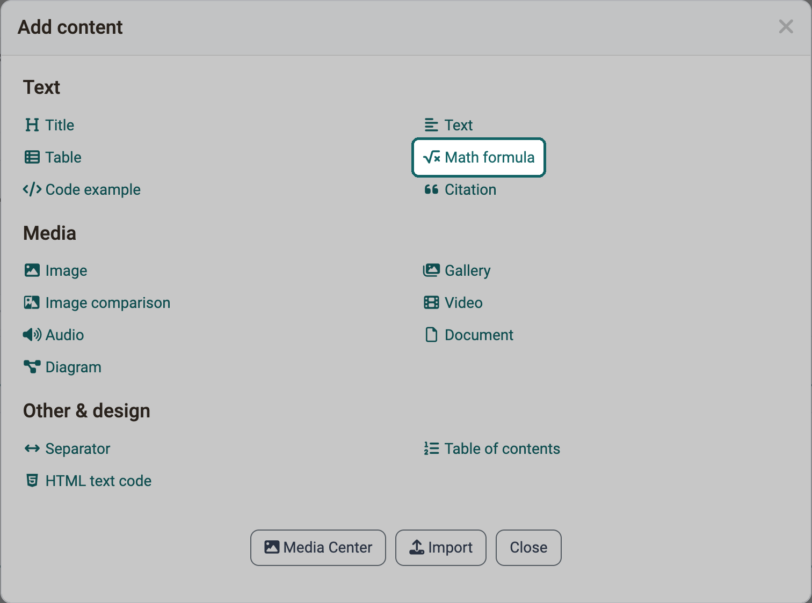
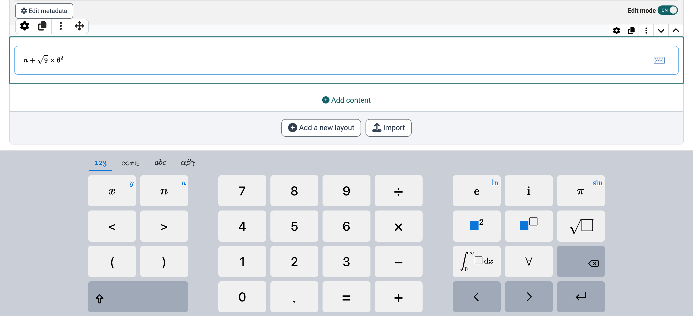

# Math formula {: #formula}

You build a formula in a test question, a forum post or a portfolio entry in OpenOlat with a graphical editor, without having to master LaTeX. How you open the editor depends on the place: in texts with the HTML editor via the menu of the HTML editor, in portfolio entries via the Content editor.

## Insert a formula via HTML editor {: #insert_via_html}

In texts you edit with the HTML editor, you insert the formula via the dialog "Formula". There you see the result in a preview before it appears in the text.

1. In the menu of the HTML editor, click `Insert > Insert math formula`. If the toolbar shows the summation sign Σ, clicking it opens the same dialog.

    { class="shadow lightbox" title="HTML editor of a test question" }

2. Enter the formula in the graphical editor or in the LaTeX field. Further information on how to use the graphical editor can be found here: [CortexJS keybindings](https://cortexjs.io/mathlive/reference/keybindings/).

    { class="shadow lightbox" title="Dialog Formula" }

3. Close the dialog "Formula" with "Save". The formula then appears typeset in the text.

    { class="shadow lightbox" title="Text in the HTML editor" }

You insert math formulas via HTML editor, for example, in the following course elements and learning resources:

* Course element "HTML page"
* Course element "Task" and "Group task" (HTML)
* Course element "Forum"
* Learning resource "CP learning content"
* Learning resource "Blog"
* Learning resource "Test"

!!! info "Important"

    Word count for tasks: The math formula counts as one word, regardless of length and complexity.

## Insert a formula via Content editor in Portfolio 2.0 [:octicons-tag-16:{ title="ab Release 16.2 (OO-6070)" }](https://track.frentix.com/issue/OO-6070) {: #insert_formula}

In a portfolio entry, the formula is a content element of its own between texts and images. You enter it directly in the content element; a displayed keyboard with numbers, operators and functions helps with characters that are missing on the normal keyboard.

1. Open or create a portfolio entry and switch on "Edit mode".

2. Click "Add a new layout" and select a layout. If the entry already has a layout, insert the formula there.

3. In the layout, click "Add content".

    { class="shadow lightbox" title="Dialog Add content in a portfolio entry · 2026.11.10" }

4. Select "Math formula".

5. The graphical formula editor opens in the new content element. Create your formula.

    { class="shadow lightbox" title="Content element Math formula in a portfolio entry · 2026.11.10" }

## Further information {: #further_information}

[CortexJS keybindings >](https://cortexjs.io/mathlive/reference/keybindings/) 
[Content Editor >](Content_Editor.md) 
[Course Element "HTML page" >](../learningresources/Course_Element_HTML_Page.md) 
[User tools: Portfolio 2.0 >](../personal_menu/Portfolio/index.md)

[To the top of the page ^](#formula)
