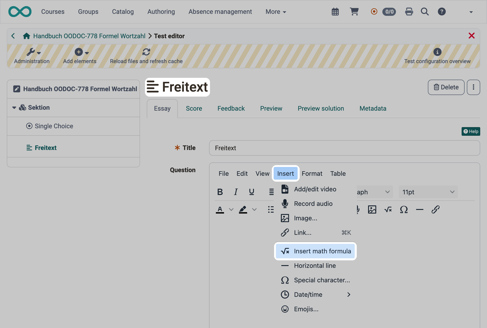
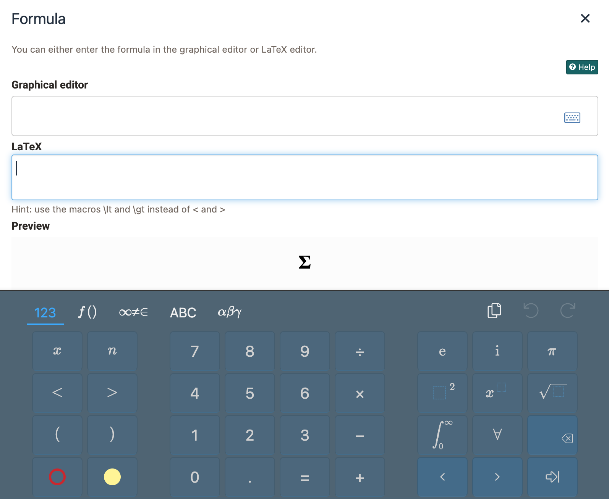
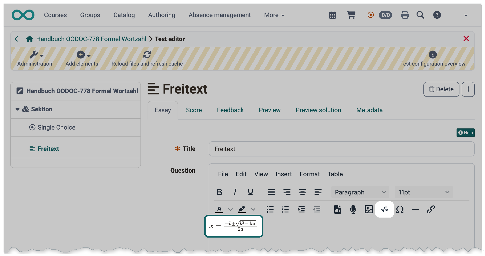
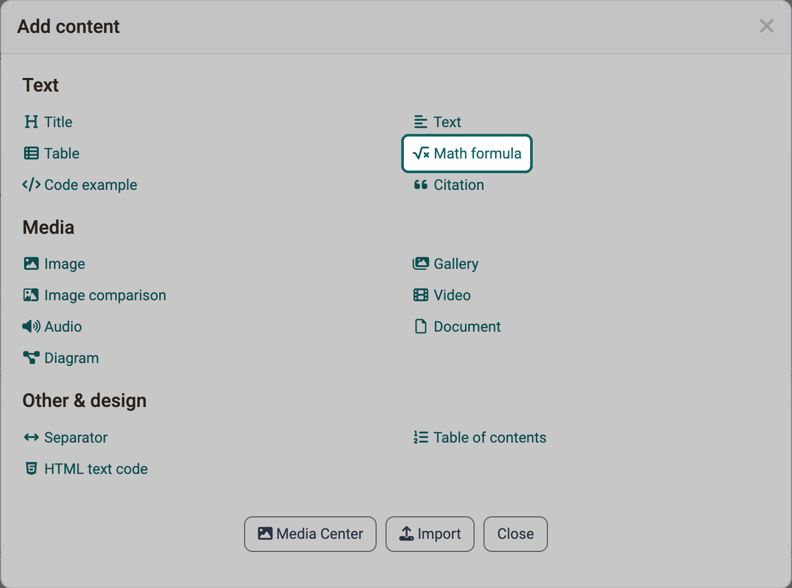
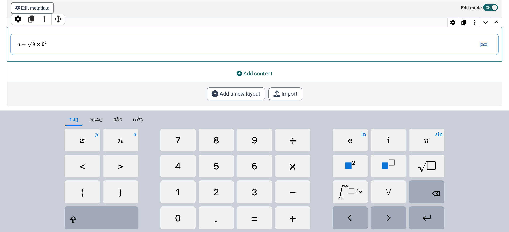

# Math formula {: #formula}

You build a formula in a test question, a forum post, a page in a course or a portfolio entry in OpenOlat with a graphical editor, without having to master LaTeX. How you open the editor depends on the place: in texts with the HTML editor via the menu of the HTML editor, in the course element "Page" and in portfolio entries via the [Content Editor](Content_Editor/index.md).

## Insert a formula via HTML editor {: #insert_via_html}

In texts you edit with the HTML editor, you insert the formula via the dialog "Formula". There you see the result in a preview before it appears in the text.

1. In the menu of the HTML editor, click `Insert > Insert math formula`. In some HTML editors, the toolbar also shows the square root symbol √x with the tooltip "Insert math formula"; clicking it opens the same dialog.

    { class="shadow lightbox" title="HTML editor of a test question in the test editor · 2026.11.26" }

2. Enter the formula in the graphical editor or in the LaTeX field. Further information on how to use the graphical editor can be found here: [CortexJS keybindings](https://cortexjs.io/mathlive/reference/keybindings/). In the LaTeX field, you write the characters < and > as the macros `\lt` and `\gt`.

    { class="shadow lightbox" title="Dialog Formula" }

3. Close the dialog "Formula" with "Save". The formula then appears typeset in the text.

    { class="shadow lightbox" title="HTML editor of a test question in the test editor · 2026.11.26" }

You insert math formulas via HTML editor, for example, in the following course elements and learning resources:

* Course element "HTML page"
* Course element "Task" and "Group task": in an HTML document that you create in the step ["Task submission"](../learningresources/Course_Element_Task/Task_Participants.md#process_task_solution) under `Create document > Show more formats > HTML (.html)`. The HTML editor then opens in a new tab.
* Course element "Forum"
* Learning resource "CP learning content"
* Learning resource "Blog"
* Learning resource "Test"

!!! info "Important"

    Word count in the test question ["Essay"](../learningresources/Test_question_types/Essay.md): In the mode "Rich text formatting", a math formula counts as one word, regardless of length and complexity. The limits "Min. words" and "Max. words" also follow this count.

## Insert a formula via Content Editor [:octicons-tag-16:{ title="from Release 16.2 (OO-6070)" }](https://track.frentix.com/issue/OO-6070) {: #insert_formula}

In the course element "Page" and in a portfolio entry, the formula is a content element of its own between texts and images. You enter it directly in the content element; a displayed keyboard with numbers, operators and functions helps with characters that are missing on the normal keyboard.

The steps show the way in [Portfolio 2.0](../personal_menu/Portfolio/index.md), your personal area for binders and entries. In the [course element "Page"](../learningresources/Course_Element_Page.md#add_elements) you insert the formula in the same way via "Add content", after opening the page in the course editor or in edit mode.

1. Under `Personal menu > Portfolio 2.0`, open an entry or create a new one. Switch on "Edit mode".

2. Click "Add a new layout" and select a layout. A layout divides the entry into fields, for example into two columns. If the entry already has a layout, skip this step.

3. In the layout, click "Add content".

    { class="shadow lightbox" title="Dialog Add content in a portfolio entry · 2026.11.10" }

4. Select "Math formula". The dialog offers the group "Knowledge" with the quiz only in the course element "Page".

5. The graphical formula editor opens in the new content element. Create your formula. OpenOlat saves it automatically.

    { class="shadow lightbox" title="Content element Math formula in a portfolio entry · 2026.11.10" }

## Further information {: #further_information}

[Content Editor >](Content_Editor/index.md) 
[CortexJS keybindings >](https://cortexjs.io/mathlive/reference/keybindings/) 
[User tools: Portfolio 2.0 >](../personal_menu/Portfolio/index.md) 
[Course Element "Page" >](../learningresources/Course_Element_Page.md) 
[Content Editor: Add content >](Content_Editor/Editor_Add_Content.md) 
[Course Element "HTML page" >](../learningresources/Course_Element_HTML_Page.md)

[To the top of the page ^](#formula)
