# Media Center: Konzept {: #media_center_concept}

## Funktionen [:octicons-tag-16:{ title="ab Release 19.1 (OO-8156)" }](https://track.frentix.com/issue/OO-8156){:target="_blank"} {: #functions}

Bilder, Videos, Dokumente und andere Medien, die Sie in Kursen und im Portfolio einsetzen, sammeln Sie an einer zentralen Stelle: im Media Center. Ein Medium legen Sie dort einmal ab und verwenden es an mehreren Stellen.

Medien können...

* ... direkt im Media Center erstellt werden
* ... in verschiedenen Kursbausteinen erstellt und dann im Media Center abgelegt werden
* ... extern erstellt und als Datei hochgeladen werden
* ... kursübergreifend verwendet werden
* ... an andere Personen freigegeben (geteilt) und gemeinsam genutzt werden
* ... versioniert werden: Mit "Neue Version erstellen" sichern Sie einen Zwischenstand und wechseln später zu einer älteren Version zurück, siehe [Neue Version erstellen](../Media_Center_Items.de.md#media_center_versioning)
* ... mit Tags verschlagwortet werden
* ... Themen und Fachbereichen zugeordnet werden (Feld "Themen/Fachbereiche"), also den Begriffen einer Taxonomie, dem Begriffsbaum, nach dem Ihre Organisation Inhalte einordnet
* ... gefiltert werden (zum Beispiel im Tab "Meine Medien")
* ... nach Verwendungsort gesucht werden

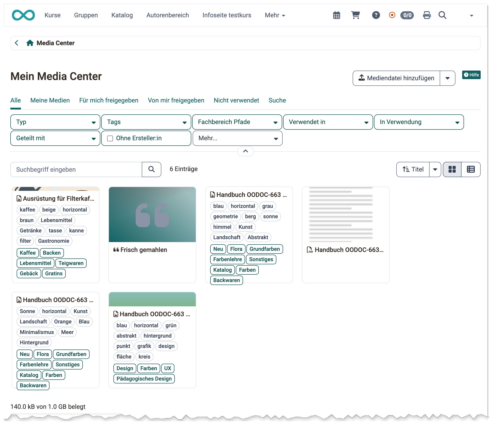{ class="shadow lightbox" title="Mein Media Center · 2026.11.26" }

[Zum Seitenanfang ^](#media_center_concept)

---

## Zugang {: #access}

Das Media Center ist Ihr persönlicher Bereich. Sie öffnen es über Ihr Profilbild oben rechts im persönlichen Menü: 
`Persönliches Menü > Media Center`

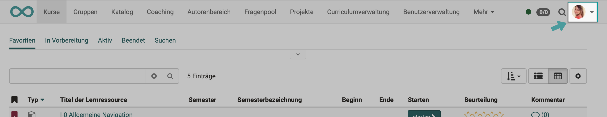{ class=" shadow lightbox" title="Hauptnavigation oben rechts" }

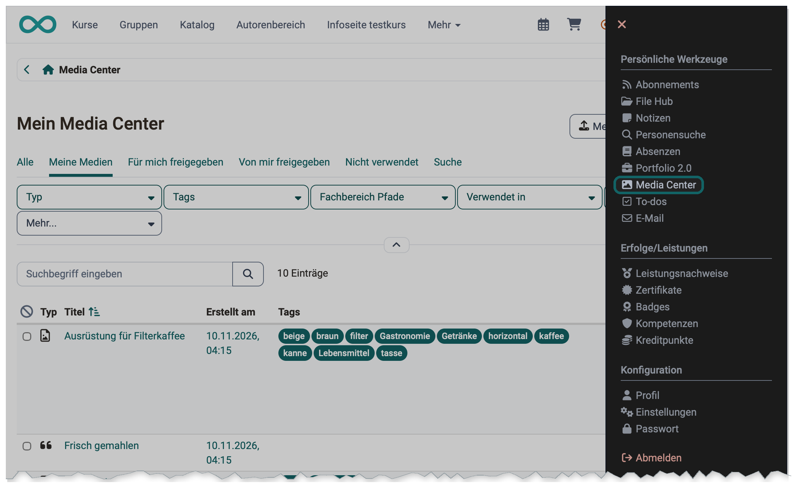{ class="shadow lightbox" title="Persönliches Menü, Persönliche Werkzeuge · 2026.11.27" }

Ihre persönlichen Medien können Sie trotzdem mit anderen Personen teilen und an verschiedenen Stellen in OpenOlat einsetzen. 
[Mehr über das Teilen (Freigabe) >](#share)

### Administrativer Zugriff {: #administrative_access}

Administrator:innen und Lernressourcenverwalter:innen haben über ihre Rolle zusätzlich administrativen Zugriff auf Medien anderer Personen, sofern diese an einen Kurs freigegeben sind, der zu einer Organisation gehört, in der sie diese Rolle haben. Sie finden diese Medien im Segment "Medienverwaltung", einem zweiten Bereich ihres Media Centers neben "Mein Media Center". Dort sehen sie, wo ein Medium eingebunden und an wen es freigegeben ist, und entfernen Freigaben. Löschen gehört nicht dazu, siehe [Media Center verwalten](#media_center_administration).

[Zum Seitenanfang ^](#media_center_concept)

---

## Medientypen {: #media_types}

Im Media Center legen Sie Dateien ab und Inhalte, die Sie in OpenOlat erstellt oder gesammelt haben. Dazu gehören:

* Bilder (png, jpg, svg [:octicons-tag-16:{ title="svg ab Release 20.3.0 (OO-9350)" }](https://track.frentix.com/issue/OO-9350){:target="_blank"}, ...)
* Video-Dateien (mp4)
* Audio-Dateien (mp3)
* Office-Dokumente (docx, xlsx, pptx, ...)
* Textelemente
* Diagramme (draw.io)
* eigene Videoaufzeichnungen per Webcam
* Audioaufzeichnungen
* Zitate
* Forumsbeiträge
* Blogeinträge
* Wiki-Seiten
* Leistungsnachweise aus Kursen

[Zum Seitenanfang ^](#media_center_concept)

---

## Medien dem Media Center hinzufügen [:octicons-tag-16:{ title="ab Release 19.1 (OO-7813)" }](https://track.frentix.com/issue/OO-7813){:target="_blank"} {: #add_media}

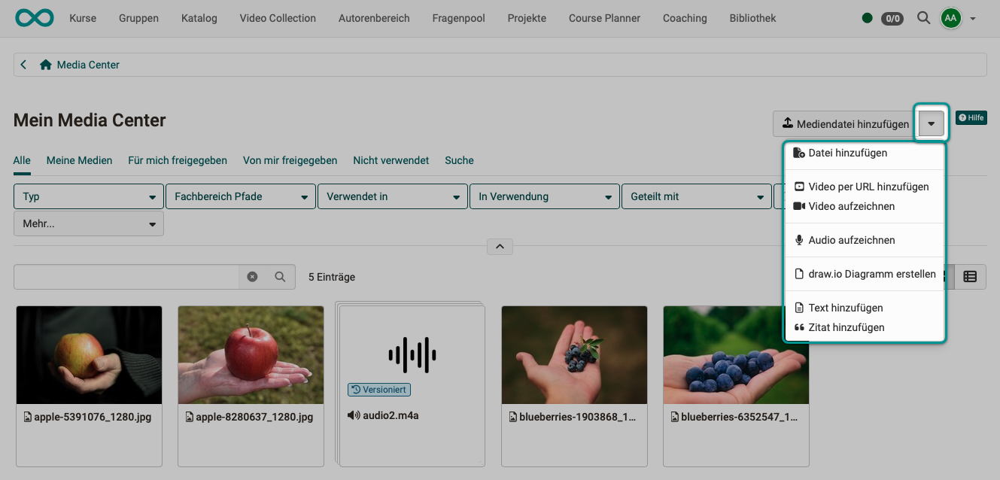{ class=" shadow lightbox" title="Aufklappmenü Mediendatei hinzufügen in Mein Media Center" }

Medien gelangen auf vier Wegen ins Media Center: Sie laden sie direkt hoch, Sie erstellen sie im Media Center, Sie erstellen sie im Content Editor, oder Sie übernehmen Inhalte aus anderen Bereichen von OpenOlat. Wie Sie ein Medium danach für andere freigeben, steht unter [Freigabe für andere](#share).

Die Einträge der beiden folgenden Listen finden Sie in "Mein Media Center" oben rechts: den Button "Mediendatei hinzufügen" und das Aufklappmenü daneben.

### Existierende Medien direkt im Media Center hochladen bzw. verlinken {: #add_existing}

* **Mediendatei hinzufügen:** lädt Bilder, Videos, PDF-, Office- und andere Dateien hoch. Bei Bildern hilft die KI auf zwei Arten, beide nur, wenn Ihre Administration das [KI-Modul](../../../manual_admin/administration/External_Tools_AI.de.md) eingeschaltet hat. Beim Hochladen klicken Sie selbst auf den Button "Metadaten mit KI generieren": Die KI füllt Titel, Beschreibung, Alt-Text und Tags vor, und Sie prüfen die Vorschläge vor dem Speichern [:octicons-tag-16:{ title="ab Release 20.3.0 (OO-9355)" }](https://track.frentix.com/issue/OO-9355){:target="_blank"}. Haben Sie zusätzlich in Ihren persönlichen Einstellungen die KI-Bildbeschreibungen eingeschaltet, füllt OpenOlat nach dem Speichern eines neuen Bildes ohne Ihr Zutun die Felder, die noch leer sind: Beschreibung, Alt-Text, Tags und Themen/Fachbereiche. Prüfen Sie diese Angaben danach in der Detailansicht des Mediums, siehe [Tab KI-Einstellungen](../../personal_menu/Settings.de.md#tab_ai_settings). [Details zu Metadaten mit KI >](../Media_Center_Items.de.md#metadata_ai)
* **Datei hinzufügen:** erster Eintrag im Aufklappmenü neben "Mediendatei hinzufügen". Der Button "Mediendatei hinzufügen" lädt direkt eine Datei von Ihrem Computer hoch. "Datei hinzufügen" bietet zusätzlich Dateien aus dem [File Hub](../File_Hub_Concept.de.md) von OpenOlat an, neben dem Bereich "Lokal" für Ihren Computer. Titel und Metadaten tragen Sie danach im Dialog "Mediendatei hinzufügen" ein.
* **Video per URL hinzufügen:** fügt ein Video aus einem externen Portal wie YouTube, Vimeo, Panopto oder nanoo.tv über seinen Link hinzu.
* **Zitat hinzufügen:** legt ein Zitat aus einem Buch, einem Artikel, einer Webseite oder einem Film als Text ab, mit Angaben wie Quelle, Autor:in und URL. Das Zitat setzen Sie danach an mehreren Stellen in OpenOlat ein, ohne die Quelle jedes Mal neu einzutragen. Tragen Sie die Angaben deshalb vollständig ein.

### Neue Medien direkt im Media Center erstellen [:octicons-tag-16:{ title="ab Release 18.1 (OO-7366)" }](https://track.frentix.com/issue/OO-7366){:target="_blank"} {: #create_in_media_center}

* **Dokument erstellen:** erstellt ein Word-, Excel- oder PowerPoint-Dokument mit einem in OpenOlat eingebundenen Office-Editor. Der Eintrag erscheint im Aufklappmenü, wenn in Ihrem OpenOlat ein solcher Editor eingerichtet ist.
* **draw.io Diagramm erstellen:** erstellt ein Diagramm, ein Flussdiagramm oder eine Zeichnung mit dem Werkzeug draw.io [:octicons-tag-16:{ title="ab Release 18.1.0 (OO-7092)" }](https://track.frentix.com/issue/OO-7092){:target="_blank"}
* **Text hinzufügen:** erstellt ein Textelement mit einem einfachen HTML-Editor, etwa für den Einsatz im Content Editor.
* **Video aufzeichnen:** startet die Aufnahme mit Ihrer Webcam, sobald Sie im Browser den Zugriff auf die Kamera erlauben.
* **Audio aufzeichnen:** startet die Aufnahme mit Ihrem Mikrofon, sobald Sie im Browser den Zugriff auf das Mikrofon erlauben.

### Neue Medien ausserhalb des Media Centers im Content Editor erstellen {: #create_in_editor}

Medien für das Media Center legen Sie auch im Kurs oder im Portfolio an, mit dem [Content Editor](../Content_Editor/index.de.md). Im Kurs nutzen Sie dafür zum Beispiel den Kursbaustein ["Seite"](../../learningresources/Course_Element_Page.de.md), im Portfolio einen Eintrag einer Mappe. Der Weg ist an beiden Orten derselbe: Schalten Sie den Bearbeitungsmodus ein und klicken Sie auf "Inhalt hinzufügen". Im Dialog "Inhalt hinzufügen" klicken Sie unten auf den Button "Media Center". Es öffnet sich der Dialog "Media Center" mit der Liste "Medium auswählen". Dort laden Sie über "Mediendatei hinzufügen" neue Medien hoch. Über das Aufklappmenü daneben erstellen Sie neue Medien, mit denselben Möglichkeiten wie direkt im Media Center.

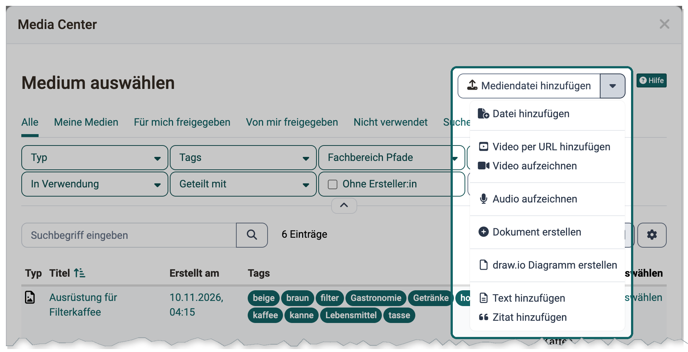{ class="shadow lightbox" title="Kursbaustein Seite, Dialog Media Center · 2026.11.26" }

### Inhaltselemente sammeln und mit dem Media Center verknüpfen {: #assign_media}

Eigene Inhalte aus anderen Bereichen von OpenOlat übernehmen Sie mit einem Klick auf das Puzzleteil-Symbol ins Media Center. Das gilt für:

* Forumsbeiträge
* Blogeinträge
* Wiki-Seiten
* Leistungsnachweise aus Kursen

Um zum Beispiel einen Forumsbeitrag zu übernehmen, öffnen Sie Ihren Beitrag im Forum und klicken oben rechts am Beitrag auf das Puzzleteil-Symbol.

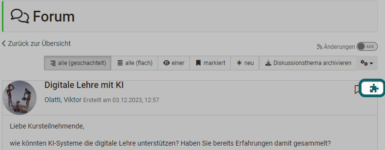{ class=" shadow lightbox" title="Forumsbeitrag mit Puzzleteil-Symbol" }

Es öffnet sich ein Fenster, in dem Sie wie beim Hochladen den Titel und weitere Metadaten eintragen und speichern. Danach steht der Beitrag mit einem Link zum Original in Ihrem Media Center.

Einen Leistungsnachweis übernehmen Sie unter `Persönliches Menü > Leistungsnachweise`: Das Puzzleteil-Symbol steht in der Liste rechts in jeder Zeile und in der Detailansicht eines Leistungsnachweises oben rechts.

!!! info "Wichtig"

    Das Puzzleteil-Symbol erscheint, wenn in Ihrem OpenOlat das Modul ePortfolio eingeschaltet ist, und nur bei Inhalten, die Ihnen gehören: bei Ihren eigenen Leistungsnachweisen und bei Forumsbeiträgen, Blogeinträgen und Wiki-Seiten, deren Ersteller:in Sie sind. Es genügt nicht, den Beitrag bearbeitet zu haben.

!!! info "Pflichtangaben"

    Jedes Medium braucht einen Titel. Hat Ihre Administration die Lizenz für das Media Center zum Pflichtfeld gemacht, braucht es zudem eine Angabe im Feld "Lizenz", und "Keine Lizenz" genügt dann nicht: Steht das Feld auf "Keine Lizenz", wählen Sie vor dem Speichern eine andere Lizenz, siehe [Modul Media Center](../../../manual_admin/administration/Modules_Media_Center.de.md#licences). Weitere Angaben und Metadaten ergänzen Sie beim Hinzufügen oder später in den Tabs, die sich beim Anklicken des Mediums öffnen.

### Freigabe für andere [:octicons-tag-16:{ title="ab Release 18.0 (OO-7061)" }](https://track.frentix.com/issue/OO-7061){:target="_blank"} {: #share}

Sollen andere Personen ein Medium nutzen, geben Sie es frei: an einzelne Benutzer:innen, an Gruppen, an Kurse oder an Organisationen. Je Freigabe legen Sie fest, ob die Empfänger:innen das Medium auch bearbeiten dürfen, also seine Metadaten und, je nach Medientyp, seine Versionen. Dafür steht in der Zeile jeder Freigabe ein Schalter in der Spalte "Bearbeitbar freigeben". Sie setzen eine Freigabe jederzeit im Tab "Freigaben" des Mediums über "Freigabe hinzufügen". Die Empfänger:innen finden das Medium in ihrem Media Center im Tab "Für mich freigegeben".

Welche Ziele das Menü "Freigabe hinzufügen" anbietet, hängt von Ihrer Rolle ab. Administrator:innen legen das im [Modul Media Center](../../../manual_admin/administration/Modules_Media_Center.de.md#shares) fest. Die Grundeinstellung:

| Ziel | Wer so freigeben kann | Wer das Medium danach sieht |
|---|---|---|
| Benutzer:in | Autor:innen, Lernressourcenverwalter:innen, Administrator:innen | die gewählte Person |
| Gruppe | alle, auch Benutzer:innen ohne weitere Rolle | die Mitglieder der Gruppe |
| Kurs | Autor:innen, Lernressourcenverwalter:innen, Administrator:innen | die Besitzer:innen des Kurses, nicht die Betreuer:innen und nicht die Teilnehmer:innen |
| Organisation | Administrator:innen | die Autor:innen, Lernressourcenverwalter:innen und Administrator:innen der Organisation |

Was die einzelnen Rollen umfassen, steht unter [Rollen und Rechte](../Roles/index.de.md).

Die Freigabe an einen Kurs gibt dessen Besitzer:innen das Medium in die Hand, damit sie es im Kurs einsetzen. Sie finden es in ihrem Media Center im Tab "Für mich freigegeben". Ist das Medium in eine Seite des Kurses eingebunden, sehen es alle, die diese Seite sehen, auch Betreuer:innen und Teilnehmer:innen.

Freigaben an Benutzer:innen, Gruppen und Organisationen setzen Sie schon beim Hinzufügen, im Dialog "Mediendatei hinzufügen". Im Dialog heisst der Bereich für die Freigaben "Share". Öffnen Sie ihn und klicken Sie auf "Freigabe hinzufügen". Das Menü bietet dort auch "Kurs" an, eine so eingetragene Freigabe an einen Kurs speichert OpenOlat aber nicht mit dem Medium. Setzen Sie die Freigabe an einen Kurs deshalb nach dem Anlegen, im Tab "Freigaben" des Mediums. Das Bild zeigt das Menü einer Autor:in, darum fehlt dort "Organisation". 
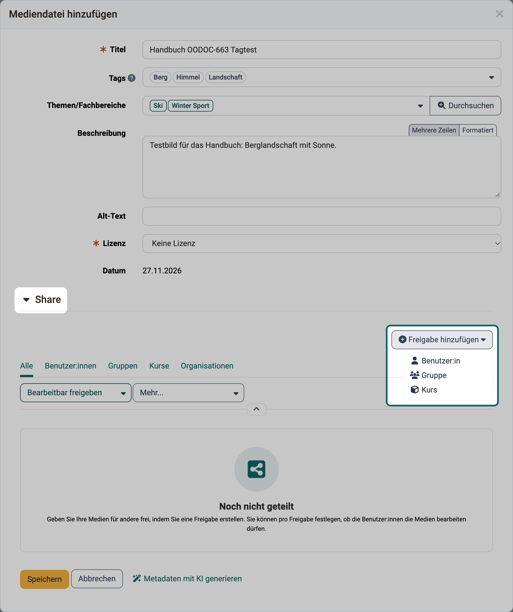{ class="shadow lightbox" title="Mein Media Center, Dialog Mediendatei hinzufügen · 2026.11.27" }

[Zum Seitenanfang ^](#media_center_concept)

---

## Medien löschen {: #delete_media}

Eigene Medien, die Sie nicht mehr brauchen, löschen Sie in Ihrem Media Center unter `Persönliches Menü > Media Center`. Sehen Sie eine Segmentleiste mit "Mein Media Center" und "Medienverwaltung" (nur als Administrator:in oder Lernressourcenverwalter:in), wählen Sie dort das Segment "Mein Media Center".

Wählen Sie oben rechts über der Liste die Tabellenansicht, das rechte der beiden Ansichtssymbole, falls Sie gerade die Medien in der Kachelansicht angezeigt haben.

Setzen Sie in der Tabellenansicht am Anfang einer Zeile ein Häkchen. Über der Liste erscheint der Button "Löschen", mit dem Sie alle angehakten Medien auf einmal löschen.

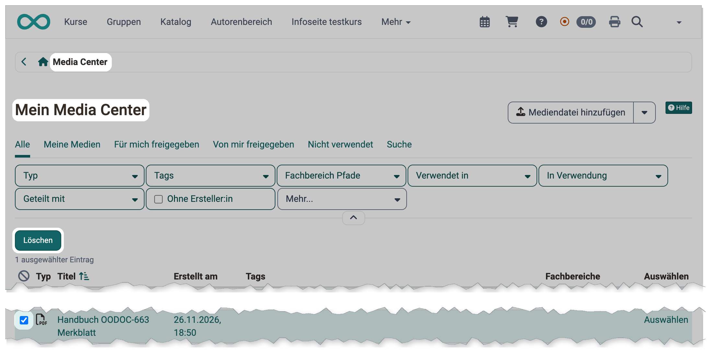{ class="shadow lightbox" title="Mein Media Center, Tabellenansicht · 2026.11.26" }

Ein einzelnes Medium löschen Sie auch in seiner Detailansicht: Klicken Sie das Medium an und wählen Sie im 3-Punkte-Menü "Löschen". Im selben Menü steht "Herunterladen".

!!! info "Wichtig"

    Löschen können Sie nur Medien, die Sie selbst erstellt haben und die nirgends in OpenOlat eingebunden sind. Wo ein Medium eingebunden ist, sehen Sie nach dem Anklicken im Tab "Verwendungen". Entfernen Sie es aus diesen Seiten, danach lässt es sich löschen. Ist es in eine Seite eingebunden, die Sie nicht bearbeiten dürfen, bitten Sie die Besitzer:in dieser Seite, es zu entfernen. Angehakte Medien, die noch eingebunden sind, löscht OpenOlat nicht. Dasselbe gilt für Medien anderer Personen im Tab "Für mich freigegeben": Auch wenn dort über der Liste der Button "Löschen" erscheint, zeigt OpenOlat nach dem Klick eine Warnung, und das Medium bleibt in der Liste. Im 3-Punkte-Menü eines fremden Mediums fehlt "Löschen". Aus Ihrer Liste verschwindet es, wenn seine Ersteller:in die Freigabe entfernt.

### Was mit den Medien beim Löschen eines Kontos geschieht {: #delete_media_account}

Jedes Medium im Media Center hat eine Ersteller:in. Wird deren Konto gelöscht, entscheidet eine einzige Frage über jedes ihrer Medien: Ist es in eine Seite eingebunden?

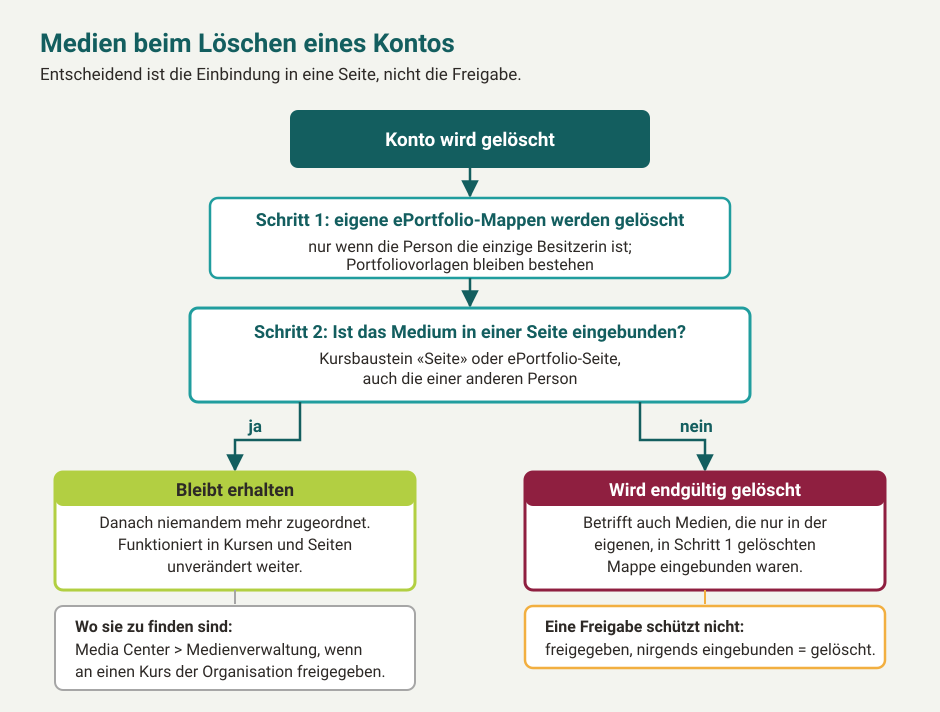{ class="shadow lightbox" title="Medien beim Löschen eines Kontos" }

Eingebunden zählt sowohl im Kursbaustein "Seite" als auch in einer ePortfolio-Seite, auch in der einer anderen Person. Eine ePortfolio-Seite ist ein Eintrag in einer Mappe, der Sammlung, in der eine Person im Portfolio ihre Arbeit ordnet. Ist das Medium eingebunden, bleibt es erhalten und ist danach niemandem mehr zugeordnet. Ist es nirgends eingebunden, wird es endgültig gelöscht.

Eine Freigabe schützt das Medium nicht. Freigegeben, aber nirgends eingebunden bedeutet: gelöscht. Die eigenen ePortfolio-Mappen der Person werden vorher gelöscht, sofern sie deren einzige Besitzerin ist. Portfoliovorlagen bleiben bestehen, also die Lernressourcen, aus denen Mappen für eine Portfolioaufgabe entstehen. Medien, die nur in diesen gelöschten Mappen eingebunden waren, verlieren dadurch ihre Einbindung und werden ebenfalls gelöscht.

Medien, die so erhalten bleiben, finden Administrator:innen und Lernressourcenverwalter:innen in der [Medienverwaltung](#media_center_administration) über den Filter "Ohne Ersteller:in", sofern das Medium an einen Kurs ihrer Organisation freigegeben ist. Zu welchen Organisationen ein Kurs gehört, steht in seinen Einstellungen im Tab "Freigabe" unter "Administrative Freigabe", siehe [Kurseinstellungen - Tab Freigabe](../../learningresources/Course_Settings_Share/index.de.md#section_share_admin_access). Ein eingebundenes Medium, das an keinen Kurs freigegeben ist, erscheint dort nicht. Ein Medium löscht nur seine Ersteller:in. Ein so erhaltenes Medium kann deshalb niemand mehr löschen, auch keine Administrator:in.

!!! tip "Vor dem Löschen eines Kontos"
    Wer ein Konto löscht, bittet die betroffene Person vorher, benötigte Medien herunterzuladen. Soll ein Medium im System bleiben, bindet die Person es vorher in eine Seite ein, etwa in einen Kursbaustein "Seite". Die vollständige Tabelle aller Datenarten steht auf der Seite [Benutzer:in löschen](../../../manual_admin/usermanagement/Delete_User.de.md#del_properties).

[Zum Seitenanfang ^](#media_center_concept)

---

## Speicherplatz und Quota [:octicons-tag-16:{ title="ab Release 18.1 (OO-7024)" }](https://track.frentix.com/issue/OO-7024){:target="_blank"} {: #quota}

Der Speicherplatz im Media Center ist begrenzt. Wie viel Speicher Ihnen genau zur Verfügung steht und wie viel Sie schon verbraucht haben, sehen Sie links unten. So wissen Sie vor dem Hochladen, wie viel Platz Ihnen für neue Medien bleibt. Die Anzeige gehört zu Ihrem eigenen Media Center ("Mein Media Center"), in der Medienverwaltung fehlt sie, siehe [Media Center verwalten](#media_center_administration).

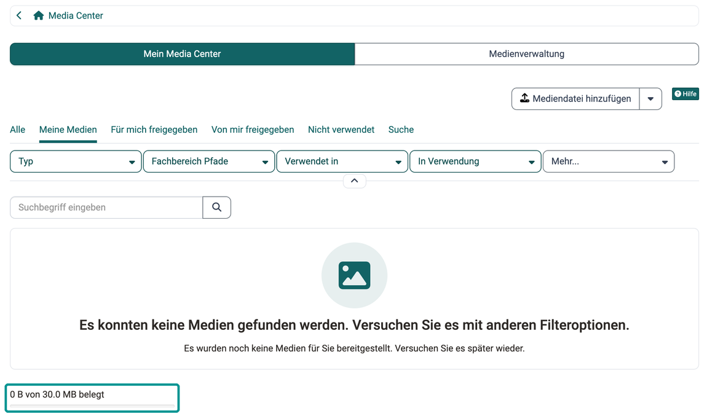{ class="shadow lightbox" title="Segment Mein Media Center, unten links" }

Autor:innen brauchen meist mehr Speicherplatz, darum gilt für sie als Poweruser ein eigener Standardwert. Als Poweruser zählen neben den Autor:innen auch Lernressourcenverwalter:innen und Administrator:innen.

Beide Standardwerte, "Normale Benutzer:innen" und "Poweruser (Autor:innen)", legen Administrator:innen in der System-Administration fest, unter: 
`Administration > Core-Konfiguration > Dateien und Ordner`, Tab "Quotas"

In der Liste dieses Tabs heissen die beiden Standardwerte "::DEFAULT::USERS" und "::DEFAULT::POWERUSERS".

Dieselben Werte gelten auch für die persönlichen Dateien. Einen eigenen Standardwert nur für das Media Center gibt es nicht, siehe [Dateien und Ordner](../../../manual_admin/administration/Files_and_Folders.de.md#files_and_folders_quotas).

Braucht eine einzelne Person mehr Platz, setzen Administrator:innen, Rollenverwalter:innen oder Benutzerverwalter:innen ([Rollen und Rechte](../Roles/index.de.md)) für sie eine eigene Quota unter `Benutzerverwaltung > "Name der Person" > Quota`, siehe [Kontoeinstellungen verwalten](../../../manual_admin/usermanagement/Configure_User.de.md#quota). Wenden Sie sich deshalb bei Fragen zum Speicherbedarf an Ihre Administrator:innen, Rollenverwalter:innen oder Benutzerverwalter:innen.

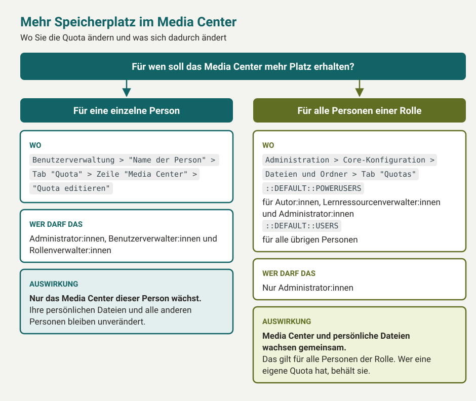{ class="shadow lightbox" title="Mehr Speicherplatz im Media Center" }

!!! note "Hinweis"

    Die Speicheranzeige zählt nur Medien, die Sie selbst hochgeladen oder erstellt haben. Medien anderer Personen, die für Sie freigegeben sind, belegen keinen Platz. Sehen Sie nur freigegebene Medien, zeigt die Anzeige einen Verbrauch von 0.

[Zum Seitenanfang ^](#media_center_concept)

---

## Medien verwenden [:octicons-tag-16:{ title="ab Release 18.0 (OO-7014)" }](https://track.frentix.com/issue/OO-7014){:target="_blank"} {: #usage}

Medien aus dem Media Center setzen Sie dort ein, wo Sie Inhalte gestalten, zum Beispiel mit dem Content Editor im Kursbaustein ["Seite"](../../learningresources/Course_Element_Page.de.md) oder im [Portfolio](../../personal_menu/Portfolio/index.de.md). Schalten Sie dort den "Bearbeitungsmodus" ein, siehe [Kursbaustein Seite im Content Editor](../Content_Editor/index.de.md#course_element_page). Klicken Sie auf "Inhalt hinzufügen" und dann unten im Dialog auf den Button "Media Center". Im Dialog "Media Center" stehen Ihre eigenen und die für Sie freigegebenen Medien. Klicken Sie in der Zeile des gewünschten Mediums auf "Auswählen", dann setzt OpenOlat es an der gewählten Stelle ein.

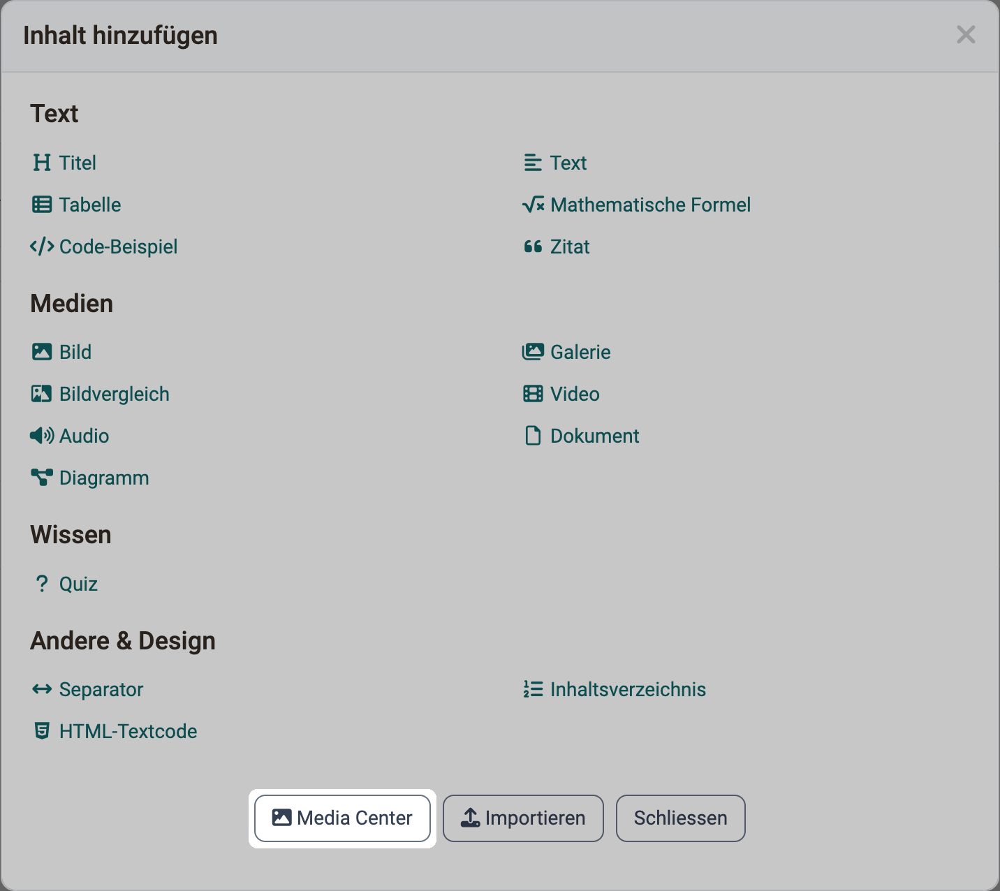{ class="shadow lightbox" title="Kursbaustein Seite, Dialog Inhalt hinzufügen · 2026.11.26" }

Mit den Filtern finden Sie die gesuchten Medien schnell. Dieselbe Filterleiste steht über der Liste in "Mein Media Center" und im Dialog "Media Center". In der Grundeinstellung sind sichtbar:

* "Typ": die Art des Mediums, etwa Bild, Video oder Dokument
* "Tags": erscheint, sobald Ihre Medien Tags tragen
* "Fachbereich Pfade": filtert nach dem Feld "Themen/Fachbereiche" und erscheint, wenn das Media Center Themen und Fachbereiche zur Zuordnung anbietet
* "Verwendet in": wo das Medium eingebunden ist, Auswahl "Seite" oder "Portfolio"
* "In Verwendung": "Ja" für eingebundene, "Nein" für nirgends eingebundene Medien

Über "Mehr..." blenden Sie weitere Filter ein:

* "Geteilt mit": die Art der Freigabe, Auswahl "Person", "Gruppe", "Kurs" oder "Organisation"
* "Ohne Ersteller:in": nur Medien, deren Ersteller:in kein Konto mehr hat
* "Quelle": ein Suchtext in der Quellenangabe von Zitaten und Bildern
* "Plattform": das Videoportal, aus dem ein Video per URL stammt

OpenOlat merkt sich, welche Filter Sie eingeblendet haben. Sie stehen beim nächsten Besuch wieder in der Filterleiste. Deshalb zeigen die Bilder auf dieser Seite "Geteilt mit" und "Ohne Ersteller:in" schon direkt in der Leiste.

In "Mein Media Center" und im Dialog "Media Center" steht ganz rechts der Tab "Suche". Dort durchsuchen Sie Titel und Beschreibung aller Medien über ein grosses Suchfeld, unabhängig vom zuvor gewählten Tab, und die Filter sind gleich aufgeklappt. Das Suchfeld "Suchbegriff eingeben" über der Liste sucht dagegen nur in den Medien des gewählten Tabs, etwa in "Meine Medien".

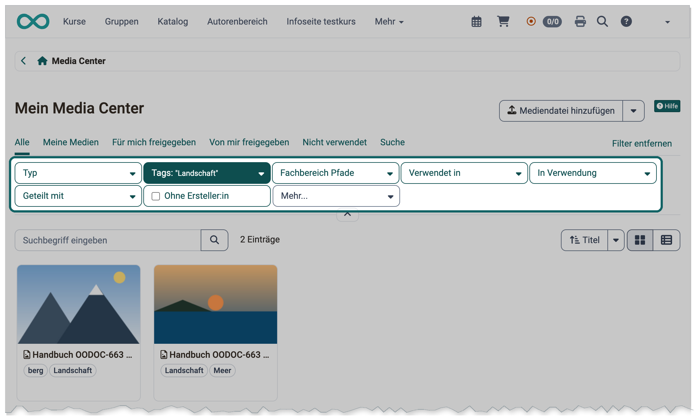{ class="shadow lightbox" title="Mein Media Center, Filterleiste · 2026.11.27" }

!!! note "Hinweis"

    In einer Portfolio-Mappe erscheint ein Bild direkt auf der Seite. Ein Dokument wie ein PDF oder eine Word-Datei erscheint als Dateikarte, ohne seinen Inhalt anzuzeigen. Der Titel auf der Karte ist ein Link auf die Datei: Der Browser zeigt sie in einem neuen Tab an oder lädt sie herunter, je nach Dateityp. Ist in Ihrem OpenOlat ein Dokumenteneditor eingeschaltet, also ein eingebundener Editor, der Dateien direkt im Browser öffnet, trägt die Karte zudem den Button "Öffnen", im Bearbeitungsmodus bei einer Word-Datei "Bearbeiten". Ein PDF öffnet sich damit im Betrachter von OpenOlat, eine Word-Datei im Editor in einem neuen Fenster.

[Zum Seitenanfang ^](#media_center_concept)

---

## Media Center verwalten [:octicons-tag-16:{ title="ab Release 18.1 (OO-7254)" }](https://track.frentix.com/issue/OO-7254){:target="_blank"} {: #media_center_administration}

Wer als Administrator:in oder Lernressourcenverwalter:in wissen muss, wo das Medium einer anderen Person eingebunden und an wen es freigegeben ist, findet die Antwort im Media Center im Segment "Medienverwaltung". Nur diese beiden Rollen sehen es neben dem Segment "Mein Media Center". Alle übrigen Rollen sehen nur ihr eigenes Media Center und keine Segmentleiste.

Sie öffnen das Segment unter: 
`Persönliches Menü > Media Center > Segment "Medienverwaltung"`

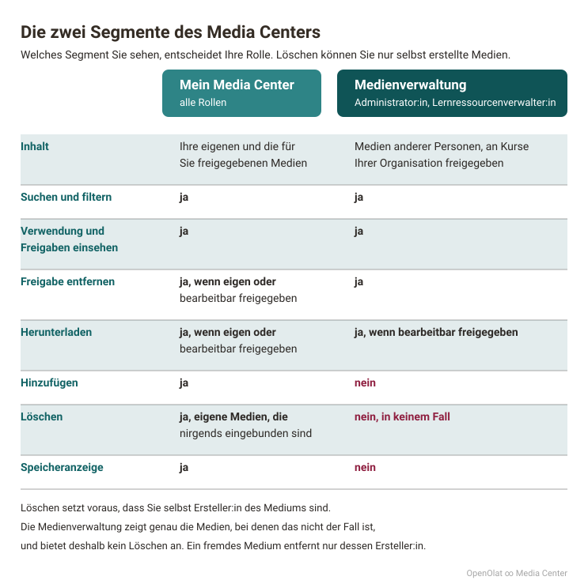{ class="shadow lightbox" title="Die zwei Segmente des Media Centers" }

Die Medienverwaltung listet Medien anderer Personen, die an einen Kurs freigegeben sind, der zu einer Organisation gehört, in der Sie Administrator:in oder Lernressourcenverwalter:in sind. Medien, die direkt an Sie, an eine Ihrer Gruppen oder an Ihre Organisation freigegeben sind, erscheinen dort nicht. Sie stehen wie Ihre eigenen Medien im Segment "Mein Media Center", im Tab "Für mich freigegeben".

Nach Anklicken eines Mediums sehen Sie im Tab "Verwendungen", wo es eingebunden ist, und im Tab "Freigaben", an wen es freigegeben ist. Je nach Medientyp zeigt der Tab "Übersicht" zudem das Aktivitätslog mit den bisherigen Aktionen am Medium. So klären Sie, wo ein Medium eingebunden ist, bevor Sie dessen Ersteller:in bitten, es zu ersetzen oder zu entfernen. Im Tab "Freigaben" können Sie eine Freigabe über das Symbol "Entfernen" in ihrer Zeile entfernen und mit "Share entfernen" bestätigen, auch ohne bearbeitbare Freigabe. Bleibt danach keine Freigabe an einen Kurs Ihrer Organisation übrig, verschwindet das Medium aus Ihrer Medienverwaltung.

Die Filter "Verwendet in", "In Verwendung" und "Geteilt mit" grenzen die Liste ein. Der Filter "Ohne Ersteller:in" zeigt innerhalb dieser Liste nur die Medien, deren Ersteller:in kein Konto mehr hat, weil es gelöscht wurde.

Ist das Medium an den Kurs bearbeitbar freigegeben (Einstellung "Bearbeitbar freigeben" in der Freigabe an den Kurs), bearbeiten Sie zusätzlich seine Metadaten und, je nach Medientyp, seine Versionen. Herunterladen können Sie es dann über das 3-Punkte-Menü. Ohne bearbeitbare Freigabe fehlt das 3-Punkte-Menü.

Medien hinzufügen können Sie in der Medienverwaltung nicht, der Button "Mediendatei hinzufügen" fehlt dort. Auch die Speicheranzeige unten links gehört zum eigenen Media Center und erscheint in der Medienverwaltung nicht.

!!! info "Wichtig"

    Medien löscht nur ihre Ersteller:in, im Segment "Mein Media Center", und das gilt auch für Administrator:innen. Die Medienverwaltung listet ausschliesslich Medien anderer Personen und bietet deshalb weder über der Liste noch im 3-Punkte-Menü eines Mediums die Aktion "Löschen" an [:octicons-tag-16:{ title="ab Release 21.1.0 (OO-9774)" }](https://track.frentix.com/issue/OO-9774){:target="_blank"}. Ihre eigenen Medien löschen Sie im Segment "Mein Media Center", sofern sie nirgends eingebunden sind, siehe [Medien löschen](#delete_media). Wer ein fremdes Medium entfernen möchte, bittet dessen Ersteller:in darum. Ist deren Konto gelöscht, bleibt ein eingebundenes Medium erhalten, ist niemandem mehr zugeordnet und lässt sich von niemandem mehr löschen, siehe [Was mit den Medien beim Löschen eines Kontos geschieht](#delete_media_account).

[Zum Seitenanfang ^](#media_center_concept)

---

## Weiterführende Informationen {: #further_information}

**Auf dieser Seite erwähnt** 
[Externe Werkzeuge: KI-Modul >](../../../manual_admin/administration/External_Tools_AI.de.md) 
[Persönliche Konfiguration: Einstellungen >](../../personal_menu/Settings.de.md) 
[Media Center: Informationen und Einstellungen zu Einzelmedien >](../Media_Center_Items.de.md) 
[Konzept des File Hub >](../File_Hub_Concept.de.md) 
[Content Editor >](../Content_Editor/index.de.md) 
[Kursbaustein "Seite" >](../../learningresources/Course_Element_Page.de.md) 
[Modul Media Center >](../../../manual_admin/administration/Modules_Media_Center.de.md) 
[Rollen und Rechte: Welche Rollen gibt es? >](../Roles/index.de.md) 
[Kurseinstellungen - Tab Freigabe >](../../learningresources/Course_Settings_Share/index.de.md) 
[Benutzer:in löschen >](../../../manual_admin/usermanagement/Delete_User.de.md) 
[Dateien und Ordner >](../../../manual_admin/administration/Files_and_Folders.de.md) 
[Kontoeinstellungen verwalten >](../../../manual_admin/usermanagement/Configure_User.de.md) 
[Persönliche Werkzeuge: Portfolio 2.0 >](../../personal_menu/Portfolio/index.de.md)

**Weiterführend** 
[Persönliche Werkzeuge: Das Media Center >](../../personal_menu/Media_Center.de.md) 
[Arbeiten mit Mediendateien >](../Working_with_Media_Files.de.md) 
[Datenschutz >](../../../manual_admin/usermanagement/Data_protection.de.md)

[Zum Seitenanfang ^](#media_center_concept)
