# Media Center Concept {: #media_center_concept}

## Functions [:octicons-tag-16:{ title="from Release 19.1 (OO-8156)" }](https://track.frentix.com/issue/OO-8156){:target="_blank"} {: #functions}

You collect images, videos, documents and other media that you use in courses and in the portfolio in one central place: the Media Center. You store a media item there once and use it in several places.

Media can be...

* ... created directly in the Media Center
* ... created in various course elements and then stored in the Media Center
* ... created externally and uploaded as a file
* ... used across courses
* ... released (shared) to other persons and used jointly
* ... versioned: With "Create new version" you save an intermediate state and later switch back to an older version, see [Create new version](../Media_Center_Items.md#media_center_versioning)
* ... tagged
* ... assigned to subjects (field "Subjects"), that is to the terms of a taxonomy, the tree of terms by which your organisation classifies content
* ... filtered (for example in the tab "My media")
* ... searched by place of use

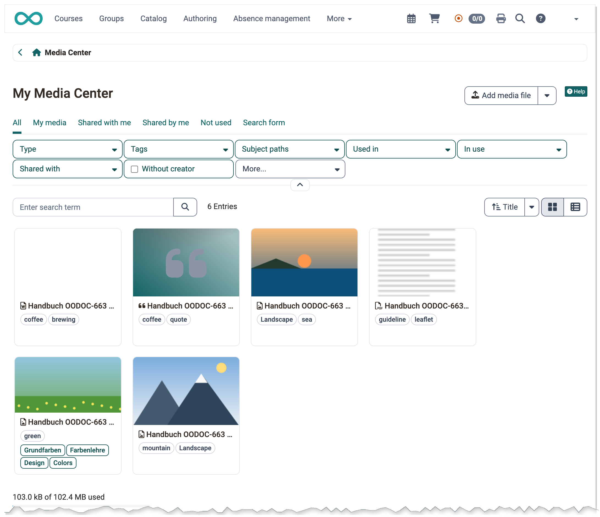{ class="shadow lightbox" title="My Media Center · 2026.11.27" }

[To the top of the page ^](#media_center_concept)

---

## Access {: #access}

The Media Center is your personal area. You open it via your profile picture at the top right, in the personal menu: 
`Personal menu > Media Center`

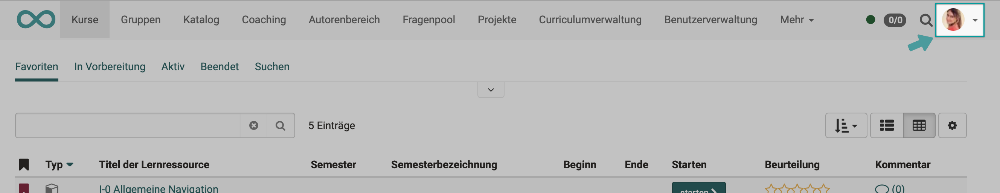{ class=" shadow lightbox" title="Main navigation at the top right" }

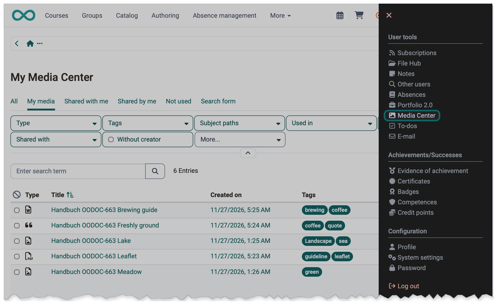{ class="shadow lightbox" title="Personal menu, User tools · 2026.11.27" }

You can nevertheless share your personal media with other people and use them in various places in OpenOlat. 
[More about sharing >](#share)

### Administrative access {: #administrative_access}

Administrators and learning resource managers additionally have administrative access through their role to media items of other persons, provided that these are shared with a course belonging to an organisation in which they hold this role. They find these media items in the segment "Media management", a second area of their Media Center next to "My Media Center". There they see where a media item is embedded and with whom it is shared, and they remove shares. Deleting is not part of it, see [Manage Media Center](#media_center_administration).

[To the top of the page ^](#media_center_concept)

---

## Types of Media {: #media_types}

In the Media Center you store files and content that you have created or collected in OpenOlat. These include:

* images (png, jpg, svg [:octicons-tag-16:{ title="svg from Release 20.3.0 (OO-9350)" }](https://track.frentix.com/issue/OO-9350){:target="_blank"}, ...)
* video files (mp4)
* audio files (mp3)
* Office documents (docx, xlsx, pptx, ...)
* text elements
* diagrams (draw.io)
* own video recordings via webcam
* audio recordings
* citations
* forum posts
* blog entries
* wiki pages
* evidences of achievement from courses

[To the top of the page ^](#media_center_concept)

---

## Add media to the Media Center [:octicons-tag-16:{ title="from Release 19.1 (OO-7813)" }](https://track.frentix.com/issue/OO-7813){:target="_blank"} {: #add_media}

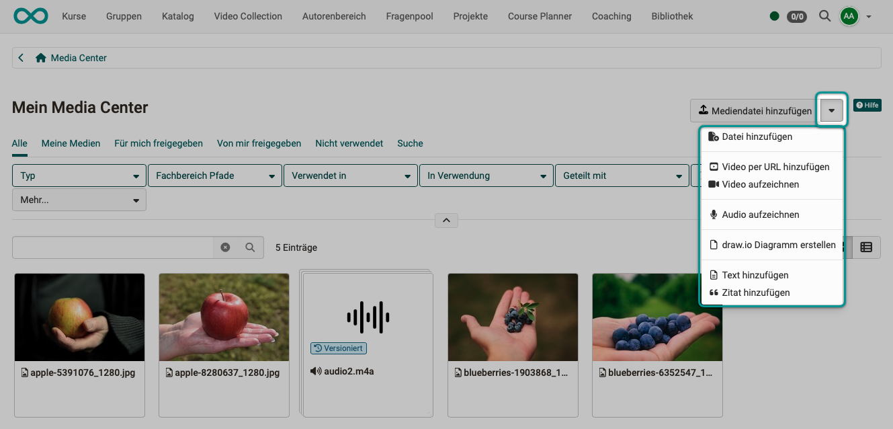{ class=" shadow lightbox" title="Add media file menu in My Media Center" }

Media get into the Media Center in four ways: you upload them directly, you create them in the Media Center, you create them in the Content Editor, or you take over content from other areas of OpenOlat. How you then share a media item with others is described under [Share with others](#share).

You find the entries of the two following lists in "My Media Center" at the top right: the button "Add media file" and the drop-down menu next to it.

### Upload or link existing media directly in the Media Center {: #add_existing}

* **Add media file:** uploads images, videos, PDF, Office and other files. For images, the AI helps in two ways, both only if your administration has switched on the [AI module](../../../manual_admin/administration/External_Tools_AI.md). When uploading, you click on the button "Generate metadata with AI" yourself: the AI pre-fills title, description, alt text and tags, and you check the suggestions before saving [:octicons-tag-16:{ title="from Release 20.3.0 (OO-9355)" }](https://track.frentix.com/issue/OO-9355){:target="_blank"}. If you have additionally switched on the AI image descriptions in your personal settings, OpenOlat fills in the fields that are still empty after you save a new image, without any action on your part: description, alt text, tags and subjects. Check these details afterwards in the detail view of the media item, see [Tab AI settings](../../personal_menu/Settings.md#tab_ai_settings). [Details on metadata with AI >](../Media_Center_Items.md#metadata_ai)
* **Add file:** first entry in the drop-down menu next to "Add media file". The button "Add media file" uploads a file directly from your computer. "Add file" additionally offers files from the [File Hub](../File_Hub_Concept.md) of OpenOlat, next to the area "Local" for your computer. You then enter the title and metadata in the dialog "Add media file".
* **Add video via URL:** adds a video from an external portal such as YouTube, Vimeo, Panopto or nanoo.tv via its link.
* **Add citation:** stores a quotation from a book, an article, a website or a film as text, with details such as source, author and URL. You then insert the citation in several places in OpenOlat without entering the source again each time. Therefore enter the details completely.

### Create new media directly in the Media Center [:octicons-tag-16:{ title="from Release 18.1 (OO-7366)" }](https://track.frentix.com/issue/OO-7366){:target="_blank"} {: #create_in_media_center}

* **Create document:** creates a Word, Excel or PowerPoint document with an Office editor integrated in OpenOlat. The entry appears in the drop-down menu if such an editor is set up in your OpenOlat.
* **Create draw.io diagram:** creates a diagram, a flowchart or a drawing with the draw.io tool [:octicons-tag-16:{ title="from Release 18.1.0 (OO-7092)" }](https://track.frentix.com/issue/OO-7092){:target="_blank"}
* **Add text:** creates a text element with a simple HTML editor, for example for use in the Content Editor.
* **Record Video:** starts the recording with your webcam as soon as you allow access to the camera in the browser.
* **Record Audio:** starts the recording with your microphone as soon as you allow access to the microphone in the browser.

### Create new media outside the Media Center in the Content Editor {: #create_in_editor}

You also create media for the Media Center in the course or in the portfolio, with the [Content Editor](../Content_Editor/index.md). In the course, you use for example the course element ["Page"](../../learningresources/Course_Element_Page.md), in the portfolio an entry of a binder. The way is the same in both places: Switch on the edit mode and click on "Add content". In the dialog "Add content", click on the button "Media Center" at the bottom. The dialog "Media Center" opens with the list "Choose media". There you upload new media via "Add media file". Via the drop-down menu next to it, you create new media, with the same options as directly in the Media Center.

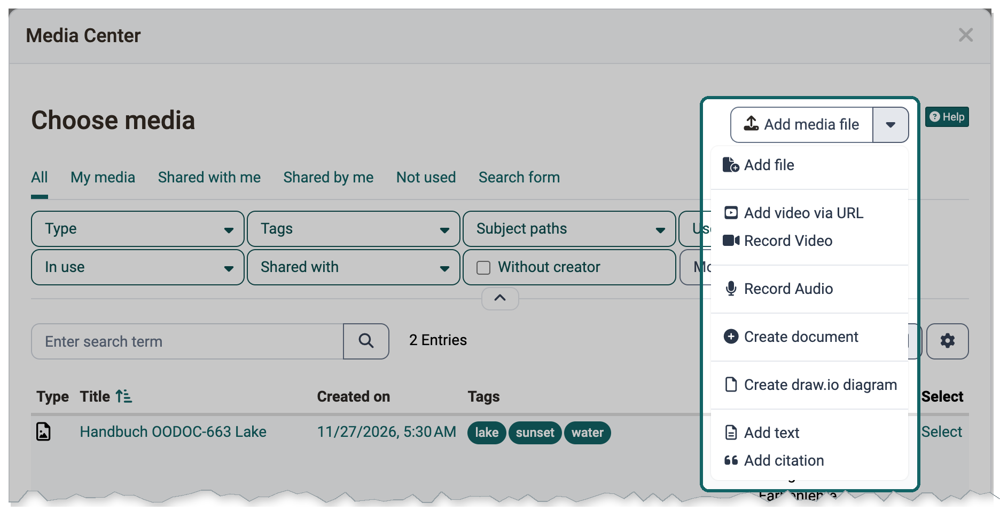{ class="shadow lightbox" title="Course element Page, dialog Media Center · 2026.11.27" }

### Collect content elements and assign them to the Media Center {: #assign_media}

You take over your own content from other areas of OpenOlat into the Media Center by clicking on the puzzle piece icon. This applies to:

* forum posts
* blog entries
* wiki pages
* evidences of achievement from courses

For example, to take over a forum post, open your post in the forum and click on the puzzle piece icon at the top right of the post.

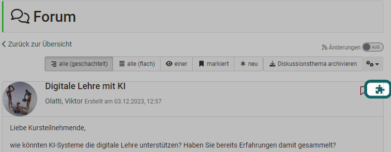{ class=" shadow lightbox" title="Forum post with puzzle piece icon" }

A window opens in which you enter the title and further metadata as when uploading, and save. The post is then in your Media Center, with a link to the original.

You take over an evidence of achievement under `Personal menu > Evidence of achievement`: the puzzle piece icon is on the right of each row in the list, and at the top right in the detail view of an evidence of achievement.

!!! info "Important"

    The puzzle piece icon appears if the module ePortfolio is switched on in your OpenOlat, and only for content that belongs to you: your own evidences of achievement, and forum posts, blog entries and wiki pages of which you are the creator. Having edited the post is not sufficient.

!!! info "Mandatory information"

    Each media item needs a title. If your administration has made the license a mandatory field for the Media Center, it also needs an entry in the field "License", and "No license" is then not sufficient. If the field is set to "No license", select another license before saving, see [Module Media Center](../../../manual_admin/administration/Modules_Media_Center.md#licences). You add further details and metadata when adding it or later in the tabs that open when you click on the media item.

### Share with others [:octicons-tag-16:{ title="from Release 18.0 (OO-7061)" }](https://track.frentix.com/issue/OO-7061){:target="_blank"} {: #share}

If other people are to use a media item, you share it: with individual users, with groups, with courses or with organisations. For each share you decide whether the recipients may also edit the media item, that is its metadata and, depending on the media type, its versions. For this, the row of each share has a switch in the column "Editable". You set a share at any time in the tab "Shares" of the media item via "Add share". The recipients find the media item in their Media Center in the tab "Shared with me".

Which targets the menu "Add share" offers depends on your role. Administrators define this in the [Module Media Center](../../../manual_admin/administration/Modules_Media_Center.md#shares). The default setting:

| Target | Who can share this way | Who sees the media item afterwards |
|---|---|---|
| User | authors, learning resource managers, administrators | the selected person |
| Group | everyone, including users without a further role | the members of the group |
| Course | authors, learning resource managers, administrators | the owners of the course, not the coaches and not the participants |
| Organisation | administrators | the authors, learning resource managers and administrators of the organisation |

What the individual roles comprise is described under [Roles and Rights](../Roles/index.md).

A share with a course puts the media item in the hands of its owners, so that they use it in the course. They find it in their Media Center in the tab "Shared with me". If the media item is embedded in a page of the course, everyone who sees this page sees it, including coaches and participants.

You set shares with users, groups and organisations already when adding, in the dialog "Add media file". In the dialog, the area for the shares is called "Share". Open it and click on "Add share". The menu there also offers "Course", but OpenOlat does not save a share with a course entered this way with the media item. Therefore set the share with a course after creating the media item, in the tab "Shares" of the media item. The image shows the menu of a role that may also share with an organisation. 
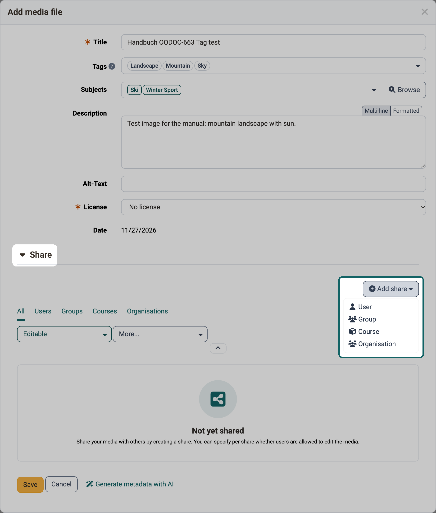{ class="shadow lightbox" title="My Media Center, dialog Add media file · 2026.11.27" }

[To the top of the page ^](#media_center_concept)

---

## Delete media {: #delete_media}

You delete your own media items that you no longer need in your Media Center under `Personal menu > Media Center`. If you see a segment bar with "My Media Center" and "Media management" (only as an administrator or learning resource manager), select the segment "My Media Center" there.

Select the table view at the top right above the list, the right one of the two view icons, if you are currently viewing the media in card view.

In the table view, set a tick at the beginning of a row. The button "Delete" appears above the list, with which you delete all ticked media items at once.

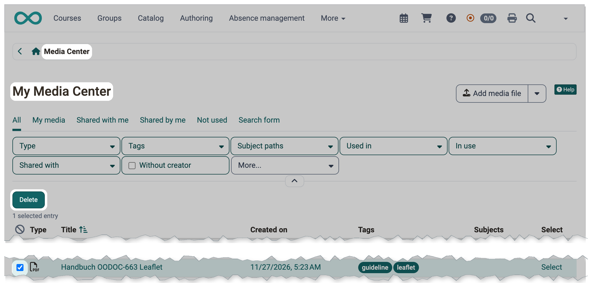{ class="shadow lightbox" title="My Media Center, table view · 2026.11.27" }

You also delete a single media item in its detail view: click on the media item and select "Delete" in the 3-dot menu. The same menu contains "Download".

!!! info "Important"

    You can only delete media items that you created yourself and that are not embedded anywhere in OpenOlat. Where a media item is embedded, you see in the tab "Uses" after clicking on it. Remove it from these pages, then it can be deleted. If it is embedded in a page that you may not edit, ask the owner of that page to remove it. Ticked media items that are still embedded are not deleted by OpenOlat. The same applies to media items of other persons in the tab "Shared with me": even if the button "Delete" appears there above the list, OpenOlat shows a warning after the click, and the media item remains in the list. In the 3-dot menu of a media item of another person, "Delete" is missing. It disappears from your list when its creator removes the share.

### What happens to the media items when an account is deleted {: #delete_media_account}

Every media item in the Media Center has a creator. When that account is deleted, a single question decides the fate of each of their media items: is it embedded in a page?

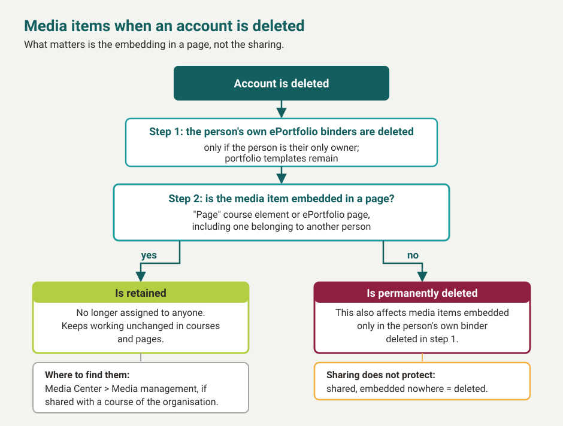{ class="shadow lightbox" title="Media items when an account is deleted" }

Embedded counts both in the "Page" course element and in an ePortfolio page, including one belonging to another person. An ePortfolio page is an entry in a binder, the collection in which a person organises their work in the portfolio. If the media item is embedded, it is retained and is no longer assigned to anyone. If it is not embedded anywhere, it is permanently deleted.

Sharing does not protect the media item. Shared, but embedded nowhere means: deleted. The person's own ePortfolio binders are deleted beforehand, provided that the person is their only owner. Portfolio templates remain, that is the learning resources from which binders for a portfolio task are created. Media items that were embedded only in these deleted binders lose their embedding and are therefore deleted as well.

Administrators and learning resource managers find the media items retained in this way in the [media management](#media_center_administration), using the filter "Without creator", provided that the media item is shared with a course of their organisation. The organisations a course belongs to are shown in its settings in the tab "Share" under "Administrative access", see [Course settings - Tab Share](../../learningresources/Course_Settings_Share/index.md#section_share_admin_access). An embedded media item that is not shared with any course does not appear there. Only its creator deletes a media item. A media item retained in this way can therefore no longer be deleted by anyone, not even by an administrator.

!!! tip "Before an account is deleted"
    Whoever deletes an account asks the person concerned beforehand to download any media items they need. If a media item is to remain in the system, the person embeds it in a page beforehand, for example in a "Page" course element. The complete table of all data types is on the page [Delete user](../../../manual_admin/usermanagement/Delete_User.md#del_properties).

[To the top of the page ^](#media_center_concept)

---

## Storage space and quota [:octicons-tag-16:{ title="from Release 18.1 (OO-7024)" }](https://track.frentix.com/issue/OO-7024){:target="_blank"} {: #quota}

The storage space in the Media Center is limited. You can see exactly how much storage space you have available and how much you have already used at the bottom left. This lets you know before uploading how much space remains for new media. The indicator belongs to your own Media Center ("My Media Center"), it is missing in the media management, see [Manage Media Center](#media_center_administration).

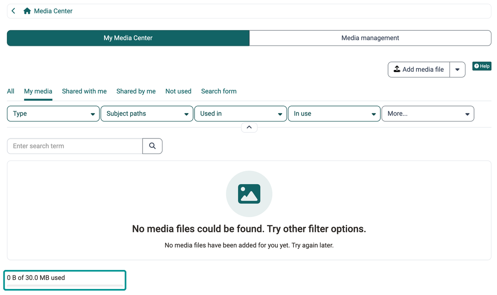{ class="shadow lightbox" title="Segment My Media Center, bottom left" }

Authors usually need more storage space, so a default value of its own applies to them as power users. Besides authors, learning resource managers and administrators also count as power users.

Administrators define both default values, "Normal users" and "Power user (authors)", in the system administration, under: 
`Administration > Core functions > Files and folders`, tab "Quotas"

In the list of this tab, the two default values are called "::DEFAULT::USERS" and "::DEFAULT::POWERUSERS".

The same values also apply to the personal files. There is no separate default value for the Media Center only, see [Files and Folders](../../../manual_admin/administration/Files_and_Folders.md#files_and_folders_quotas).

If a single person needs more space, administrators, roles managers or user managers ([Roles and Rights](../Roles/index.md)) set a quota of its own for this person under `User management > "Name of the person" > Quota`, see [Manage user settings](../../../manual_admin/usermanagement/Configure_User.md#quota). Therefore, if you have any questions about storage requirements, please contact your administrators, roles managers or user managers.

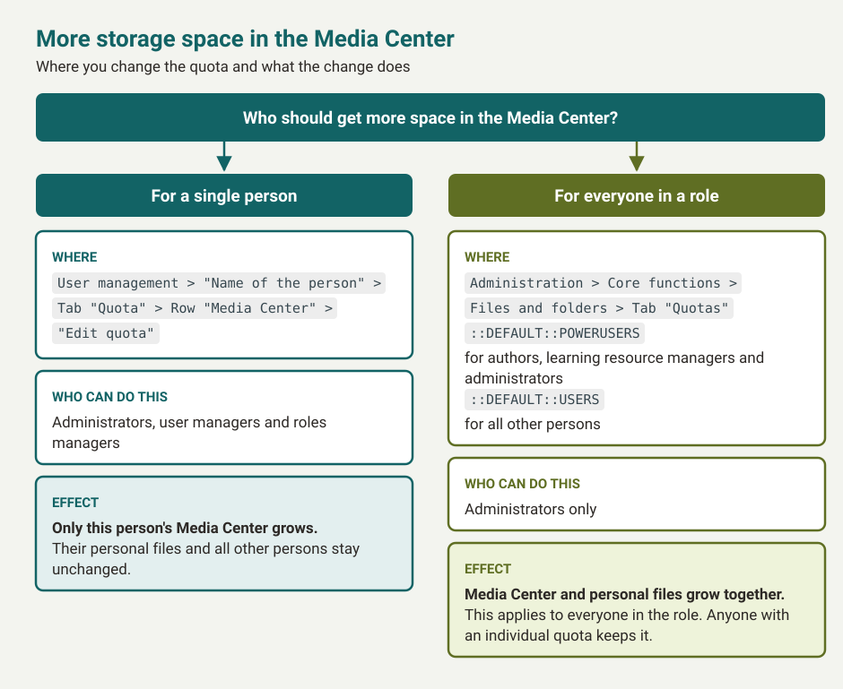{ class="shadow lightbox" title="More storage space in the Media Center" }

!!! note "Note"

    The storage indicator only counts media items that you have uploaded or created yourself. Media items of other persons that are shared with you take up no space. If you only see shared media items, the indicator shows a usage of 0.

[To the top of the page ^](#media_center_concept)

---

## Use media [:octicons-tag-16:{ title="from Release 18.0 (OO-7014)" }](https://track.frentix.com/issue/OO-7014){:target="_blank"} {: #usage}

You use media items from the Media Center wherever you create content, for example with the Content Editor in the course element ["Page"](../../learningresources/Course_Element_Page.md) or in the [Portfolio](../../personal_menu/Portfolio/index.md). Switch on the "Edit mode" there, see [Course element Page in the Content Editor](../Content_Editor/index.md#course_element_page). Click on "Add content" and then on the button "Media Center" at the bottom of the dialog. The dialog "Media Center" lists your own media items and those shared with you. Click on "Select" in the row of the media item you want, and OpenOlat inserts it at the chosen place.

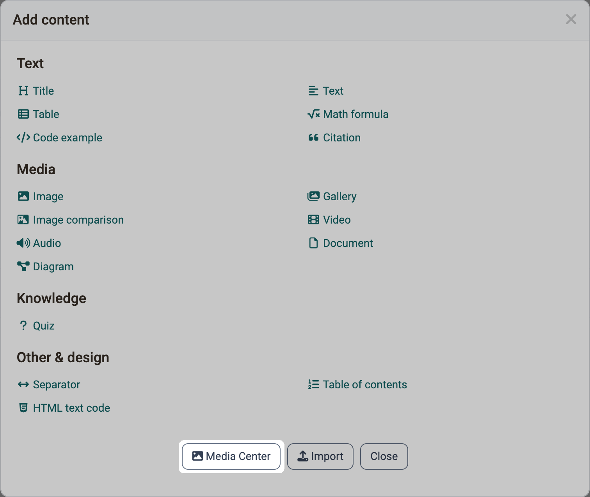{ class="shadow lightbox" title="Course element Page, dialog Add content · 2026.11.27" }

With the filters you quickly find the media you are looking for. The same filter bar is above the list in "My Media Center" and in the dialog "Media Center". In the default setting, the following are visible:

* "Type": the kind of media item, for example image, video or document
* "Tags": appears as soon as your media items carry tags
* "Subject paths": filters by the field "Subjects" and appears if the Media Center offers subjects for assignment
* "Used in": where the media item is embedded, selection "Page" or "Portfolio"
* "In use": "Yes" for embedded media items, "No" for media items embedded nowhere

Via "More..." you show further filters:

* "Shared with": the kind of share, selection "Person", "Group", "Course" or "Organisation"
* "Without creator": only media items whose creator no longer has an account
* "Source": a search text in the source details of citations and images
* "Platform": the video portal that a video via URL comes from

OpenOlat remembers which filters you have shown. They are back in the filter bar on your next visit. That is why the images on this page already show "Shared with" and "Without creator" directly in the bar.

In "My Media Center" and in the dialog "Media Center", the tab "Search form" is on the far right. There you search the title and description of all media items via a large search field, regardless of the tab selected before, and the filters are already expanded. The search field "Enter search term" above the list, by contrast, only searches the media items of the selected tab, for example in "My media".

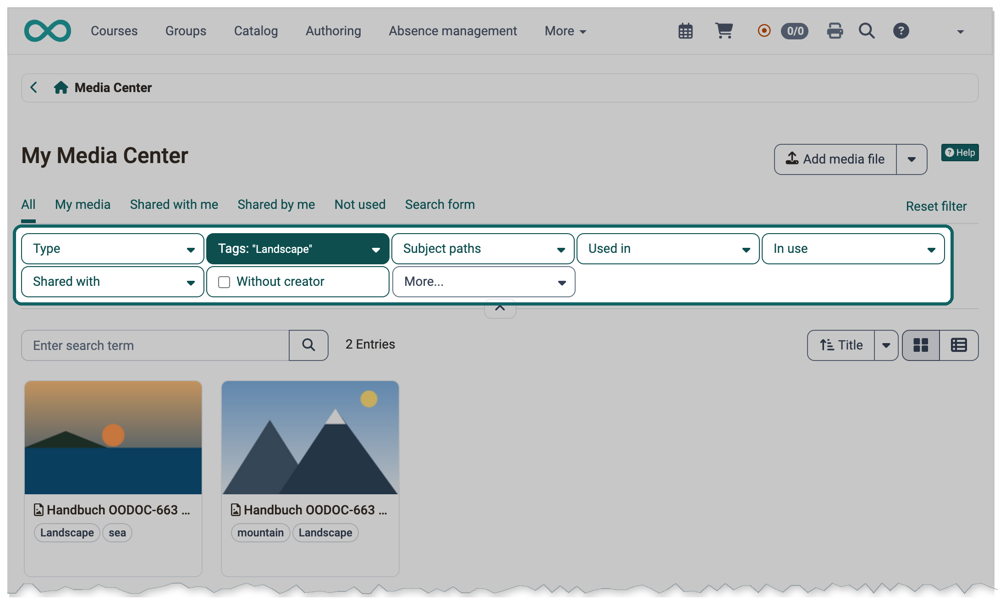{ class="shadow lightbox" title="My Media Center, filter bar · 2026.11.27" }

!!! note "Note"

    In a portfolio binder, an image appears directly on the page. A document such as a PDF or a Word file appears as a file card, without displaying its content. The title on the card is a link to the file: the browser displays it in a new tab or downloads it, depending on the file type. If a document editor is switched on in your OpenOlat, that is an embedded editor that opens files directly in the browser, the card also carries the button "Open", in the edit mode for a Word file "Edit". A PDF then opens in the viewer of OpenOlat, a Word file in the editor in a new window.

[To the top of the page ^](#media_center_concept)

---

## Manage Media Center [:octicons-tag-16:{ title="from Release 18.1 (OO-7254)" }](https://track.frentix.com/issue/OO-7254){:target="_blank"} {: #media_center_administration}

If you, as an administrator or learning resource manager, need to know where a media item of another person is embedded and with whom it is shared, you find the answer in the Media Center in the segment "Media management". Only these two roles see it next to the segment "My Media Center". All other roles only see their own Media Center and no segment bar.

You open the segment under: 
`Personal menu > Media Center > "Media management" segment`

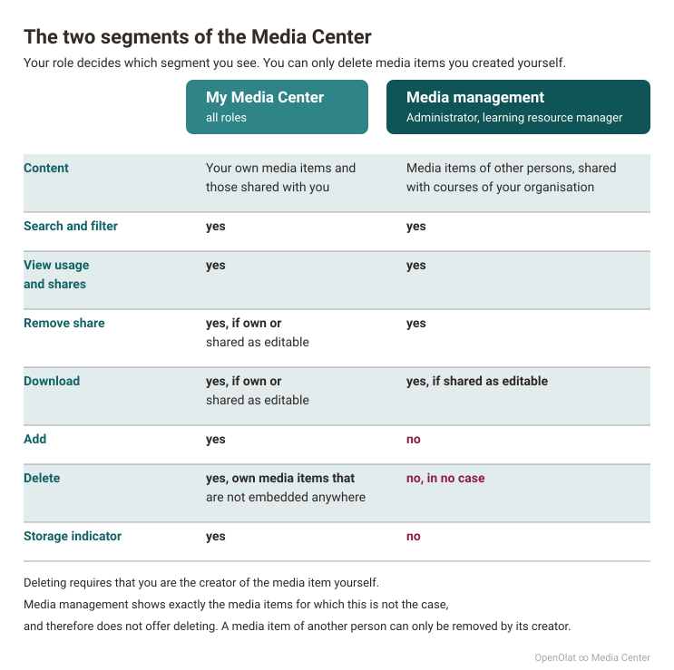{ class="shadow lightbox" title="The two segments of the Media Center" }

The media management lists media items of other persons that are shared with a course belonging to an organisation in which you are an administrator or learning resource manager. Media items shared directly with you, with one of your groups or with your organisation do not appear there. Like your own media items, they are in the segment "My Media Center", in the tab "Shared with me".

After clicking on a media item, you see in the tab "Uses" where it is embedded, and in the tab "Shares" with whom it is shared. Depending on the media type, the tab "Overview" also shows the activities log with the previous actions on the media item. This lets you clarify where a media item is embedded before you ask its creator to replace or remove it. In the tab "Shares", you can remove a share with the "Remove" icon in its row and confirm with "Remove share", also without an editable share. If no share with a course of your organisation remains afterwards, the media item disappears from your media management.

The filters "Used in", "In use" and "Shared with" narrow down the list. The filter "Without creator" shows, within this list, only the media items whose creator no longer has an account because it was deleted.

If the media item is shared with the course as editable (setting "Editable" in the share with the course), you can also edit its metadata and, depending on the media type, its versions. You can then download it via the 3-dot menu. Without an editable share, the 3-dot menu is missing.

You cannot add media items in the media management, the "Add media file" button is missing there. The storage indicator at the bottom left also belongs to your own Media Center and does not appear in the media management.

!!! info "Important"

    Only their creator deletes media items, in the segment "My Media Center", and this also applies to administrators. The media management lists only media items of other persons and therefore offers the action "Delete" neither above the list nor in the 3-dot menu of a media item [:octicons-tag-16:{ title="from Release 21.1.0 (OO-9774)" }](https://track.frentix.com/issue/OO-9774){:target="_blank"}. You delete your own media items in the segment "My Media Center", provided that they are not embedded anywhere, see [Delete media](#delete_media). Anyone who wants to remove a media item of another person asks its creator to do so. If the creator's account was deleted, an embedded media item is retained, is no longer assigned to anyone and can no longer be deleted by anyone, see [What happens to the media items when an account is deleted](#delete_media_account).

[To the top of the page ^](#media_center_concept)

---

## Further information {: #further_information}

**Mentioned on this page** 
[External tools: AI module >](../../../manual_admin/administration/External_Tools_AI.md) 
[Personal Configuration: Settings >](../../personal_menu/Settings.md) 
[Information and settings for items in the Media Center >](../Media_Center_Items.md) 
[File Hub Concept >](../File_Hub_Concept.md) 
[Content Editor >](../Content_Editor/index.md) 
[Course Element "Page" >](../../learningresources/Course_Element_Page.md) 
[Module Media Center >](../../../manual_admin/administration/Modules_Media_Center.md) 
[Roles and Rights: Which roles are available? >](../Roles/index.md) 
[Course settings - Tab Share >](../../learningresources/Course_Settings_Share/index.md) 
[Delete user >](../../../manual_admin/usermanagement/Delete_User.md) 
[Files and Folders >](../../../manual_admin/administration/Files_and_Folders.md) 
[Manage user settings >](../../../manual_admin/usermanagement/Configure_User.md) 
[User tools: Portfolio 2.0 >](../../personal_menu/Portfolio/index.md)

**Further reading** 
[User tools: Media Center >](../../personal_menu/Media_Center.md) 
[Working with media files >](../Working_with_Media_Files.md) 
[Data protection >](../../../manual_admin/usermanagement/Data_protection.md)

[To the top of the page ^](#media_center_concept)
