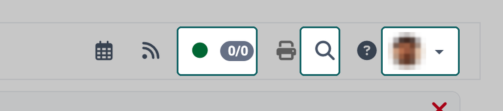
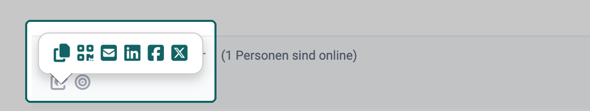
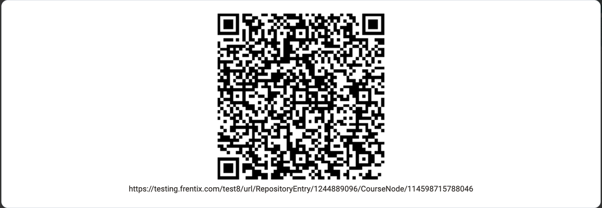

# Navigation {: #navigation}

Nach dem Login gelangen Sie entweder auf

* die Startseite, die Ihre Organisation für Ihre Rolle eingerichtet hat, z.B. den Autorenbereich für Autor:innen oder die Kurse für Nicht-Autor:innen,
* den Bereich "Infoseite", einen Kurs mit allgemeinen Informationen, den Ihre Organisation als Tab in die Hauptnavigation eingebunden hat,
* den Bereich "Portal",
* Ihre persönliche Startseite, die Sie in den [Einstellungen](../personal_menu/Settings.de.md#landing_page) festlegen. Das kann jede OpenOlat-Seite sein, auf die Sie Zugriff haben,
* oder den zuletzt besuchten Ort, wenn "Sitzung wiederherstellen" in Ihren Einstellungen auf "Ja, automatisch" steht.

Die Seite [Rollen und ihre Arbeitsbereiche](Roles_Home_Areas.de.md) zeigt, in welchem Bereich der Hauptnavigation die einzelnen Rollen arbeiten.

!!! info "Wichtig"

    Der Bereich "Portal" ist im Standard ausgeschaltet. Fehlt er in Ihrer Hauptnavigation, haben ihn die Administrator:innen Ihrer OpenOlat-Instanz nicht freigegeben. Bereiche geben sie in der System-Administration frei: `Administration > Customizing > Bereiche`. Mehr dazu: [Customizing: Bereiche](../../manual_admin/administration/Customizing.de.md#sites)

## Globale Navigation {: #global_navigation}

Rechts oben in der Hauptnavigation stehen auf jeder Seite generell der [Chat](Chat.de.md) (Instant Messenger) und die [Suche](Search_General.de.md), dazu Ihr persönliches Menü. Welche weiteren Elemente dort erscheinen, hängt von Ihren Einstellungen ab.

{ class="shadow aside-right lightbox" title="Hauptnavigation rechts oben · 2026.10.20" }

Im [persönlichen Menü](../personal_menu/index.de.md) finden Sie unter anderem die Abschnitte "Persönliche Werkzeuge", "Konfiguration" und "System". Welche persönlichen Werkzeuge als Symbol direkt in der Hauptnavigation stehen und welche im persönlichen Menü bleiben, legen Sie in den [Einstellungen](../personal_menu/Settings.de.md#personal_tools) fest.

:octicons-device-camera-video-24: **Video-Einführung**: [Navigation](<https://www.youtube.com/embed/kxfVVbfDXMw>){:target="_blank"}

:octicons-device-camera-video-24: **Video-Einführung**: [Der OpenOlat-Bildschirm](<https://www.youtube.com/embed/WbD6ZSgZ02Y>){:target="_blank"}

:octicons-device-camera-video-24: **Video-Einführung**: [Persönliches Menü](<https://www.youtube.com/embed/VxK1EKV7_rc>){:target="_blank"}

:octicons-device-camera-video-24: **Video-Einführung**: [Menüleiste](<https://www.youtube.com/embed/_abUlsfmBcs>){:target="_blank"}

## Teilen in der Fusszeile [:octicons-tag-16:{ title="ab Release 21.1 (OO-9693)" }](https://track.frentix.com/issue/OO-9693){:target="_blank"} {: #share}

!!! info "Kontakt"

    Ob die Aktion "Teilen" in der Fusszeile erscheint und welche Symbole sie zeigt, legt die Serverkonfiguration Ihrer OpenOlat-Instanz fest. Für eine Änderung wenden Sie sich an Ihre Organisation.

Möchten Sie jemandem genau die Seite zeigen, die Sie gerade geöffnet haben, etwa einen Kursbaustein oder eine Liste, geben Sie den Link darauf weiter. Der Link führt direkt an diese Stelle in OpenOlat und nicht auf die Startseite. Alle Wege dafür finden Sie links unten in der Fusszeile unter der Aktion "Teilen". Die Aktion ist ein Symbol ohne Beschriftung. Das Wort "Teilen" erscheint, wenn Sie mit der Maus darauf zeigen.

Ein Klick auf "Teilen" öffnet ein kleines Fenster mit einer Reihe von Symbolen. Auch hier erscheint der Name eines Symbols, wenn Sie mit der Maus darauf zeigen. Im Standard sind es diese:

- **Link kopieren**: OpenOlat legt den Link in die Zwischenablage, bestätigt das mit der Meldung "Link in die Zwischenablage kopiert." und schliesst das Fenster.
- **QR-Code anzeigen**: OpenOlat zeigt den Link als QR-Code in einem eigenen Fenster, darunter den Link als Text. So öffnet jemand die Seite am eigenen Telefon, ohne den Link abzutippen.
- **Link per Mail versenden**: Ihr Mailprogramm öffnet eine neue E-Mail mit dem Titel der Seite als Betreff und dem Link im Text. OpenOlat verschickt die E-Mail nicht selbst.
- **Netzwerke**: "Link auf LinkedIn teilen", "Link auf facebook teilen" und "Link auf X teilen" öffnen das jeweilige Netzwerk in einem neuen Fenster, der Link ist zum Teilen vorbereitet.

{ class="shadow lightbox" title="Fusszeile links unten mit geöffnetem Fenster Teilen · 2026.10.20" }

{ class="shadow lightbox" title="QR-Code anzeigen in der Aktion Teilen · 2026.10.20" }

Welche Symbole das Fenster zeigt und in welcher Reihenfolge, legt die Serverkonfiguration Ihrer OpenOlat-Instanz fest. "Link kopieren" und "QR-Code anzeigen" erscheinen immer zusammen.

Wer den Link öffnet, braucht selbst Zugriff auf die Seite. Ein geteilter Link ersetzt keine Buchung und keine Mitgliedschaft.

Neben "Teilen" steht das Symbol "Aktuelle Seite im Profil als persönliche Startseite festlegen". Es macht die geöffnete Seite zu Ihrer persönlichen Startseite, siehe [Einstellungen: Startseite](../personal_menu/Settings.de.md#landing_page). Gäste sehen dieses Symbol nicht.

Auf der Infoseite einer Lernressource oder einer Durchführung steht dieselbe Aktion als beschriftete Schaltfläche "Teilen". Sie teilt den Link auf die Infoseite, aus dem Katalog und bei einer Durchführung teilt sie den Link auf das Angebot. Mehr dazu: [Allgemeine Funktionen: Infoseite](../learningresources/General_Functions_Infopage.de.md#content)

!!! note "Hinweis"

    Sie sehen die Aktion "Teilen" in der Fusszeile nicht? Dann ist das Teilen in der Serverkonfiguration Ihrer OpenOlat-Instanz ausgeschaltet. In der Administration lässt es sich nicht einschalten. Auf der Infoseite bleibt die Schaltfläche "Teilen" trotzdem sichtbar.

## Weiterführende Informationen {: #further_information}

**Auf dieser Seite erwähnt** 
[Persönliche Konfiguration: Einstellungen >](../personal_menu/Settings.de.md) 
[Rollen und ihre Arbeitsbereiche >](Roles_Home_Areas.de.md) 
[Customizing: Übersicht >](../../manual_admin/administration/Customizing.de.md) 
[Chat >](Chat.de.md) 
[Allgemeines zur Suche >](Search_General.de.md) 
[Persönliches Menü >](../personal_menu/index.de.md) 
[Allgemeine Funktionen: Infoseite >](../learningresources/General_Functions_Infopage.de.md)

**Weiterführend** 
[Startseite >](../../manual_admin/administration/Landing_pages.de.md) 
[Persönliche Werkzeuge >](../personal_menu/Personal_Tools.de.md)

**youtube** 
[Navigation](<https://www.youtube.com/embed/kxfVVbfDXMw>) 
[Der OpenOlat-Bildschirm](<https://www.youtube.com/embed/WbD6ZSgZ02Y>) 
[Persönliches Menü](<https://www.youtube.com/embed/VxK1EKV7_rc>) 
[Menüleiste](<https://www.youtube.com/embed/_abUlsfmBcs>)

[Zum Seitenanfang ^](#navigation)
