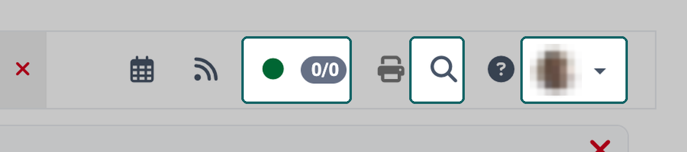
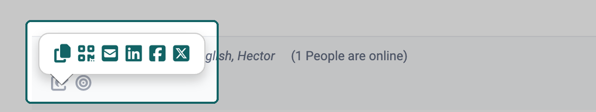
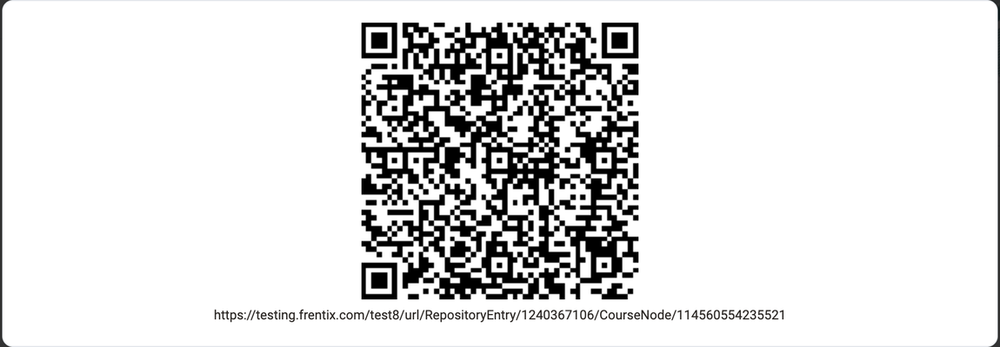

# Navigation {: #navigation}

After the login you get either to

* the landing page your organisation has set up for your role, e.g. the Authoring area for authors or the Courses for non-authors,
* the site "Info page", a course with general information that your organisation has added as a tab to the main navigation,
* the site "Portal",
* your personal landing page, which you set in the [settings](../personal_menu/Settings.md#landing_page). This can be any OpenOlat page you have access to,
* or the location last visited, if "Resume last session" is set to "Yes, automatically" in your settings.

The page [Roles and their working areas](Roles_Home_Areas.md) shows which site of the main navigation each role works in.

!!! info "Important"

    The site "Portal" is switched off by default. If it is missing in your main navigation, the administrators of your OpenOlat instance have not enabled it. They enable sites in the system administration: `Administration > Customizing > Sites`. More about this: [Customizing: Sites](../../manual_admin/administration/Customizing.md#sites)

## Global navigation {: #global_navigation}

At the top right of the main navigation, the [chat](Chat.md) (instant messenger) and the [search](Search_General.md) are generally available on every page, together with your personal menu. Which other elements appear there depends on your settings.

{ class="shadow aside-right lightbox" title="Main navigation at the top right · 2026.10.20" }

In the [personal menu](../personal_menu/index.md) you find, among others, the sections "User tools", "Configuration" and "System". In the [settings](../personal_menu/Settings.md#personal_tools) you define which user tools appear as an icon directly in the main navigation and which remain in the personal menu.

:octicons-device-camera-video-24: **Video Introduction (German)**: [Navigation](<https://www.youtube.com/embed/kxfVVbfDXMw>){:target="_blank"}

:octicons-device-camera-video-24: **Video Introduction (German)**: [The OpenOlat screen](<https://www.youtube.com/embed/WbD6ZSgZ02Y>){:target="_blank"}

:octicons-device-camera-video-24: **Video Introduction (German)**: [Personal menu](<https://www.youtube.com/embed/VxK1EKV7_rc>){:target="_blank"}

:octicons-device-camera-video-24: **Video Introduction (German)**: [Menu bar](<https://www.youtube.com/embed/_abUlsfmBcs>){:target="_blank"}

## Share in the footer [:octicons-tag-16:{ title="from Release 21.1 (OO-9693)" }](https://track.frentix.com/issue/OO-9693){:target="_blank"} {: #share}

If you want to show someone exactly the page you have open, for example a course element or a list, pass on the link to it. The link leads directly to this place in OpenOlat and not to the landing page. You find all ways to do this at the bottom left of the footer under the action "Share". The action is an icon without a label. The word "Share" appears when you point at it with the mouse.

A click on "Share" opens a small window with a row of icons. Here too, the name of an icon appears when you point at it with the mouse. By default, these are:

- **Copy link**: OpenOlat puts the link on the clipboard, confirms this with the message "Link copied to clipboard" and closes the window.
- **Show QR code**: OpenOlat shows the link as a QR code in a separate window, with the link as text below it. This way someone opens the page on their own phone without typing the link.
- **Share link with mail**: your mail program opens a new e-mail with the title of the page as subject and the link in the text. OpenOlat does not send the e-mail itself.
- **Networks**: "Share link on LinkedIn", "Share link on facebook" and "Share link on X" open the respective network in a new window, with the link prepared for sharing.

{ class="shadow lightbox" title="Footer at the bottom left with the opened window Share · 2026.10.20" }

{ class="shadow lightbox" title="Show QR code in the action Share · 2026.10.20" }

The server configuration of your OpenOlat instance defines which icons the window shows and in which order. "Copy link" and "Show QR code" always appear together.

Anyone who opens the link needs access to the page themselves. A shared link does not replace a booking or a membership.

Next to "Share" is the icon "Set current page as personal start page in profile". It makes the open page your personal landing page, see [Settings: Landing page](../personal_menu/Settings.md#landing_page). Guests do not see this icon.

On the info page of a learning resource or an implementation, the same action is available as the labelled button "Share". It shares the link to the info page, from the catalog and for an implementation it shares the link to the offer. More about this: [General Functions: Info Page](../learningresources/General_Functions_Infopage.md#content)

!!! note "Note"

    You do not see the action "Share" in the footer? Then sharing is switched off in the server configuration of your OpenOlat instance. It cannot be switched on in the administration. On the info page, the button "Share" remains visible anyway. frentix customers contact the frentix support for a change: [support@frentix.com](mailto:support@frentix.com)

## Further information {: #further_information}

**Mentioned on this page** 
[Personal Configuration: Settings >](../personal_menu/Settings.md) 
[Roles and their working areas >](Roles_Home_Areas.md) 
[Customizing: Overview >](../../manual_admin/administration/Customizing.md) 
[Chat >](Chat.md) 
[General information on the search >](Search_General.md) 
[Personal menu >](../personal_menu/index.md) 
[General Functions: Info Page >](../learningresources/General_Functions_Infopage.md)

**Further reading** 
[Landing pages >](../../manual_admin/administration/Landing_pages.md) 
[User tools >](../personal_menu/Personal_Tools.md)

**youtube** 
[Navigation](<https://www.youtube.com/embed/kxfVVbfDXMw>) 
[The OpenOlat screen](<https://www.youtube.com/embed/WbD6ZSgZ02Y>) 
[Personal menu](<https://www.youtube.com/embed/VxK1EKV7_rc>) 
[Menu bar](<https://www.youtube.com/embed/_abUlsfmBcs>)

[To the top of the page ^](#navigation)
