# Angebotskonzepte {: #offer_concepts}

## Was ist ein Angebot? {: #offers}

Sind Kurse und andere Lerninhalte in OpenOlat erstellt, bestimmen Sie, welche Benutzer:innen wann darauf zugreifen. Den Zugriff (Freigabe) gewähren Sie auf zwei Arten:

* **Privat:** Tragen Sie registrierte OpenOlat-Benutzer:innen in der Mitgliederverwaltung der Kurs-Administration ein, werden sie Mitglieder des Kurses oder der Lernressource und greifen darauf zu.

* **Buchbare und offene Angebote:** Besitzer:innen (Autor:innen) fügen dem Kurs ein Angebot hinzu. Benutzer:innen finden das Angebot im Katalog und werden Mitglied, indem sie es buchen. 
Für denselben Kurs erstellen Sie auch mehrere Angebote für verschiedene Zielgruppen. 
So bieten Sie einen Kurs zum Beispiel internen Benutzer:innen kostenlos an und mit einem zweiten Angebot Externen kostenpflichtig.
Ein Angebot erscheint im Katalog nur für bestimmte Organisationseinheiten oder für alle. Mit der Angebotsart "Ohne Buchung" braucht es nicht einmal eine Mitgliedschaft.

**Beispiel für Kursangebote im Katalog:**
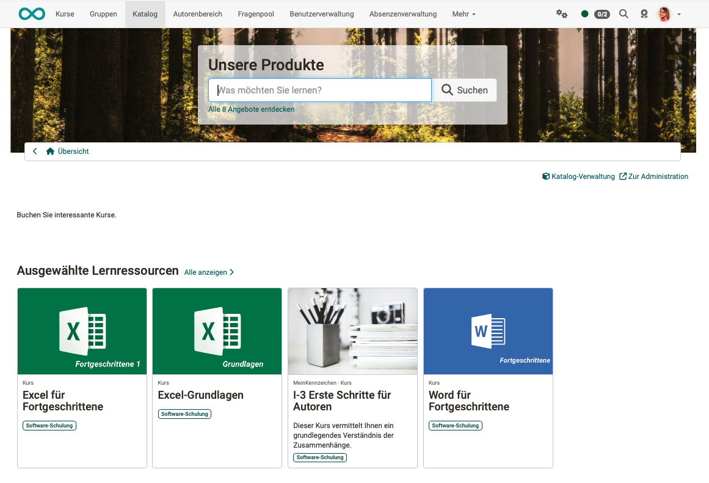{ class="shadow lightbox" title="Startseite des Katalogs" }

[Mehr zu Angeboten >](../area_modules/catalog2.0/index.de.md)

[zum Seitenanfang ^](#offer_concepts)

---

## Was kann in Angeboten gezeigt werden? {: #offers_card}

Im Katalog erscheint ein Angebot als Karte oder als Zeile der Listenansicht. Dazu kommen Regeln, die im Katalog nicht sichtbar sind: wann und wo das Angebot erscheint.

Welche Angaben eine Karte zeigt, legen Systemadministrator:innen für alle Karten einheitlich in der System-Administration fest: 
`Administration > Module > Katalog > Tab Layout > Abschnitt Launchers`

* Durchführungsformat
* Zertifikat
* Kreditpunkte
* Kennzeichen
* Typ
* Titel
* Teaser
* Autor:innen
* Zeitaufwand
* Hauptsprache
* Durchführungszeitraum
* Durchführungsort
* Fachbereiche / Katalog

[zum Seitenanfang ^](#offer_concepts)

---

## Wo können Angebote gezeigt werden? {: #show_offers}

OpenOlat hat einen internen und einen externen Katalog. Sie bestimmen, ob ein Angebot in einem oder in beiden Katalogen erscheint.

Der Katalog ist in Abschnitte gegliedert, die Launcher. Als Besitzer:in eines Kurses oder einer Durchführung bestimmen Sie, in welchem Launcher Ihr Angebot erscheint. Der Katalog (V2) stellt die Angebote dynamisch zusammen und ordnet sie den Launchern zu. Taxonomie-Launcher zeigen zudem Ordner, die bestimmten Taxonomie-Leveln entsprechen. So erscheinen die Kurse und Lernressourcen nach Taxonomiebegriffen sortiert.

Ein Angebot erscheint auch in mehreren Launchern des Katalogs (V2), zum Beispiel in einem Launcher "Beliebte Kurse" und in einem Launcher, der Kurse anhand einer bestimmten Taxonomie thematisch zusammenstellt.

Angebote erscheinen auch in Launchern, die nur Mitglieder bestimmter Organisationseinheiten sehen. Voraussetzung ist, dass das Modul "Organisationen" aktiviert ist.

Die Freigabe stellen Sie direkt im Angebot ein: 
Kurs: `Kurs > Administration > Einstellungen > Tab "Freigabe" > Abschnitt "Angebot" > Link "Angebot editieren"` 
Durchführung: `Course Planner > Durchführungen > "Ihre Durchführung" > Tab Katalog > Button Angebote > Link "Angebot editieren"`

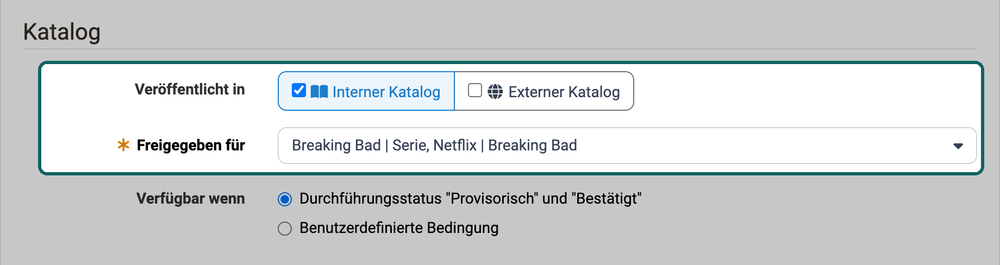{ class="shadow lightbox" title="Abschnitt Katalog im Dialog Frei verfügbar einer Durchführung · 2026.11.09" }

!!! info "Wichtig"

    Ein Angebot ist im Katalog buchbar, sobald der Kurs den Status "Veröffentlicht" hat. Bei einer Durchführung genügt standardmässig der Status "Provisorisch" oder "Bestätigt".

!!! tip "Tipp"

    Innerhalb eines Launchers legen Sie auch die Reihenfolge der Angebote fest.
    [Mehr dazu >](../../manual_user/area_modules/catalog2.0_sort_offers.de.md)

[zum Seitenanfang ^](#offer_concepts)

---

## Wo werden Angebote erstellt? {: #create_offers}

Angebote erstellen Sie

* im Kurs  oder
* in einer Durchführung (innerhalb des Course Planners)

### Angebotserstellung im Kurs [:octicons-tag-16:{ title="ab Release 17.0.0 (OO-6141)" }](https://track.frentix.com/issue/OO-6141){:target="_blank"} {: #create_offers_course}

Um einen Kurs im Katalog anzubieten, öffnen Sie den Kurs und wählen: 
`Kurs > Administration > Einstellungen > Tab "Freigabe" > Abschnitt "Angebot" > Button "Angebot hinzufügen"`

Der Abschnitt "Angebot" trägt zwei Überschriften "Angebot": Die obere zeigt in der Übersicht, wo der Kurs angeboten wird, unter der unteren stehen der Button "Angebot hinzufügen" und die Angebote. Mehr dazu unter [Abschnitt Angebot](../learningresources/Course_Settings_Share/index.de.md#section_offer).

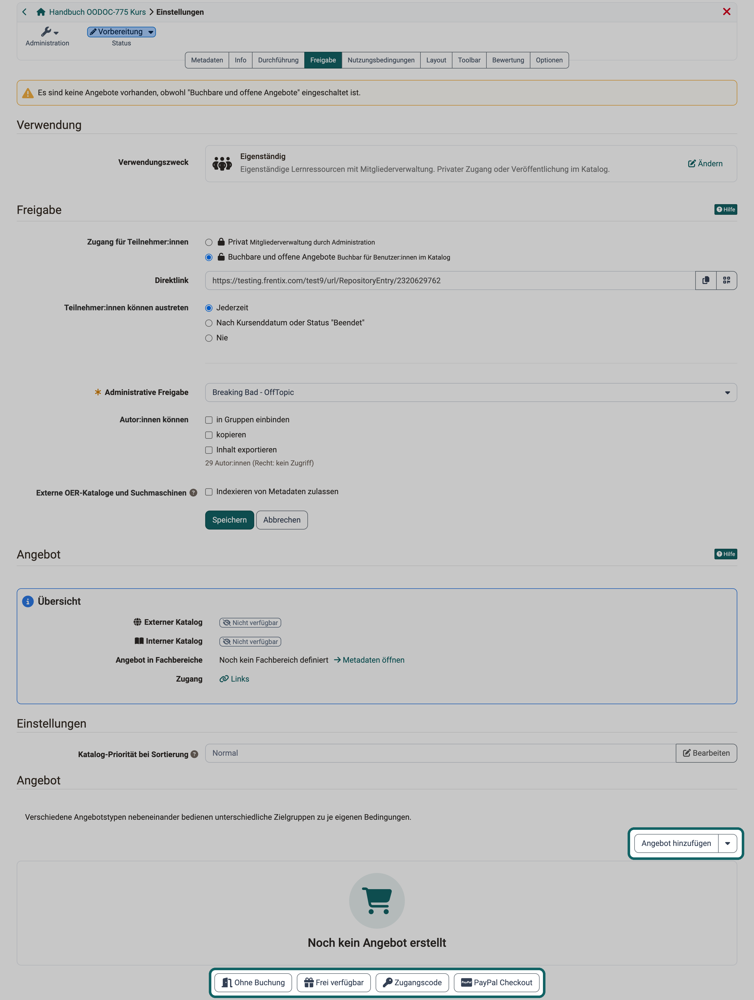{ class="shadow lightbox" title="Tab Freigabe der Kurseinstellungen · 2026.11.09" }

!!! tip "Tipp"

    Erstellte Angebote sehen Sie auch unter: 
    `Kurs > Administration > Angebotsarten` 
    Der Eintrag erscheint, sobald für den Kurs ein buchbares Angebot konfiguriert ist. Angebote konfigurieren Sie unter `Kurs > Administration > Einstellungen > Tab "Freigabe" > Abschnitt "Angebot" > Button "Angebot hinzufügen"` (siehe oben). 
    [Details zur Angebotskonfiguration >](../../manual_user/learningresources/Access_configuration.de.md#offer)

### Angebotserstellung im Course Planner [:octicons-tag-16:{ title="ab Release 20.0 (OO-8301)" }](https://track.frentix.com/issue/OO-8301){:target="_blank"} {: #create_offers_implementation}

Um eine Durchführung im Katalog anzubieten, öffnen Sie die Durchführung im Course Planner und wählen: 
`Course Planner > Durchführungen > "Ihre Durchführung" > Tab Katalog > Button Angebote`

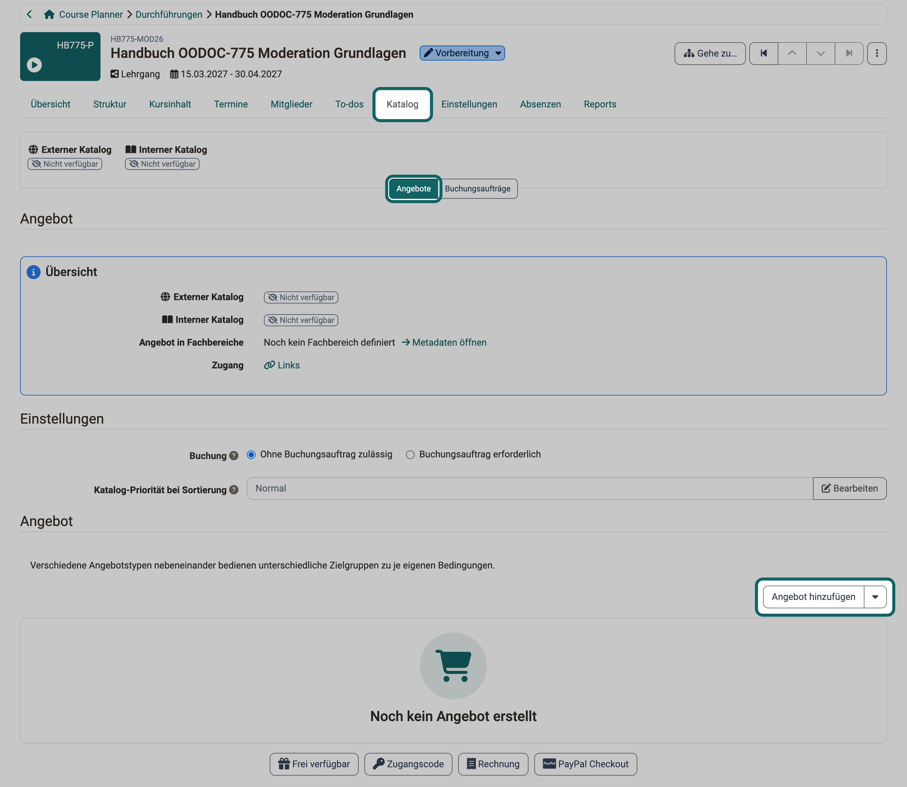{ class="shadow lightbox" title="Tab Katalog einer Durchführung im Course Planner · 2026.11.09" }

[zum Seitenanfang ^](#offer_concepts)

---

## Die Angebotsarten {: #offer_types}

Diese Angebotsarten stehen zur Wahl:

|                       | Mitgliedstatus  |                                 | verfügbar in |
| --------------------- | --------------- |-------------------------------- | --- |
| <b>Ohne Buchung</b>    | ohne  |Mit diesem Angebot ist die Ressource ohne eine Mitgliedschaft für Benutzer:innen zugänglich. | Eigenständiger Kurs |
| <b>Frei verfügbar</b>  | Mitgliedschaft | Mit diesem Angebot ist die Ressource buchbar. Die Benutzer:innen erhalten eine entsprechende Mitgliedschaft, die ihnen den Zugang zur Ressource ermöglicht. | Eigenständiger Kurs und Durchführung |
| <b>Zugangscode</b> | Mitgliedschaft | Mit diesem Angebot ist die Ressource mit einem Zugangscode buchbar. Die Benutzer:innen erhalten eine entsprechende Mitgliedschaft, die ihnen den Zugang zur Ressource ermöglicht. | Eigenständiger Kurs und Durchführung |
| <b>PayPal Checkout</b> | Mitgliedschaft | Mit diesem Angebot ist die Ressource mit PayPal kostenpflichtig buchbar. Die Benutzer:innen erhalten eine entsprechende Mitgliedschaft, die ihnen den Zugang zur Ressource ermöglicht. Das Angebot erstellen Personen mit der Rolle Autor:in, Lernressourcenverwalter:in oder Administrator:in, siehe [PayPal](#offer_payed_paypal). | Eigenständiger Kurs und Durchführung |
| <b>Rechnung</b> | Mitgliedschaft | Mit diesem Angebot ist die Ressource per Rechnung kostenpflichtig buchbar. Die Benutzer:innen erhalten eine entsprechende Mitgliedschaft, die ihnen den Zugang zur Ressource ermöglicht. | Durchführung |

Beim Erstellen wählen Sie die Angebotsart über den Button "Angebot hinzufügen".

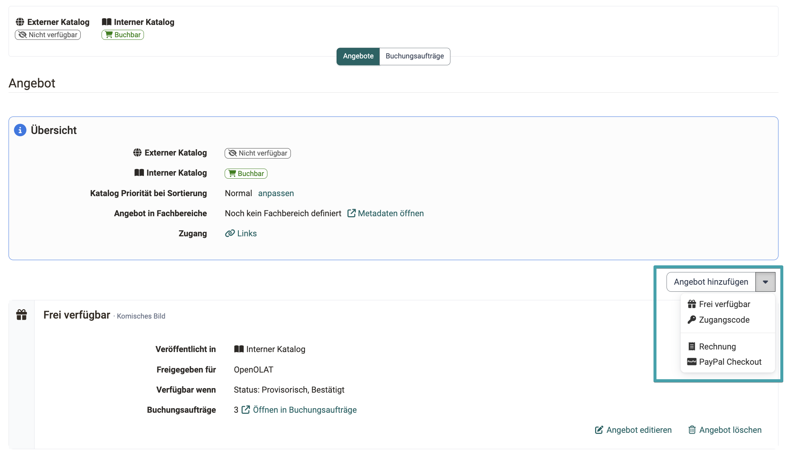{ class="shadow lightbox" title="Tab Katalog einer Durchführung" }

[Mehr über die Angebotsarten >](../../manual_user/learningresources/Access_configuration.de.md#angebotsoptionen)

[zum Seitenanfang ^](#offer_concepts)

---

## Was kann angeboten werden? {: #what_is_offered}

Angebote im Katalog gibt es für

- Kurse
- Durchführungen
- sonstige Lernressourcen

### Kurse anbieten {: #what_is_offered_courses}

Angebote zu einem Kurs erstellen Sie unter: 
`Kurs > Administration > Einstellungen > Tab "Freigabe" > Abschnitt "Angebot" > Button "Angebot hinzufügen"` 
Wählen Sie vorher bei "Zugang für Teilnehmer:innen" die Option "Buchbare und offene Angebote".

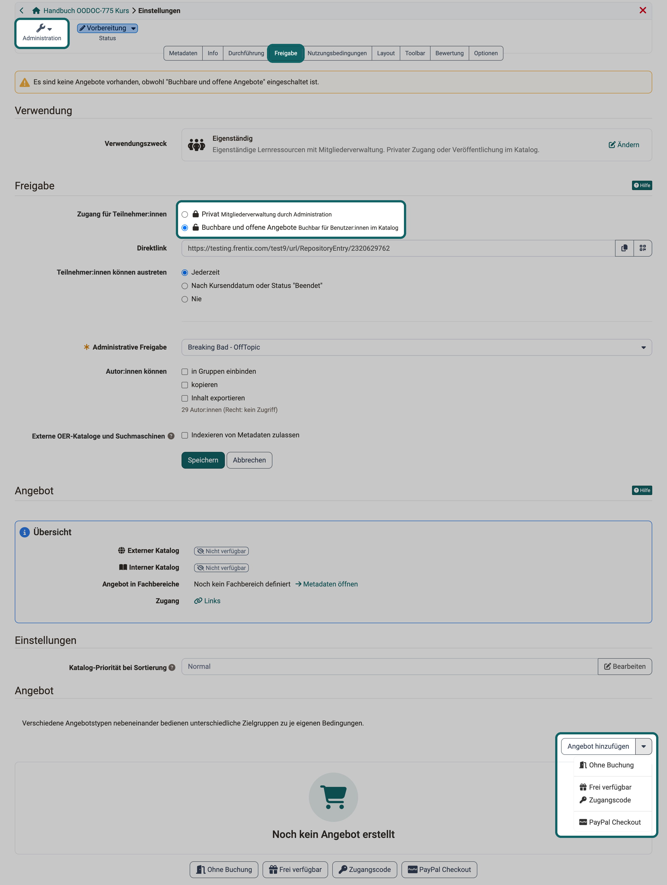{ class="shadow lightbox" title="Tab Freigabe der Kurseinstellungen · 2026.11.09" }

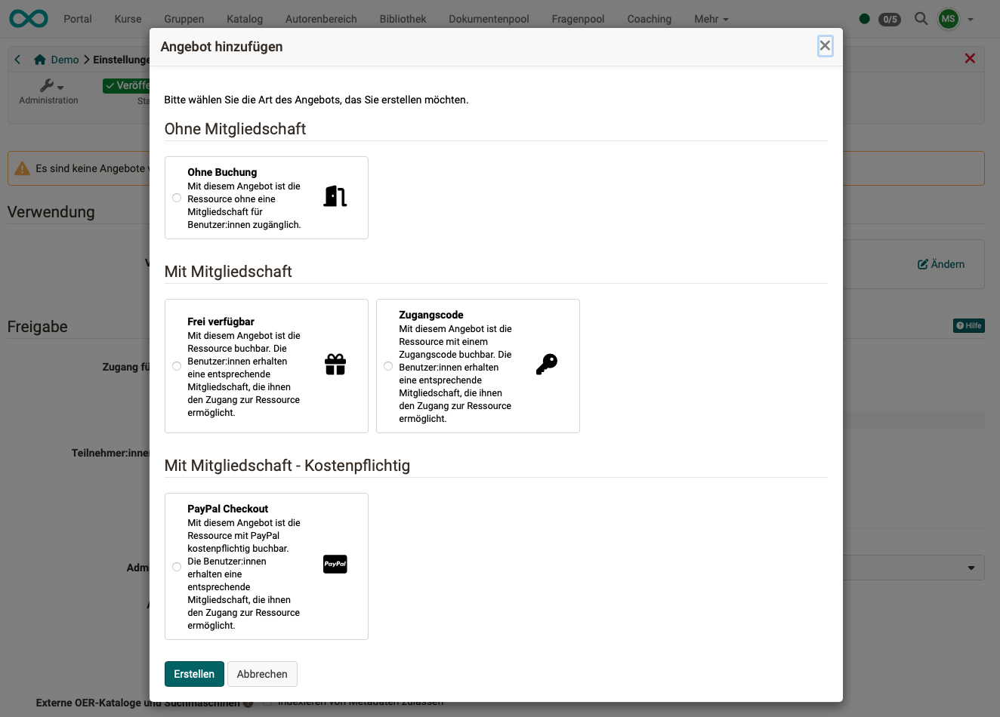{ class="shadow lightbox" title="Dialog Angebot hinzufügen eines Kurses" }

Ausführliche Informationen über das [Anbieten von Kursen im Katalog finden Sie hier >](../../manual_user/area_modules/catalog2.0_angebote.de.md)

[zum Seitenanfang ^](#offer_concepts)

---

### Durchführungen anbieten {: #what_is_offered_implementations}

Bieten Sie denselben Kurs mehrmals zu verschiedenen Terminen an, verwenden Sie Durchführungen im Course Planner.

Eine Durchführung schreiben Sie im Katalog auch aus, wenn noch unklar ist, ob sie stattfindet, etwa weil das von der Zahl der Buchungen abhängt. Das Angebot für eine Durchführung erstellen Sie deshalb immer in der Durchführung im Course Planner, nicht in einem Kurs, der für diese Durchführung vorgesehen ist. Kurse lassen sich dafür speziell für Durchführungen vorsehen und haben dann keine eigene Mitgliederverwaltung.

Benutzer:innen buchen eine Durchführung, indem sie sich aus dem Katalog heraus anmelden (wenn sie schon OpenOlat-Benutzer:in sind) oder sich neu registrieren (wenn sie eine passende Durchführung im externen Katalog gefunden haben, den sie ohne Registrierung ansehen können).

Bei einem Angebot "Rechnung" geben die Interessent:innen beim Buchen ihre Rechnungsadresse und weitere Angaben an. OpenOlat erstellt dabei eine Buchungsnummer. Die Angebotsart "Rechnung" gibt es nur bei Durchführungen im Course Planner.

Der Buchungsauftrag entsteht erst, wenn die Person die Buchung abschliesst, und kann anschliessend bestätigt werden.

Ob Teilnehmende eine gebuchte Durchführung selbst stornieren dürfen, legen Sie im Angebot fest, siehe [Stornierung](#offer_cancellation).

Braucht eine Durchführung beim Buchen weitere Angaben, etwa Essenswünsche oder Vorkenntnisse, kann ein Angebot der Durchführung Formulare verlangen. Die buchende Person füllt sie als Schritte beim Buchen aus, die Antworten stehen danach beim Buchungsauftrag. Das ist nur bei Angeboten von Durchführungen im Course Planner möglich, nicht bei Kursangeboten und nicht bei der Angebotsart PayPal Checkout. [Formulare für Buchungsaufträge >](../area_modules/Course_Planner_Implementations.de.md#booking_order_forms) [:octicons-tag-16:{ title="ab Release 21.1 (OO-9724)" }](https://track.frentix.com/issue/OO-9724){:target="_blank"}

Mit Formularen wird die Buchung zu einem Assistenten, und der Buchungsauftrag entsteht erst im letzten Schritt. [Buchung mit Formularen als Assistent >](../area_modules/catalog2.0_angebote.de.md#offer_booking_wizard) [:octicons-tag-16:{ title="ab Release 21.1 (OO-9742)" }](https://track.frentix.com/issue/OO-9742){:target="_blank"}

Angebote für Durchführungen erstellen Sie im Course Planner unter: 
`Course Planner > Durchführungen > "Ihre Durchführung" > Tab Katalog > Button Angebote`

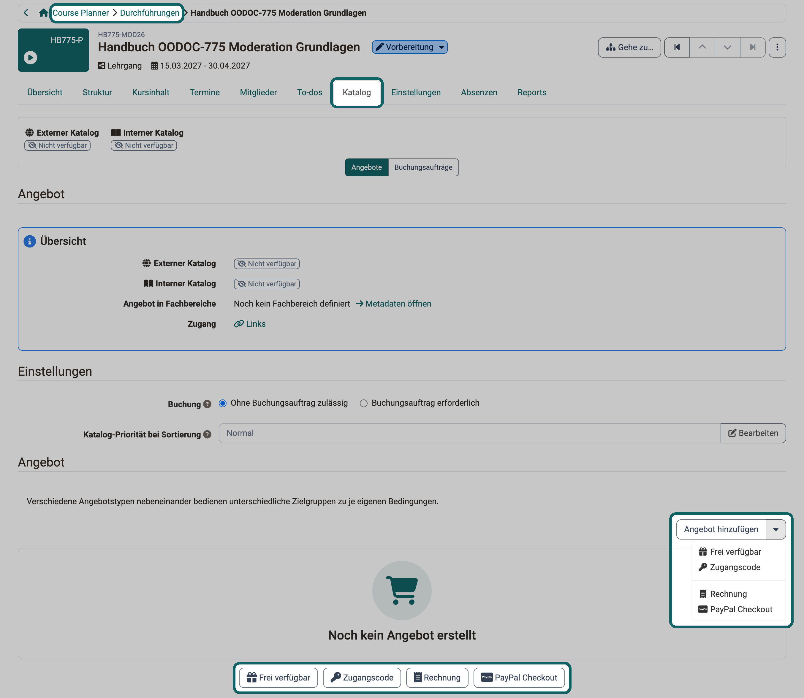{ class="shadow lightbox" title="Tab Katalog einer Durchführung im Course Planner · 2026.11.09" }

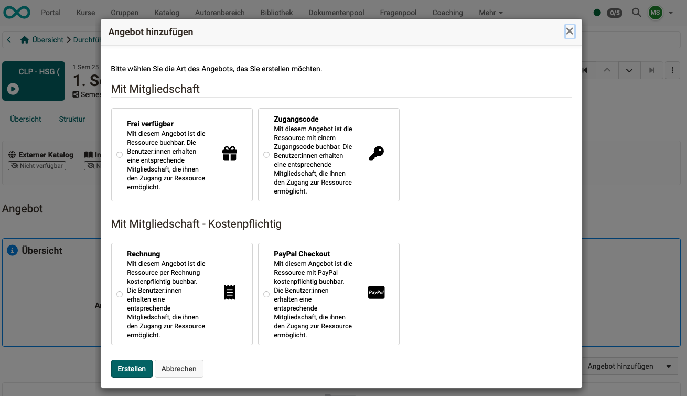{ class="shadow lightbox" title="Dialog Angebot hinzufügen einer Durchführung" }

[Mehr über das Anbieten von Durchführungen im Katalog >](../../manual_user/area_modules/Course_Planner_Implementations.de.md#tab_catalog)

[zum Seitenanfang ^](#offer_concepts)

---

### Sonstige Lernressourcen anbieten {: #what_is_offered_other}

Möchten Sie einzelne Videos oder Dokumente im Katalog anbieten, richten Sie dafür je einen Kurs mit nur einem Kursbaustein ein (z.B. Kursbaustein Video oder Kursbaustein Dokument). Achten Sie darauf, dass der Kurs beim Öffnen automatisch zum ersten Kursbaustein wechselt.

Das Angebot erstellen Sie dann wie für jeden anderen eigenständigen Kurs.

Passen Sie Metadaten und Beschreibung dieses Kurses an die enthaltene Lernressource an, damit im Katalog zum Beispiel "Video xy" als Angebot erscheint.

[zum Seitenanfang ^](#offer_concepts)

---

## Angebote mit Bezahlung {: #offer_payed}

### PayPal [:octicons-tag-16:{ title="ab Release 14.1 (OO-4203)" }](https://track.frentix.com/issue/OO-4203){:target="_blank"} {: #offer_payed_paypal}

Mit dem Bezahlungsmodul PayPal bieten Autor:innen Lerninhalte gegen Bezahlung an. Systemadministrator:innen richten das Modul vorher in der System-Administration ein und schalten es ein.

Ist das PayPal Modul konfiguriert, steht die Angebotsart "PayPal Checkout" beim Erstellen eines Angebots zur Verfügung: für Kurse unter `Kurs > Administration > Einstellungen > Tab "Freigabe" > Abschnitt "Angebot" > Button "Angebot hinzufügen"`, für Durchführungen im Course Planner und für Gruppen in der [Gruppenadministration](../groups/Group_Administration/index.de.md#booking).

Ein Angebot "PayPal Checkout" erstellen Personen mit der Rolle Autor:in, Lernressourcenverwalter:in oder Administrator:in. Kursplaner:innen brauchen dafür zusätzlich eine dieser Rollen; ohne sie zeigt "Angebot hinzufügen" bei einer Durchführung "Frei verfügbar", "Zugangscode" und "Rechnung".

[Einrichtung des Bezahlungsmoduls PayPal (Administration) >](../../manual_admin/administration/Payment_PayPal.de.md)

### Rechnung [:octicons-tag-16:{ title="ab Release 20.0 (OO-8210)" }](https://track.frentix.com/issue/OO-8210){:target="_blank"} {: #offer_payed_invoice}

Die Bezahlung per Rechnung gibt es nur bei Durchführungen im Course Planner.

Bei einem Angebot mit Rechnung ist

* die Mitgliedschaft sofort aktiv oder
* die Mitgliedschaft ist zunächst ausstehend, bis eine administrative Rolle die Reservierung bestätigt.

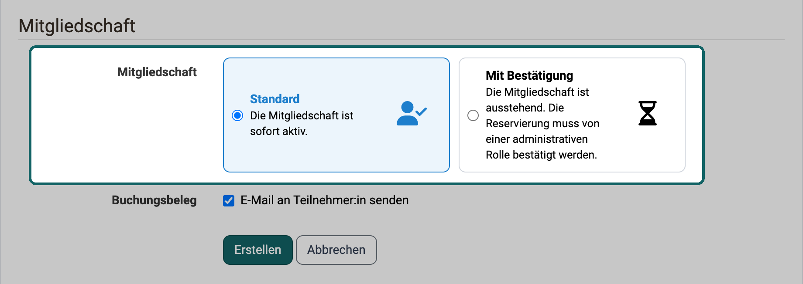{ class="shadow lightbox" title="Abschnitt Mitgliedschaft im Dialog Rechnung einer Durchführung · 2026.11.09" }

!!! tip "Tipp"

    Die Buchungsaufträge sind je Durchführung gesammelt: 
    `Course Planner > Durchführungen > "Ihre Durchführung" > Tab Katalog > Button Buchungsaufträge` 
    Die Tabs einer Durchführung erscheinen erst, wenn Sie diese in der Tabelle geöffnet haben. Dort exportieren Sie die Buchungsaufträge als Excel-Datei, etwa für die Rechnungserstellung in einem anderen Programm.

[Einrichtung des Bezahlungsmoduls Rechnung (Administration) >](../../manual_admin/administration/Payment_Invoice.de.md)

### Kreditpunkte [:octicons-tag-16:{ title="ab Release 20.1.1 (OO-8558)" }](https://track.frentix.com/issue/OO-8558){:target="_blank"} {: #offer_payed_credit_points}

Mit einem Kreditpunktesystem sammeln Teilnehmende Kreditpunkte über verschiedene Lernangebote hinweg, zum Beispiel ECTS oder LearnCoins. Eigene Kreditpunktesysteme definieren Sie global über das Modul "Kreditpunkte". Für einen erfolgreich abgeschlossenen Kurs erhalten Teilnehmende Kreditpunkte, wenn der Kurs sie vergibt.

Zertifikatsprogramme setzen Kreditpunkte zum Beispiel für Rezertifizierungen ein.

Organisationen definieren und benennen eigene Kreditpunktesysteme und schränken sie bei Bedarf ein, etwa nach Rollen oder organisatorischen Bereichen. Nach dem erfolgreichen Abschluss eines Lernangebots weisen Sie Kreditpunkte gezielt zu.

[Kreditpunkte systemweit aktivieren (Administration) >](../../manual_admin/administration/e-Assessment_Credit_Points.de.md) 
[Kreditpunkte in Kursen vergeben >](../learningresources/Course_Settings_Assessment/index.de.md#section_credit_points) 
[Kreditpunkte im persönlichen Menü >](../../manual_user/personal_menu/Credit_Points.de.md)

[zum Seitenanfang ^](#offer_concepts)

---

## Stornierung [:octicons-tag-16:{ title="ab Release 20.0 (OO-8397)" }](https://track.frentix.com/issue/OO-8397){:target="_blank"} {: #offer_cancellation}

Kann eine Person an einer gebuchten Durchführung doch nicht teilnehmen, storniert sie ihre Buchung selbst, wenn das Angebot es erlaubt. Sie braucht dafür keine Hilfe der Verwaltung. Stornieren lässt sich eine Buchung nur bei einem Angebot einer Durchführung. Bei Kursen und Gruppen treten Teilnehmende stattdessen aus, wenn der Kurs oder die Gruppe es erlaubt:

| Angebot in | Was Teilnehmende tun | Wer es erlaubt | Wo Teilnehmende es finden |
|---|---|---|---|
| Durchführung im Course Planner | Buchung stornieren | Kursplaner:innen, Produktbesitzer:innen und Elementbesitzer:innen im Angebot der Durchführung, siehe die Abschnitte unten | Infoseite der Durchführung, Kasten "Mein Bildungsprodukt", bei einer Durchführung vom Typ Einzelkurs Kasten "Mein Kurs", siehe [Buchung stornieren](../learningresources/General_Functions_Infopage.de.md#cancel_booking) |
| Kurs | Kurs verlassen | Besitzer:innen des Kurses mit "Teilnehmer:innen können austreten" unter `Kurs > Administration > Einstellungen > Tab "Freigabe"` | Infoseite des Kurses, Kasten "Mein Kurs", siehe [Kurs verlassen](../learningresources/General_Functions_Infopage.de.md#leave_course) |
| Gruppe | Gruppe verlassen | Betreuer:innen der Gruppe mit "Teilnehmer:innen können Gruppe verlassen" unter `Gruppe > Administration > Tab "Mitglieder"` | Spalte "Verlassen" in der Liste unter `Gruppen`, siehe [Gruppe verlassen](../groups/Leave_a_Group.de.md) |

Die folgenden Abschnitte richten sich an Kursplaner:innen, Produktbesitzer:innen und Elementbesitzer:innen. Ob und bis wann Teilnehmende stornieren, hängt von der Angebotsart und ihrer Einstellung ab. Die Grafik zeigt die Fälle auf einer Zeitachse:

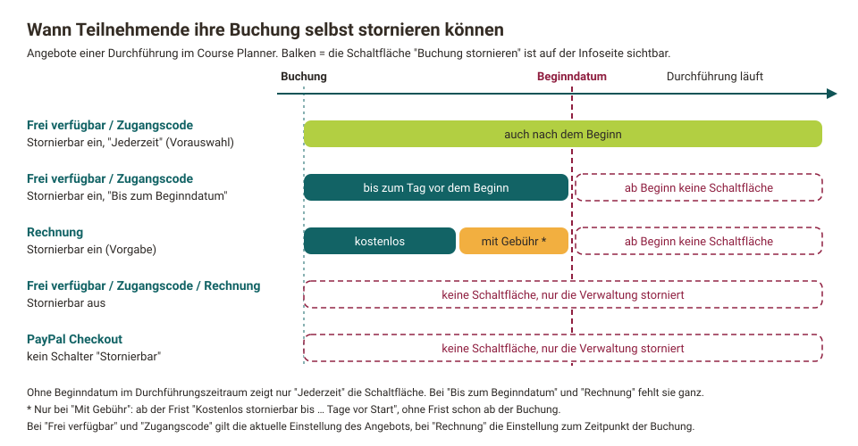{ class="shadow lightbox" title="Stornierung je Angebotsart und Einstellung · 2026.11.11" }

### Frei verfügbar und Zugangscode [:octicons-tag-16:{ title="ab Release 21.1.2 (OO-9977)" }](https://track.frentix.com/issue/OO-9977){:target="_blank"} {: #offer_cancellation_free_token}

Mit dem Schalter "Stornierbar" entscheiden Sie bei den Angeboten "Frei verfügbar" und "Zugangscode" einer Durchführung, ob Teilnehmende ihre Buchung selbst zurückziehen dürfen. Ist der Schalter aus (Vorgabe), storniert nur die Verwaltung der Durchführung eine Buchung. Der Schalter steht im Angebot direkt unter "Angebotsbeschreibung".

Ist er eingeschaltet, wählen Sie unter "Teilnehmende können stornieren":

* **Jederzeit:** Teilnehmende stornieren auch nach dem Beginn und bei einer Durchführung ohne Beginndatum, etwa bei einem laufenden Selbstlernangebot. Diese Option ist vorausgewählt.
* **Bis zum Beginndatum:** Teilnehmende stornieren bis zum Tag vor dem Beginn. So steht die Zahl der Teilnehmenden ab dem Start fest. Hat der Durchführungszeitraum kein Beginndatum, zeigt das Angebot die Warnung "Teilnehmende können nur stornieren, wenn beim Durchführungszeitraum ein Beginndatum angegeben ist!", und Teilnehmende stornieren nicht selbst.

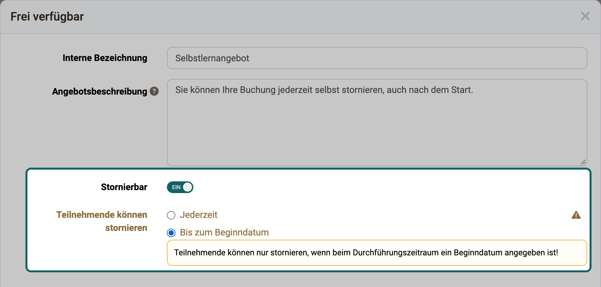{ class="shadow lightbox" title="Dialog Frei verfügbar einer Durchführung · 2026.11.09" }

"Jederzeit" gibt es auch beim Durchführungszeitraum und meint dort etwas anderes: Die Durchführung ist an keinen Zeitraum gebunden und hat damit kein Beginndatum, siehe [Durchführung in den Einstellungen](../area_modules/Course_Planner_Implementations.de.md#tab_settings_execution). Bei einer solchen Durchführung stornieren Teilnehmende nur mit der Option "Jederzeit" im Angebot.

Es gilt immer die aktuelle Einstellung des Angebots, auch für Buchungen von früher. Schalten Sie "Stornierbar" aus, sehen auch Teilnehmende, die schon gebucht haben, die Schaltfläche "Buchung stornieren" nicht mehr. Beim Update auf Release 21.1.2 schaltet OpenOlat "Stornierbar" bei allen bestehenden Angeboten ausser "Rechnung" aus. Sollen Teilnehmende bei einem bestehenden Angebot "Frei verfügbar" oder "Zugangscode" selbst stornieren, schalten Sie "Stornierbar" dort ein.

!!! tip "Tipp"

    Ob ein Angebot "Frei verfügbar" oder "Zugangscode" stornierbar ist, zeigt der Katalog den Buchenden nicht. Schreiben Sie die Regel deshalb in die "Angebotsbeschreibung", zum Beispiel "Sie können Ihre Buchung bis zum Tag vor dem Beginn selbst stornieren."

### Stornierungsbedingungen bei Rechnung [:octicons-tag-16:{ title="ab Release 21.0 (OO-9382)" }](https://track.frentix.com/issue/OO-9382){:target="_blank"} {: #offer_invoice_cancellation}

Beim Angebot "Rechnung" legen Sie fest, ob Teilnehmende ihre Buchung stornieren dürfen und ob dafür eine Gebühr anfällt.

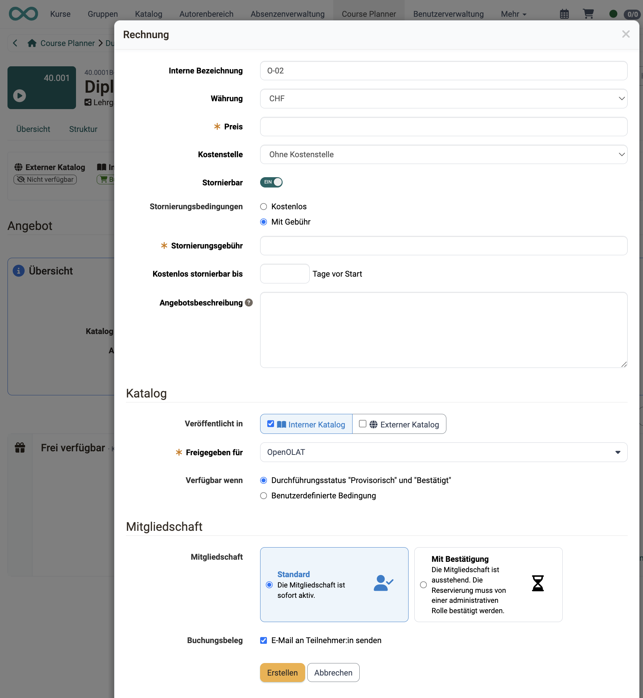{ class="shadow lightbox" title="Dialog Rechnung" }

* **Kostenstelle:** Oberhalb der Stornierungsoptionen ordnen Sie dem Angebot bei Bedarf eine Kostenstelle zu.
* **Stornierbar:** Mit diesem Schalter bestimmen Sie, ob Teilnehmende ihre Buchung stornieren dürfen. Standardmässig ist er eingeschaltet.
* **Stornierungsbedingungen:** Ist das Angebot stornierbar, wählen Sie zwischen "Kostenlos" (Standard) und "Mit Gebühr".
* **Stornierungsgebühr:** Bei der Auswahl "Mit Gebühr" geben Sie die Höhe der Gebühr an. Mit "Kostenlos stornierbar bis \<Anzahl\> Tage vor Start" definieren Sie zusätzlich eine Frist, bis zu der ohne Gebühr storniert werden kann. Damit die Frist berücksichtigt wird, muss beim Durchführungszeitraum ein Anfangsdatum angegeben sein.

Teilnehmende stornieren bis zum Tag vor dem Beginn der Durchführung. Dafür braucht der Durchführungszeitraum ein Anfangsdatum. Für eine Buchung gelten die Bedingungen, die bei der Buchung galten; eine spätere Änderung am Angebot betrifft nur neue Buchungen.

Bei "Mit Gebühr" zeigt der Katalog beim Angebot, bis wann die Stornierung kostenlos ist, und der Dialog der Buchung nennt die Stornierungsgebühr.

### PayPal Checkout {: #offer_cancellation_paypal}

Eine Buchung mit "PayPal Checkout" storniert die Verwaltung der Durchführung. Das Angebot hat keinen Schalter "Stornierbar", eine Stornierung durch Teilnehmende lässt sich deshalb nicht einstellen.

Wer die Mitglieder der Durchführung verwaltet, storniert eine Buchung im Tab "Mitglieder" mit "Buchung stornieren" im Menü der Mitgliederzeile: 
`Course Planner > Durchführungen > "Ihre Durchführung" > Tab Mitglieder` 
Das geht bei jeder Angebotsart, auch bei "PayPal Checkout", und unabhängig vom Schalter "Stornierbar". Voraussetzung ist ein Buchungsauftrag der Person, siehe [Tab Mitglieder](../area_modules/Course_Planner_Implementations.de.md#tab_members).

[zum Seitenanfang ^](#offer_concepts)

---

## Weitere Randbedingungen für Angebote {: #further_boundary_conditions}

Für Angebote stellen Sie weitere Bedingungen ein. Die meisten Konfigurationsoptionen geben Sie direkt beim Erstellen eines neuen Angebots ein.

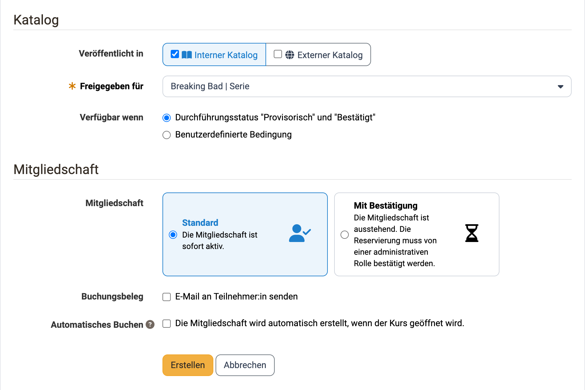{ class="shadow lightbox" title="Abschnitte Katalog und Mitgliedschaft im Dialog Frei verfügbar einer Durchführung · 2026.11.09" }

* **Verfügbar wenn: Durchführungsstatus "Provisorisch" und "Bestätigt":** 
Eine Durchführung muss noch nicht vollständig geplant sein, damit Sie ein Angebot veröffentlichen. Bei Kursen lautet die Standardbedingung Kursstatus "Veröffentlicht".

* **Verfügbar wenn: Benutzerdefinierte Bedingung:** 
Das Angebot ist nur in den gewählten Status verfügbar und zusätzlich auf einen Zeitraum begrenzt, mit festen Daten oder relativ zum Durchführungszeitraum. [Details zur Verfügbarkeit >](../../manual_user/learningresources/Access_configuration.de.md) [:octicons-tag-16:{ title="ab Release 21.0 (OO-9304)" }](https://track.frentix.com/issue/OO-9304){:target="_blank"}

* **Mitgliedschaft Standard:** 
Die Mitgliedschaft ist sofort nach der Buchung des Angebots aktiv.

* **Mitgliedschaft mit Bestätigung:** 
Die Mitgliedschaft ist zunächst ausstehend, bis eine administrative Rolle die Reservierung bestätigt.

* **Buchungsbeleg:** 
Mit der Option "E-Mail an Teilnehmer:in senden" erhält die buchende Person nach der Buchung den Buchungsbeleg per E-Mail.

* **Automatisches Buchen:** 
OpenOlat erstellt die Mitgliedschaft automatisch, wenn die Person den Kurs öffnet.
Beim automatischen Buchen zeigt OpenOlat die Angebotsbeschreibung nicht, und Benutzer:innen sehen nur die Aktion "Öffnen". Verwenden Sie diese Option deshalb nicht zusammen mit anderen Angeboten.

* Auch bei sofort aktiver Mitgliedschaft (Durchführungen, Angebot mit Rechnung) akzeptieren Buchende in der Regel zuerst die Datenschutzbestimmungen und weitere Nutzungsbedingungen. In den Nutzungsbedingungen legen Sie bei Bedarf weitere Rahmenbedingungen fest.

* Eine Durchführung bieten Sie auch an, wenn noch unklar ist, ob sie stattfindet. Beim Erstellen des Angebots muss noch nicht einmal ein Kurs existieren. Einen eigenständigen Kurs bieten Sie dagegen im Kurs an, und das Angebot erscheint erst im Katalog, wenn der Kurs veröffentlicht ist.

* Mit einem Angebot "Zugangscode" buchen Benutzer:innen die Ressource mit einem Zugangscode. Sie erhalten eine entsprechende Mitgliedschaft, die ihnen den Zugang zur Ressource ermöglicht.

[zum Seitenanfang ^](#offer_concepts)

---

## Weiterführende Informationen {: #further_information}

**Auf dieser Seite erwähnt** 
[Katalog 2.0: Übersicht >](../area_modules/catalog2.0/index.de.md) 
[Katalog 2.0 - Sortierung/Reihenfolge >](../area_modules/catalog2.0_sort_offers.de.md) 
[Kurseinstellungen - Tab Freigabe >](../learningresources/Course_Settings_Share/index.de.md) 
[Zugangskonfiguration / Freigabe >](../learningresources/Access_configuration.de.md) 
[Katalog 2.0 - Angebote >](../area_modules/catalog2.0_angebote.de.md) 
[Course Planner: Durchführungen >](../area_modules/Course_Planner_Implementations.de.md) 
[Gruppenadministration >](../groups/Group_Administration/index.de.md) 
[PayPal Konfiguration (Administration) >](../../manual_admin/administration/Payment_PayPal.de.md) 
[Bezahlungsmodule: Rechnung (Administration) >](../../manual_admin/administration/Payment_Invoice.de.md) 
[e-Assessment Administration: Kreditpunkte >](../../manual_admin/administration/e-Assessment_Credit_Points.de.md) 
[Kurseinstellungen - Tab Bewertung >](../learningresources/Course_Settings_Assessment/index.de.md) 
[Persönliche Erfolge/Leistungen: Kreditpunkte >](../personal_menu/Credit_Points.de.md) 
[Allgemeine Funktionen: Infoseite >](../learningresources/General_Functions_Infopage.de.md) 
[Gruppe verlassen >](../groups/Leave_a_Group.de.md)

**Weiterführend** 
[Wie zeige ich meine Kurse im OpenOlat-Katalog? >](../../manual_how-to/catalog/catalog.de.md) 
[Persönliche Werkzeuge: Buchungsaufträge >](../personal_menu/Bookings.de.md) 
[Reports: Buchungsaufträge >](../area_modules/Reports_BookingOrders.de.md)

[Zum Seitenanfang ^](#offer_concepts)
