# Offer concepts {: #offer_concepts}

## What is an offer? {: #offers}

Once courses and other learning content have been created in OpenOlat, you determine which users access them and when. You grant access (release) in two ways:

* **Private:** If you enter registered OpenOlat users in the member management of the course administration, they become members of the course or learning resource and access it.

* **Bookable and open offers:** Owners (authors) add an offer to the course. Users find the offer in the catalog and become members by booking it. 
For the same course, you also create several offers for different target groups. 
For example, you offer a course free of charge to internal users and, with a second offer, for a fee to external users.
An offer appears in the catalog only for specific organisational units or for everyone. With the offer type "Without booking", not even a membership is required.

**Example of courses offered in the catalog:**
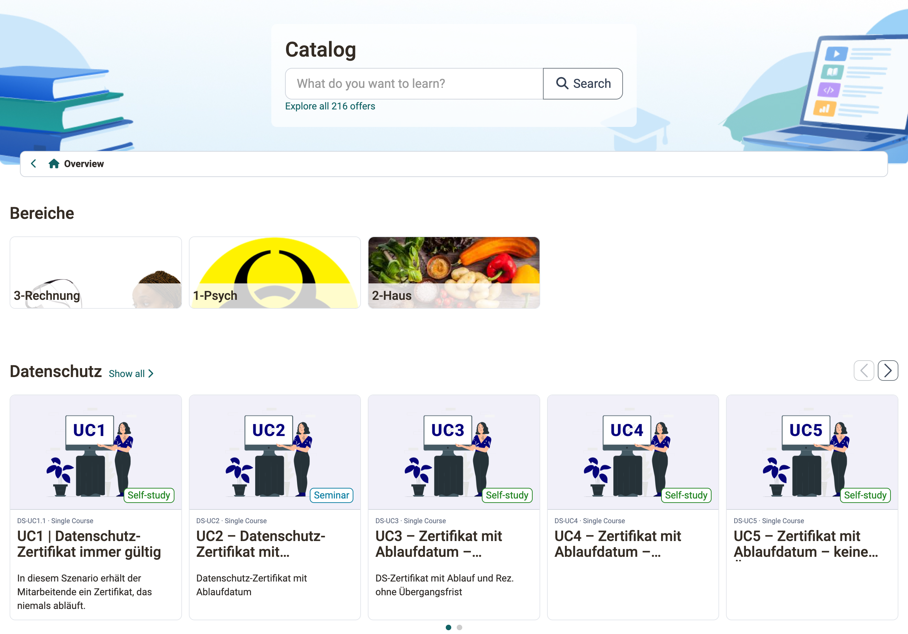{ class="shadow lightbox" title="Start page of the catalog · 2026.11.09" }

[More about offers >](../area_modules/catalog2.0/index.md)

[To the top of the page ^](#offer_concepts)

---

## What can be shown in offers? {: #offers_card}

In the catalog, an offer appears as a card or as a row of the list view. In addition, there are rules that are not visible in the catalog: when and where the offer appears.

Which details a card shows is defined uniformly for all cards by system administrators in the system administration: 
`Administration > Modules > Catalog > Tab Layout > Section Launchers`

* Implementation format
* Certificate
* Credit points
* Reference
* Type
* Title
* Teaser
* Authors
* Time required
* Main language
* Execution period
* Place of implementation
* Subjects / Catalog

[To the top of the page ^](#offer_concepts)

---

## Where can offers be displayed? {: #show_offers}

OpenOlat has an internal and an external catalog. You determine whether an offer appears in one or in both catalogs.

The catalog is divided into sections, the launchers. As the owner of a course or implementation, you determine in which launcher your offer appears. The catalog (V2) compiles the offers dynamically and assigns them to the launchers. Taxonomy launchers also show folders that correspond to specific taxonomy levels. This way, courses and learning resources appear sorted by taxonomy terms.

An offer also appears in several launchers of the catalog (V2), for example in a launcher "Popular courses" and in a launcher that compiles courses thematically based on a specific taxonomy.

Offers also appear in launchers that only members of certain organisational units see. This requires that the "Organisations" module is activated.

You set the release directly in the offer: 
Course: `Course > Administration > Settings > Tab "Share" > Section "Offer" > Link "Edit offer"` 
Implementation: `Course Planner > Implementations > "your implementation" > Tab Catalog > Button Offers > Link "Edit offer"`

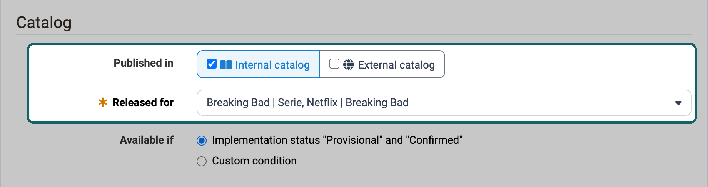{ class="shadow lightbox" title="Catalog section in the dialog Freely available of an implementation · 2026.11.09" }

!!! info "Important"

    An offer can be booked in the catalog as soon as the course has the status "Published". For an implementation, the status "Provisional" or "Confirmed" is sufficient by default.

!!! tip "Tip"

    Within a launcher, you also define the order of the offers.
    [Find out more >](../area_modules/catalog2.0_sort_offers.md)

[To the top of the page ^](#offer_concepts)

---

## Where can offers be created? {: #create_offers}

You create offers

* in a course  or
* in an implementation (within the Course Planner)

### Create offers in courses [:octicons-tag-16:{ title="from Release 17.0.0 (OO-6141)" }](https://track.frentix.com/issue/OO-6141){:target="_blank"} {: #create_offers_course}

To offer a course in the catalog, open the course and select: 
`Course > Administration > Settings > Tab "Share" > Section "Offer" > Button "Add offer"`

The "Offer" section carries two headings "Offer": the upper one shows in the overview where the course is offered, under the lower one you find the button "Add offer" and the offers. More on this under [Section Offer](../learningresources/Course_Settings_Share/index.md#section_offer).

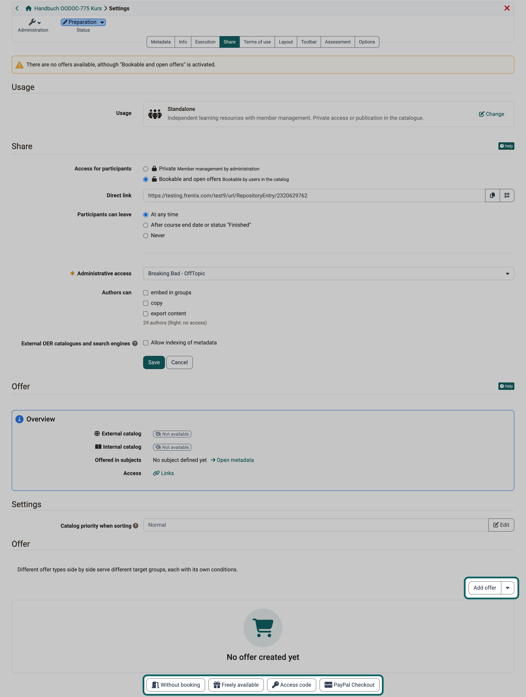{ class="shadow lightbox" title="Share tab of the course settings · 2026.11.09" }

!!! tip "Tip"

    You also see the offers you created under: 
    `Course > Administration > Offer types` 
    The entry appears as soon as a bookable offer has been configured for the course. You configure offers under `Course > Administration > Settings > Tab "Share" > Section "Offer" > Button "Add offer"` (see above). 
    [Details on the offer configuration >](../learningresources/Access_configuration.md#offer)

### Create offers in the Course Planner [:octicons-tag-16:{ title="from Release 20.0 (OO-8301)" }](https://track.frentix.com/issue/OO-8301){:target="_blank"} {: #create_offers_implementation}

To offer an implementation in the catalog, open the implementation in the Course Planner and select: 
`Course Planner > Implementations > "your implementation" > Tab Catalog > Button Offers`

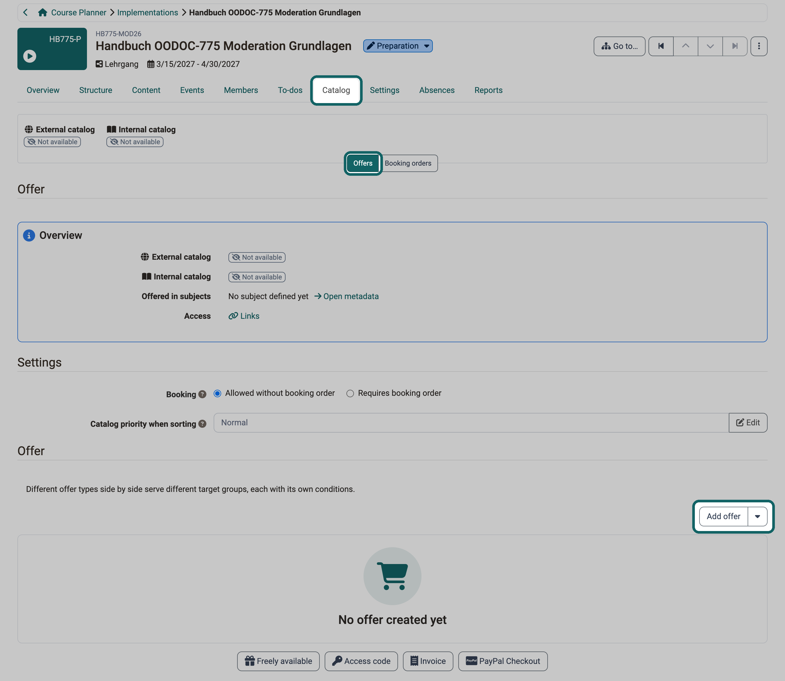{ class="shadow lightbox" title="Catalog tab of an implementation in the Course Planner · 2026.11.09" }

[To the top of the page ^](#offer_concepts)

---

## Offer types {: #offer_types}

These offer types are available:

|                       | Member status  |                                 | available in |
| --------------------- | --------------- |-------------------------------- | --- |
| <b>Without booking</b>    | without  |With this offer, the resource is accessible to users without a membership. | Standalone course |
| <b>Freely available</b>  | Membership | This offer allows the resource to be booked. Users receive a corresponding membership that gives them access to the resource. | Standalone course and implementation |
| <b>Access code</b> | Membership | With this offer, the resource can be booked with an access code. Users receive a corresponding membership that allows them to access the resource. | Standalone course and implementation |
| <b>PayPal Checkout</b> | Membership | With this offer, the resource can be booked for a fee using PayPal. Users receive a corresponding membership that gives them access to the resource. The offer is created by persons with the role author, learning resource manager or administrator, see [PayPal](#offer_payed_paypal). | Standalone course and implementation |
| <b>Invoice</b> | Membership | With this offer, the resource can be booked for a fee via invoice. Users receive a corresponding membership that gives them access to the resource. | Implementation |

When creating an offer, you select the offer type via the button "Add offer".

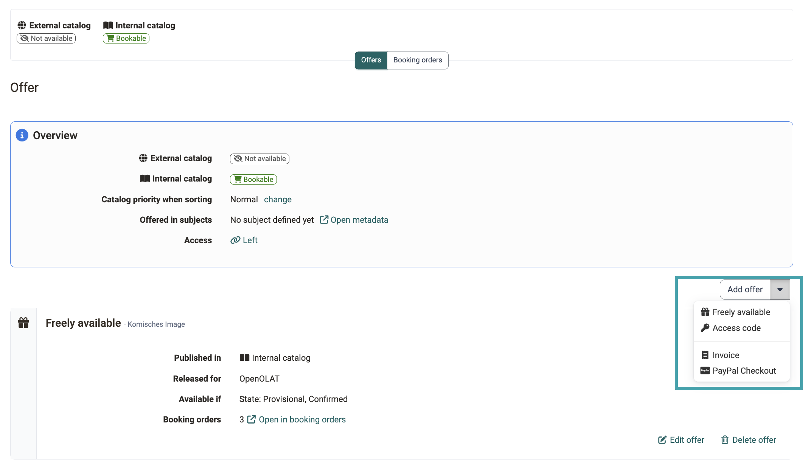{ class="shadow lightbox" title="Tab Catalog of an implementation" }

[More about offer types >](../learningresources/Access_configuration.md#offer-options)

[To the top of the page ^](#offer_concepts)

---

## What can be offered? {: #what_is_offered}

Offers in the catalog exist for

- Courses
- Implementations
- other learning resources

### Offer courses {: #what_is_offered_courses}

You create offers for a course under: 
`Course > Administration > Settings > Tab "Share" > Section "Offer" > Button "Add offer"` 
First select the option "Bookable and open offers" under "Access for participants".

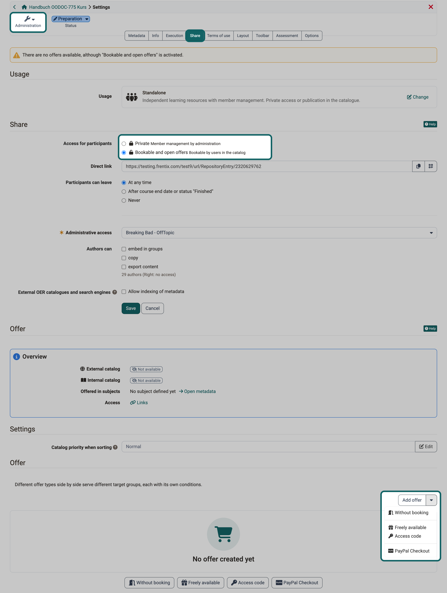{ class="shadow lightbox" title="Share tab of the course settings · 2026.11.09" }

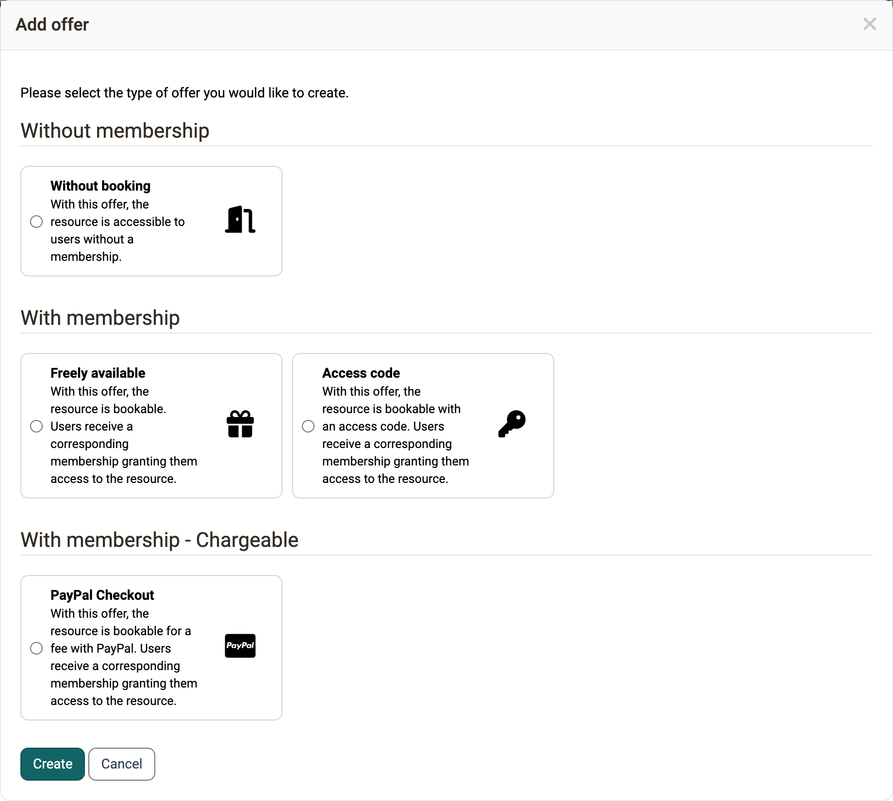{ class="shadow lightbox" title="Dialog Add offer of a course · 2026.11.09" }

Detailed information about [offering courses in the catalog can be found here >](../area_modules/catalog2.0_angebote.md)

[To the top of the page ^](#offer_concepts)

---

### Offer implementations {: #what_is_offered_implementations}

If you offer the same course several times on different dates, use implementations in the Course Planner.

You also advertise an implementation in the catalog if it is still unclear whether it will take place, for example because this depends on the number of bookings. You therefore always create the offer for an implementation in the implementation in the Course Planner, not in a course that is intended for this implementation. Courses can be designated specifically for implementations and then do not have their own member management.

Users book an implementation by logging in from the catalog (if they are already OpenOlat users) or by registering as new users (if they have found a suitable implementation in the external catalog, which they can view without registering).

With an offer "Invoice", interested parties enter their billing address and further details when booking. OpenOlat creates a booking number in the process. The offer type "Invoice" exists only for implementations in the Course Planner.

The booking order is only created when the person completes the booking, and can then be confirmed.

Whether participants may cancel a booked implementation themselves is defined in the offer, see [Cancellation](#offer_cancellation).

If an implementation needs further details at booking, for example dietary requirements or prior knowledge, an offer of the implementation can require forms. The booking person fills them in as steps when booking, and the answers are then available with the booking order. This is only possible for offers of implementations in the Course Planner, not for course offers and not for the offer type PayPal Checkout. [Booking order forms >](../area_modules/Course_Planner_Implementations.md#booking_order_forms) [:octicons-tag-16:{ title="from Release 21.1 (OO-9724)" }](https://track.frentix.com/issue/OO-9724){:target="_blank"}

With forms, the booking becomes a wizard, and the booking order is only created in the last step. [Booking with forms as a wizard >](../area_modules/catalog2.0_angebote.md#offer_booking_wizard) [:octicons-tag-16:{ title="from Release 21.1 (OO-9742)" }](https://track.frentix.com/issue/OO-9742){:target="_blank"}

You create offers for implementations in the Course Planner under: 
`Course Planner > Implementations > "your implementation" > Tab Catalog > Button Offers`

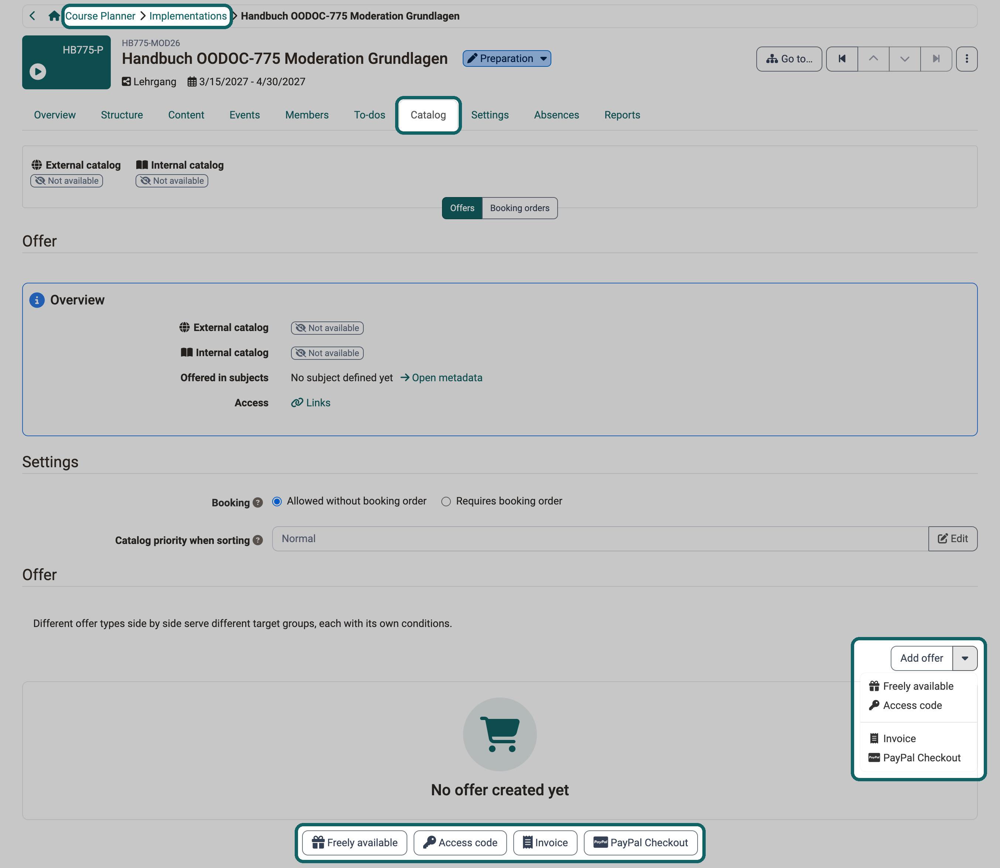{ class="shadow lightbox" title="Catalog tab of an implementation in the Course Planner · 2026.11.09" }

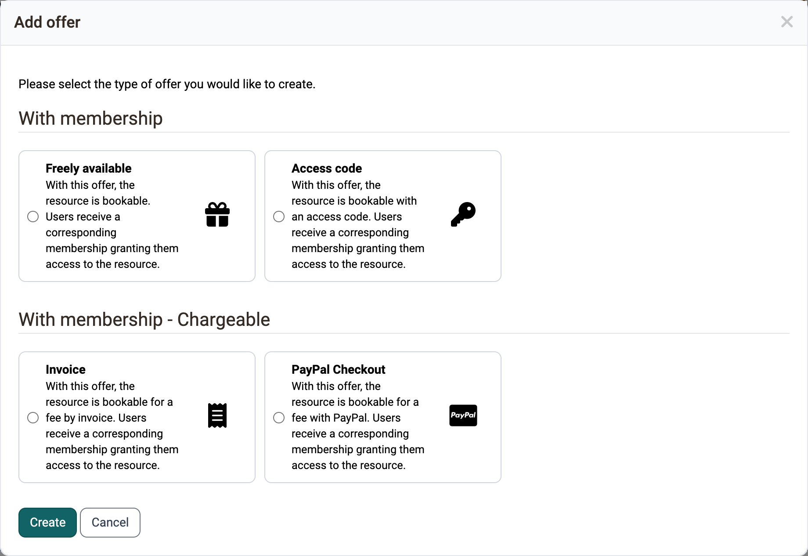{ class="shadow lightbox" title="Dialog Add offer of an implementation · 2026.11.09" }

[More about offering implementations in the catalog >](../area_modules/Course_Planner_Implementations.md#tab_catalog)

[To the top of the page ^](#offer_concepts)

---

### Offer other learning resources {: #what_is_offered_other}

If you want to offer individual videos or documents in the catalog, set up one course with only one course element for each (e.g., course element Video or course element Document). Make sure that the course automatically switches to the first course element when it is opened.

You then create the offer as for any other independent course.

Adapt the metadata and description of this course to the learning resource it contains, so that, for example, "Video xy" appears as an offer in the catalog.

[To the top of the page ^](#offer_concepts)

---

## Offers with payment {: #offer_payed}

### PayPal [:octicons-tag-16:{ title="from Release 14.1 (OO-4203)" }](https://track.frentix.com/issue/OO-4203){:target="_blank"} {: #offer_payed_paypal}

With the PayPal payment module, authors offer learning content for payment. System administrators set up the module beforehand in the system administration and switch it on.

Once the PayPal module is configured, the offer type "PayPal Checkout" is available when creating an offer: for courses under `Course > Administration > Settings > Tab "Share" > Section "Offer" > Button "Add offer"`, for implementations in the Course Planner and for groups in the [group administration](../groups/Group_Administration/index.md#booking).

An offer "PayPal Checkout" is created by persons with the role author, learning resource manager or administrator. Course planners additionally need one of these roles; without it, "Add offer" shows "Freely available", "Access code" and "Invoice" for an implementation.

[Setting up the PayPal payment module (Administration) >](../../manual_admin/administration/Payment_PayPal.md)

### Invoice [:octicons-tag-16:{ title="from Release 20.0 (OO-8210)" }](https://track.frentix.com/issue/OO-8210){:target="_blank"} {: #offer_payed_invoice}

Payment by invoice exists only for implementations in the Course Planner.

For an offer with invoice,

* the membership is active immediately or
* the membership is initially pending until an administrative role confirms the reservation.

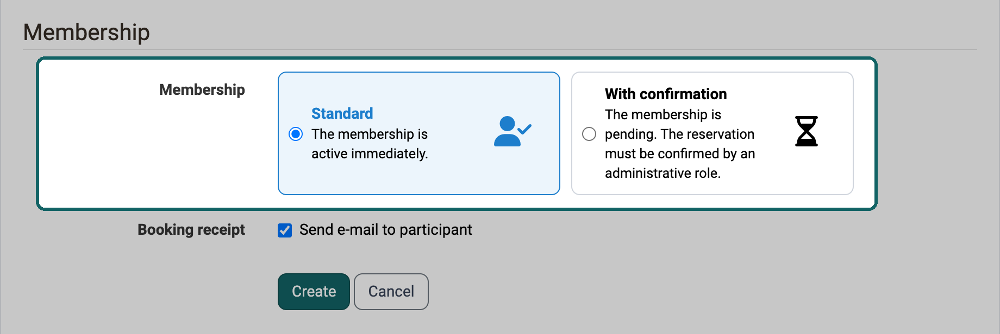{ class="shadow lightbox" title="Membership section in the dialog Invoice of an implementation · 2026.11.09" }

!!! tip "Tip"

    The booking orders are collected per implementation: 
    `Course Planner > Implementations > "your implementation" > Tab Catalog > Button Booking orders` 
    The tabs of an implementation only appear once you have opened it in the table. There, you export the booking orders as an Excel file, for example for invoicing in another program.

[Setting up the invoice payment module (Administration) >](../../manual_admin/administration/Payment_Invoice.md)

### Credit points [:octicons-tag-16:{ title="from Release 20.1.1 (OO-8558)" }](https://track.frentix.com/issue/OO-8558){:target="_blank"} {: #offer_payed_credit_points}

With a credit point system, participants collect credit points across different learning opportunities, for example ECTS or LearnCoins. You define your own credit point systems globally with the "Credit points" module. For a successfully completed course, participants receive credit points if the course awards them.

Certification programs use credit points, for example, for recertification.

Organisations define and name their own credit point systems and restrict them as needed, for example by role or organisational area. After the successful completion of a learning program, you assign credit points in a targeted manner.

[Activate credit points system-wide (Administration) >](../../manual_admin/administration/e-Assessment_Credit_Points.md) 
[Awarding credit points in courses >](../learningresources/Course_Settings_Assessment/index.md#section_credit_points) 
[Credit points in the personal menu >](../personal_menu/Credit_Points.md)

[To the top of the page ^](#offer_concepts)

---

## Cancellation [:octicons-tag-16:{ title="from Release 20.0 (OO-8397)" }](https://track.frentix.com/issue/OO-8397){:target="_blank"} {: #offer_cancellation}

If a person cannot attend a booked implementation after all, they cancel their booking themselves if the offer allows it. They do not need help from the administration. Cancelling a booking is only possible for an offer of an implementation. In courses and groups, participants leave instead, if the course or the group allows it:

| Offer in | What participants do | Who allows it | Where participants find it |
|---|---|---|---|
| Implementation in the Course Planner | Cancel booking | Course planners, product owners and element owners in the offer of the implementation, see the sections below | Info page of the implementation, box "My educational product", for an implementation of type Single course box "My course", see [Cancel booking](../learningresources/General_Functions_Infopage.md#cancel_booking) |
| Course | Leave course | Course owners with "Participants can leave" under `Course > Administration > Settings > Tab "Share"` | Info page of the course, box "My course", see [Leave course](../learningresources/General_Functions_Infopage.md#leave_course) |
| Group | Leave group | Group coaches with "Members can leave the group" under `Group > Administration > Tab "Members"` | Column "Leave" in the list under `Groups`, see [Leave a group](../groups/Leave_a_Group.md) |

The following sections address course planners, product owners and element owners. Whether and until when participants can cancel depends on the offer type and its setting. The graphic shows the cases on a timeline:

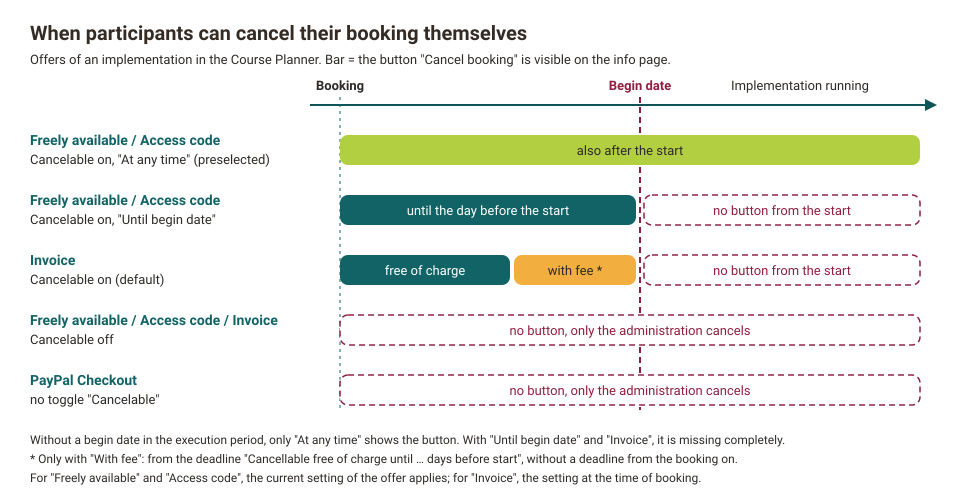{ class="shadow lightbox" title="Cancellation by offer type and setting · 2026.11.11" }

### Freely available and Access code [:octicons-tag-16:{ title="from Release 21.1.2 (OO-9977)" }](https://track.frentix.com/issue/OO-9977){:target="_blank"} {: #offer_cancellation_free_token}

With the toggle "Cancelable", you decide for the offers "Freely available" and "Access code" of an implementation whether participants may withdraw their booking themselves. If the toggle is off (default), only the administration of the implementation cancels a booking. The toggle is located in the offer directly below "Offer description".

If it is switched on, you choose under "Participants can cancel":

* **At any time:** Participants also cancel after the start and for an implementation without a begin date, for example for an ongoing self-study offer. This option is preselected.
* **Until begin date:** Participants cancel until the day before the start. This way, the number of participants is fixed from the start. If the execution period has no begin date, the offer shows the warning "Participants can only cancel if a begin date is specified in the execution period!", and participants do not cancel themselves.

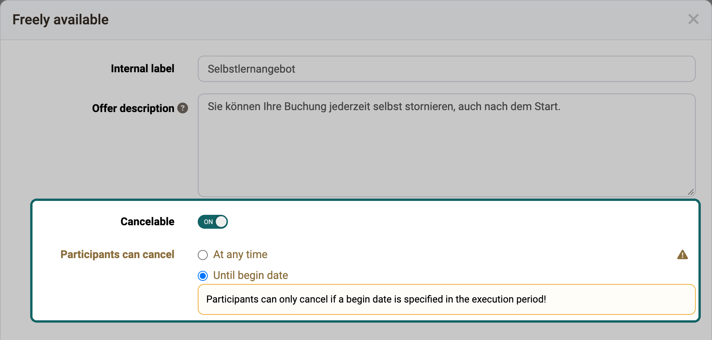{ class="shadow lightbox" title="Dialog Freely available of an implementation · 2026.11.09" }

The execution period has a similar option, "Anytime", which means something else: the implementation is not bound to a period and therefore has no begin date, see [Execution in the settings](../area_modules/Course_Planner_Implementations.md#tab_settings_execution). For such an implementation, participants only cancel with the option "At any time" in the offer.

The current setting of the offer always applies, also to earlier bookings. If you switch "Cancelable" off, participants who have already booked no longer see the button "Cancel booking" either. With the update to Release 21.1.2, OpenOlat switches "Cancelable" off for all existing offers except "Invoice". If participants are to cancel an existing offer "Freely available" or "Access code" themselves, switch "Cancelable" on there.

!!! tip "Tip"

    The catalog does not show bookers whether an offer "Freely available" or "Access code" is cancelable. Therefore, write the rule in the "Offer description", for example "You can cancel your booking yourself until the day before the start."

### Cancellation policy for Invoice [:octicons-tag-16:{ title="from Release 21.0 (OO-9382)" }](https://track.frentix.com/issue/OO-9382){:target="_blank"} {: #offer_invoice_cancellation}

For the offer "Invoice", you define whether participants may cancel their booking and whether a fee applies.

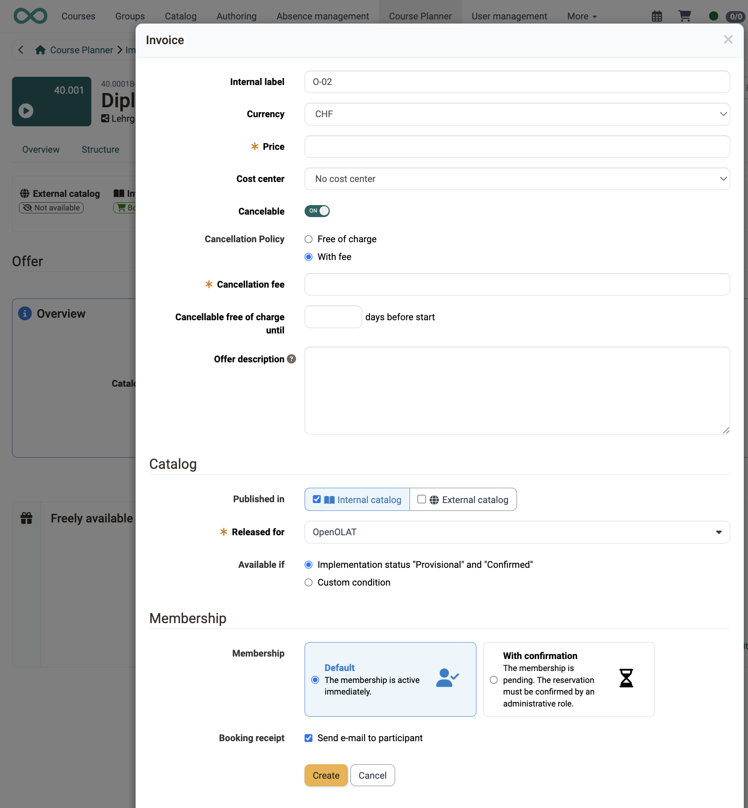{ class="shadow lightbox" title="Dialog Invoice" }

* **Cost center:** Above the cancellation options, you can assign a cost center to the offer if required.
* **Cancelable:** This toggle determines whether participants may cancel their booking. It is switched on by default.
* **Cancellation Policy:** If the offer is cancelable, choose between "Free of charge" (default) and "With fee".
* **Cancellation fee:** If "With fee" is selected, you enter the amount of the fee. With "Cancellable free of charge until \<number\> days before start" you additionally define a period during which cancellation is free of charge. In order for the deadline to be taken into account, a start date must be specified in the execution period.

Participants cancel until the day before the start of the implementation. For this, the execution period needs a start date. A booking is subject to the conditions that applied at the time of booking; a later change to the offer only affects new bookings.

With "With fee", the catalog shows with the offer until when cancellation is free of charge, and the booking dialog states the cancellation fee.

### PayPal Checkout {: #offer_cancellation_paypal}

A booking with "PayPal Checkout" is cancelled by the administration of the implementation. The offer has no toggle "Cancelable", so a cancellation by participants cannot be set.

Whoever manages the members of the implementation cancels a booking in the tab "Members" with "Cancel booking" in the menu of the member row: 
`Course Planner > Implementations > "your implementation" > Tab Members` 
This works for every offer type, also for "PayPal Checkout", and regardless of the toggle "Cancelable". It requires a booking order of the person, see [Tab Members](../area_modules/Course_Planner_Implementations.md#tab_members).

[To the top of the page ^](#offer_concepts)

---

## Further conditions for offers {: #further_boundary_conditions}

You set further conditions for offers. You enter most configuration options directly when creating a new offer.

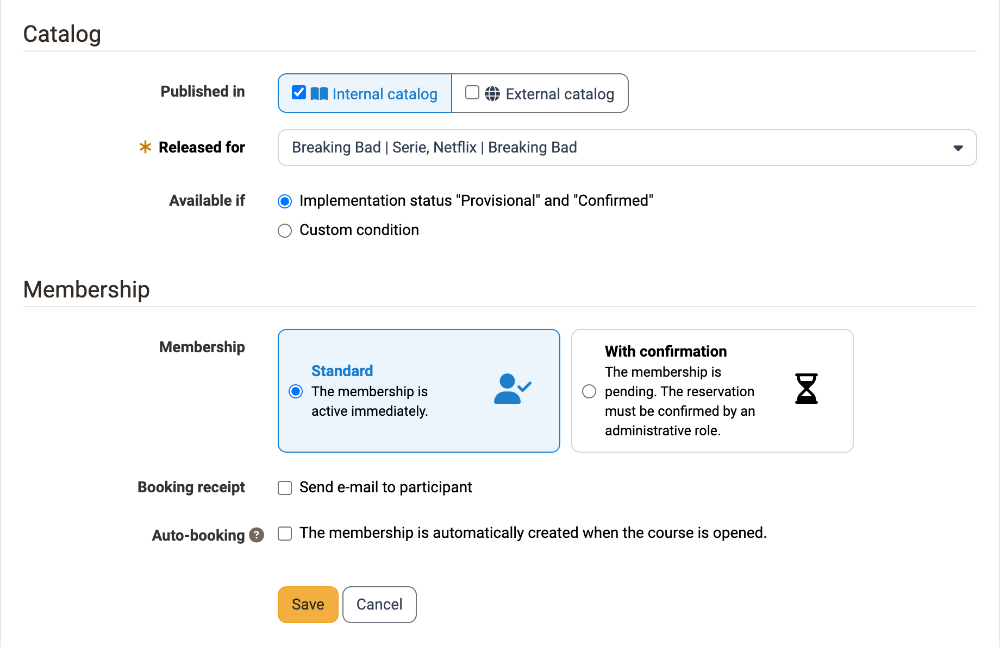{ class="shadow lightbox" title="Catalog and Membership sections in the dialog Freely available of an implementation · 2026.11.09" }

* **Available if: Implementation status "Provisional" and "Confirmed":** 
An implementation does not have to be fully planned for you to publish an offer. For courses, the default condition is Course status "Published".

* **Available if: Custom condition:** 
The offer is only available in the selected statuses and additionally limited to a period, with fixed dates or relative to the execution period. [Details on availability >](../learningresources/Access_configuration.md) [:octicons-tag-16:{ title="from Release 21.0 (OO-9304)" }](https://track.frentix.com/issue/OO-9304){:target="_blank"}

* **Membership Standard:** 
The membership is active immediately after booking the offer.

* **Membership with confirmation:** 
The membership is initially pending until an administrative role confirms the reservation.

* **Booking receipt:** 
With the option "Send e-mail to participant", the booking person receives the booking receipt by e-mail after booking.

* **Auto-booking:** 
OpenOlat creates the membership automatically when the person opens the course.
With auto-booking, OpenOlat does not show the offer description, and users only see the action "Open". Therefore, do not use this option together with other offers.

* Even with immediately active membership (implementations, offer with invoice), bookers usually first accept the privacy policy and further terms of use. In the terms of use, you define additional conditions if required.

* You also offer an implementation if it is still unclear whether it will take place. A course does not even have to exist when you create the offer. An independent course, on the other hand, is offered in the course, and the offer only appears in the catalog once the course has been published.

* With an offer "Access code", users book the resource with an access code. They receive a corresponding membership that allows them to access the resource.

[To the top of the page ^](#offer_concepts)

---

## Further information {: #further_information}

**Mentioned on this page** 
[Catalog 2.0: Overview >](../area_modules/catalog2.0/index.md) 
[Catalog 2.0 - Sorting/order >](../area_modules/catalog2.0_sort_offers.md) 
[Course settings - Tab Share >](../learningresources/Course_Settings_Share/index.md) 
[Access configuration >](../learningresources/Access_configuration.md) 
[Catalog 2.0 - Offers >](../area_modules/catalog2.0_angebote.md) 
[Course Planner: Implementations >](../area_modules/Course_Planner_Implementations.md) 
[Group Administration >](../groups/Group_Administration/index.md) 
[PayPal Configuration (Administration) >](../../manual_admin/administration/Payment_PayPal.md) 
[Payment modules: Invoice (Administration) >](../../manual_admin/administration/Payment_Invoice.md) 
[e-Assessment Administration: Credit points >](../../manual_admin/administration/e-Assessment_Credit_Points.md) 
[Course Settings - Tab Assessment >](../learningresources/Course_Settings_Assessment/index.md) 
[Personal achievements/successes: Credit points >](../personal_menu/Credit_Points.md) 
[General Functions: Info Page >](../learningresources/General_Functions_Infopage.md) 
[Leave a group >](../groups/Leave_a_Group.md)

**Further reading** 
[How do I present my courses in the OpenOlat catalog? >](../../manual_how-to/catalog/catalog.md) 
[User tools: Booking orders >](../personal_menu/Bookings.md) 
[Reports: Booking orders >](../area_modules/Reports_BookingOrders.md)

[To the top of the page ^](#offer_concepts)
