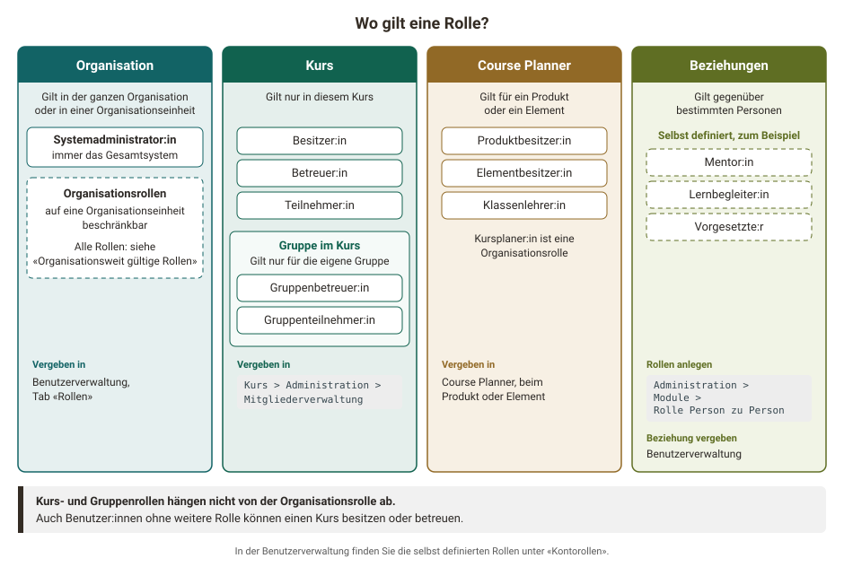
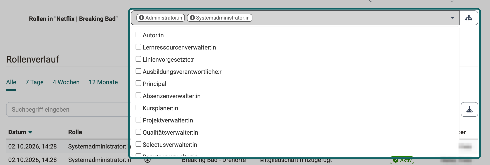
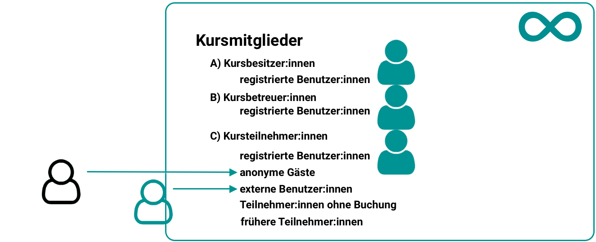
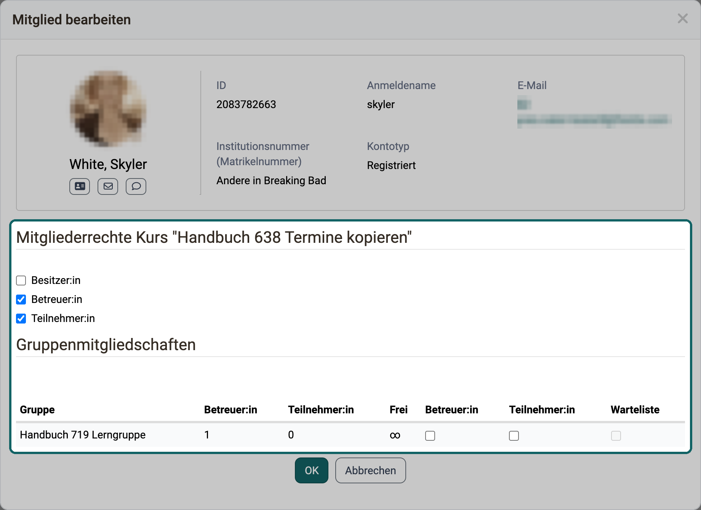
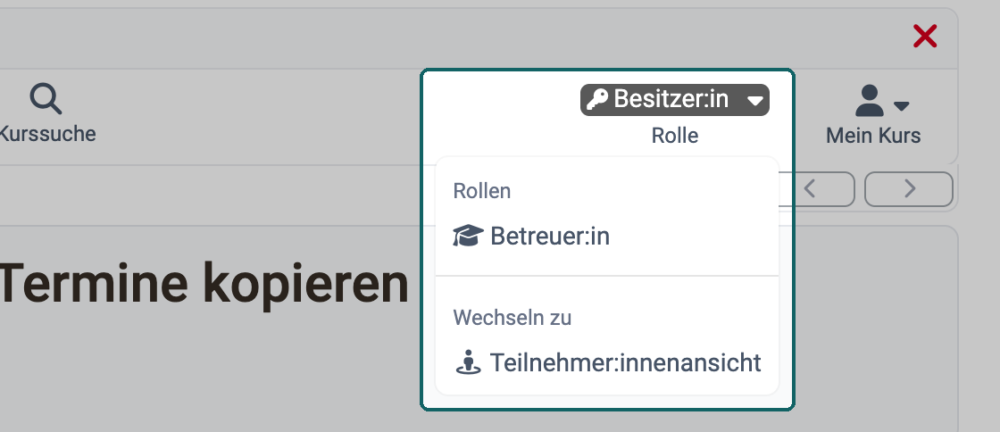
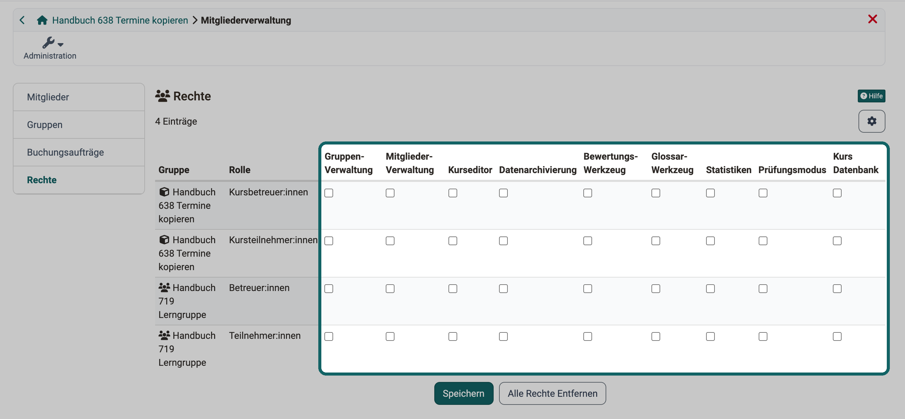

# Rollen und Rechte: Welche Rollen gibt es? {: #roles} 

Welche Bereiche und Funktionen eine Person in OpenOlat nutzt, bestimmen ihre Rollen. Jede Rolle gilt in einem bestimmten Bereich:

{ class="shadow lightbox" title="Rollen nach Bereich" }

Im Course Planner gelten zusätzlich die Rollen Produktbesitzer:in (vergeben beim Produkt), Elementbesitzer:in und Klassenlehrer:in (beide vergeben beim Element). Ihre Rechte beschreibt die Seite [Course Planner: Übersicht](../area_modules/Course_Planner.de.md#roles_rights).

## Organisationsweit gültige Rollen {: #org} 

Organisationsrollen geben einer Person Rechte, die in ihrer ganzen Organisation gelten, etwa zum Erstellen von Kursen oder zum Verwalten von Konten. Sie werden in der Benutzerverwaltung vergeben: 
`Benutzerverwaltung > "Name der Person" > Rollen` 
Dort kreuzen Sie die Rollen im Feld "Rollen in "Name der Organisation"" an.

{ class="shadow lightbox" title="Tab Rollen in der Benutzerverwaltung · 2026.10.21" }

* **Autor:in**: Autor:innen erstellen Kurse und weitere Lernressourcen wie Tests, Videos und Portfoliovorlagen. Dafür öffnen sie den Autorenbereich in der obersten Navigation. Dort finden sie alle Kurse und Lernressourcen, auf die sie Zugriff haben. Die Rolle geht häufig an Lehrende oder E-Learning-Verantwortliche.
* **Lernressourcenverwalter:in**: Lernressourcenverwalter:innen verwalten die Kurse und Lernressourcen ihrer Organisation, auch ohne dort als Besitzer:in eingetragen zu sein. Sie haben automatisch Besitzerrechte (Vollzugriff) für alle Kurse und Lernressourcen, die der eigenen Organisation angehören (siehe [Administrative Freigabe](../learningresources/Access_configuration.de.md#administrative-freigabe)). Im Status "Beendet" und "Gelöscht" ist der Zugriff lesend. Im Autorenbereich finden sie diese Kurse und Lernressourcen und können sie kopieren und exportieren.
* **Linienvorgesetzte:r**: Linienvorgesetzte können zum Beispiel automatisch informiert werden, wenn eine Person ihrer Organisation ein Zertifikat erhält.
* **Ausbildungsverantwortliche:r**: Ausbildungsverantwortliche haben Rechte für ihre Organisation und alle Organisationen darunter. Sie haben Rechte im Coaching, auch wenn sie dort nicht als Betreuer:in eingetragen sind, und übernehmen administrative Aufgaben, zum Beispiel Buchungsaufträge kontrollieren oder Konten sperren.
* **Principal**: Principals sehen viele Bereiche des Systems, aber nur lesend. Sie können nichts ändern und keine Objekte bearbeiten.
* **Absenzenverwalter:in**: Absenzenverwalter:innen verwalten die Absenzen ihrer Organisation. Dafür steht ihnen in der obersten Navigation der Menüpunkt "Absenzenverwaltung" zur Verfügung.
* **Kursplaner:in**: Kursplaner:innen arbeiten im [Course Planner](../area_modules/Course_Planner.de.md). Sind Kursplaner:innen einer Organisation zugeordnet, haben sie nur Zugang zum Course Planner dieser Organisation.
* **Projektverwalter:in**: Projektverwalter:innen verwalten alle Projekte. Im Menüpunkt "Projekte" öffnen sie zusätzlich den Tab "Administration" und erreichen dort alle Projekte mit Mitgliederverwaltung und Konfiguration.
* **Qualitätsverwalter:in**: Qualitätsverwalter:innen steuern das Qualitätsmanagement. Im Menüpunkt "Qualitätsmanagement" verwalten sie sämtliche Einstellungen und Objekte wie Fragebögen, Datenerhebungsgeneratoren und das Analysewerkzeug.
* **Selectusverwalter:in**: Selectusverwalter:innen verwalten die Berufungsverfahren ihrer Organisation. Im Menüpunkt "Selectus" legen sie Ausschreibungen an, bearbeiten, kopieren und archivieren sie und stellen die Kommissionen zusammen. Die Rolle wirkt nur, wenn das Modul "Selectus" eingeschaltet ist.
* **Benutzerverwalter:in**: Benutzerverwalter:innen verwalten die Konten ihrer Organisation in der [Benutzerverwaltung](../../manual_admin/usermanagement/index.de.md), die ihnen als Menüpunkt in der obersten Navigation zur Verfügung steht. Sie erstellen Konten, bearbeiten sie und setzen sie inaktiv. Sie vergeben die Rollen Benutzer:in und Autor:in.
* **Rollenverwalter:in**: Rollenverwalter:innen verwalten die Rollen der Personen ihrer Organisation. Sie öffnen die Benutzerverwaltung über einen eigenen Menüpunkt in der obersten Navigation und sehen dort alle Konten der eigenen Organisationen. Ausser den Rollen Principal, Administrator:in und Systemadministrator:in vergeben, ändern und entfernen sie alle Rollen.
* **Administrator:in**: Administrator:innen besitzen Modul- und Funktionsverwaltung und haben auf alle Bereiche des Systems, wie Benutzerverwaltung, Katalogverwaltung und Course Planner Zugriff, ausser auf die System-Administration. Die Rolle kann auf eine Organisation beschränkt werden. Administrator:innen können Benutzer:innen löschen und zudem weiteren Personen das Recht für die Katalogverwaltung einräumen.
* **Gruppenverwalter:in**: Gruppenverwalter:innen verwalten alle Gruppen. Im Menüpunkt "Gruppen" öffnen sie zusätzlich den Tab [Gruppenverwaltung](../area_modules/Group_Management.de.md). Die Rolle ist eine Systemrolle und gilt für das gesamte System.
* **Poolverwalter:in**: Poolverwalter:innen verwalten den [Fragenpool](../area_modules/Question_Bank.de.md). Im Fragenpool öffnen sie den Bereich "Administration". Die Rolle ist eine Systemrolle und gilt für das gesamte System.
* **Systemadministrator:in**: Systemadministrator:innen konfigurieren und überwachen das System technisch. Dafür haben sie Zugriff auf die System-Administration. Die Rolle ist eine Systemrolle und an keine Organisation gebunden.

!!! note "Hinweis"

    Nicht jede Instanz nutzt alle Rollen. Meist genügt eine Kombination aus Benutzer:in, Autor:in und Administrator:in oder Systemadministrator:in. Weitere Rollen kommen hinzu, wenn die Organisation entsprechend gegliedert ist oder bestimmte Werkzeuge wie den [Course Planner](../area_modules/Course_Planner.de.md) nutzt.

    Bei Fragen zur Rollenvergabe wenden Sie sich an den Support Ihrer OpenOlat-Instanz.

[Zum Seitenanfang ^](#roles)

---

## Rollen in einer Organisation [:octicons-tag-16:{ title="ab Release 13.0 (OO-3302)" }](https://track.frentix.com/issue/OO-3302) {: #orgunit} 

Gliedert sich Ihre Instanz in mehrere Organisationen, erhält eine Person in jeder Organisation die Rollen, die sie dort braucht. Voraussetzung ist, dass das Modul "Organisationen" eingeschaltet ist.

Eine Person kann Mitglied mehrerer Organisationen sein und in jeder andere Rollen haben.

Auf eine Organisation begrenzen lassen sich diese Rollen:

* Benutzer:innen
* Autor:innen
* Absenzenverwalter:innen
* Projektverwalter:innen
* Qualitätsverwalter:innen
* Selectusverwalter:innen
* Benutzerverwalter:innen
* Rollenverwalter:innen
* Kursplaner:innen
* Lernressourcenverwalter:innen
* Linienvorgesetzte
* Ausbildungsverantwortliche
* Principals
* Administrator:innen

Systemadministrator:innen, Gruppenverwalter:innen und Poolverwalter:innen sind Systemrollen. Sie gelten für das gesamte System, auch wenn sie in einer untergeordneten Organisation vergeben werden.

Wie Sie Rollen je Organisation vergeben, beschreibt die Seite [Rollenzuweisung organisationsspezifischer Rollen](Assign_Roles.de.md#role_assignment_orgunit).

!!! info "Ohne Modul Organisationen"

    Ist das Modul "Organisationen" ausgeschaltet, gehören alle Personen automatisch zur einzigen Organisation der Instanz, und alle Rollen gelten für diese Organisation.

[Zum Seitenanfang ^](#roles)

---

## Rollen in einem Kurs {: #course} 

{ class="shadow lightbox" title="Kursmitglieder nach Rolle" }

Wer in einem Kurs lehrt, betreut oder lernt, erhält dort eine von drei Kursrollen. Sie vergeben die Kursrollen unter: 
`Kurs > Administration > Mitgliederverwaltung`

* **Besitzer:in**: Besitzer:innen haben alle Rechte im Kurs. Sie bearbeiten den Kurs, verwalten die Mitglieder und können den Kurs löschen.

    :octicons-device-camera-video-24: **Video-Einführung**: [Voraussetzungen für Autoren](<https://www.youtube.com/embed/L0jc_LBKXLE>){:target="_blank"}

* **Betreuer:in**: Betreuer:innen begleiten und bewerten die Teilnehmenden. Sie haben Zugriff auf das [Bewertungswerkzeug](../learningresources/Assessment_tool_overview.de.md) des Kurses und auf "Test Statistiken" und "Fragebogen Statistiken". Den Kurs bearbeiten sie nicht im Kurseditor, und sie können ihn nicht löschen. Im Bewertungswerkzeug sehen sie die Teilnehmer:innen, die direkt im Kurs eingetragen sind. Teilnehmer:innen einer Gruppe oder einer Durchführung sehen sie nur, wenn sie auch dort Betreuer:in sind. Mehr dazu im Abschnitt [Die Rolle Betreuer:in](#coach).

* **Teilnehmer:in**: Teilnehmer:innen öffnen den Kurs und bearbeiten die Kursbausteine und Inhalte, die ihnen je nach Konfiguration offenstehen. Weitere Rechte im Kurs haben sie nicht.

Die Rollen einer Person, die schon Mitglied ist, ändern Sie in der Mitgliederverwaltung über "Mitglied bearbeiten" im Menü ihrer Zeile.

{ class="shadow lightbox" title="Dialog Mitglied bearbeiten in der Mitgliederverwaltung · 2026.10.21" }

Neben den kursbezogenen Rollen können in herkömmlichen Kursen auch [Gäste](guest_access.de.md) ohne OpenOlat-Konto Zugang zu einem Kurs erhalten.

!!! tip "Rollenwechsel"

    Eine Person kann mehrere Kursrollen haben, zum Beispiel Besitzer:in und Betreuer:in. Im Menü "Rolle" in der Toolbar des Kurses wechselt sie unter "Rollen" zu einer anderen ihrer Rollen und sieht den Kurs so, wie diese Rolle ihn sieht. Besitzer:innen und Betreuer:innen, die nicht zugleich Teilnehmer:in sind, wählen unter "Wechseln zu" die "Teilnehmer:innenansicht".

    { class="shadow lightbox" title="Menü Rolle in der Toolbar des Kurses · 2026.10.21" }

### Die Rolle Betreuer:in {: #coach}

Betreuer:innen begleiten und bewerten die Teilnehmenden eines Kurses, den Kurs selbst gestalten sie nicht. Brauchen sie weitere Rechte, haben Besitzer:innen zwei Wege:

* **Für den ganzen Kurs** geben sie Werkzeuge frei unter: 
`Kurs > Administration > Mitgliederverwaltung > Rechte`
* **Für einen einzelnen Kursbaustein** schalten sie Rechte in dessen Konfiguration ein, meist im Block "Berechtigungen": 
`Kurs > Administration > Kurseditor > "Kursbaustein"`

Was hier für Betreuer:innen steht, gilt auch für Gruppenbetreuer:innen einer Gruppe, die dem Kurs zugeordnet ist, und für Betreuer:innen einer Durchführung im Course Planner. Gruppenbetreuer:innen sehen dabei nur die Teilnehmenden ihrer Gruppe. Den Kurs sehen Betreuer:innen ab dem Status "Freigabe Betreuer:innen" (siehe [Rechte der Kursrollen](Authorisation_Concept.de.md)).

#### Mehr Rechte in Kursbausteinen {: #coach_rights}

In den folgenden Kursbausteinen dürfen Betreuer:innen mehr als Teilnehmende. Die Spalte "Standard" zeigt, wie das Recht eingestellt ist:

* **ein**: Das Recht gilt immer.
* **ein, abschaltbar**: Das Recht ist eingeschaltet. Besitzer:innen schalten es im Block "Berechtigungen" des Kursbausteins aus.
* **nach Freigabe**: Das Recht gilt erst, wenn Besitzer:innen es in der Konfiguration des Kursbausteins einschalten.

Die Einzelheiten beschreibt die Seite des Kursbausteins.

| Kursbaustein | Was Betreuer:innen mehr dürfen | Standard |
|---|---|---|
| [Adobe Connect](../learningresources/Course_Element_Adobe_Connect.de.md) | Meetings moderieren | ein |
| [Aufgabe](../learningresources/Course_Element_Task.de.md) | Abgaben korrigieren und bewerten, Fristen verlängern, Dokumente herunterladen | ein |
| [Auswahl](../learningresources/Course_Element_Selection.de.md) | Auswahl der betreuten Teilnehmenden einsehen | ein |
| [Bewertung](../learningresources/Course_Element_Assessment.de.md) | Betreute Teilnehmende bewerten | ein |
| [BigBlueButton](../learningresources/bigbluebutton/index.de.md) | Meetings verwalten und moderieren | ein |
| [Blog](../learningresources/Course_Element_Blog.de.md) | Recht "Moderator": alle Beiträge bearbeiten und löschen | ein, abschaltbar |
| [Checkliste](../learningresources/Course_Element_Checklist.de.md) | Checklisten der betreuten Teilnehmenden einsehen und bewerten | ein |
| [Dateidiskussion](../learningresources/Course_Element_File_Dialog.de.md) | Recht "Moderator": Beiträge anderer bearbeiten und löschen | ein, abschaltbar |
| [Dokument](../learningresources/Course_Element_Document.de.md) | Recht "Bearbeiten": Dokument bearbeiten | nach Freigabe |
| [Formular](../learningresources/Course_Element_Form.de.md) | Daten exportieren, einzelne Teilnahmen zurücksetzen und wieder öffnen | ein |
| [Forum](../learningresources/Course_Element_Forum.de.md) | Recht "Moderator": Beiträge anderer bearbeiten und löschen, nach Person filtern | ein, abschaltbar |
| [GoToMeeting](../learningresources/Course_Element_GoToMeeting.de.md) | Meetings moderieren | ein |
| [Gruppenaufgabe](../learningresources/Course_Element_Grouptask.de.md) | Wie bei "Aufgabe", nur als Betreuer:in einer Gruppe, die dem Kursbaustein zugewiesen ist | ein |
| [HTML-Seite](../learningresources/Course_Element_HTML_Page.de.md) | Seite bearbeiten mit "Betreuer:innen erlauben Seite zu editieren" | nach Freigabe |
| [Kalender](../learningresources/Course_Element_Calendar.de.md) | Recht "Termine bearbeiten" | ein, abschaltbar |
| [Liste der Teilnehmer:innen](../learningresources/Course_Element_Participant_List.de.md) | E-Mail an alle senden, Liste herunterladen und drucken | ein |
| [LTI-Seite](../learningresources/Course_Element_LTI_Page.de.md) | Start mit der LTI-Rolle aus der Einstellung "Betreuer:innen"; bewerten, wenn der Kursbaustein bewertbar ist | ein |
| [Microsoft Teams](../learningresources/Course_Element_Microsoft_Teams.de.md) | Meetings verwalten und moderieren | ein |
| [Mitteilungen](../learningresources/Course_Element_Notifications.de.md) | Rechte "Mitteilung verfassen" und "Mitteilungen verwalten" | ein, abschaltbar |
| [OpenMeetings](../learningresources/Course_Element_OpenMeetings.de.md) | Meetings moderieren | ein |
| [Ordner](../learningresources/Course_Element_Folder.de.md) | Recht "Vollzugriff": hochladen, Ordner anlegen, löschen | ein, abschaltbar |
| [Podcast](../learningresources/Course_Element_Podcast.de.md) | Recht "Moderator": alle Beiträge bearbeiten und löschen | ein, abschaltbar |
| [Portfolioaufgabe](../learningresources/Course_Element_Portfolio_Task.de.md) | Vorschau; bewerten, wenn der Kursbaustein bewertbar ist | ein |
| [SCORM 1.2](../learningresources/Course_Element_SCORM_Learning_Content.de.md) | Inhalt als Vorschau starten; bewerten, wenn der Kursbaustein bewertbar ist | ein |
| [Seite](../learningresources/Course_Element_Page.de.md) | Recht "Seite editieren" | nach Freigabe |
| [Struktur](../learningresources/Course_Element_Structure.de.md) | Zeigt der Kursbaustein eine Seite an: Seite bearbeiten mit "Betreuer:innen erlauben Seite zu editieren" | nach Freigabe |
| [Teilnehmer:innen Ordner](../learningresources/Course_Element_Participant_Folder.de.md) | Abgabe- und Rückgabeordner der betreuten Teilnehmenden | ein |
| [Terminplanung](../learningresources/Course_Element_Appointment_Scheduling.de.md) | Rechte "Anlass bearbeiten" und "Termine bearbeiten" für Anlässe, bei denen sie als Organisator:in eingetragen sind | ein, abschaltbar |
| [Test](../learningresources/Course_Element_Test.de.md) | Korrigieren, Test einziehen, annullieren | ein |
| [Themenbörse](../learningresources/Course_Element_Topic_Broker.de.md) | Teilnehmer:innen, Themen und Aktivitätslog einsehen; mit den Rechten "Thema bearbeiten" und "Teilnehmer:innen bearbeiten" auch bearbeiten | ein; Bearbeiten nach Freigabe |
| [Übung](../learningresources/Course_Element_Practice.de.md) | Ergebnisse der betreuten Teilnehmenden einsehen | ein |
| [Umfrage](../learningresources/Course_Element_Survey.de.md) | Recht "Resultate sichtbar für": Resultate einsehen | ein, abschaltbar |
| [Video Livestream](../learningresources/Course_Element_Video_Livestream.de.md) | Reiter "Statistik"; mit "Betreuer:in darf Termine bearbeiten" auch Termine bearbeiten | ein; Bearbeiten nach Freigabe |
| [Videoaufgabe](../learningresources/Course_Element_Video_Task.de.md) | Alle Versuche abspielen und bewerten | ein |

In den übrigen Kursbausteinen haben Betreuer:innen standardmässig dieselben Rechte wie Teilnehmende. Eine Ausnahme ist der veraltete Kursbaustein "Terminvergabe", der sich nicht mehr hinzufügen lässt: In bestehenden Kursen verwalten Betreuer:innen dort die Termine und die Teilnehmer:innen. Die Kursbausteine "Opencast", "JupyterHub" und "Zoom" übergeben die Rolle an das eingebundene System, und dieses legt fest, was sie dort bewirkt.

#### Kurswerkzeuge {: #course_tools}

**Standardmässig verfügbar** 
Im Menü "Administration" des Kurses:

* "Bewertungswerkzeug": die betreuten Teilnehmenden bewerten. Daten zurücksetzen und löschen können Betreuer:innen dort nicht.
* "To-dos"
* "Test Statistiken" und "Fragebogen Statistiken", wenn der Kurs einen Test oder eine Umfrage enthält: Resultate der betreuten Teilnehmenden
* "Unterlagen Betreuer:innen", wenn die Funktion im Kurs eingeschaltet ist
* "Badges", wenn der Kurs die manuelle Vergabe von Badges für Betreuer:innen erlaubt
* "Datenerhebungsvorschau", wenn das Qualitätsmanagement die Vorschau anbietet

In der Toolbar des Kurses:

* "Termine": Termine einsehen. Absenzen erfassen Betreuer:innen nur bei Terminen, bei denen sie als Dozent:in eingetragen sind.
* "Lernpfad" in Lernpfad-Kursen: Lernpfade der Teilnehmenden
* "Dokumente": lesen und schreiben, Teilnehmende nur lesen
* "Forum" und "Blog": moderieren
* "Mitteilungen": Mitteilungen verfassen
* "E-Mail": Empfänger:innen frei wählen, auch Teilnehmende
* "BigBlueButton" und "Teams": Meetings verwalten und moderieren

**Zuschaltbar** 
Unter `Kurs > Administration > Mitgliederverwaltung > Rechte` geben Besitzer:innen den Betreuer:innen weitere Werkzeuge frei: Gruppen-Verwaltung, Mitglieder-Verwaltung, Kurseditor, Datenarchivierung, Bewertungs-Werkzeug, Glossar-Werkzeug, Statistiken, Prüfungsmodus und Kurs Datenbank. Was jedes Recht freigibt, beschreibt der Abschnitt [Vergabe zusätzlicher Rechte](../learningresources/Members_management.de.md#additional_rights).

**Kein Zugriff** 
Ohne zusätzliche Rechte öffnen Betreuer:innen nicht:

* "Einstellungen" mit "Info", "Freigabe", "Katalog", "Layout", "Toolbar" und "Bewertung"
* "Mitgliederverwaltung", "Kurseditor", "Dateien", "Lernbereich", "Erinnerung", "Prüfungsverwaltung", "Archivierung & Reports", "Kurs Statistiken" und "Kurs DB"
* "Termine und Absenzen" und "Angebotsarten"
* den Status des Kurses und die Aktionen "Kopieren", "Als Lernpfad duplizieren" und "Löschen"
* "Inhalt exportieren". Ausnahme: Hat die Person in der Organisation des Kurses zusätzlich die Rolle Autor:in und erlaubt der Kurs das Herunterladen, sieht sie diese Aktion.

[Zum Seitenanfang ^](#roles)

---

## Rollen in Gruppen {: #groups} 

Arbeitet ein Kurs mit Gruppen, tragen Sie die Mitglieder einer Gruppe als Gruppenbetreuer:innen oder Gruppenteilnehmer:innen ein.

* **Gruppenbetreuer:in**: 
Gruppenbetreuer:innen haben fast dieselben Rechte wie Kursbetreuer:innen, aber nur für ihre Gruppe. Im Kurs öffnen sie das Bewertungswerkzeug, "Test Statistiken" und "Fragebogen Statistiken". Im Bewertungswerkzeug sehen sie nur die Teilnehmer:innen ihrer eigenen Gruppe.

* **Gruppenteilnehmer:in**: 
Gruppenteilnehmer:innen haben dieselben Rechte wie Kursteilnehmer:innen.

Brauchen Mitglieder mehr Rechte, als ihre Rolle mitbringt, vergeben Sie zusätzliche Rechte unter: 
`Kurs > Administration > Mitgliederverwaltung > Rechte` 
Die Rechte lassen sich an Kursbetreuer:innen und Kursteilnehmer:innen vergeben, je Gruppe auch an Gruppenbetreuer:innen und Gruppenteilnehmer:innen.

{ class="shadow lightbox" title="Bereich Rechte der Mitgliederverwaltung · 2026.10.21" }

#### Gruppen-Verwaltung {: #group_management}

Mit diesem Recht verwalten Mitglieder die Gruppen des Kurses unter `Kurs > Administration > Mitgliederverwaltung > Gruppen`. Sie ändern und entfernen Gruppen, die bereits zum Kurs gehören, fügen weitere Gruppen hinzu, auf die sie Zugriff haben, oder erstellen neue Gruppen.

[Mehr zu Gruppen >](../groups/index.de.md) 
[Mehr zur Gruppenadministration >](../groups/Group_Administration.de.md)

#### Mitglieder-Verwaltung {: #members_management}

Mit diesem Recht steht die Mitgliederverwaltung im Menü "Administration" des Kurses zur Verfügung, mit denselben Optionen wie für Kursbesitzer:innen. Beim Hinzufügen neuer Mitglieder sehen die Mitglieder mit diesem Recht alle registrierten Benutzer:innen.

Das Recht "Mitglieder-Verwaltung" schliesst die Gruppen-Verwaltung ein, auch wenn das Recht "Gruppen-Verwaltung" nicht gesetzt ist.

[Mehr zur Mitgliederverwaltung >](../learningresources/Members_management.de.md)

#### Kurseditor {: #course_editor}

Mit diesem Recht steht der Kurseditor im Menü "Administration" des Kurses zur Verfügung. Kursmitglieder wie Betreuer:innen bearbeiten damit den Kurs und konfigurieren oder ergänzen Kursbausteine. Neue Kurse oder Lernressourcen erstellen sie damit nicht. Im selben Menü öffnen sie zusätzlich "Einstellungen", "Dateien", "Lernbereich", "Prüfungsverwaltung", "Erinnerung" und "Termine und Absenzen", die drei letzten nur, wenn die zugehörige Funktion eingeschaltet ist. 
**Hinweis:** 
Ein Kurs, den eine Person über dieses Recht bearbeitet, ohne Besitzer:in zu sein, erscheint nicht in ihrem Autorenbereich, auch wenn sie sonst Autorenrechte hat. Sie öffnet den Kurs stattdessen in der obersten Navigation unter "Kurse" und findet den Kurseditor im Menü "Administration". Betreuer:innen und Teilnehmer:innen sehen den Kurs auch in diesem Fall erst, wenn die Besitzer:innen ihn veröffentlicht haben.

[Mehr zum Kurseditor >](../learningresources/General_Configuration_of_Course_Elements.de.md)

#### Datenarchivierung {: #archive_tool}

Mit diesem Recht steht "Archivierung & Reports" im Menü "Administration" des Kurses zur Verfügung, mit denselben Optionen wie für Kursbesitzer:innen.

[Mehr zur Archivierung & Reports >](../learningresources/Course_Archiving.de.md)

#### Bewertungs-Werkzeug {: #assessment_tool}

Das Bewertungswerkzeug gehört zur Grundausstattung aller Betreuer:innen. Mit diesem Recht steht es auch weiteren Mitgliedern im Menü "Administration" des Kurses zur Verfügung. Wer das Recht hat, sieht dort alle Teilnehmer:innen des Kurses und kann Daten zurücksetzen und löschen, auch als Betreuer:in.

[Mehr zum Bewertungswerkzeug >](../learningresources/Assessment_tool_overview.de.md)

#### Glossar-Werkzeug {: #glossary_tool}

Mit diesem Recht fügen Mitglieder über das Glossar-Icon in der Toolbar des Kurses Glossareinträge hinzu und bearbeiten sie. Das Icon erscheint, wenn die Anzeige unter `Kurs > Administration > Einstellungen > Tab "Toolbar"` eingeschaltet und unter `Kurs > Administration > Einstellungen > Tab "Optionen"` ein Glossar ausgewählt oder erstellt ist.

Ist noch kein Glossar angelegt, ist das Glossar-Icon nicht sichtbar, und das Recht allein gibt keinen Zugriff. Damit die Mitglieder das Glossar selbst anlegen, brauchen sie zusätzlich das Recht "Kurseditor". Dann richten sie es unter `Kurs > Administration > Einstellungen > Tab "Toolbar"` und `Tab "Optionen"` ein.

[Mehr zum Glossar >](../learningresources/Glossary.de.md)

#### Statistiken {: #statistics}

Mit diesem Recht steht "Kurs Statistiken" im Menü "Administration" des Kurses zur Verfügung, mit denselben Optionen wie für Kursbesitzer:innen.

[Mehr zu Kursstatistiken >](../learningresources/Statistics_Course.de.md)

#### Prüfungsmodus {: #assessment_mode}

Mit diesem Recht steht "Prüfungsverwaltung" im Menü "Administration" des Kurses zur Verfügung, mit denselben Optionen wie für Kursbesitzer:innen.

[Mehr zur Prüfungsverwaltung >](../learningresources/Assessment_Management.de.md)

#### Kurs Datenbank {: #course_database}

Mit diesem Recht steht "Kurs DB" im Menü "Administration" des Kurses zur Verfügung, wenn die Kurs Datenbanken auf der Instanz eingeschaltet sind, mit denselben Optionen wie für Kursbesitzer:innen. Die Mitglieder erstellen Kurs Datenbanken, setzen sie zurück, löschen und exportieren sie.

!!! info "Kurs-/Gruppenrollen"

    Kurs- und Gruppenrechte hängen nicht von den Organisationsrollen ab, die eine Person in der Benutzerverwaltung erhalten hat. Auch Personen ohne weitere Rolle können Kursbesitzer:in, Kursbetreuer:in oder Gruppenbetreuer:in sein.

!!! note "Hinweis"

    Gruppenteilnehmer:innen und Gruppenbetreuer:innen sind Rollen innerhalb einer bestimmten Gruppe. Die Rolle Gruppenverwalter:in ist dagegen eine Systemrolle: Sie verwaltet die Gruppen des gesamten Systems.

[Zum Seitenanfang ^](#roles)

---

## Selbst definierte Rollen und Beziehungen [:octicons-tag-16:{ title="ab Release 13.2 (OO-3305)" }](https://track.frentix.com/issue/OO-3305) {: #relations} 

Betreut eine Person eine andere über einzelne Kurse hinaus, zum Beispiel als Mentor:in, Lernbegleiter:in oder Vorgesetzte:r, bilden Sie das mit einer Beziehung zwischen den beiden Konten ab. Die Rollen dafür legen Administrator:innen in der System-Administration selbst an: 
`Administration > Module > Rolle Person zu Person` 
Jede dieser Rollen hat eine Gegenrolle, welche die andere Seite der Beziehung benennt. Administrator:innen statten die Rollen mit eigenen Rechten aus. Wie Betreuende ihre Personen im Coaching begleiten, beschreibt die Seite [Coaching - Personen](../area_modules/Coaching_People.de.md).

Sind die Rollen eingerichtet, verbinden Sie in der Benutzerverwaltung zwei Konten über eine dieser Rollen. Wie das geht, beschreibt die Seite [Beziehungen definieren](Assign_Roles.de.md#role_assignment_relations).

[Zum Seitenanfang ^](#roles)

---

## Kontorollen {: #account_roles} 

In der Benutzerverwaltung erscheinen die [selbst definierten Rollen](#relations) unter "Kontorollen". Dort steht jede Rolle und ihre Gegenrolle als eigener Eintrag. Ein Klick auf einen Eintrag listet die Konten auf, die diese Rolle in einer Beziehung haben. Der Menüpunkt erscheint, sobald mindestens eine solche Rolle angelegt ist. 
(Siehe [Kontorollen](../../manual_admin/usermanagement/Search_Users.de.md#user_roles))

[Zum Seitenanfang ^](#roles)

---

!!! warning "Zugriff Bewertungswerkzeug"

    Soll eine Person das Bewertungswerkzeug nicht öffnen, geben Sie ihr weder im Kurs noch in einer Gruppe oder Durchführung die Rolle Betreuer:in.

!!! warning "Zugriff Mitgliederverwaltung"

    Personen mit dem Recht "Mitglieder-Verwaltung" können sich selbst weitere Rechte geben, andere Mitglieder aus dem Kurs entfernen und deren Rechte einschränken, auch die Rechte der Person, die den Kurs erstellt hat, und der übrigen Besitzer:innen. Mehr dazu auf der Seite [Mitgliederverwaltung](../learningresources/Members_management.de.md).

[Zum Seitenanfang ^](#roles)

---

## Weiterführende Informationen {: #further_information} 

**Auf dieser Seite erwähnt** 
[Course Planner: Übersicht >](../area_modules/Course_Planner.de.md) 
[Zugangskonfiguration / Freigabe >](../learningresources/Access_configuration.de.md) 
[Benutzerverwaltung >](../../manual_admin/usermanagement/index.de.md) 
[Gruppenverwaltung >](../area_modules/Group_Management.de.md) 
[Fragenpool: Übersicht >](../area_modules/Question_Bank.de.md) 
[Rollen zuweisen >](Assign_Roles.de.md) 
[Bewertungswerkzeug - Übersicht >](../learningresources/Assessment_tool_overview.de.md) 
[Gastzugang >](guest_access.de.md) 
[Rollen und Rechte: Rechte in Kursen >](Authorisation_Concept.de.md) 
[Kursbaustein "Adobe Connect" >](../learningresources/Course_Element_Adobe_Connect.de.md) 
[Kursbaustein "Aufgabe" >](../learningresources/Course_Element_Task.de.md) 
[Kursbaustein "Auswahl" >](../learningresources/Course_Element_Selection.de.md) 
[Kursbaustein "Bewertung" >](../learningresources/Course_Element_Assessment.de.md) 
[Kursbaustein "BigBlueButton" >](../learningresources/bigbluebutton/index.de.md) 
[Kursbaustein "Blog" >](../learningresources/Course_Element_Blog.de.md) 
[Kursbaustein "Checkliste" >](../learningresources/Course_Element_Checklist.de.md) 
[Kursbaustein "Dateidiskussion" >](../learningresources/Course_Element_File_Dialog.de.md) 
[Kursbaustein "Dokument" >](../learningresources/Course_Element_Document.de.md) 
[Kursbaustein "Formular" >](../learningresources/Course_Element_Form.de.md) 
[Kursbaustein "Forum" >](../learningresources/Course_Element_Forum.de.md) 
[Kursbaustein "GoToMeeting" >](../learningresources/Course_Element_GoToMeeting.de.md) 
[Kursbaustein "Gruppenaufgabe" >](../learningresources/Course_Element_Grouptask.de.md) 
[Kursbaustein "HTML-Seite" >](../learningresources/Course_Element_HTML_Page.de.md) 
[Kursbaustein "Kalender" >](../learningresources/Course_Element_Calendar.de.md) 
[Kursbaustein "Teilnehmerliste" >](../learningresources/Course_Element_Participant_List.de.md) 
[Kursbaustein "LTI-Seite" >](../learningresources/Course_Element_LTI_Page.de.md) 
[Kursbaustein "Microsoft Teams" >](../learningresources/Course_Element_Microsoft_Teams.de.md) 
[Kursbaustein "Mitteilungen" >](../learningresources/Course_Element_Notifications.de.md) 
[Kursbaustein "OpenMeetings" >](../learningresources/Course_Element_OpenMeetings.de.md) 
[Kursbaustein "Ordner" >](../learningresources/Course_Element_Folder.de.md) 
[Kursbaustein "Podcast" >](../learningresources/Course_Element_Podcast.de.md) 
[Kursbaustein "Portfolioaufgabe" >](../learningresources/Course_Element_Portfolio_Task.de.md) 
[Kursbaustein "SCORM 1.2" >](../learningresources/Course_Element_SCORM_Learning_Content.de.md) 
[Kursbaustein "Seite" >](../learningresources/Course_Element_Page.de.md) 
[Kursbaustein "Struktur" >](../learningresources/Course_Element_Structure.de.md) 
[Kursbaustein "Teilnehmer:innen Ordner" >](../learningresources/Course_Element_Participant_Folder.de.md) 
[Kursbaustein "Terminplanung" >](../learningresources/Course_Element_Appointment_Scheduling.de.md) 
[Kursbaustein "Test" >](../learningresources/Course_Element_Test.de.md) 
[Kursbaustein "Themenbörse" >](../learningresources/Course_Element_Topic_Broker.de.md) 
[Kursbaustein "Übung" >](../learningresources/Course_Element_Practice.de.md) 
[Kursbaustein "Umfrage" >](../learningresources/Course_Element_Survey.de.md) 
[Kursbaustein "Video Livestream" >](../learningresources/Course_Element_Video_Livestream.de.md) 
[Kursbaustein "Videoaufgabe" >](../learningresources/Course_Element_Video_Task.de.md) 
[Mitgliederverwaltung >](../learningresources/Members_management.de.md) 
[Gruppen >](../groups/index.de.md) 
[Gruppenadministration >](../groups/Group_Administration.de.md) 
[Kursbausteine im Kurseditor >](../learningresources/General_Configuration_of_Course_Elements.de.md) 
[Kursadministration - Archivierung & Reports >](../learningresources/Course_Archiving.de.md) 
[Glossar >](../learningresources/Glossary.de.md) 
[Kursstatistiken >](../learningresources/Statistics_Course.de.md) 
[Prüfungsverwaltung: Übersicht >](../learningresources/Assessment_Management.de.md) 
[Coaching - Personen >](../area_modules/Coaching_People.de.md) 
[Kontosuche >](../../manual_admin/usermanagement/Search_Users.de.md)

**Weiterführend** 
[Benutzertypen >](User_Types.de.md) 
[Rollen und ihre Arbeitsbereiche >](Roles_Home_Areas.de.md)

**youtube** 
[Voraussetzungen für Autoren](<https://www.youtube.com/embed/L0jc_LBKXLE>)

[Zum Seitenanfang ^](#roles)
