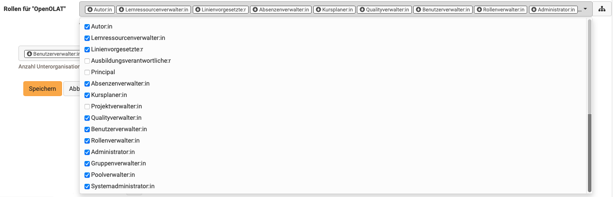
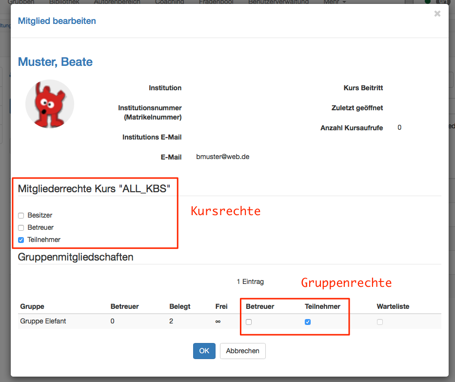
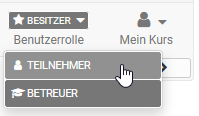
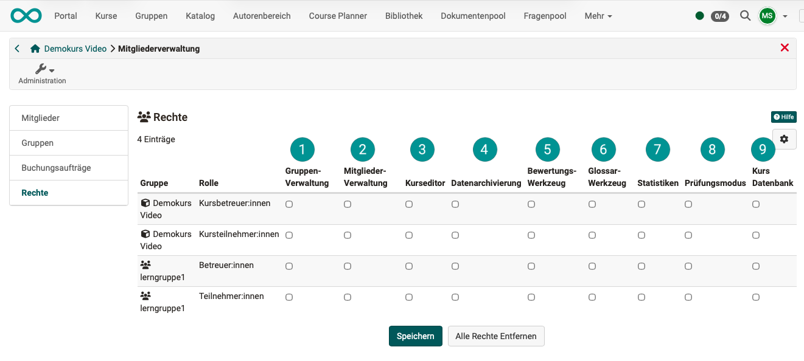

# Rollen und Rechte: Welche Rollen gibt es? {: #roles} 

Welche Bereiche und Funktionen eine Person in OpenOlat nutzt, bestimmen ihre Rollen. Jede Rolle gilt in einem bestimmten Bereich:

{ class="shadow lightbox" title="Rollen nach Bereich" }

Im Course Planner gelten zusätzlich die Rollen Produktbesitzer:in (vergeben beim Produkt), Elementbesitzer:in und Klassenlehrer:in (beide vergeben beim Element). Ihre Rechte beschreibt die Seite [Course Planner: Übersicht](../area_modules/Course_Planner.de.md#roles_rights).

## Organisationsweit gültige Rollen {: #org} 

Organisationsrollen geben einer Person Rechte, die in ihrer ganzen Organisation gelten, etwa zum Erstellen von Kursen oder zum Verwalten von Konten. Sie werden in der Benutzerverwaltung vergeben: 
`Benutzerverwaltung > "Name der Person" > Rollen`

{ class="shadow lightbox" title="Tab Rollen der Benutzerverwaltung" }

* **Autor:in**: Autor:innen erstellen Kurse und weitere Lernressourcen wie Tests, Videos und Portfoliovorlagen. Dafür öffnen sie den Autorenbereich in der obersten Navigation. Dort finden sie alle Kurse und Lernressourcen, auf die sie Zugriff haben. Die Rolle geht häufig an Lehrende oder E-Learning-Verantwortliche.
* **Lernressourcenverwalter:in**: Lernressourcenverwalter:innen verwalten die Kurse und Lernressourcen ihrer Organisation, auch ohne dort als Besitzer:in eingetragen zu sein. Sie haben automatisch Besitzerrechte (Vollzugriff) für alle Kurse und Lernressourcen, die der eigenen Organisation angehören (siehe [Administrative Freigabe](../learningresources/Access_configuration.de.md#administrative-freigabe)). Im Status "Beendet" und "Gelöscht" ist der Zugriff lesend. Im Autorenbereich finden sie diese Kurse und Lernressourcen und können sie kopieren und exportieren.
* **Linienvorgesetzte:r**: Linienvorgesetzte können zum Beispiel automatisch informiert werden, wenn eine Person ihrer Organisation ein Zertifikat erhält.
* **Ausbildungsverantwortliche:r**: Ausbildungsverantwortliche haben Rechte für ihre Organisation und alle Organisationen darunter. Sie haben Rechte im Coaching, auch wenn sie dort nicht als Betreuer:in eingetragen sind, und übernehmen administrative Aufgaben, zum Beispiel Buchungsaufträge kontrollieren oder Konten sperren.
* **Principal**: Principals sehen viele Bereiche des Systems, aber nur lesend. Sie können nichts ändern und keine Objekte bearbeiten.
* **Absenzenverwalter:in**: Absenzenverwalter:innen verwalten die Absenzen ihrer Organisation. Dafür steht ihnen in der obersten Navigation der Menüpunkt "Absenzenverwaltung" zur Verfügung.
* **Kursplaner:in**: Kursplaner:innen arbeiten im [Course Planner](../area_modules/Course_Planner.de.md). Sind Kursplaner:innen einer Organisation zugeordnet, haben sie nur Zugang zum Course Planner dieser Organisation.
* **Projektverwalter:in**: Projektverwalter:innen verwalten alle Projekte. Im Menüpunkt "Projekte" öffnen sie zusätzlich den Tab "Administration" und erreichen dort alle Projekte mit Mitgliederverwaltung und Konfiguration.
* **Qualitätsverwalter:in**: Qualitätsverwalter:innen steuern das Qualitätsmanagement. Im Menüpunkt "Qualitätsmanagement" verwalten sie sämtliche Einstellungen und Objekte wie Fragebögen, Datenerhebungsgeneratoren und das Analysewerkzeug.
* **Selectusverwalter:in**: Selectusverwalter:innen verwalten die Berufungsverfahren ihrer Organisation. Im Menüpunkt "Selectus" legen sie Ausschreibungen an, bearbeiten, kopieren und archivieren sie und stellen die Kommissionen zusammen. Die Rolle wirkt nur, wenn das Modul "Selectus" eingeschaltet ist.
* **Benutzerverwalter:in**: Benutzerverwalter:innen verwalten die Konten ihrer Organisation in der [Benutzerverwaltung](../../manual_admin/usermanagement/index.de.md), die ihnen als Menüpunkt in der obersten Navigation zur Verfügung steht. Sie erstellen Konten, bearbeiten sie und setzen sie inaktiv. Sie vergeben die Rollen Benutzer:in und Autor:in.
* **Rollenverwalter:in**: Rollenverwalter:innen verwalten die Rollen der Personen ihrer Organisation. Sie öffnen die Benutzerverwaltung über einen eigenen Menüpunkt in der obersten Navigation und sehen dort alle Konten der eigenen Organisationen. Ausser den Rollen Principal, Administrator:in und Systemadministrator:in vergeben, ändern und entfernen sie alle Rollen.
* **Administrator:in**: Administrator:innen besitzen Modul- und Funktionsverwaltung und haben auf alle Bereiche des Systems, wie Benutzerverwaltung, Katalogverwaltung und Course Planner Zugriff, ausser auf die System-Administration. Die Rolle kann auf eine Organisation beschränkt werden. Administrator:innen können Benutzer:innen löschen und zudem weiteren Personen das Recht für die Katalogverwaltung einräumen.
* **Gruppenverwalter:in**: Gruppenverwalter:innen verwalten alle Gruppen. Im Menüpunkt "Gruppen" öffnen sie zusätzlich den Tab [Gruppenverwaltung](../area_modules/Group_Management.de.md). Die Rolle ist eine Systemrolle und gilt für das gesamte System.
* **Poolverwalter:in**: Poolverwalter:innen verwalten den [Fragenpool](../area_modules/Question_Bank.de.md). Im Fragenpool öffnen sie den Bereich "Administration". Die Rolle ist eine Systemrolle und gilt für das gesamte System.
* **Systemadministrator:in**: Systemadministrator:innen konfigurieren und überwachen das System technisch. Dafür haben sie Zugriff auf die System-Administration. Die Rolle ist eine Systemrolle und an keine Organisation gebunden.

!!! note "Hinweis"

    Nicht jede Instanz nutzt alle Rollen. Meist genügt eine Kombination aus Benutzer:in, Autor:in und Administrator:in oder Systemadministrator:in. Weitere Rollen kommen hinzu, wenn die Organisation entsprechend gegliedert ist oder bestimmte Werkzeuge wie den [Course Planner](../area_modules/Course_Planner.de.md) nutzt.

    Bei Fragen zur Rollenvergabe wenden Sie sich an den Support Ihrer OpenOlat-Instanz.

[Zum Seitenanfang ^](#roles)

---

## Rollen in einer Organisation [:octicons-tag-16:{ title="ab Release 13.0 (OO-3302)" }](https://track.frentix.com/issue/OO-3302) {: #orgunit} 

Gliedert sich Ihre Instanz in mehrere Organisationen, erhält eine Person in jeder Organisation die Rollen, die sie dort braucht. Voraussetzung ist, dass das Modul "Organisationen" eingeschaltet ist.

Eine Person kann Mitglied mehrerer Organisationen sein und in jeder andere Rollen haben.

Auf eine Organisation begrenzen lassen sich diese Rollen:

* Benutzer:innen
* Autor:innen
* Absenzenverwalter:innen
* Projektverwalter:innen
* Qualitätsverwalter:innen
* Selectusverwalter:innen
* Benutzerverwalter:innen
* Rollenverwalter:innen
* Kursplaner:innen
* Lernressourcenverwalter:innen
* Linienvorgesetzte
* Ausbildungsverantwortliche
* Principals
* Administrator:innen

Systemadministrator:innen, Gruppenverwalter:innen und Poolverwalter:innen sind Systemrollen. Sie gelten für das gesamte System, auch wenn sie in einer untergeordneten Organisation vergeben werden.

Wie Sie Rollen je Organisation vergeben, beschreibt die Seite [Rollenzuweisung organisationsspezifischer Rollen](Assign_Roles.de.md#role_assignment_orgunit).

!!! info "Ohne Modul Organisationen"

    Ist das Modul "Organisationen" ausgeschaltet, gehören alle Personen automatisch zur einzigen Organisation der Instanz, und alle Rollen gelten für diese Organisation.

[Zum Seitenanfang ^](#roles)

---

## Rollen in einem Kurs {: #course} 

{ class="shadow lightbox" title="Kursmitglieder nach Rolle" }

Wer in einem Kurs lehrt, betreut oder lernt, erhält dort eine von drei Kursrollen. Sie vergeben die Kursrollen unter: 
`Kurs > Administration > Mitgliederverwaltung`

* **Besitzer:in**: Besitzer:innen haben alle Rechte im Kurs. Sie bearbeiten den Kurs, verwalten die Mitglieder und können den Kurs löschen.

    :octicons-device-camera-video-24: **Video-Einführung**: [Voraussetzungen für Autoren](<https://www.youtube.com/embed/L0jc_LBKXLE>){:target="_blank"}

* **Betreuer:in**: Betreuer:innen begleiten und bewerten die Teilnehmenden. Sie haben Zugriff auf das [Bewertungswerkzeug](../learningresources/Assessment_tool_overview.de.md) des Kurses und auf die Test- und Fragebogen-Statistik. Den Kurs bearbeiten sie nicht im Kurseditor, und sie können ihn nicht löschen. Im Bewertungswerkzeug sehen sie alle Teilnehmenden des Kurses, aber keine Gruppenteilnehmenden. Mehr dazu auf der Seite [Die Rolle "Betreuer:in"](coach.de.md).

* **Teilnehmer:in**: Teilnehmer:innen öffnen den Kurs und bearbeiten die Kursbausteine und Inhalte, die ihnen je nach Konfiguration offenstehen. Weitere Rechte im Kurs haben sie nicht.

{ class="shadow lightbox" title="Dialog Mitglied bearbeiten in der Mitgliederverwaltung" }

Neben den kursbezogenen Rollen können in herkömmlichen Kursen auch [Gäste](guest_access.de.md) ohne OpenOlat-Konto Zugang zu einem Kurs erhalten.

!!! tip "Rollenwechsel"

    Eine Person kann mehrere Kursrollen haben, zum Beispiel Besitzer:in und Teilnehmer:in. Über das Menü "Rolle" in der Toolbar des Kurses wechselt sie zwischen diesen Rollen und sieht den Kurs so, wie die jeweilige Rolle ihn sieht.

    { class="shadow lightbox" title="Toolbar des Kurses" }

[Zum Seitenanfang ^](#roles)

---

## Rollen in Gruppen {: #groups} 

Arbeitet ein Kurs mit Gruppen, tragen Sie die Mitglieder einer Gruppe als Gruppenbetreuer:innen oder Gruppenteilnehmer:innen ein.

* **Gruppenbetreuer:in**: 
Gruppenbetreuer:innen haben fast dieselben Rechte wie Kursbetreuer:innen, aber nur für ihre Gruppe. Im Kurs öffnen sie das Bewertungswerkzeug und die Test- und Fragebogen-Statistik. Im Bewertungswerkzeug sehen sie nur die Teilnehmer:innen ihrer eigenen Gruppe.

* **Gruppenteilnehmer:in**: 
Gruppenteilnehmer:innen haben dieselben Rechte wie Kursteilnehmer:innen.

Brauchen Mitglieder mehr Rechte, als ihre Rolle mitbringt, vergeben Sie zusätzliche Rechte unter: 
`Kurs > Administration > Mitgliederverwaltung > Rechte` 
Die Rechte lassen sich an Kursbetreuer:innen und Kursteilnehmer:innen vergeben, je Gruppe auch an Gruppenbetreuer:innen und Gruppenteilnehmer:innen.

{ class="shadow lightbox" title="Tab Rechte der Mitgliederverwaltung" }

{ class=" aside-left-lg" }
**Gruppen-Verwaltung** 
Mit diesem Recht verwalten Mitglieder die Gruppen des Kurses unter `Kurs > Administration > Mitgliederverwaltung > Gruppen`. Sie ändern und entfernen Gruppen, die bereits zum Kurs gehören, fügen weitere Gruppen hinzu, auf die sie Zugriff haben, oder erstellen neue Gruppen.

[Mehr zu Gruppen >](../groups/index.de.md) 
[Mehr zur Gruppenadministration >](../groups/Group_Administration.de.md)

{ class=" aside-left-lg" }
**Mitglieder-Verwaltung** 
Mit diesem Recht steht die Mitgliederverwaltung im Menü "Administration" des Kurses zur Verfügung, mit denselben Optionen wie für Kursbesitzer:innen. Beim Hinzufügen neuer Mitglieder sehen die Mitglieder mit diesem Recht alle registrierten Benutzer:innen.

Das Recht "Mitglieder-Verwaltung" schliesst die Gruppen-Verwaltung ein, auch wenn das Recht "Gruppen-Verwaltung" nicht gesetzt ist.

[Mehr zur Mitgliederverwaltung >](../learningresources/Members_management.de.md)

{ class=" aside-left-lg" }
**Kurseditor** 
Mit diesem Recht steht der Kurseditor im Menü "Administration" des Kurses zur Verfügung. Kursmitglieder wie Betreuer:innen bearbeiten damit den Kurs und konfigurieren oder ergänzen Kursbausteine. Neue Kurse oder Lernressourcen erstellen sie damit nicht. 
**Hinweis:** 
Ein Kurs, den eine Person über dieses Recht bearbeitet, ohne Besitzer:in zu sein, erscheint nicht in ihrem Autorenbereich, auch wenn sie sonst Autorenrechte hat. Sie öffnet den Kurs stattdessen in der obersten Navigation unter "Kurse" und findet den Kurseditor im Menü "Administration". Betreuer:innen und Teilnehmer:innen sehen den Kurs auch in diesem Fall erst, wenn die Besitzer:innen ihn veröffentlicht haben.

[Mehr zum Kurseditor >](../learningresources/General_Configuration_of_Course_Elements.de.md)

{ class=" aside-left-lg" }
**Datenarchivierung** 
Mit diesem Recht steht die Datenarchivierung im Menü "Administration" des Kurses zur Verfügung, mit denselben Optionen wie für Kursbesitzer:innen.

[Mehr zur Archivierung & Reports >](../learningresources/Course_Archiving.de.md)

{ class=" aside-left-lg" }
**Bewertungs-Werkzeug** 
Das Bewertungswerkzeug gehört zur Grundausstattung aller Betreuer:innen. Mit diesem Recht steht es auch weiteren Mitgliedern im Menü "Administration" des Kurses zur Verfügung.

[Mehr zum Bewertungswerkzeug >](../learningresources/Assessment_tool_overview.de.md)

{ class=" aside-left-lg" }
**Glossar-Werkzeug** 
Mit diesem Recht fügen Mitglieder über das Glossar-Icon in der Toolbar des Kurses Glossareinträge hinzu und bearbeiten sie. Das Icon erscheint, wenn die Anzeige unter `Kurs > Administration > Einstellungen > Tab "Toolbar"` eingeschaltet und unter `Kurs > Administration > Einstellungen > Tab "Optionen"` ein Glossar ausgewählt oder erstellt ist.

Ist noch kein Glossar angelegt, ist das Glossar-Icon nicht sichtbar, und das Recht allein gibt keinen Zugriff. Damit die Mitglieder das Glossar selbst anlegen, brauchen sie zusätzlich das Recht "Kurseditor". Dann richten sie es unter `Kurs > Administration > Einstellungen > Tab "Toolbar"` und `Tab "Optionen"` ein.

[Mehr zum Glossar >](../learningresources/Glossary.de.md)

{ class=" aside-left-lg" }
**Statistiken** 
Mit diesem Recht stehen die Statistiken im Menü "Administration" des Kurses zur Verfügung, mit denselben Optionen wie für Kursbesitzer:innen.

[Mehr zu Kursstatistiken >](../learningresources/Statistics_Course.de.md)

{ class=" aside-left-lg" }
**Prüfungsmodus** 
Mit diesem Recht steht der Prüfungsmodus im Menü "Administration" des Kurses zur Verfügung, mit denselben Optionen wie für Kursbesitzer:innen.

[Mehr zur Prüfungsverwaltung >](../learningresources/Assessment_Management.de.md)

{ class=" aside-left-lg" }
**Kurs Datenbank** 
Mit diesem Recht stehen die Kursdatenbanken im Menü "Administration" des Kurses zur Verfügung, mit denselben Optionen wie für Kursbesitzer:innen. Die Mitglieder erstellen Kursdatenbanken, setzen sie zurück, löschen und exportieren sie.

!!! info "Kurs-/Gruppenrollen"

    Kurs- und Gruppenrechte hängen nicht von den Organisationsrollen ab, die eine Person in der Benutzerverwaltung erhalten hat. Auch Personen ohne weitere Rolle können Kursbesitzer:in, Kursbetreuer:in oder Gruppenbetreuer:in sein.

!!! note "Hinweis"

    Gruppenteilnehmer:innen und Gruppenbetreuer:innen sind Rollen innerhalb einer bestimmten Gruppe. Die Rolle Gruppenverwalter:in ist dagegen eine Systemrolle: Sie verwaltet die Gruppen des gesamten Systems.

[Zum Seitenanfang ^](#roles)

---

## Selbst definierte Rollen und Beziehungen [:octicons-tag-16:{ title="ab Release 13.2 (OO-3305)" }](https://track.frentix.com/issue/OO-3305) {: #relations} 

Betreut eine Person eine andere über einzelne Kurse hinaus, zum Beispiel als Mentor:in, Lernbegleiter:in oder Vorgesetzte:r, bilden Sie das mit einer Beziehung zwischen den beiden Konten ab. Die Rollen dafür legen Administrator:innen in der System-Administration selbst an: 
`Administration > Module > Rolle Person zu Person` 
Jede dieser Rollen hat eine Gegenrolle, welche die andere Seite der Beziehung benennt. Administrator:innen statten die Rollen mit eigenen Rechten aus. Wie Betreuende ihre Personen im Coaching begleiten, beschreibt die Seite [Coaching - Personen](../area_modules/Coaching_People.de.md).

Sind die Rollen eingerichtet, verbinden Sie in der Benutzerverwaltung zwei Konten über eine dieser Rollen. Wie das geht, beschreibt die Seite [Beziehungen definieren](Assign_Roles.de.md#role_assignment_relations).

[Zum Seitenanfang ^](#roles)

---

## Kontorollen {: #account_roles} 

In der Benutzerverwaltung erscheinen die [selbst definierten Rollen](#relations) unter "Kontorollen". Dort steht jede Rolle und ihre Gegenrolle als eigener Eintrag. Ein Klick auf einen Eintrag listet die Konten auf, die diese Rolle in einer Beziehung haben. Der Menüpunkt erscheint, sobald mindestens eine solche Rolle angelegt ist. 
(Siehe [Kontorollen](../../manual_admin/usermanagement/Search_Users.de.md#user_roles))

[Zum Seitenanfang ^](#roles)

---

!!! warning "Zugriff Bewertungswerkzeug"

    Soll eine Person das Bewertungswerkzeug nicht öffnen, geben Sie ihr weder im Kurs noch in einer Gruppe die Rolle Betreuer:in.

!!! warning "Zugriff Mitgliederverwaltung"

    Personen mit dem Recht "Mitglieder-Verwaltung" können sich selbst weitere Rechte geben, andere Mitglieder aus dem Kurs entfernen und deren Rechte einschränken, auch die Rechte der Person, die den Kurs erstellt hat, und der übrigen Besitzer:innen. Mehr dazu auf der Seite [Mitgliederverwaltung](../learningresources/Members_management.de.md).

[Zum Seitenanfang ^](#roles)

---

## Weiterführende Informationen {: #further_information} 

**Auf dieser Seite erwähnt** 
[Course Planner: Übersicht >](../area_modules/Course_Planner.de.md) 
[Zugangskonfiguration / Freigabe >](../learningresources/Access_configuration.de.md) 
[Benutzerverwaltung >](../../manual_admin/usermanagement/index.de.md) 
[Gruppenverwaltung >](../area_modules/Group_Management.de.md) 
[Fragenpool: Übersicht >](../area_modules/Question_Bank.de.md) 
[Rollen zuweisen >](Assign_Roles.de.md) 
[Bewertungswerkzeug - Übersicht >](../learningresources/Assessment_tool_overview.de.md) 
[Die Rolle "Betreuer:in" >](coach.de.md) 
[Gastzugang >](guest_access.de.md) 
[Gruppen >](../groups/index.de.md) 
[Gruppenadministration >](../groups/Group_Administration.de.md) 
[Mitgliederverwaltung >](../learningresources/Members_management.de.md) 
[Kursbausteine im Kurseditor >](../learningresources/General_Configuration_of_Course_Elements.de.md) 
[Kursadministration - Archivierung & Reports >](../learningresources/Course_Archiving.de.md) 
[Glossar >](../learningresources/Glossary.de.md) 
[Kursstatistiken >](../learningresources/Statistics_Course.de.md) 
[Prüfungsverwaltung: Übersicht >](../learningresources/Assessment_Management.de.md) 
[Coaching - Personen >](../area_modules/Coaching_People.de.md) 
[Kontosuche >](../../manual_admin/usermanagement/Search_Users.de.md)

**Weiterführend** 
[Rechte in Kursen >](Authorisation_Concept.de.md) 
[Benutzertypen >](User_Types.de.md) 
[Rollen und ihre Arbeitsbereiche >](Roles_Home_Areas.de.md)

**youtube** 
[Voraussetzungen für Autoren](<https://www.youtube.com/embed/L0jc_LBKXLE>)

[Zum Seitenanfang ^](#roles)
