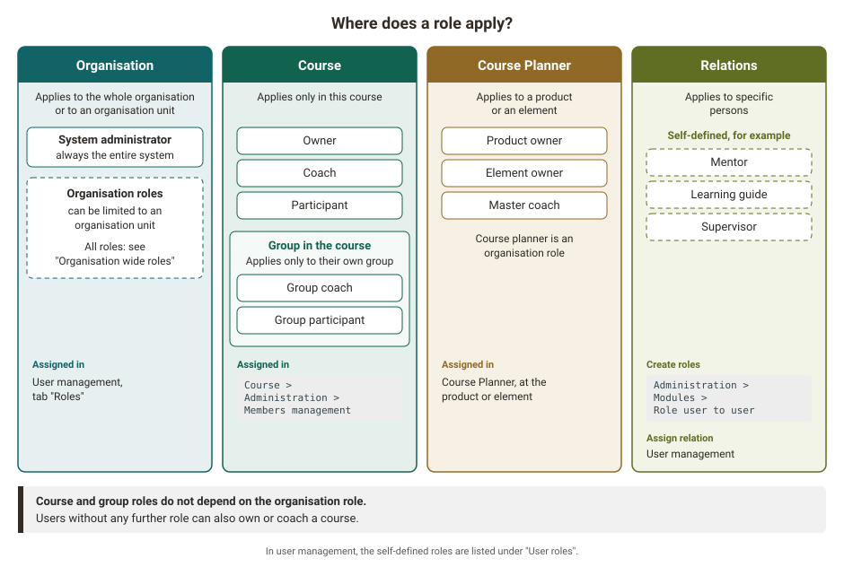
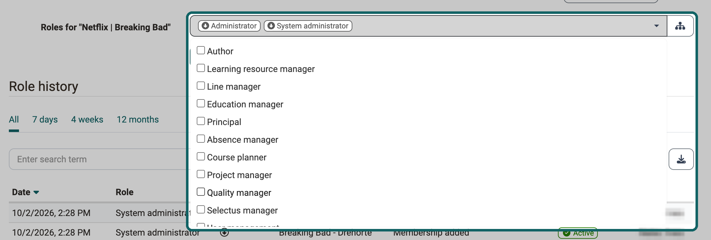
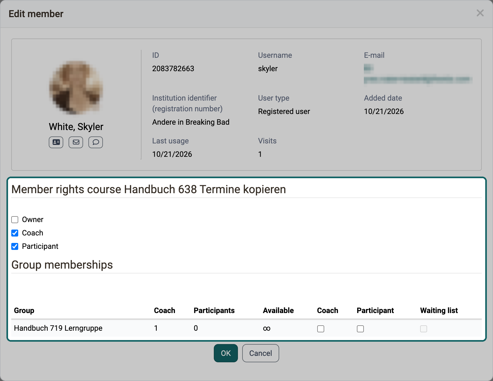
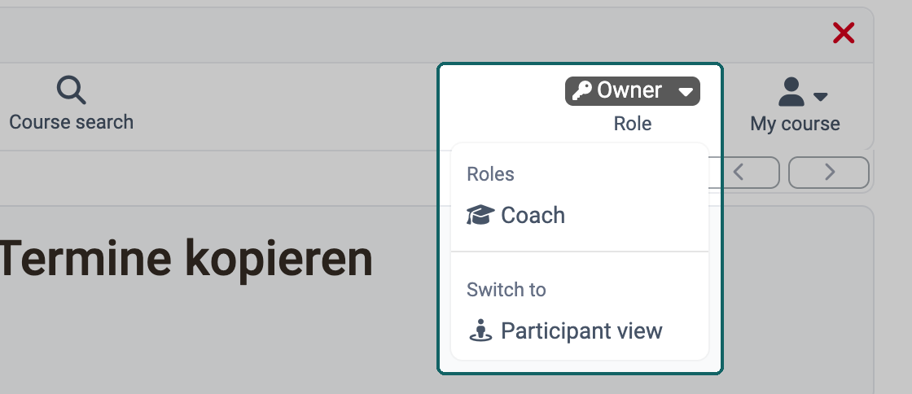
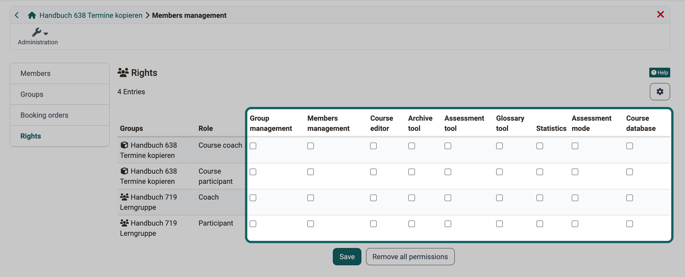

# Roles and Rights: Which roles are available? {: #roles} 

A person's roles determine which areas and functions they use in OpenOlat. Each role applies in a particular area:

{ class="shadow lightbox" title="Roles by area" }

The Course Planner also has the roles Product owner (assigned at the product), Element owner and Master coach (both assigned at the element). Their rights are described on the page [Course Planner: Overview](../area_modules/Course_Planner.md#roles_rights).

## Organisation roles {: #org} 

Organisation roles give a person rights that apply throughout their organisation, for example to create courses or to manage accounts. They are assigned in the user management: 
`User management > "Name of the person" > Roles` 
There you tick the roles in the field "Roles for "Name of the organisation"".

Which areas of the main navigation a role opens is shown on the page [Roles and their working areas](Roles_Home_Areas.md).

{ class="shadow lightbox" title="Roles tab in the user management · 2026.10.21" }

* **Author**: Authors create courses and other learning resources such as tests, videos and portfolio templates. For this they open Authoring in the main navigation. There they find all courses and learning resources they have access to. The role is often given to teachers or e-learning managers.
* **Learning resource manager**: Learning resource managers manage the courses and learning resources of their organisation, even without being entered there as owner. They automatically have owner rights (full access) for all courses and learning resources belonging to their own organisation (see [Administrative access](../learningresources/Access_configuration.md#administrative-release)). In the status "Finished" and "Deleted" the access is read-only. In Authoring they find these courses and learning resources and can copy and export them.
* **Line manager**: Line managers can, for example, be informed automatically when a person of their organisation receives a certificate.
* **Education manager**: Education managers have rights for their organisation and all organisations below it. They have rights in Coaching, even if they are not entered there as coach, and take on administrative tasks, for example checking booking orders or blocking accounts.
* **Principal**: Principals see many areas of the system, but read-only. They cannot change anything and cannot edit objects.
* **Absence manager**: Absence managers manage the absences of their organisation. For this, the menu item "Absence management" is available to them in the main navigation.
* **Course planner**: Course planners work in the [Course Planner](../area_modules/Course_Planner.md). If course planners are assigned to an organisation, they only have access to that organisation's Course Planner.
* **Project manager**: Project managers manage all projects. In the "Projects" menu item they also open the "Administration" tab and reach all projects there, including member management and configuration.
* **Quality manager**: Quality managers steer quality management. In the "Quality management" menu item they manage all settings and objects such as questionnaires, data collection generators and the analysis tool.
* **Selectus manager**: Selectus managers manage the appointment procedures of their organisation. In the "Selectus" menu item they create, edit, copy and archive positions and put together the committees. The role only takes effect if the "Selectus" module is switched on.
* **User manager**: User managers manage the accounts of their organisation in the [User management](../../manual_admin/usermanagement/index.md), which is available to them as a menu item in the main navigation. They create accounts, edit them and set them to inactive. They assign the roles User and Author.
* **Roles manager**: Roles managers manage the roles of the people in their organisation. They open the user management via a menu item of its own in the main navigation and see all accounts of their own organisations there. Except for the roles Principal, Administrator and System administrator, they assign, change and remove all roles.
* **Administrator**: Administrators manage modules and functions and have access to all areas of the system such as user management, catalog management and Course Planner, except the system administration. This role can be limited to an organisation. Administrators can delete users and also grant other people the right to manage the catalog.
* **Group manager**: Group managers manage all groups. In the "Groups" menu item they also open the tab [Group Management](../area_modules/Group_Management.md). The role is a system role and applies to the entire system.
* **Question bank manager**: Question bank managers manage the [Question Bank](../area_modules/Question_Bank.md). In the question bank they open the "Administration" section. The role is a system role and applies to the entire system.
* **System administrator**: System administrators configure and monitor the system technically. For this they have access to the system administration. The role is a system role and is not tied to any organisation.

!!! note "Note"

    Not every instance uses all roles. Usually a combination of User, Author and Administrator or System administrator is sufficient. Further roles are added if the organisation is structured accordingly or uses certain tools such as the [Course Planner](../area_modules/Course_Planner.md).

    If you have questions about the role assignment, please contact the support of your OpenOlat instance.

### Limit to one organisation [:octicons-tag-16:{ title="from Release 13.0 (OO-3302)" }](https://track.frentix.com/issue/OO-3302) {: #orgunit} 

If your instance is divided into several organisations, a person receives in each organisation the roles they need there. The prerequisite is that the "Organisations" module is switched on.

A person can be a member of several organisations and have different roles in each.

These roles can be limited to an organisation:

* Users
* Authors
* Absence managers
* Project managers
* Quality managers
* Selectus managers
* User managers
* Roles managers
* Course planners
* Learning resource managers
* Line managers
* Education managers
* Principals
* Administrators

System administrators, group managers and question bank managers are system roles. They apply to the entire system, even if they are assigned in a subordinate organisation.

How to assign roles per organisation is described on the page [Role assignment of organisation-specific roles](Assign_Roles.md#role_assignment_orgunit).

!!! info "Without the Organisations module"

    If the "Organisations" module is switched off, all people automatically belong to the only organisation of the instance, and all roles apply to this organisation.

[To the top of the page ^](#roles)

---

## Course roles {: #course} 

Whoever teaches, coaches or learns in a course receives one of three course roles there: Owner, Coach or Participant. You assign the course roles under: 
`Course > Administration > Members management`

{ class="shadow lightbox" title="Course members by role" }

You change the roles of a person who is already a member in the members management via "Edit membership" in the menu of their row.

{ class="shadow lightbox" title="Dialog Edit member in the members management · 2026.10.21" }

In addition to the course-related roles, [guests](guest_access.md) without an OpenOlat account can also get access to a course in conventional courses.

### Owner {: #owner}

Owners have all rights in the course. They edit the course, manage the members and can delete the course.

:octicons-device-camera-video-24: **Video Introduction (German)**: [Requirements for authors](<https://www.youtube.com/embed/L0jc_LBKXLE>){:target="_blank"}

### Coach {: #coach}

Coaches accompany and assess the participants; they do not design the course itself. They have access to the [Assessment tool](../learningresources/Assessment_tool_overview.md) of the course and to "Test statistics" and "Survey statistics". They do not edit the course in the course editor and cannot delete it. In the assessment tool they see the participants who are entered directly in the course. They only see participants of a group or an implementation if they are coach there as well.

If coaches need further rights, owners have two ways:

* **For the whole course** they make further tools available under: 
`Course > Administration > Members management > Rights`
* **For a single course element** they switch rights on in its configuration, usually in the "User rights" block: 
`Course > Administration > Course editor > "Course element"`

What this section says about coaches also applies to group coaches of a group assigned to the course and to coaches of an implementation in the Course Planner. Group coaches only see the participants of their group. Coaches see the course from the status "Access for coach" onwards (see [Rights of the course roles](Authorisation_Concept.md)).

!!! warning "Access assessment tool"

    If a person is not to open the assessment tool, give them the role Coach neither in the course nor in a group or implementation.

#### More rights in course elements {: #coach_rights}

In the following course elements, coaches may do more than participants. The column "Default" shows how the right is set:

* **on**: The right always applies.
* **on, can be switched off**: The right is switched on. Owners switch it off in the "User rights" block of the course element.
* **after release**: The right only applies once owners switch it on in the configuration of the course element.

The details are described on the page of the course element.

| Course element | What coaches may do in addition | Default |
|---|---|---|
| [Adobe Connect](../learningresources/Course_Element_Adobe_Connect.md) | Moderate meetings | on |
| [Appointment scheduling](../learningresources/Course_Element_Appointment_Scheduling.md) | Rights "Edit occasion" and "Edit appointments" for occasions where they are entered as organiser | on, can be switched off |
| [Assessment](../learningresources/Course_Element_Assessment.md) | Assess the coached participants | on |
| [BigBlueButton](../learningresources/bigbluebutton/index.md) | Manage and moderate meetings | on |
| [Blog](../learningresources/Course_Element_Blog.md) | Right "Moderator": edit and delete all entries | on, can be switched off |
| [Calendar](../learningresources/Course_Element_Calendar.md) | Right "Edit events" | on, can be switched off |
| [Check list](../learningresources/Course_Element_Checklist.md) | View and assess the check lists of the coached participants | on |
| [Document](../learningresources/Course_Element_Document.md) | Right "Edit": edit the document | after release |
| [File dialog](../learningresources/Course_Element_File_Dialog.md) | Right "Moderator": edit and delete posts of others | on, can be switched off |
| [Folder](../learningresources/Course_Element_Folder.md) | Right "Full access": upload, create folders, delete | on, can be switched off |
| [Form](../learningresources/Course_Element_Form.md) | Export data, reset and reopen single submissions | on |
| [Forum](../learningresources/Course_Element_Forum.md) | Right "Moderator": edit and delete posts of others, filter by person | on, can be switched off |
| [GoToMeeting](../learningresources/Course_Element_GoToMeeting.md) | Moderate meetings | on |
| [Grouptask](../learningresources/Course_Element_Grouptask.md) | As for "Task", but only as coach of a group assigned to the course element | on |
| [HTML page](../learningresources/Course_Element_HTML_Page.md) | Edit the page with "Allow coaches to edit the page" | after release |
| [Info messages](../learningresources/Course_Element_Notifications.md) | Rights "Create info messages" and "Manage info messages" | on, can be switched off |
| [LTI page](../learningresources/Course_Element_LTI_Page.md) | Start with the LTI role from the setting "Coach"; assess if the course element is assessable | on |
| [Microsoft Teams](../learningresources/Course_Element_Microsoft_Teams.md) | Manage and moderate meetings | on |
| [OpenMeetings](../learningresources/Course_Element_OpenMeetings.md) | Moderate meetings | on |
| [Page](../learningresources/Course_Element_Page.md) | Right "Edit page" | after release |
| [Participant Folder](../learningresources/Course_Element_Participant_Folder.md) | Drop boxes and return boxes of the coached participants | on |
| [Participant list](../learningresources/Course_Element_Participant_List.md) | Send e-mail to all, download and print the list | on |
| [Podcast](../learningresources/Course_Element_Podcast.md) | Right "Moderator": edit and delete all entries | on, can be switched off |
| [Portfolio task](../learningresources/Course_Element_Portfolio_Task.md) | Preview; assess if the course element is assessable | on |
| [Practice](../learningresources/Course_Element_Practice.md) | View the results of the coached participants | on |
| [SCORM 1.2](../learningresources/Course_Element_SCORM_Learning_Content.md) | Start the content as preview; assess if the course element is assessable | on |
| [Selection](../learningresources/Course_Element_Selection.md) | View the selection of the coached participants | on |
| [Structure](../learningresources/Course_Element_Structure.md) | If the course element shows a page: edit the page with "Allow coaches to edit the page" | after release |
| [Survey](../learningresources/Course_Element_Survey.md) | Right "Results visible for": view results | on, can be switched off |
| [Task](../learningresources/Course_Element_Task.md) | Correct and assess submissions, extend deadlines, download documents | on |
| [Test](../learningresources/Course_Element_Test.md) | Correct, pull the test, invalidate | on |
| [Topic broker](../learningresources/Course_Element_Topic_Broker.md) | View participants, topics and activity log; with the rights "Edit topic" and "Edit participants" also edit | on; editing after release |
| [Video live stream](../learningresources/Course_Element_Video_Livestream.md) | Tab "Statistic"; with "Coach is allowed to edit" also edit events | on; editing after release |
| [Video task](../learningresources/Course_Element_Video_Task.md) | Play and assess all attempts | on |

In all other course elements, coaches have the same rights as participants by default. One exception is the outdated course element "Assignment of dates", which can no longer be added: in existing courses, coaches manage the dates and the participants there. The course elements "Opencast", "JupyterHub" and "Zoom" pass the role on to the integrated system, which determines what it does there.

#### Course tools {: #course_tools}

**Available by default** 
In the "Administration" menu of the course:

* "Assessment tool": assess the coached participants. Coaches cannot reset or delete data there, and they see an exam with manual start there but do not start it (see below).
* "To-dos"
* "Test statistics" and "Survey statistics", if the course contains a test or a survey: results of the coached participants
* "Coach files", if the function is switched on in the course
* "Badges", if the course allows coaches to award badges manually
* "Data collection previews", if quality management offers the preview

In the toolbar of the course:

* "Events": view events. Coaches only record absences for events where they are entered as teacher.
* "Learning path" in learning path courses: learning paths of the participants
* "Documents": read and write, participants read only
* "Forum" and "Blog": moderate
* "Info messages": create info messages
* "E-Mail": choose any recipients, including participants
* "BigBlueButton" and "Teams": manage and moderate meetings

**Can be switched on** 
Under `Course > Administration > Members management > Rights`, owners give coaches further tools: Group management, Members management, Course editor, Archive tool, Assessment tool, Glossary tool, Statistics, Assessment mode and Course database. What each right enables is described in the section [Assignment of additional rights](../learningresources/Members_management.md#additional_rights).

**No access** 
Without additional rights, coaches do not open:

* "Settings" with "Info", "Share", "Catalog", "Layout", "Toolbar" and "Assessment"
* "Members management", "Course editor", "Files", "Learning areas", "Reminders", "Assessment management", "Archiving & Reporting", "Course statistics" and "Course DB"
* "Events and Absences" and "Offer types"
* the status of the course and the actions "Copy", "Duplicate as learning path" and "Delete"
* "Export content". Exception: if the person also has the role Author in the organisation of the course and the course allows downloading, they see this action.

Coaches without an additional right do not start or finish an exam with manual start. They only see the button "Start exam" in the assessment tool with the right "Assessment tool", and in the assessment management with the right "Assessment mode". Without a right, only coaches who are entered as teacher in the event of the exam see it. More on this in the section [Who can start and finish an exam manually](../learningresources/Assessment_mode.md#start_stop_rights).

### Participant {: #participant}

Participants open the course and work on the course elements and contents that are open to them depending on the configuration. They have no further rights in the course.

### Switch role {: #role_switch}

A person can have several course roles, for example Owner and Coach. In the "Role" menu in the toolbar of the course, they switch under "Roles" to another of their roles and see the course the way this role sees it. Owners and coaches who are not also participants choose "Participant view" under "Switch to".

{ class="shadow lightbox" title="Role menu in the toolbar of the course · 2026.10.21" }

[To the top of the page ^](#roles)

---

## Group roles {: #groups} 

If a course works with groups, you enter the members of a group as group coaches or group participants.

* **Group coach**: 
Group coaches have the rights of the role [Coach](#coach) in the course. In the assessment tool, in "Test statistics" and in "Survey statistics" they only see the participants of their own group.

* **Group participant**: 
Group participants have the same rights in the course as [participants](#participant).

!!! info "Course/group roles"

    Course and group rights do not depend on the organisation roles a person has received in the user management. People without a further role can also be course owner, course coach or group coach.

!!! note "Note"

    Group participants and group coaches are roles within a specific group. The role Group manager, on the other hand, is a system role: whoever has it manages the groups of the entire system.

[To the top of the page ^](#roles)

---

## Additional rights {: #rights}

If members need more rights than their role brings, you assign additional rights under: 
`Course > Administration > Members management > Rights` 
The rights can be assigned to course coaches and course participants, and per group also to group coaches and group participants.

The "Rights" section is visible to people with owner rights for the course, that is owners, learning resource managers and administrators, and also to principals and course planners. If the course belongs to an implementation in the Course Planner, product owners, element owners and master coaches see it as well. Coaches do not see it, not even with the right "Members management".

{ class="shadow lightbox" title="Rights section of the members management · 2026.10.21" }

#### Group management {: #group_management}

With this right, members manage the groups of the course under `Course > Administration > Members management > Groups`. They change and remove groups that already belong to the course, add further groups they have access to, or create new groups.

[More about groups >](../groups/index.md) 
[More about the group administration >](../groups/Group_Administration/index.md)

#### Members management {: #members_management}

With this right, the members management is available in the "Administration" menu of the course, with the same options as for course owners, except the sections "Rights" and "Course Planner". When adding new members, the members with this right see all registered users.

The right "Members management" includes group management, even if the right "Group management" is not set.

!!! warning "Access members management"

    People with the right "Members management" can give themselves additional rights, remove other members from the course and restrict their rights, including the rights of the person who created the course and of the other owners. More on the page [Members management](../learningresources/Members_management.md).

[More about members management >](../learningresources/Members_management.md)

#### Course editor {: #course_editor}

With this right, the course editor is available in the "Administration" menu of the course. Course members such as coaches use it to edit the course and to configure or add course elements. They cannot create new courses or learning resources with it. In the same menu they also open "Settings", "Files", "Learning areas", "Assessment management", "Reminders" and "Events and Absences", the last three only if the respective function is switched on.

A course that a person edits via this right without being its owner does not appear in their Authoring, even if they otherwise have author rights. Instead, they open the course in the main navigation under "Courses" and find the course editor in the "Administration" menu. In this case, too, coaches and participants only see the course once the owners have published it.

[More about the course editor >](../learningresources/General_Configuration_of_Course_Elements.md)

#### Archive tool {: #archive_tool}

With this right, "Archiving & Reporting" is available in the "Administration" menu of the course, with the same options as for course owners.

[More about Archiving & Reports >](../learningresources/Course_Archiving.md)

#### Assessment tool {: #assessment_tool}

The assessment tool is part of the basic equipment of all coaches. With this right, it is also available to other members in the "Administration" menu of the course. Whoever has the right sees all participants of the course there and can reset and delete data, also as coach. The person with this right also starts and finishes an exam with manual start in the assessment tool.

[More about the assessment tool >](../learningresources/Assessment_tool_overview.md)

#### Glossary tool {: #glossary_tool}

With this right, members add and edit glossary entries via the glossary icon in the toolbar of the course. The icon appears if the display is switched on under `Course > Administration > Settings > Tab "Toolbar"` and a glossary is selected or created under `Course > Administration > Settings > Tab "Options"`.

If no glossary has been created yet, the glossary icon is not visible, and the right alone gives no access. For the members to create the glossary themselves, they also need the right "Course editor". They then set it up under `Course > Administration > Settings > Tab "Toolbar"` and `Tab "Options"`.

[More about the glossary >](../learningresources/Glossary.md)

#### Statistics {: #statistics}

With this right, "Course statistics" is available in the "Administration" menu of the course, with the same options as for course owners.

[More about course statistics >](../learningresources/Statistics_Course.md)

#### Assessment mode {: #assessment_mode}

With this right, "Assessment management" is available in the "Administration" menu of the course, with the same options as for course owners. The members create, edit and delete assessment modes there and start and finish an exam with manual start.

[More about assessment management >](../learningresources/Assessment_Management.md)

#### Course database {: #course_database}

With this right, "Course DB" is available in the "Administration" menu of the course if course databases are switched on for the instance, with the same options as for course owners. The members create course databases, reset, delete and export them.

[To the top of the page ^](#roles)

---

## Self-defined roles and relations [:octicons-tag-16:{ title="from Release 13.2 (OO-3305)" }](https://track.frentix.com/issue/OO-3305) {: #relations} 

If one person supports another beyond individual courses, for example as mentor, learning guide or superior, you map this with a relation between the two accounts. Administrators create the roles for this themselves in the system administration: 
`Administration > Modules > Role user to user` 
Each of these roles has a contra-role that names the other side of the relation. Administrators equip the roles with rights of their own. How supporters accompany their people in Coaching is described on the page [Coaching - People](../area_modules/Coaching_People.md).

Once the roles are set up, you connect two accounts in the user management via one of these roles. How to do this is described on the page [Define relations](Assign_Roles.md#role_assignment_relations).

### User roles {: #account_roles} 

Which accounts are connected via a self-defined role is shown in the user management under: 
`User management > User roles` 
There, each role and its contra-role appear as separate entries. Clicking an entry lists the accounts that have this role in a relation. The menu item appears if "Role user to user" is switched on in the system administration and at least one such role exists. More on this in the section [User roles](../../manual_admin/usermanagement/Search_Users.md#user_roles) of the account search.

[To the top of the page ^](#roles)

---

## Further information {: #further_information} 

**Mentioned on this page** 
[Course Planner: Overview >](../area_modules/Course_Planner.md) 
[Roles and their working areas >](Roles_Home_Areas.md) 
[Access configuration >](../learningresources/Access_configuration.md) 
[User management >](../../manual_admin/usermanagement/index.md) 
[Group Management >](../area_modules/Group_Management.md) 
[Question Bank: Overview >](../area_modules/Question_Bank.md) 
[Roles and Rights: Assign roles >](Assign_Roles.md) 
[Roles and Rights: Guest access >](guest_access.md) 
[Assessment tool - overview >](../learningresources/Assessment_tool_overview.md) 
[Roles and Rights: Authorisation in courses >](Authorisation_Concept.md) 
[Course Element "Adobe Connect" >](../learningresources/Course_Element_Adobe_Connect.md) 
[Course Element "Task" >](../learningresources/Course_Element_Task.md) 
[Course Element "Selection" >](../learningresources/Course_Element_Selection.md) 
[Course Element "Assessment" >](../learningresources/Course_Element_Assessment.md) 
[Course Element "BigBlueButton" >](../learningresources/bigbluebutton/index.md) 
[Course Element "Blog" >](../learningresources/Course_Element_Blog.md) 
[Course Element "Checklist" >](../learningresources/Course_Element_Checklist.md) 
[Course Element "File Dialog" >](../learningresources/Course_Element_File_Dialog.md) 
[Course Element "Document" >](../learningresources/Course_Element_Document.md) 
[Course Element "Form" >](../learningresources/Course_Element_Form.md) 
[Course Element "Forum" >](../learningresources/Course_Element_Forum.md) 
[Course Element "GoToMeeting" >](../learningresources/Course_Element_GoToMeeting.md) 
[Course Element "Group Task" >](../learningresources/Course_Element_Grouptask.md) 
[Course Element "HTML page" >](../learningresources/Course_Element_HTML_Page.md) 
[Course Element "Calendar" >](../learningresources/Course_Element_Calendar.md) 
[Course Element "Participant list" >](../learningresources/Course_Element_Participant_List.md) 
[Course Element "LTI Page" >](../learningresources/Course_Element_LTI_Page.md) 
[Course Element "Microsoft Teams" >](../learningresources/Course_Element_Microsoft_Teams.md) 
[Course Element "Info messages" >](../learningresources/Course_Element_Notifications.md) 
[Course Element "OpenMeetings" >](../learningresources/Course_Element_OpenMeetings.md) 
[Course Element "Folder" >](../learningresources/Course_Element_Folder.md) 
[Course Element "Podcast" >](../learningresources/Course_Element_Podcast.md) 
[Course Element "Portfolio Task" >](../learningresources/Course_Element_Portfolio_Task.md) 
[Course Element "SCORM 1.2" >](../learningresources/Course_Element_SCORM_Learning_Content.md) 
[Course Element "Page" >](../learningresources/Course_Element_Page.md) 
[Course Element "Structure" >](../learningresources/Course_Element_Structure.md) 
[Course Element "Participant folder" >](../learningresources/Course_Element_Participant_Folder.md) 
[Course Element "Appointment scheduling" >](../learningresources/Course_Element_Appointment_Scheduling.md) 
[Course Element "Test" >](../learningresources/Course_Element_Test.md) 
[Course Element "Topic Broker" >](../learningresources/Course_Element_Topic_Broker.md) 
[Course Element "Practice" >](../learningresources/Course_Element_Practice.md) 
[Course Element "Survey" >](../learningresources/Course_Element_Survey.md) 
[Course Element "Video Livestream" >](../learningresources/Course_Element_Video_Livestream.md) 
[Course Element "Video task" >](../learningresources/Course_Element_Video_Task.md) 
[Members management >](../learningresources/Members_management.md) 
[Assessment management: Assessment mode >](../learningresources/Assessment_mode.md) 
[Groups >](../groups/index.md) 
[Group Administration >](../groups/Group_Administration/index.md) 
[Course elements in the Course editor >](../learningresources/General_Configuration_of_Course_Elements.md) 
[Course administration - Archiving & Reports >](../learningresources/Course_Archiving.md) 
[Glossary >](../learningresources/Glossary.md) 
[Course statistics >](../learningresources/Statistics_Course.md) 
[Assessment Management: Overview >](../learningresources/Assessment_Management.md) 
[Coaching - People >](../area_modules/Coaching_People.md) 
[Account search >](../../manual_admin/usermanagement/Search_Users.md)

**Further reading** 
[Roles and Rights: Overview >](Roles_Rights.md) 
[Roles and Rights: User Types >](User_Types.md)

**youtube** 
[Requirements for authors](<https://www.youtube.com/embed/L0jc_LBKXLE>)

[To the top of the page ^](#roles)
