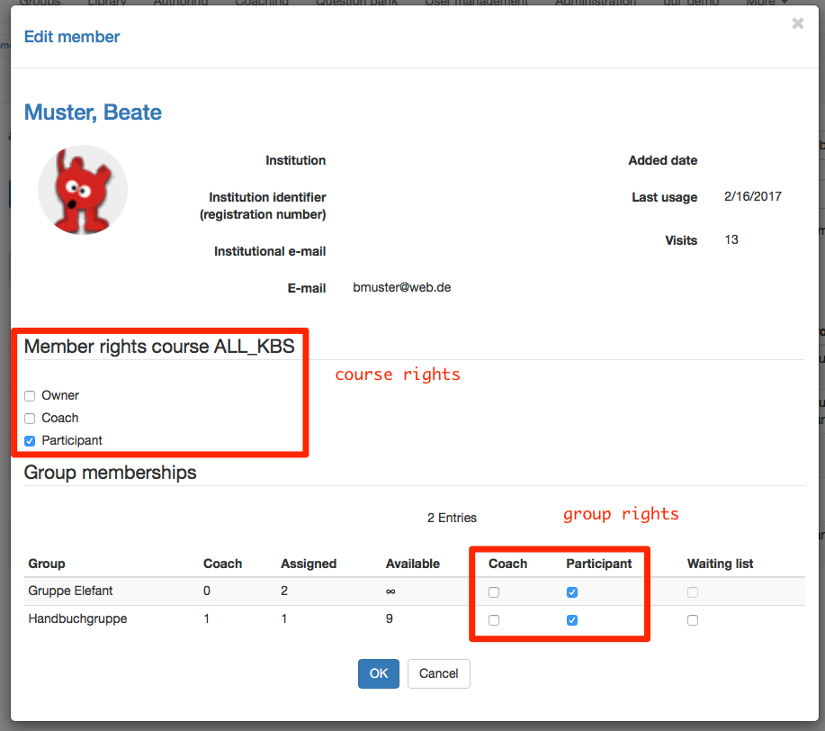
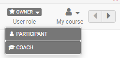
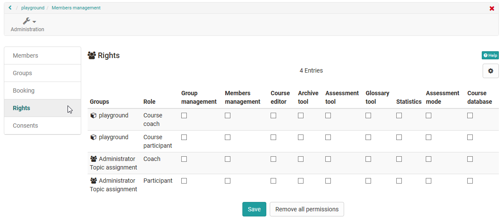

# Roles and Rights: Which roles are available? {: #roles} 

A person's roles determine which areas and functions they use in OpenOlat. Each role applies in a particular area:

{ class="shadow lightbox" title="Roles by area" }

The Course Planner also has the roles Product owner (assigned at the product), Element owner and Master coach (both assigned at the element). Their rights are described on the page [Course Planner: Overview](../area_modules/Course_Planner.md#roles_rights).

## Organisation wide roles {: #org} 

Organisation roles give a person rights that apply throughout their organisation, for example to create courses or to manage accounts. They are assigned in the user management: 
`User management > "Name of the person" > Roles`

{ class="shadow lightbox" title="Roles tab of the user management" }

* **Author**: Authors create courses and other learning resources such as tests, videos and portfolio templates. For this they open Authoring in the top navigation. There they find all courses and learning resources they have access to. The role is often given to teachers or e-learning managers.
* **Learning resource manager**: Learning resource managers manage the courses and learning resources of their organisation, even without being entered there as owner. They automatically have owner rights (full access) for all courses and learning resources belonging to their own organisation (see [Administrative access](../learningresources/Access_configuration.md#administrative-release)). In the status "Finished" and "Deleted" the access is read-only. In Authoring they find these courses and learning resources and can copy and export them.
* **Line manager**: Line managers can, for example, be informed automatically when a person of their organisation receives a certificate.
* **Education manager**: Education managers have rights for their organisation and all organisations below it. They have rights in Coaching, even if they are not entered there as coach, and take on administrative tasks, for example checking booking orders or blocking accounts.
* **Principal**: Principals see many areas of the system, but read-only. They cannot change anything and cannot edit objects.
* **Absence manager**: Absence managers manage the absences of their organisation. For this, the menu item "Absence management" is available to them in the top navigation.
* **Course planner**: Course planners work in the [Course Planner](../area_modules/Course_Planner.md). If course planners are assigned to an organisation, they only have access to that organisation's Course Planner.
* **Project manager**: Project managers manage all projects. In the "Projects" menu item they also open the "Administration" tab and reach all projects there, including member management and configuration.
* **Quality manager**: Quality managers steer quality management. In the "Quality management" menu item they manage all settings and objects such as questionnaires, data collection generators and the analysis tool.
* **Selectus manager**: Selectus managers manage the appointment procedures of their organisation. In the "Selectus" menu item they create, edit, copy and archive positions and put together the committees. The role only takes effect if the "Selectus" module is switched on.
* **User manager**: User managers manage the accounts of their organisation in the [User management](../../manual_admin/usermanagement/index.md), which is available to them as a menu item in the top navigation. They create accounts, edit them and set them to inactive. They assign the roles User and Author.
* **Roles manager**: Roles managers manage the roles of the people in their organisation. They open the user management via a menu item of its own in the top navigation and see all accounts of their own organisations there. Except for the roles Principal, Administrator and System administrator, they assign, change and remove all roles.
* **Administrator**: Administrators have module and function management and have access to all areas of the system, such as user management, catalog management and Course Planner, except the system administration. This role can be limited to an organisation. Administrators can delete users and also grant other people the right to manage the catalog.
* **Group manager**: Group managers manage all groups. In the "Groups" menu item they also open the tab [Group Management](../area_modules/Group_Management.md). The role is a system role and applies to the entire system.
* **Question bank manager**: Question bank managers manage the [Question Bank](../area_modules/Question_Bank.md). In the question bank they open the "Administration" section. The role is a system role and applies to the entire system.
* **System administrator**: System administrators configure and monitor the system technically. For this they have access to the system administration. The role is a system role and is not tied to any organisation.

!!! note "Note"

    Not every instance uses all roles. Usually a combination of User, Author and Administrator or System administrator is sufficient. Further roles are added if the organisation is structured accordingly or uses certain tools such as the [Course Planner](../area_modules/Course_Planner.md).

    If you have questions about the role assignment, please contact the support of your OpenOlat instance.

[To the top of the page ^](#roles)

---

## Roles in an organisation [:octicons-tag-16:{ title="from Release 13.0 (OO-3302)" }](https://track.frentix.com/issue/OO-3302) {: #orgunit} 

If your instance is divided into several organisations, a person receives in each organisation the roles they need there. The prerequisite is that the "Organisations" module is switched on.

A person can be a member of several organisations and have different roles in each.

These roles can be limited to an organisation:

* Users
* Authors
* Absence managers
* Project managers
* Quality managers
* Selectus managers
* User managers
* Roles managers
* Course planners
* Learning resource managers
* Line managers
* Education managers
* Principals
* Administrators

System administrators, group managers and question bank managers are system roles. They apply to the entire system, even if they are assigned in a subordinate organisation.

How to assign roles per organisation is described on the page [Role assignment of organisation-specific roles](Assign_Roles.md#role_assignment_orgunit).

!!! info "Without the Organisations module"

    If the "Organisations" module is switched off, all people automatically belong to the only organisation of the instance, and all roles apply to this organisation.

[To the top of the page ^](#roles)

---

## Roles in a course {: #course} 

{ class="shadow lightbox" title="Course members by role" }

Whoever teaches, coaches or learns in a course receives one of three course roles there. You assign the course roles under: 
`Course > Administration > Members management`

* **Owner**: Owners have all rights in the course. They edit the course, manage the members and can delete the course.

    :octicons-device-camera-video-24: **Video Introduction (German)**: [Requirements for authors](<https://www.youtube.com/embed/L0jc_LBKXLE>){:target="_blank"}

* **Coach**: Coaches accompany and assess the participants. They have access to the [Assessment tool](../learningresources/Assessment_tool_overview.md) of the course and to the test and survey statistics. They do not edit the course in the course editor and cannot delete it. In the assessment tool they see all participants of the course, but no group participants. More on the page [The role of a coach](coach.md).

* **Participant**: Participants open the course and work on the course elements and contents that are open to them depending on the configuration. They have no further rights in the course.

{ class="shadow lightbox" title="Dialog Edit member in the members management" }

In addition to the course-related roles, [guests](guest_access.md) without an OpenOlat account can also get access to a course in conventional courses.

!!! tip "Role change"

    A person can have several course roles, for example Owner and Participant. Via the "Role" menu in the toolbar of the course, they switch between these roles and see the course the way the respective role sees it.

    { class="shadow lightbox" title="Toolbar of the course" }

[To the top of the page ^](#roles)

---

## Roles in groups {: #groups} 

If a course works with groups, you enter the members of a group as group coaches or group participants.

* **Group coach**: 
Group coaches have almost the same rights as course coaches, but only for their group. In the course they open the assessment tool and the test and survey statistics. In the assessment tool they only see the participants of their own group.

* **Group participant**: 
Group participants have the same rights as course participants.

If members need more rights than their role brings, you assign additional rights under: 
`Course > Administration > Members management > Rights` 
The rights can be assigned to course coaches and course participants, and per group also to group coaches and group participants.

{ class="shadow lightbox" title="Rights tab of the members management" }

{ class=" aside-left-lg" }
**Group management** 
With this right, members manage the groups of the course under `Course > Administration > Members management > Groups`. They change and remove groups that already belong to the course, add further groups they have access to, or create new groups.

[More about groups >](../groups/index.md) 
[More about the group administration >](../groups/Group_Administration.md)

{ class=" aside-left-lg" }
**Members management** 
With this right, the members management is available in the "Administration" menu of the course, with the same options as for course owners. When adding new members, the members with this right see all registered users.

The right "Members management" includes group management, even if the right "Group management" is not set.

[More about members management >](../learningresources/Members_management.md)

{ class=" aside-left-lg" }
**Course editor** 
With this right, the course editor is available in the "Administration" menu of the course. Course members such as coaches use it to edit the course and to configure or add course elements. They cannot create new courses or learning resources with it. 
**Note:** 
A course that a person edits via this right without being its owner does not appear in their Authoring, even if they otherwise have author rights. Instead, they open the course in the top navigation under "Courses" and find the course editor in the "Administration" menu. In this case, too, coaches and participants only see the course once the owners have published it.

[More about the course editor >](../learningresources/General_Configuration_of_Course_Elements.md)

{ class=" aside-left-lg" }
**Archive tool** 
With this right, the archive tool is available in the "Administration" menu of the course, with the same options as for course owners.

[More about Archiving & Reports >](../learningresources/Course_Archiving.md)

{ class=" aside-left-lg" }
**Assessment tool** 
The assessment tool is part of the basic equipment of all coaches. With this right, it is also available to other members in the "Administration" menu of the course.

[More about the assessment tool >](../learningresources/Assessment_tool_overview.md)

{ class=" aside-left-lg" }
**Glossary tool** 
With this right, members add and edit glossary entries via the glossary icon in the toolbar of the course. The icon appears if the display is switched on under `Course > Administration > Settings > Tab "Toolbar"` and a glossary is selected or created under `Course > Administration > Settings > Tab "Options"`.

If no glossary has been created yet, the glossary icon is not visible, and the right alone gives no access. For the members to create the glossary themselves, they also need the right "Course editor". They then set it up under `Course > Administration > Settings > Tab "Toolbar"` and `Tab "Options"`.

[More about the glossary >](../learningresources/Glossary.md)

{ class=" aside-left-lg" }
**Statistics** 
With this right, the statistics are available in the "Administration" menu of the course, with the same options as for course owners.

[More about course statistics >](../learningresources/Statistics_Course.md)

{ class=" aside-left-lg" }
**Assessment mode** 
With this right, the assessment mode is available in the "Administration" menu of the course, with the same options as for course owners.

[More about assessment management >](../learningresources/Assessment_Management.md)

{ class=" aside-left-lg" }
**Course database** 
With this right, the course databases are available in the "Administration" menu of the course, with the same options as for course owners. The members create course databases, reset, delete and export them.

!!! info "Course/group roles"

    Course and group rights do not depend on the organisation roles a person has received in the user management. People without a further role can also be course owner, course coach or group coach.

!!! note "Note"

    Group participants and group coaches are roles within a specific group. The role Group manager, on the other hand, is a system role: it manages the groups of the entire system.

[To the top of the page ^](#roles)

---

## Self-defined roles and relations [:octicons-tag-16:{ title="from Release 13.2 (OO-3305)" }](https://track.frentix.com/issue/OO-3305) {: #relations} 

If one person supports another beyond individual courses, for example as mentor, learning guide or superior, you map this with a relation between the two accounts. Administrators create the roles for this themselves in the system administration: 
`Administration > Modules > Role user to user` 
Each of these roles has a contra-role that names the other side of the relation. Administrators equip the roles with rights of their own. How supporters accompany their people in Coaching is described on the page [Coaching - People](../area_modules/Coaching_People.md).

Once the roles are set up, you connect two accounts in the user management via one of these roles. How to do this is described on the page [Define relations](Assign_Roles.md#role_assignment_relations).

[To the top of the page ^](#roles)

---

## User roles {: #account_roles} 

In user management, the [self-defined roles](#relations) appear under "User roles". There, each role and its contra-role appear as separate entries. Clicking an entry lists the accounts that have this role in a relation. The menu item appears as soon as at least one such role exists. 
(See [User roles](../../manual_admin/usermanagement/Search_Users.md#user_roles))

[To the top of the page ^](#roles)

---

!!! warning "Access assessment tool"

    If a person is not to open the assessment tool, give them the role Coach neither in the course nor in a group.

!!! warning "Access members management"

    People with the right "Members management" can give themselves additional rights, remove other members from the course and restrict their rights, including the rights of the person who created the course and of the other owners. More on the page [Members management](../learningresources/Members_management.md).

[To the top of the page ^](#roles)

---

## Further information {: #further_information} 

**Mentioned on this page** 
[Course Planner: Overview >](../area_modules/Course_Planner.md) 
[Access configuration >](../learningresources/Access_configuration.md) 
[User management >](../../manual_admin/usermanagement/index.md) 
[Group Management >](../area_modules/Group_Management.md) 
[Question Bank: Overview >](../area_modules/Question_Bank.md) 
[Assign roles >](Assign_Roles.md) 
[Assessment tool - overview >](../learningresources/Assessment_tool_overview.md) 
[The role of a coach >](coach.md) 
[Guest access >](guest_access.md) 
[Groups >](../groups/index.md) 
[Group Administration >](../groups/Group_Administration.md) 
[Members management >](../learningresources/Members_management.md) 
[Elements >](../learningresources/General_Configuration_of_Course_Elements.md) 
[Course administration - Archiving & Reports >](../learningresources/Course_Archiving.md) 
[Glossary >](../learningresources/Glossary.md) 
[Course statistics >](../learningresources/Statistics_Course.md) 
[Assessment Management: Overview >](../learningresources/Assessment_Management.md) 
[Coaching - People >](../area_modules/Coaching_People.md) 
[Account search >](../../manual_admin/usermanagement/Search_Users.md)

**Further reading** 
[Authorisation in courses >](Authorisation_Concept.md) 
[User Types >](User_Types.md) 
[Roles and their working areas >](Roles_Home_Areas.md)

**youtube** 
[Requirements for authors](<https://www.youtube.com/embed/L0jc_LBKXLE>)

[To the top of the page ^](#roles)
