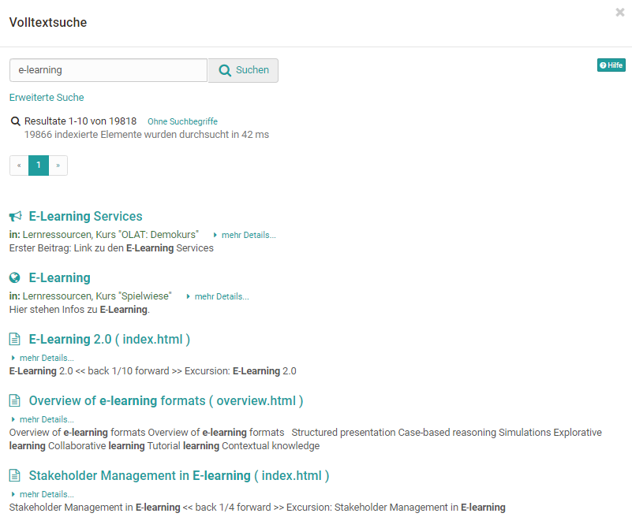
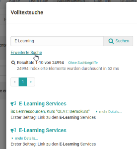
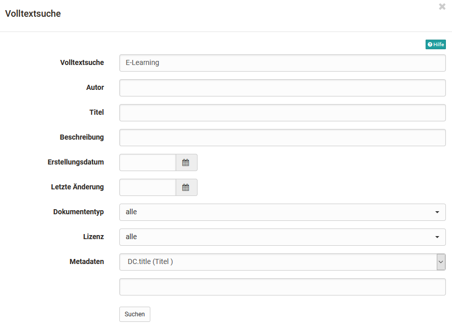
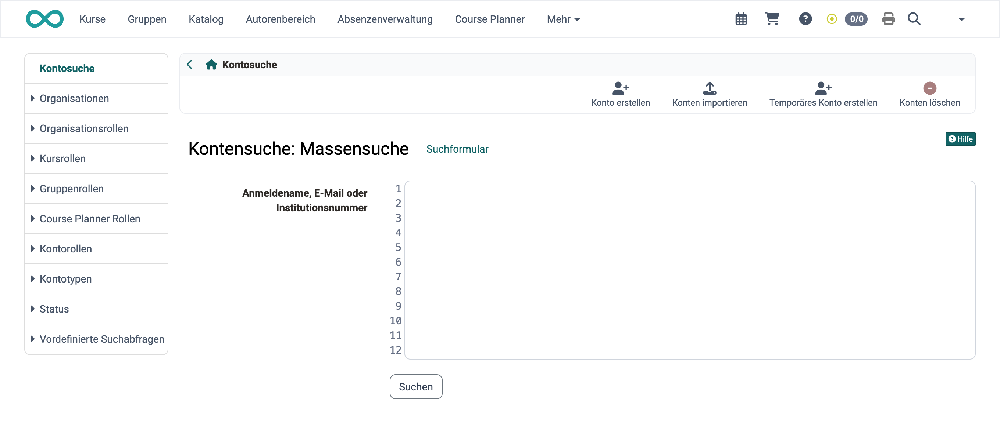
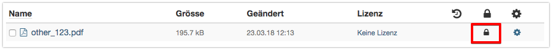

# :o_icon_o_icon_search: Allgemeines zur Suche {: #search_general}

Was eine Suche findet, hängt davon ab, wo Sie sie starten. Je nach Ausgangspunkt

* sucht OpenOlat nur in einem bestimmten Bereich
* sucht OpenOlat nur nach bestimmten Objekttypen
* arbeitet die Suche mit einem anderen Suchverfahren

:octicons-device-camera-video-24: **Video-Einführung**: [Suchfunktion](<https://www.youtube.com/embed/GlUCyVl11ic>){:target="_blank"}

[Globale Suche >](Search_Global.de.md)

[Lokale Suche >](Search_Local.de.md)

[Personensuche >](Search_Person.de.md)

[Suche in Kursen >](Search_in_Course.de.md)

[Suche im File Hub >](Search_in_FileHub.de.md)

---

## Volltextsuche [:octicons-tag-16:{ title="ab Release 20.1 (OO-8767)" }](https://track.frentix.com/issue/OO-8767) {: #full_text_search}

Die globale Suche arbeitet mit der Volltextsuche. Mit ihr suchen Sie in den Inhalten von Kursen, Gruppen und Lernressourcen nach Ihren Suchbegriffen, beispielsweise in Forumsbeiträgen, Wiki-Seiten und in Dateien aus Ordnern. Die Volltextsuche erfasst die Dateiformate PDF, HTML, TXT, Word, PowerPoint und Excel. Personendaten wie Profile oder Visitenkarten indexiert sie nicht.

{ class="shadow lightbox" title="Dialog Volltextsuche" }

!!! info "Wichtig"

    Sie finden über die Volltextsuche immer nur diejenigen Kursinhalte, auf die Sie eine Zugriffsberechtigung haben.

[zum Seitenanfang ^](#search_general)

---

## Erweiterte Suche {: #advanced_search}

Liefert die Volltextsuche zu viele Treffer, verfeinern Sie die Suche mit der erweiterten Suche. Sie öffnen sie im Dialog "Volltextsuche" mit dem Link "Erweiterte Suche" unter dem Suchfeld.

{ class="shadow lightbox" title="Dialog Volltextsuche" }

{ class="shadow lightbox" title="Erweiterte Suche im Dialog Volltextsuche" }

In der erweiterten Suche stehen die Felder Volltextsuche, Autor:in, Titel, Beschreibung, Erstellungsdatum, Letzte Änderung, Dokumententyp, Lizenz und Metadaten zur Verfügung. Die Suchfelder sind mit dem booleschen AND-Operator verknüpft. Füllen Sie zum Beispiel die Felder "Titel" und "Autor:in" aus, findet die Suche nur Dokumente, die beide Begriffe im jeweiligen Feld enthalten.

Ausnahme: Das Feld "Volltextsuche" sucht über alle Felder.

Aus der Ergebnisliste können Sie direkt auf den Lerninhalt mit dem gefundenen Suchbegriff springen.

[zum Seitenanfang ^](#search_general)

---

## Massensuche [:octicons-tag-16:{ title="ab Release 15.4 (OO-5233)" }](https://track.frentix.com/issue/OO-5233) {: #bulk_search}

Wenn Sie viele Personen auf einmal suchen, etwa mit einer Liste von E-Mail-Adressen aus einem Office-Dokument, schalten Sie auf die Massensuche um. Manche Suchformulare bieten dafür den Link "Massensuche". Statt des Suchformulars mit einzelnen Eingabefeldern erscheint dann ein einzelnes grosses Feld. Dort fügen Sie die Werte aus der Zwischenablage ein, einen pro Zeile, und klicken auf "Suchen". Mit dem Link "Suchformular" wechseln Sie zurück.

{ class="shadow lightbox" title="Kontosuche in der Benutzerverwaltung · 2026.10.22" }

{ class="shadow lightbox" title="Massensuche in der Benutzerverwaltung · 2026.10.22" }

[zum Seitenanfang ^](#search_general)

---

## Suche zurücksetzen [:octicons-tag-16:{ title="ab Release 21.1 (OO-9627)" }](https://track.frentix.com/issue/OO-9627) {: #search_reset}

Einen Suchbegriff entfernen Sie mit einem Klick, ohne das Feld von Hand zu leeren. Sobald im Suchfeld etwas steht, erscheint rechts im Feld eine runde Schaltfläche mit einem Kreuz und dem Tooltip "Suche zurücksetzen". Ein Klick darauf leert das Feld.

Was danach geschieht, hängt vom Ort des Suchfelds ab:

* **In Tabellen** zeigt die Tabelle sofort wieder die Einträge ohne Einschränkung durch den Suchbegriff.
* **Im grossen Suchfeld auf den Einstiegsseiten von Coaching und Course Planner** leert der Klick nur das Feld. Eine neue Suche startet erst, wenn Sie wieder auf "Suchen" klicken oder die Eingabetaste drücken.
* **Im grossen Suchfeld des Katalogs** leert der Klick ebenfalls nur das Feld, solange noch keine Suche gelaufen ist. Stehen darunter bereits Suchergebnisse, zeigt der Katalog sofort wieder die Angebote ohne Einschränkung durch den Suchbegriff.

[zum Seitenanfang ^](#search_general)

---

## Suchsyntax {: #syntax}

Mit der folgenden Syntax grenzen Sie Ihre Suchanfrage genauer ein.

**Einzelne Begriffe**, z.B. _OpenOlat_

**Mehrere Begriffe** im Suchfeld sind immer mit dem ODER-Operator verknüpft.

**Suche mittels Wildcards (Platzhalter):** Um nach bestimmten Wortfragmenten zu suchen, verwenden Sie Wildcards.

  * Das Fragezeichen in einem Suchbegriff steht für einen beliebigen, einzelnen Buchstaben. Mit der Sucheingabe _te?t_ finden Sie zum Beispiel alle Dokumente, die die Wörter "test", "text" usw. enthalten.
  * Der Stern in einem Suchbegriff steht für eine beliebige Anzahl von beliebigen Buchstaben. Mit der Sucheingabe _Test*_ finden Sie zum Beispiel alle Dokumente, die Wörter enthalten, die mit "Test" beginnen. Der Stern kann auch innerhalb eines Suchbegriffes stehen: _Te*t_

**Erweiterte Suche:** In der erweiterten Suche sind die verschiedenen Suchfelder mit dem AND-Operator verknüpft.

[zum Seitenanfang ^](#search_general)

---

## Metadaten {: #metadata}

Metadaten helfen, ein Dokument zu erkennen und in der Suche zu finden. Metadaten oder _Metainformationen_ sind Daten, die Informationen über Merkmale anderer Daten enthalten, aber nicht diese Daten selbst. Sie beschreiben eine Datei mit ergänzenden Informationen wie zum Beispiel einem Titel, dem Urheber oder dem Herausgeber. So ist besser erkennbar, um was für ein Dokument es sich handelt. Das ist besonders nützlich, wenn der Titel eines Dokuments nicht in den Dateinamen passt, weil er zu lang ist oder spezielle Zeichen enthält.

Sie können jede Datei und auch ganze Lernressourcen mit Metadaten versehen. Die Metadaten sind optional und müssen nicht ausgefüllt werden. Sie orientieren sich am [Dublin Core Simple Standard](https://de.wikipedia.org/wiki/Dublin_Core). Einige Metadaten lassen sich nicht ändern: der Name der Person, die das Dokument hochgeladen hat, die Grösse des Dokuments, der Zeitpunkt, zu dem das Dokument hochgeladen wurde, und der Dateityp. Informationen wie z.B. den ursprünglichen Verfasser, den Titel, eine Beschreibung, die Quelle oder die Sprache können Sie manuell eingeben.

Die Volltextsuche indexiert die Metadaten. Sie finden Dokumente deshalb auch über die Begriffe, die in ihren Metadaten stehen.

**Datei sperren:** Wählen Sie in den Metadaten einer Datei beim Feld "Gesperrt" die Option "Gesperrt", damit andere Benutzer:innen die Datei weder überschreiben noch löschen oder verschieben können. Gesperrte Dateien tragen in der Dateiliste ein Schloss. Für Ordner gibt es diese Option nicht.

{ class="shadow lightbox" title="Dateiliste eines Ordners" }

Das Feld "Externer Link zu dieser Ressource" in den Metadaten zeigt einen Link, mit dem Sie auch ausserhalb von OpenOlat direkt auf die Datei verlinken.

[zum Seitenanfang ^](#search_general)

---

## Weiterführende Informationen {: #further_information}

**Auf dieser Seite erwähnt** 
[Globale Suche >](Search_Global.de.md) 
[Lokale Suche >](Search_Local.de.md) 
[Personensuche >](Search_Person.de.md) 
[Suche in einem Kurs >](Search_in_Course.de.md) 
[Suche im File Hub >](Search_in_FileHub.de.md) 
[Dublin Core (Wikipedia) >](https://de.wikipedia.org/wiki/Dublin_Core)

**Weiterführend** 
[Kontosuche >](../../manual_admin/usermanagement/Search_Users.de.md) 
[Coaching - Personensuche >](../area_modules/Coaching_User_Search.de.md) 
[Katalog 2.0: Übersicht >](../area_modules/catalog2.0.de.md) 
[Course Planner: Übersicht >](../area_modules/Course_Planner.de.md)

**youtube** 
[Suchfunktion](<https://www.youtube.com/embed/GlUCyVl11ic>)

[Zum Seitenanfang ^](#search_general)
