# Nutzungsbedingungen {: #terms_of_use}

## Welche Nutzungsbedingungen müssen akzeptiert werden?

Wenn Sie OpenOlat oder bestimmte Elemente darin zum ersten Mal nutzen, kann eine Zustimmung zu den Nutzungsbedingungen erforderlich sein. Wird dies von der betreibenden Organisation oder von Besitzer:innen eines Kurses oder sonstigen Elements verlangt, können verschiedene Nutzungsbedingungen zur Bestätigung eingeblendet werden.

[Nutzungsbedingungen der OpenOlat-Plattform >](#terms_of_use_platform)

[Nutzungsbedingungen eines Kurses >](#terms_of_use_course)

[Nutzungsbedingungen eines Formulars >](#terms_of_use_form)

[Nutzungsbedingungen externer Werkzeuge >](#terms_of_use_external_tools)

!!! note "Hinweis"

    Neben den Nutzungsbedingungen können auch Bestimmungen zum Datenschutz angezeigt werden und Zustimmung erfordern.

## Nutzungsbedingungen der OpenOlat-Plattform {: #terms_of_use_platform}

### Bestätigung durch OpenOlat-Benutzer:innen beim ersten Aufruf

Beim ersten Aufruf von OpenOlat werden alle Benutzer:innen um Bestätigung der Nutzungsbedingungen gebeten. Lehnen Sie ab, kehren Sie zurück zur Login-Seite.

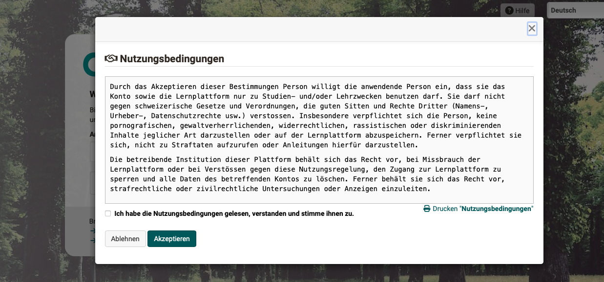{ class="shadow lightbox" title="Login-Seite beim ersten Login" }

### Nutzungsbedingungen der Plattform definieren {: #terms_of_use_platform_define}

**Systemadministrator:innen** definieren den Text der Nutzungsbedingungen in der System-Administration unter `Administration > Customizing > Impressum`. Die Nutzungsbedingungen lassen sich nur hinterlegen, wenn das Impressum eingeschaltet ist. Für jede aktivierte Sprache kann ein eigener Text erstellt werden.

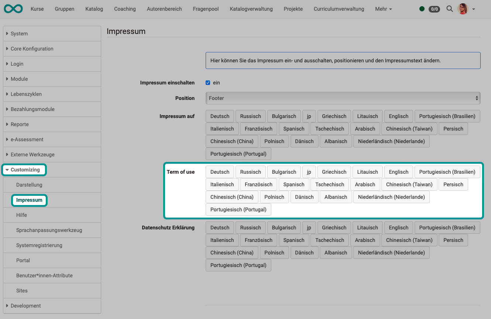{ class="shadow lightbox" title="Seite Impressum im Menü Customizing" }

### Akzeptierte Nutzungsbedingungen nachlesen {: #terms_of_use_platform_verify}

Alle Benutzer:innen können die Nutzungsbedingungen, denen sie einmal zugestimmt haben, in ihrem persönlichen Menü jederzeit nachlesen: `Persönliches Menü > Einstellungen > Tab "Nutzungsbedingungen"`

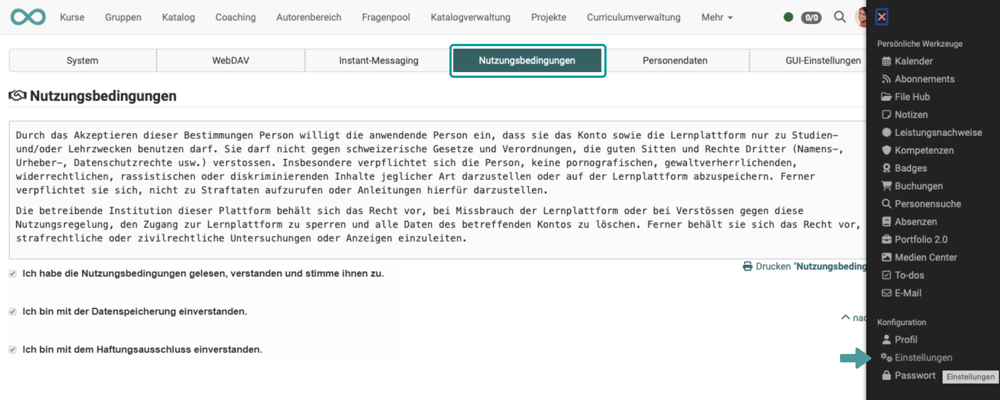{ class="shadow lightbox" title="Tab Nutzungsbedingungen der Einstellungen" }

[Zum Seitenanfang ^](#terms_of_use)

## Nutzungsbedingungen in den Kurseinstellungen [:octicons-tag-16:{ title="ab Release 15.0 (OO-4455)" }](https://track.frentix.com/issue/OO-4455) {: #terms_of_use_course}

### Bestätigung durch Lernende im Kurs

Kursbesitzer:innen können für ihren Kurs eigene Nutzungsbedingungen festlegen. Die Teilnehmer:innen akzeptieren sie beim ersten Aufruf des Kurses. Wer ablehnt, kann den Kurs nicht öffnen.

### Nutzungsbedingungen eines Kurses definieren {: #terms_of_use_course_define}

Kursbesitzer:innen erstellen für ihren Kurs kursspezifische Nutzungsbedingungen unter: `Kurs > Administration > Einstellungen > Tab "Nutzungsbedingungen"`

Der Texteditor wird angezeigt, sobald die Checkbox "Nutzungsbedingungen" angehakt ist. Auf demselben Tab kann zusätzlich eine kursbezogene Datenschutzerklärung eingeschaltet werden; sie ist gleich aufgebaut.

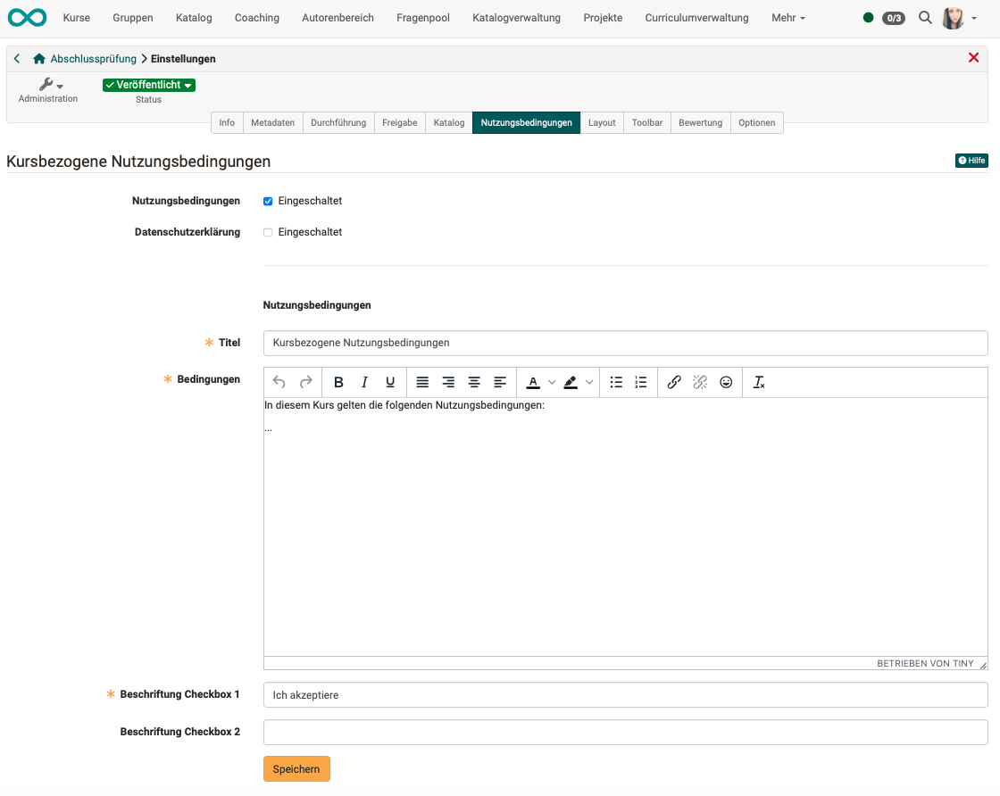{ class="shadow lightbox" title="Tab Nutzungsbedingungen der Kurseinstellungen" }

Im Feld "Beschriftung Checkbox 1" am unteren Rand der Seite definieren Sie, welcher Text den Teilnehmer:innen neben ihrer Checkbox zum Akzeptieren der Nutzungsbedingungen angezeigt wird.

Zusätzlich kann im Feld "Beschriftung Checkbox 2" eine zweite Checkbox mit einem beliebigen Beschreibungstext zur Bestätigung definiert werden. Wird ein Text eingegeben, müssen beide Checkboxen von den Teilnehmer:innen bestätigt werden, damit die Nutzungsbedingungen als akzeptiert gelten. Ist kein Beschreibungstext eingegeben, wird die zweite Checkbox den Teilnehmer:innen nicht angezeigt.

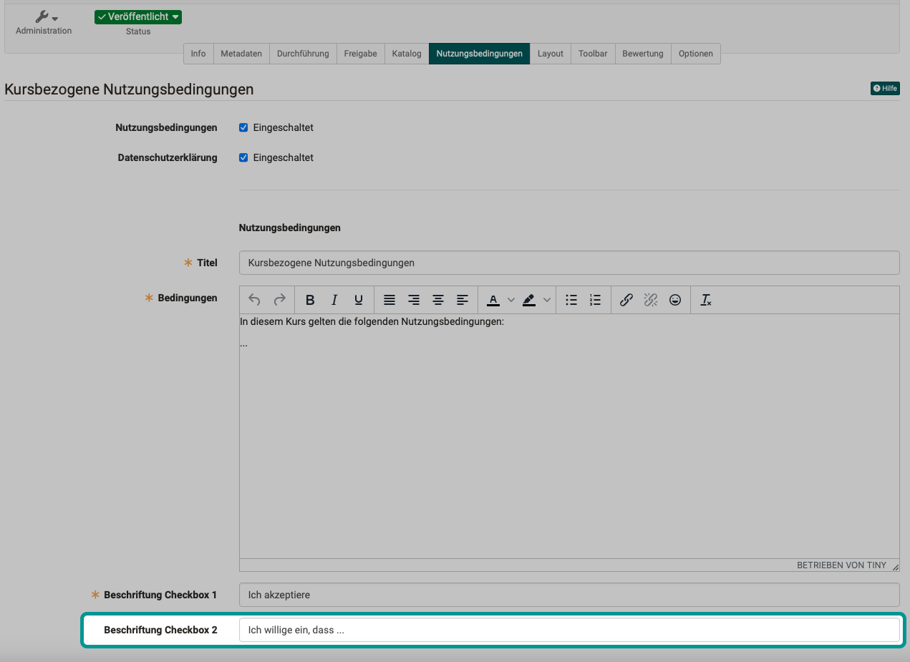{ class="shadow lightbox" title="Tab Nutzungsbedingungen der Kurseinstellungen" }

### Bestätigungsaufforderung für einen Kurs aktivieren

Damit die Nutzungsbedingungen angezeigt werden, müssen die Kursbesitzer:innen sie einschalten. Wurde ein Text für die Nutzungsbedingungen erfasst, bleibt er nach dem Speichern erhalten, unabhängig davon, ob die Anzeige aktiviert ist. So können Sie die Nutzungsbedingungen ausgeschaltet vorbereiten und erst einschalten, wenn die endgültige Fassung steht.

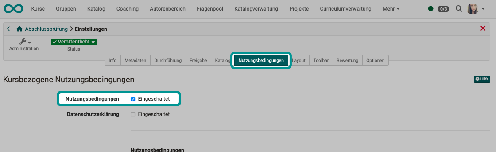{ class="shadow lightbox" title="Tab Nutzungsbedingungen der Kurseinstellungen" }

### Verwaltung der Nutzungsbedingungen in der Mitgliederverwaltung

Welche Teilnehmer:innen ihre Zustimmung zu den kursspezifischen Nutzungsbedingungen gegeben haben, sehen Kursbesitzer:innen in der [Mitgliederverwaltung](../learningresources/Members_management.de.md) unter: `Kurs > Administration > Mitgliederverwaltung > Einwilligungen`

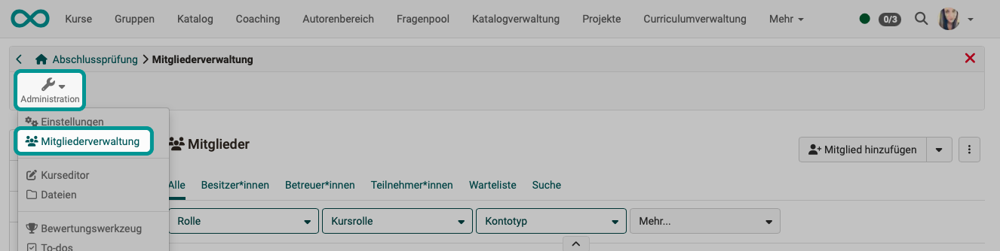{ class="shadow lightbox" title="Menü Administration des Kurses" }

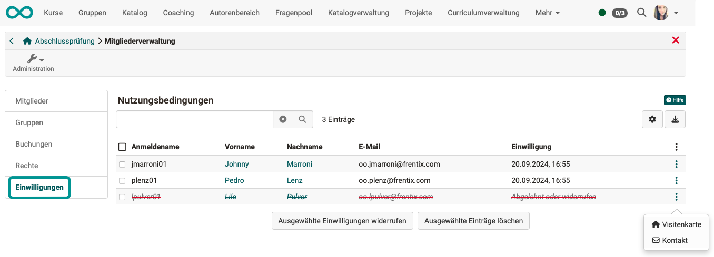{ class="shadow lightbox" title="Bereich Einwilligungen der Mitgliederverwaltung" }

* Lehnt eine Teilnehmer:in ab, können Sie direkt mit der Person Kontakt aufnehmen.
* Kursbesitzer:innen können ausgewählte Einwilligungen widerrufen oder die Einträge löschen.

### Übernahme von Nutzungsbedingungen beim Kopieren von Kursen

[Lernpfadkurse](../learningresources/Creating_learning_path_courses.de.md) können mit Hilfe eines Wizards kopiert werden: `Kurs > Administration > Kopieren mit Wizard`. Im Wizard legen Sie vor dem Kopieren fest, welche [Kurseinstellungen](../learningresources/Course_Settings/index.de.md) die Kopie übernimmt, darunter die Nutzungsbedingungen.

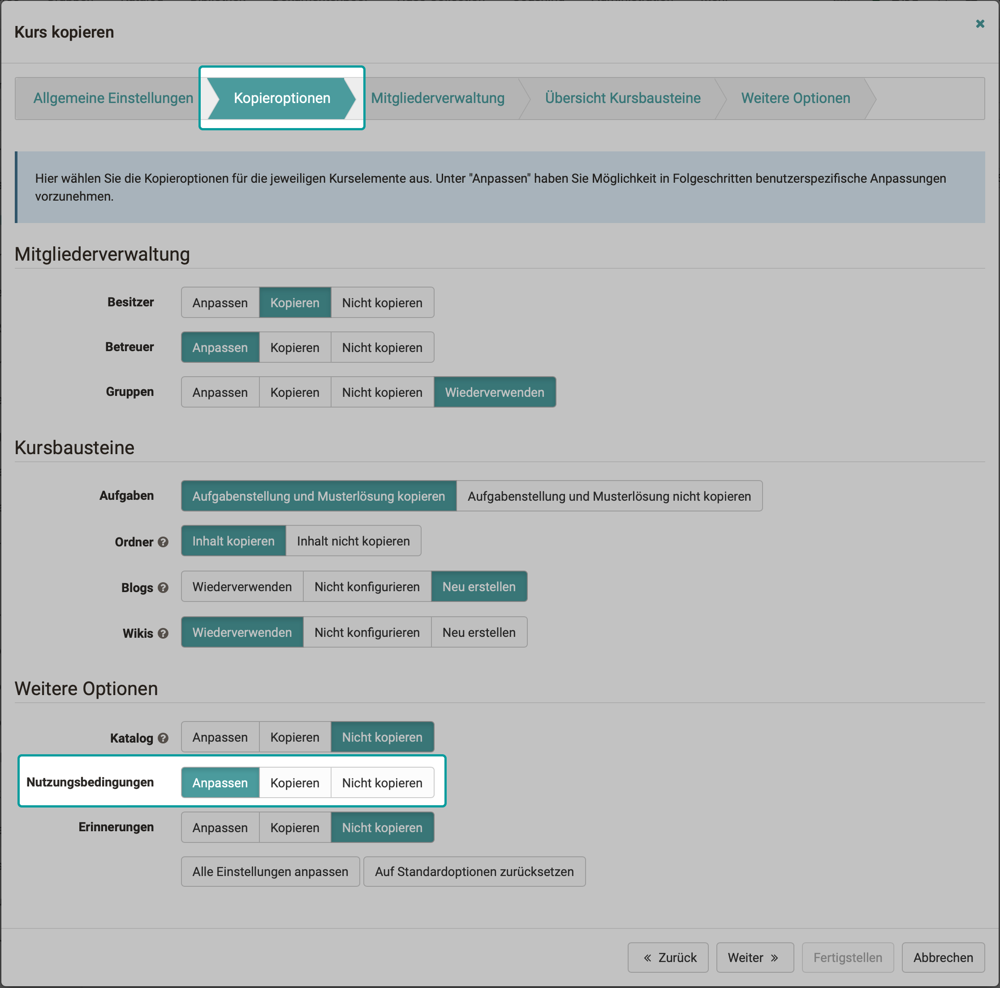{ class="shadow lightbox" title="Wizard Kurs kopieren, Schritt Kopieroptionen" }

[Zum Seitenanfang ^](#terms_of_use)

## Nutzungsbedingungen in Formularen [:octicons-tag-16:{ title="ab Release 13.0 (OO-3674)" }](https://track.frentix.com/issue/OO-3674) {: #terms_of_use_form}

### Bestätigung durch Lernende

Auch ein Formular kann eine Einverständniserklärung enthalten. Die Teilnehmer:innen haken sie an, bevor sie das Formular abschliessen.

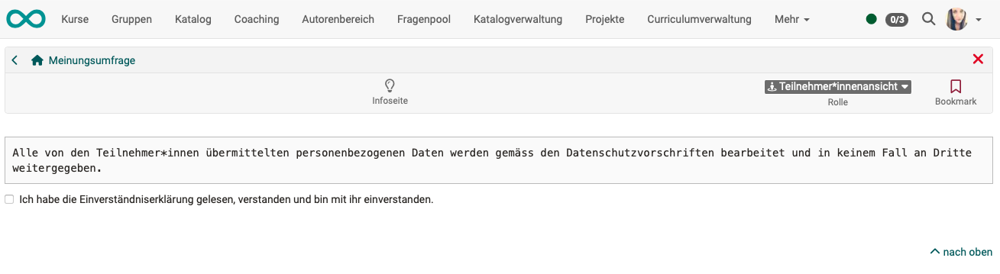{ class="shadow lightbox" title="Teilnehmer:innenansicht eines Formulars" }

### Nutzungsbedingungen eines Formulars definieren

Die Einverständniserklärung fügen Autor:innen der Lernressource Formular im [Formulareditor](../learningresources/Form_Editor/index.de.md) als Element "Nutzungsbedingungen" ein, über "Inhalt hinzufügen". Im Element legen Sie den Text der Einverständniserklärung und die Beschriftung der Checkbox fest.

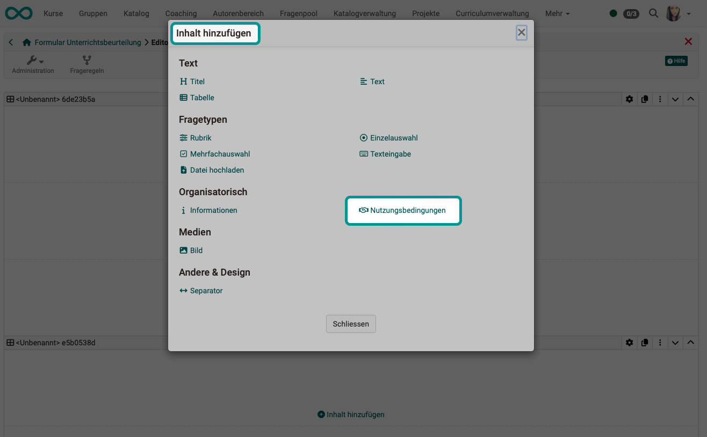{ class="shadow lightbox" title="Dialog Inhalt hinzufügen im Formulareditor" }

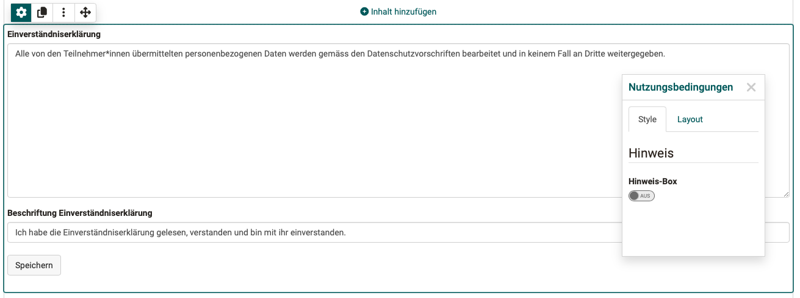{ class="shadow lightbox" title="Element Nutzungsbedingungen im Formulareditor" }

[Zum Seitenanfang ^](#terms_of_use)

## Nutzungsbedingungen externer Werkzeuge {: #terms_of_use_external_tools}

In OpenOlat sind an einigen Stellen externe Werkzeuge eingebunden (meistens ebenfalls Open Source, aber nicht von frentix entwickelt), für die ebenfalls vor Benutzung die Bedingungen akzeptiert werden müssen.

Beispiel **draw.io** 
draw.io ist ein Online-Werkzeug zur Erstellung von Diagrammen, das in OpenOlat an vielen Stellen eingesetzt werden kann, z.B. in Projekten, im Portfolio, im Kursbaustein "Dokument", im Media Center und überall, wo neue Dokumente erstellt werden können. In draw.io können auch mehrere Personen kooperativ an einem Diagramm arbeiten.

[Zum Seitenanfang ^](#terms_of_use)

## Weiterführende Informationen {: #further_information}

[Mitgliederverwaltung >](../learningresources/Members_management.de.md) 
[Lernpfadkurse erstellen >](../learningresources/Creating_learning_path_courses.de.md) 
[Kurseinstellungen >](../learningresources/Course_Settings/index.de.md) 
[Der Formulareditor >](../learningresources/Form_Editor/index.de.md) 
[Datenschutz >](../../manual_admin/usermanagement/Data_protection.de.md) 
[Persönliche Konfiguration: Einstellungen >](../personal_menu/Settings.de.md)

[Zum Seitenanfang ^](#terms_of_use)
