# Nutzungsbedingungen {: #terms_of_use}

## Welche Nutzungsbedingungen müssen akzeptiert werden?

Wenn Sie OpenOlat oder bestimmte Elemente darin zum ersten Mal nutzen, kann eine Zustimmung zu den Nutzungsbedingungen erforderlich sein. Wird dies von der betreibenden Organisation oder von Besitzer:innen eines Kurses oder sonstigen Elements verlangt, können verschiedene Nutzungsbedingungen zur Bestätigung eingeblendet werden.

[Nutzungsbedingungen der OpenOlat-Plattform >](#terms_of_use_platform)

[Nutzungsbedingungen eines Kurses >](#terms_of_use_course)

[Nutzungsbedingungen eines Formulars >](#terms_of_use_form)

[Nutzungsbedingungen externer Werkzeuge >](#terms_of_use_external_tools)

!!! note "Hinweis"

    Neben den Nutzungsbedingungen können auch Bestimmungen zum Datenschutz angezeigt werden und Zustimmung erfordern.

## Nutzungsbedingungen der OpenOlat-Plattform {: #terms_of_use_platform}

### Bestätigung durch OpenOlat-Benutzer:innen beim ersten Login

Beim ersten Login fragt OpenOlat alle Benutzer:innen im Dialog "Nutzungsbedingungen" nach ihrer Zustimmung. Erst mit "Akzeptieren" gelangen Sie in OpenOlat. Lehnen Sie ab, bleiben Sie auf der Login-Seite.

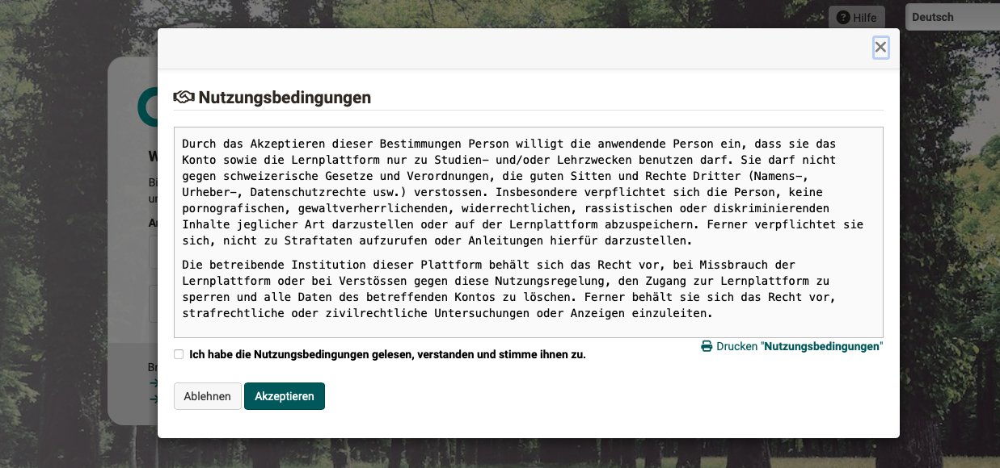{ class="shadow lightbox" title="Login-Seite beim ersten Login" }

### Nutzungsbedingungen der Plattform definieren {: #terms_of_use_platform_define}

!!! info "Kontakt"

    Für eine Änderung wenden Sie sich an Ihre Organisation.

Ob OpenOlat beim ersten Login nach der Zustimmung fragt, ist Teil der Serverkonfiguration und gilt nach einer Änderung erst ab dem nächsten Neustart. In der Grundeinstellung ist der Dialog eingeschaltet.

Den Text des Dialogs passen Systemadministrator:innen in der System-Administration mit dem [Sprachanpassungswerkzeug](../../manual_how-to/language_adaption_tool/language_adaption_tool.de.md) an: `Administration > Customizing > Sprachanpassungswerkzeug` 
Der Text gehört zu den Texten der Oberfläche. Deshalb lässt er sich für jede aktivierte Sprache eigens anpassen.

Davon getrennt hinterlegen Systemadministrator:innen im Impressum einen Text "Nutzungsbedingungen": `Administration > Customizing > Impressum` 
Dieser Text erscheint im Impressum unter "Nutzungsbedingungen", nicht im Dialog beim ersten Login. Hinterlegen lässt er sich nur, wenn das Impressum eingeschaltet ist, für jede aktivierte Sprache ein eigener Text.

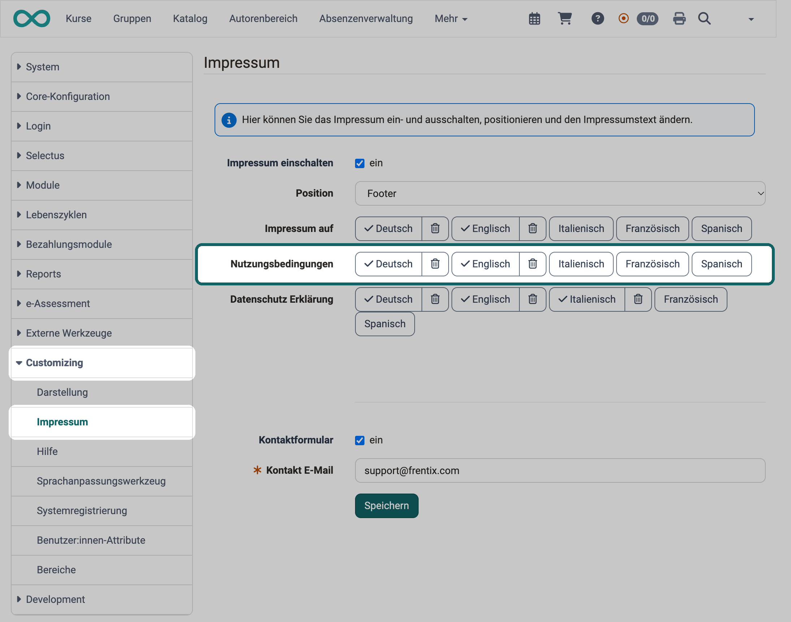{ class="shadow lightbox" title="Seite Impressum im Menü Customizing · 2026.11.27" }

### Akzeptierte Nutzungsbedingungen nachlesen {: #terms_of_use_platform_verify}

Die Nutzungsbedingungen, denen Sie beim ersten Login zugestimmt haben, lesen Sie jederzeit in Ihrem persönlichen Menü nach: `Persönliches Menü > Einstellungen > Tab "Nutzungsbedingungen"`

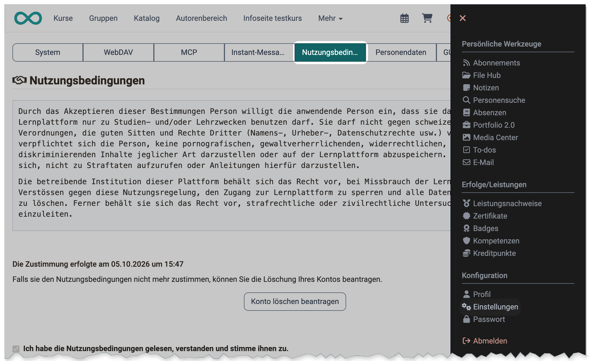{ class="shadow lightbox" title="Tab Nutzungsbedingungen der Einstellungen · 2026.11.27" }

[Zum Seitenanfang ^](#terms_of_use)

## Nutzungsbedingungen in den Kurseinstellungen [:octicons-tag-16:{ title="ab Release 15.0 (OO-4455)" }](https://track.frentix.com/issue/OO-4455) {: #terms_of_use_course}

### Bestätigung durch Teilnehmer:innen im Kurs

Kursbesitzer:innen können für ihren Kurs eigene Nutzungsbedingungen festlegen. Die Teilnehmer:innen akzeptieren sie beim ersten Aufruf des Kurses. Wer ablehnt, kann den Kurs nicht öffnen.

### Nutzungsbedingungen eines Kurses definieren {: #terms_of_use_course_define}

Kursbesitzer:innen erstellen für ihren Kurs kursspezifische Nutzungsbedingungen unter: `Kurs > Administration > Einstellungen > Tab "Nutzungsbedingungen"`

Den Tab gibt es, wenn die System-Administration im [Modul Kurs](../../manual_admin/administration/Modules_Course.de.md#enable_course_option) die Option "Kursbezogene Nutzungsbedingungen und Datenschutzerklärung" eingeschaltet hat. Alle Felder des Tabs beschreibt die Seite [Kurseinstellungen - Tab Nutzungsbedingungen](../learningresources/Course_Settings_Disclaimer.de.md).

Die Felder für den Text erscheinen, sobald Sie bei "Nutzungsbedingungen" die Checkbox "Eingeschaltet" anhaken. Auf demselben Tab können Sie zusätzlich eine kursbezogene Datenschutzerklärung einschalten; sie ist gleich aufgebaut.

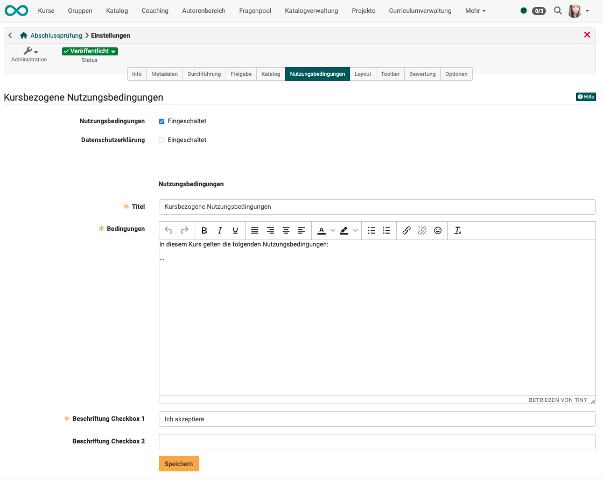{ class="shadow lightbox" title="Tab Nutzungsbedingungen der Kurseinstellungen" }

Im Feld "Beschriftung Checkbox 1" am unteren Rand der Seite definieren Sie, welcher Text den Teilnehmer:innen neben ihrer Checkbox zum Akzeptieren der Nutzungsbedingungen angezeigt wird.

Zusätzlich kann im Feld "Beschriftung Checkbox 2" eine zweite Checkbox mit einem beliebigen Beschreibungstext zur Bestätigung definiert werden. Wird ein Text eingegeben, müssen beide Checkboxen von den Teilnehmer:innen bestätigt werden, damit die Nutzungsbedingungen als akzeptiert gelten. Ist kein Beschreibungstext eingegeben, wird die zweite Checkbox den Teilnehmer:innen nicht angezeigt.

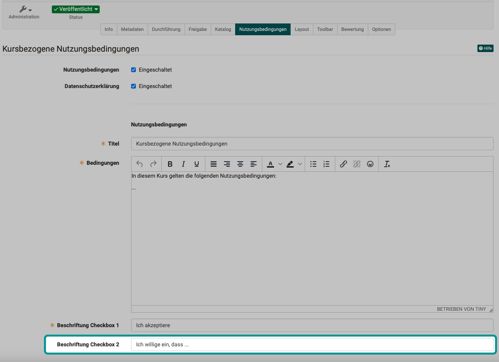{ class="shadow lightbox" title="Tab Nutzungsbedingungen der Kurseinstellungen" }

### Bestätigungsaufforderung für einen Kurs aktivieren

Die Teilnehmer:innen sehen die Nutzungsbedingungen, sobald Sie bei "Nutzungsbedingungen" die Checkbox "Eingeschaltet" anhaken und speichern. Den Text speichert OpenOlat nur, solange die Checkbox angehakt ist. Schalten Sie die Nutzungsbedingungen später aus, bleibt der zuletzt gespeicherte Text erhalten und erscheint wieder, wenn Sie sie erneut einschalten.

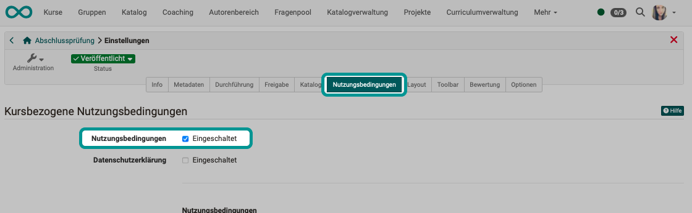{ class="shadow lightbox" title="Tab Nutzungsbedingungen der Kurseinstellungen" }

### Verwaltung der Nutzungsbedingungen in der Mitgliederverwaltung

Welche Teilnehmer:innen ihre Zustimmung zu den kursspezifischen Nutzungsbedingungen gegeben haben, sehen Kursbesitzer:innen in der [Mitgliederverwaltung](../learningresources/Members_management.de.md) unter: `Kurs > Administration > Mitgliederverwaltung > Einwilligungen`

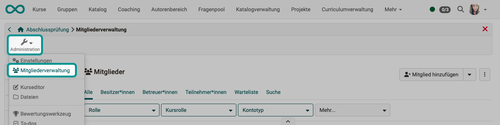{ class="shadow lightbox" title="Menü Administration des Kurses" }

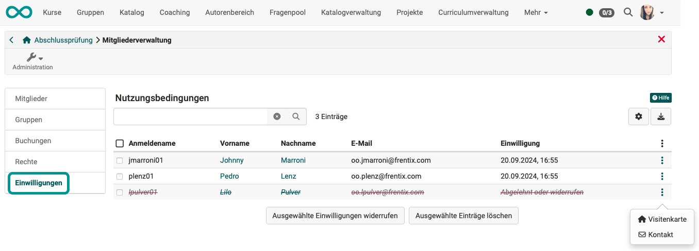{ class="shadow lightbox" title="Bereich Einwilligungen der Mitgliederverwaltung" }

* Lehnt jemand ab, steht in der Spalte "Einwilligung" der Vermerk "Abgelehnt oder widerrufen". Sie können dann direkt mit der Person Kontakt aufnehmen.
* Kursbesitzer:innen können ausgewählte Einwilligungen widerrufen oder die Einträge löschen.

### Übernahme von Nutzungsbedingungen beim Kopieren von Kursen

[Lernpfadkurse](../learningresources/Creating_learning_path_courses.de.md) können mit Hilfe eines Wizards kopiert werden: `Kurs > Administration > Kopieren mit Wizard`. Im Wizard legen Sie vor dem Kopieren fest, welche [Kurseinstellungen](../learningresources/Course_Settings/index.de.md) die Kopie übernimmt, darunter die Nutzungsbedingungen.

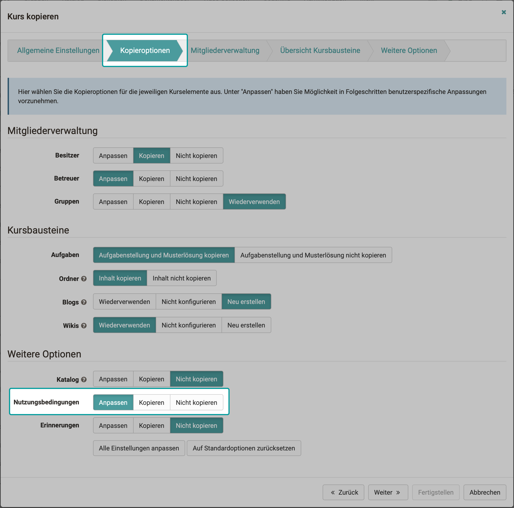{ class="shadow lightbox" title="Wizard Kurs kopieren, Schritt Kopieroptionen" }

[Zum Seitenanfang ^](#terms_of_use)

## Nutzungsbedingungen in Formularen [:octicons-tag-16:{ title="ab Release 13.0 (OO-3674)" }](https://track.frentix.com/issue/OO-3674) {: #terms_of_use_form}

### Bestätigung beim Ausfüllen

Auch ein Formular kann Nutzungsbedingungen enthalten: Das Element "Nutzungsbedingungen" zeigt eine Einverständniserklärung mit einer Checkbox. Die Person, die das Formular ausfüllt, hakt sie an. Ohne Häkchen lässt sich das Formular nicht abschliessen, OpenOlat meldet dann "Bitte geben Sie zuerst Ihr Einverständnis."

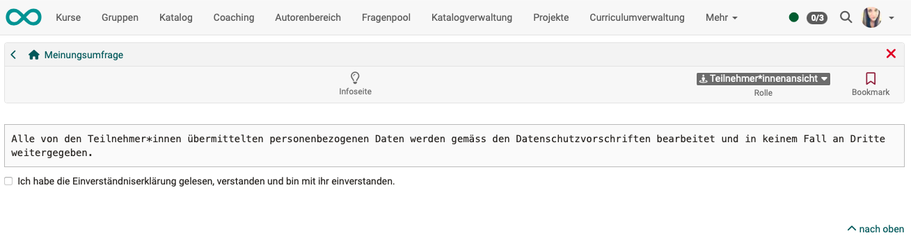{ class="shadow lightbox" title="Teilnehmer:innenansicht eines Formulars" }

### Nutzungsbedingungen eines Formulars definieren

Die Einverständniserklärung fügen Autor:innen der Lernressource Formular im [Formulareditor](../learningresources/Form_Editor/index.de.md) als Element "Nutzungsbedingungen" ein: über "Inhalt hinzufügen", in der Gruppe "Organisatorisch". Im Element legen Sie in den Feldern "Einverständniserklärung" und "Beschriftung Einverständniserklärung" den Text und die Beschriftung der Checkbox fest. Im Tab "Stil" des Inspektors stellen Sie das Element mit dem Schalter "Hinweis-Box" in eine hervorgehobene Box.

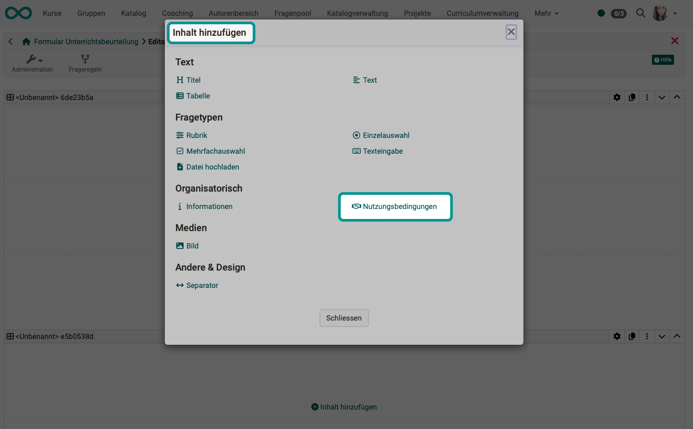{ class="shadow lightbox" title="Dialog Inhalt hinzufügen im Formulareditor" }

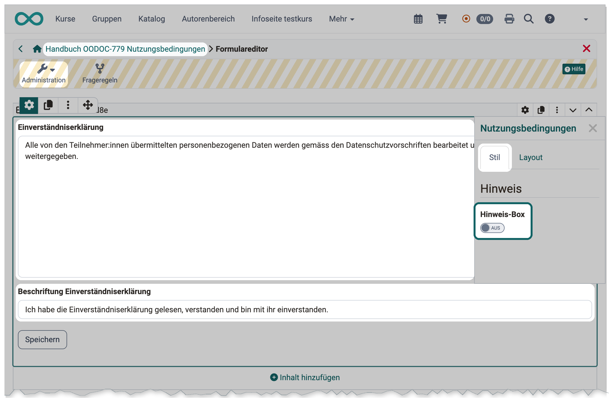{ class="shadow lightbox" title="Element Nutzungsbedingungen im Formulareditor · 2026.11.27" }

[Zum Seitenanfang ^](#terms_of_use)

## Nutzungsbedingungen externer Werkzeuge {: #terms_of_use_external_tools}

In OpenOlat sind an einigen Stellen externe Werkzeuge eingebunden, meistens ebenfalls Open Source, aber nicht von frentix entwickelt. Öffnet ein solches Werkzeug ein Dokument, gehen Daten an einen externen Server. Je nach Einstellung fragt OpenOlat vorher nach Ihrer Zustimmung.

Beispiel **draw.io** 
draw.io ist ein Online-Werkzeug zur Erstellung von Diagrammen, das in OpenOlat an vielen Stellen eingesetzt werden kann, zum Beispiel in Projekten, im Portfolio, im Kursbaustein "Dokument", im Media Center und überall, wo neue Dokumente erstellt werden können. In draw.io können auch mehrere Personen kooperativ an einem Diagramm arbeiten.

Ist bei draw.io die Option "Bestätigung Datentransfer" eingeschaltet, zeigt OpenOlat beim ersten Öffnen eines Diagramms den Dialog "Zustimmung Datenübertragung". Er erklärt, dass das Dokument vorübergehend auf einem externen Server gespeichert und Ihr Name an den Editor übergeben wird. Mit "Ich stimme der Datenübertragung zu" öffnen Sie das Diagramm, danach fragt OpenOlat Sie nicht mehr. Die Option schalten Systemadministrator:innen in der System-Administration ein: `Administration > Externe Werkzeuge > draw.io`

[Zum Seitenanfang ^](#terms_of_use)

## Weiterführende Informationen {: #further_information}

**Auf dieser Seite erwähnt** 
[Wie verwende ich das Sprachanpassungswerkzeug? >](../../manual_how-to/language_adaption_tool/language_adaption_tool.de.md) 
[Modul Kurs >](../../manual_admin/administration/Modules_Course.de.md) 
[Kurseinstellungen - Tab Nutzungsbedingungen >](../learningresources/Course_Settings_Disclaimer.de.md) 
[Mitgliederverwaltung >](../learningresources/Members_management.de.md) 
[Lernpfadkurse erstellen >](../learningresources/Creating_learning_path_courses.de.md) 
[Kurseinstellungen >](../learningresources/Course_Settings/index.de.md) 
[Der Formulareditor >](../learningresources/Form_Editor/index.de.md)

**Weiterführend** 
[Externe Werkzeuge: Übersicht >](../../manual_admin/administration/External_Tools_-_Administration/index.de.md) 
[Datenschutz >](../../manual_admin/usermanagement/Data_protection.de.md) 
[Persönliche Konfiguration: Einstellungen >](../personal_menu/Settings.de.md)

[Zum Seitenanfang ^](#terms_of_use)
