# Terms of Use {: #terms_of_use}

## Which terms of use must be accepted?

When you use OpenOlat or certain elements of it for the first time, you may be required to agree to the terms of use. If this is required by the operating organisation or by the owners of a course or other element, various terms of use may be displayed for confirmation.

[Terms of use of the OpenOlat platform >](#terms_of_use_platform)

[Terms of use of a course >](#terms_of_use_course)

[Terms of use of a form >](#terms_of_use_form)

[Terms of use of external tools >](#terms_of_use_external_tools)

!!! note "Note"

    In addition to the terms of use, data protection provisions may also be displayed and require consent.

## Terms of use of the OpenOlat platform {: #terms_of_use_platform}

### Confirmation by OpenOlat users at the first login

At the first login, OpenOlat asks all users for their consent in the dialog "Terms of use". Only with "Accept" do you get into OpenOlat. If you deny, you stay on the login page.

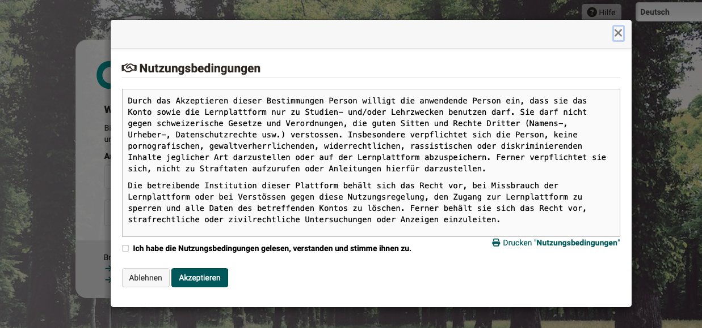{ class="shadow lightbox" title="Login page on the first login" }

### Define terms of use of the platform {: #terms_of_use_platform_define}

!!! info "Contact"

    For a change, contact your organisation.

Whether OpenOlat asks for consent at the first login is part of the server configuration and only applies after the next restart once changed. By default, the dialog is switched on.

System administrators adapt the text of the dialog in the system administration with the [language adaptation tool](../../manual_how-to/language_adaption_tool/language_adaption_tool.md): `Administration > Customizing > Language adaptation tool` 
The text is one of the texts of the user interface. This is why it can be adapted separately for each activated language.

Separately from this, system administrators store a text "Terms of use" in the imprint: `Administration > Customizing > Imprint` 
This text appears in the imprint under "Terms of use", not in the dialog at the first login. It can only be stored if the imprint is enabled, with a separate text for each activated language.

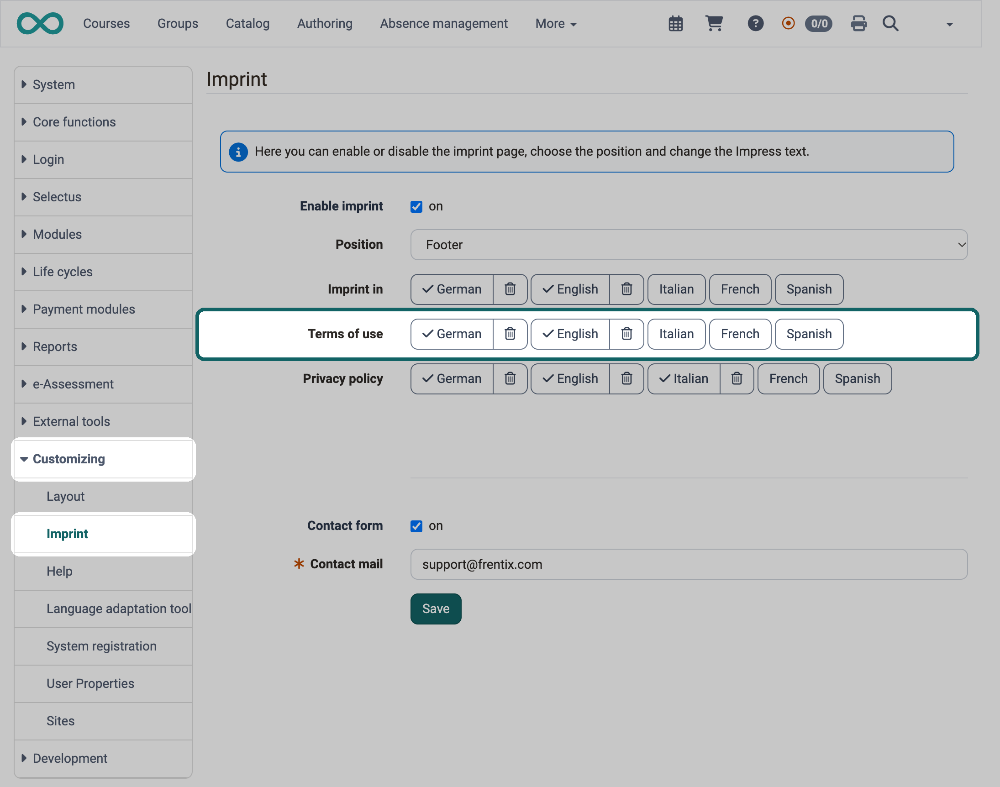{ class="shadow lightbox" title="Imprint page in the Customizing menu · 2026.11.27" }

### Read accepted terms of use {: #terms_of_use_platform_verify}

You can read the terms of use that you agreed to at the first login at any time in your personal menu: `Personal menu > Settings > Tab "Terms of use"`

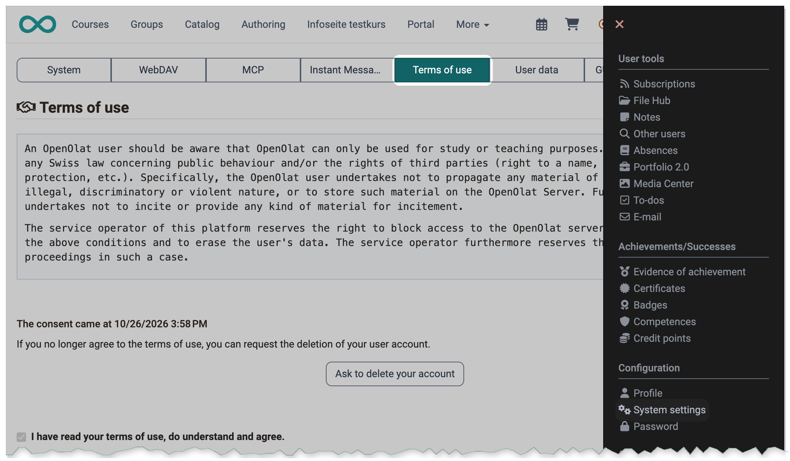{ class="shadow lightbox" title="Terms of use tab of the settings · 2026.11.27" }

[To the top of the page ^](#terms_of_use)

## Terms of use in the course settings [:octicons-tag-16:{ title="from Release 15.0 (OO-4455)" }](https://track.frentix.com/issue/OO-4455) {: #terms_of_use_course}

### Confirmation by participants in the course

Course owners can set their own terms of use for their course. The participants accept them when they call up the course for the first time. Anyone who declines cannot open the course.

### Define terms of use of a course {: #terms_of_use_course_define}

Course owners create course-specific terms of use for their course under: `Course > Administration > Settings > Tab "Terms of use"`

The tab exists if the system administration has switched on the option "Course related terms of use and privacy policy" in the [module Course](../../manual_admin/administration/Modules_Course.md#enable_course_option). All fields of the tab are described on the page [Course Settings - Tab Terms of use](../learningresources/Course_Settings_Disclaimer.md).

The fields for the text appear as soon as you tick the checkbox "Enabled" next to "Terms of use". On the same tab, you can also switch on a course-related privacy policy; it has the same structure.

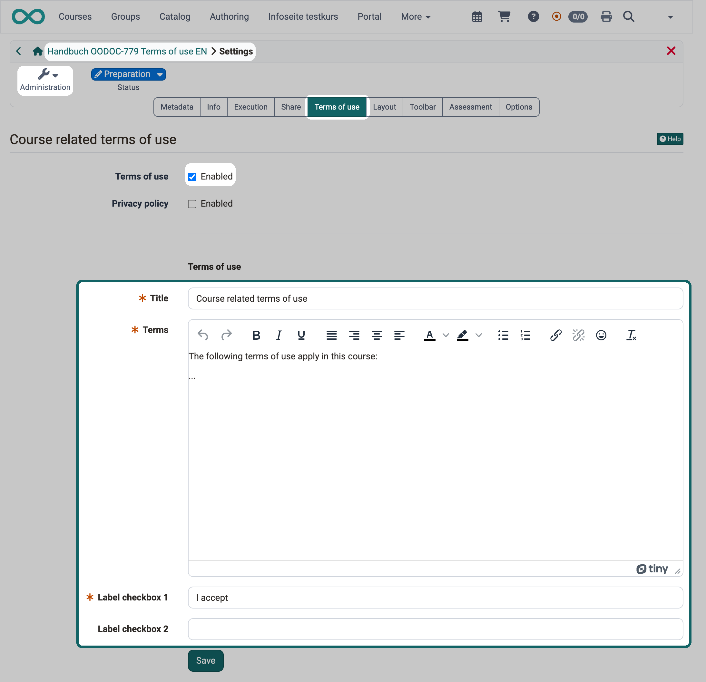{ class="shadow lightbox" title="Terms of use tab of the course settings · 2026.11.27" }

In the field "Label checkbox 1" at the bottom of the page, you define which text is displayed to participants next to their checkbox for accepting the terms of use.

In addition, a second checkbox with any descriptive text can be defined for confirmation in the field "Label checkbox 2". If a text is entered, both checkboxes must be confirmed by the participants for the terms of use to be considered accepted. If no descriptive text is entered, the second checkbox is not displayed to the participants.

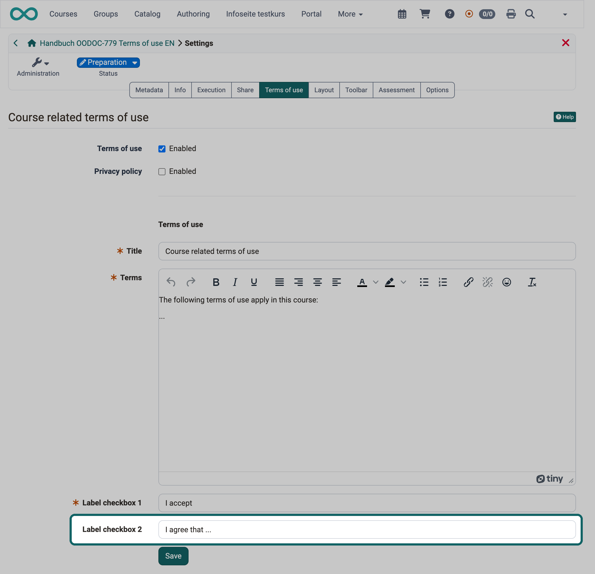{ class="shadow lightbox" title="Terms of use tab of the course settings · 2026.11.27" }

### Activate confirmation request for a course

The participants see the terms of use as soon as you tick the checkbox "Enabled" next to "Terms of use" and save. OpenOlat only saves the text while the checkbox is ticked. If you switch the terms of use off later, the last saved text is kept and appears again when you switch them on again.

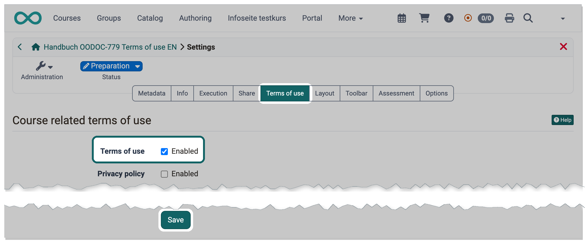{ class="shadow lightbox" title="Terms of use tab of the course settings · 2026.11.27" }

### Management of the terms of use in the members management

Which participants have given their consent to the course-specific terms of use is visible to course owners in the [members management](../learningresources/Members_management.md) under: `Course > Administration > Members management > Consents`

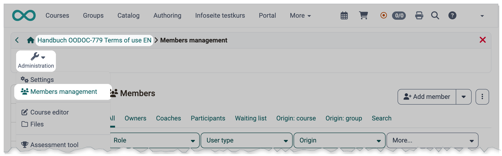{ class="shadow lightbox" title="Administration menu of the course · 2026.11.27" }

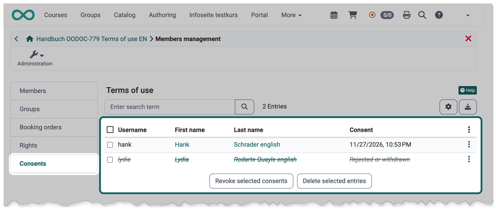{ class="shadow lightbox" title="Consents area of the members management · 2026.11.27" }

* If someone declines, the column "Consent" shows the note "Rejected or withdrawn". You can then contact the person directly.
* Course owners can revoke selected consents or delete the entries.

### Acceptance of terms of use when copying courses

[Learning path courses](../learningresources/Creating_learning_path_courses.md) can be copied with the help of a wizard: `Course > Administration > Copy with wizard`. In the wizard, you specify before copying which [course settings](../learningresources/Course_Settings/index.md) the copy takes over, including the terms of use.

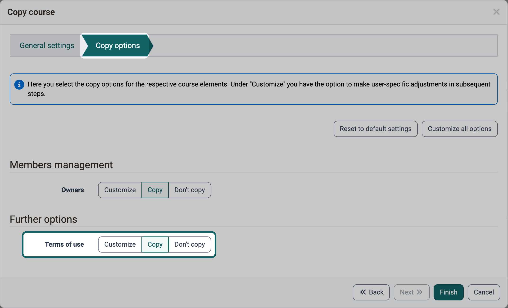{ class="shadow lightbox" title="Copy course wizard, Copy options step · 2026.11.27" }

[To the top of the page ^](#terms_of_use)

## Terms of use in forms [:octicons-tag-16:{ title="from Release 13.0 (OO-3674)" }](https://track.frentix.com/issue/OO-3674) {: #terms_of_use_form}

### Confirmation when filling in

A form can also contain terms of use: the element "Terms of use" shows a letter of agreement with a checkbox. The person filling in the form ticks it. Without the tick, the form cannot be finished, OpenOlat then reports "Please give your consent first."

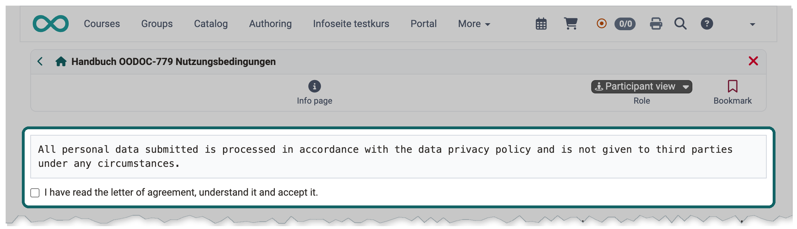{ class="shadow lightbox" title="Participant view of a form · 2026.11.27" }

### Define terms of use of a form

Authors add the letter of agreement to the learning resource Form in the [form editor](../learningresources/Form_Editor/index.md) as the element "Terms of use": via "Add content", in the group "Organisational". In the element, you set the text and the label of the checkbox in the fields "Letter of agreement" and "Agreement label". In the tab "Style" of the inspector, you place the element in a highlighted box with the switch "Alert box".

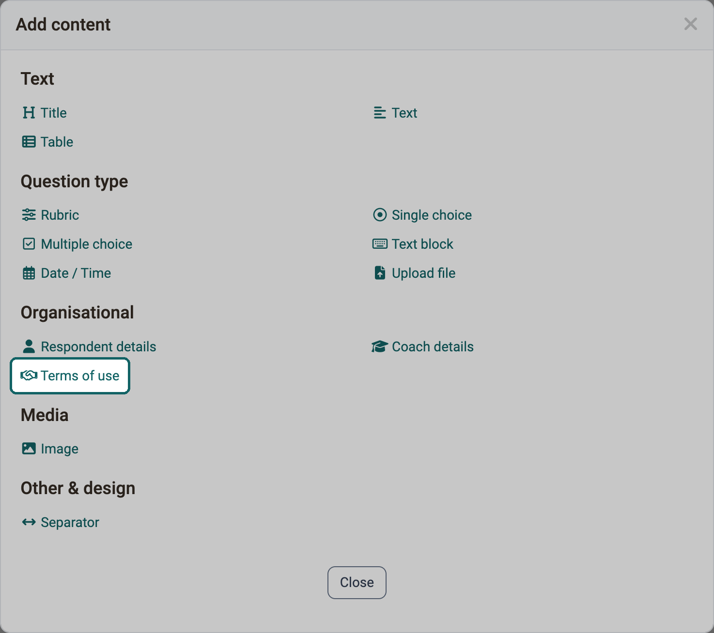{ class="shadow lightbox" title="Add content dialog in the form editor · 2026.11.27" }

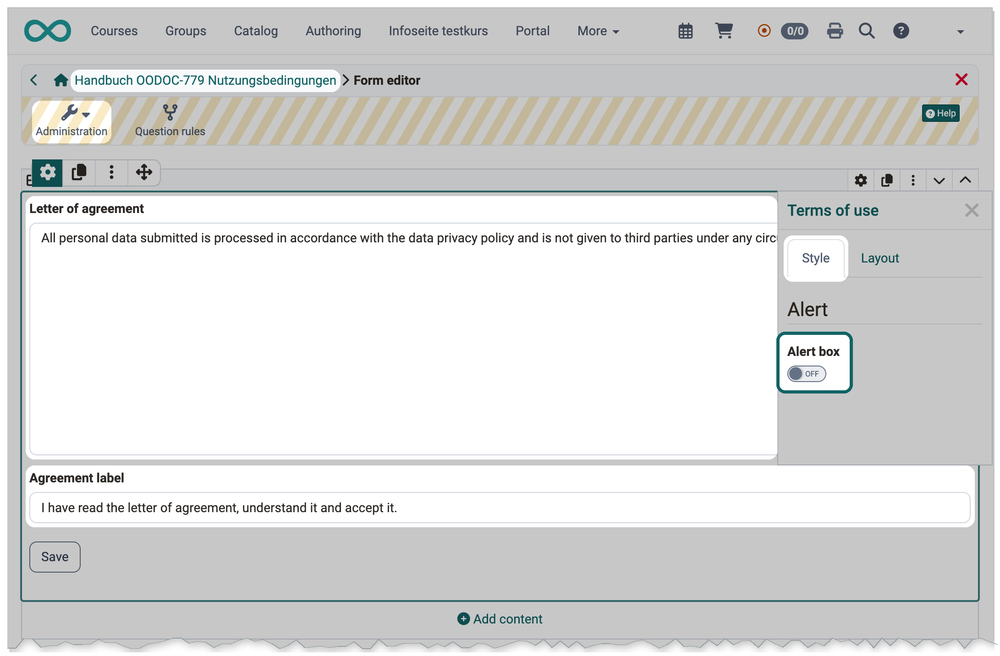{ class="shadow lightbox" title="Element Terms of use in the form editor · 2026.11.27" }

[To the top of the page ^](#terms_of_use)

## Terms of use of external tools {: #terms_of_use_external_tools}

In OpenOlat, external tools are integrated in some places, mostly also open source, but not developed by frentix. When such a tool opens a document, data goes to an external server. Depending on the setting, OpenOlat asks for your consent first.

Example **draw.io** 
draw.io is an online tool for creating diagrams that can be used in many places in OpenOlat, for example in projects, in the portfolio, in the "Document" course element, in the Media Center and wherever new documents can be created. In draw.io, several people can also work together on a diagram.

If the option "Confirmation of data transfer" is switched on for draw.io, OpenOlat shows the dialog "Confirmation of data transfer" when you open a diagram for the first time. It explains that the document is temporarily saved on an external server and that your name is passed to the editor. With "I accept the data transfer" you open the diagram, after that OpenOlat does not ask you again. System administrators switch the option on in the system administration: `Administration > External tools > draw.io`

[To the top of the page ^](#terms_of_use)

## Further information {: #further_information}

**Mentioned on this page** 
[How do I use the language adaptation tool? >](../../manual_how-to/language_adaption_tool/language_adaption_tool.md) 
[Module Course >](../../manual_admin/administration/Modules_Course.md) 
[Course Settings - Tab Terms of use >](../learningresources/Course_Settings_Disclaimer.md) 
[Members management >](../learningresources/Members_management.md) 
[Creating learning path courses >](../learningresources/Creating_learning_path_courses.md) 
[Course Settings >](../learningresources/Course_Settings/index.md) 
[The form editor >](../learningresources/Form_Editor/index.md)

**Further reading** 
[External Tools: Overview >](../../manual_admin/administration/External_Tools_-_Administration/index.md) 
[Data protection >](../../manual_admin/usermanagement/Data_protection.md) 
[Personal Configuration: Settings >](../personal_menu/Settings.md)

[To the top of the page ^](#terms_of_use)
