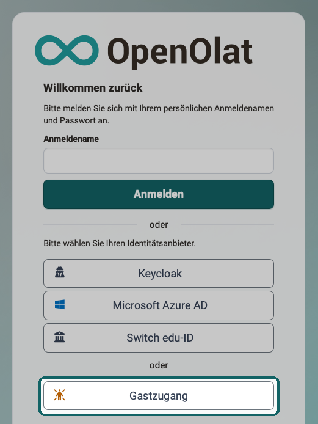
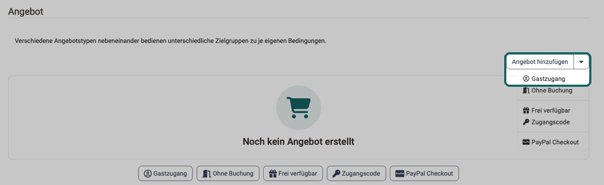
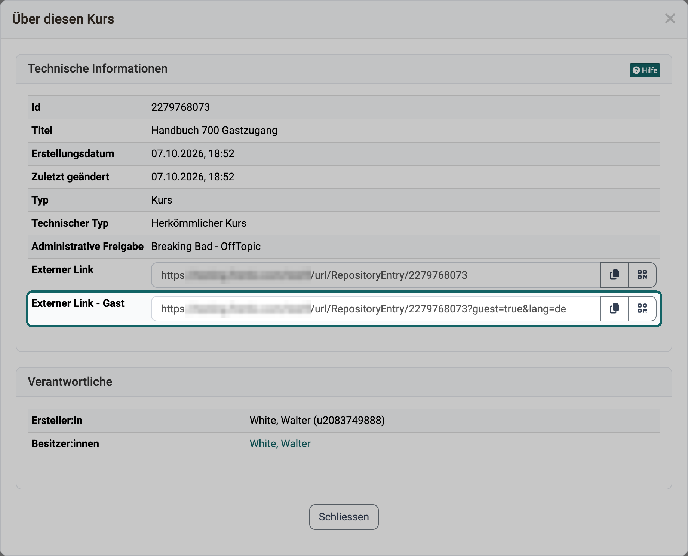

# Rollen und Rechte: Gastzugang {: #guest_access}

{ class="shadow lightbox aside-right-lg" }

Neben registrierten Benutzer:innen können auch Personen ohne OpenOlat-Konto als Gäste Zugang zum System erhalten. Gäste sind anonyme, nicht registrierte Benutzer:innen, die in der [Benutzerverwaltung](../../manual_admin/usermanagement/index.de.md) nicht verwaltet werden können.

Damit Gäste Zugang erhalten, schalten die Systemadministrator:innen der OpenOlat-Instanz den Gastzugang ein. Sie legen auch fest, auf welche OpenOlat-Bereiche Gäste zugreifen. Ist der Gastzugang eingeschaltet, zeigt die Login-Seite unter den übrigen Anmeldemöglichkeiten den Button "Gastzugang". Über diesen Button betreten Gäste OpenOlat.

Neben Kursen lassen sich auch andere Lernressourcen für Gäste freigeben, zum Beispiel Wikis, Blogs, Tests, Videos oder Glossare.

## Kursbereich {: #course_level}

!!! info "Wichtig"

    Der Gastzugang ist nur bei herkömmlichen Kursen, nicht bei Lernpfadkursen aktivierbar.

In einem herkömmlichen Kurs können Kursbesitzer:innen die Zugangskonfiguration so einrichten, dass auch Gäste Zugriff auf den Kurs erhalten: `Kurs > Administration > Einstellungen > Tab "Freigabe"`. Setzen Sie dort "Zugang für Teilnehmer:innen" auf "Buchbare und offene Angebote". Fügen Sie anschliessend im Abschnitt "Angebot" über "Angebot hinzufügen" ein Angebot der Art "Gastzugang" hinzu. Hat der Kurs noch kein Angebot, stehen die Angebotsarten unter "Noch kein Angebot erstellt" zusätzlich als eigene Buttons bereit, darunter "Gastzugang".

{ class="shadow lightbox" title="Tab Freigabe der Kurseinstellungen · 2026.10.07" }

Folgende Kursbausteine kann ein Gast sehen bzw. teilweise bearbeiten:

  * **Nur lesen**: CP-Lerninhalt, Blog, Wiki, Forum, Mitteilungen, Kalender, Einzelseite, Externe Seite, Dateidiskussion, Linkliste
  * **Forum**: Kursbesitzer:innen können im Kurseditor mit der Option "Gästen das Erstellen von Beiträgen gestatten" einstellen, ob auch Gäste Forenbeiträge erstellen dürfen
  * **Podcast und Video**: anschauen
  * **Ordner**: Dateien herunterladen
  * **SCORM**: durchführen
  * **Test**: je nach Konfiguration durchführen
  * **Selbsttest**: durchführen
  * **BigBlueButton, OpenMeetings** und ähnliche Meetings: teilnehmen
  * **Umfragen**: bearbeiten

!!! tip "Gäste bleiben anonym"

    Der Gastzugang erzeugt keine Mitgliedschaft im Kurs. Alle Gäste benutzen dasselbe anonyme Gastkonto. Die Mitgliederverwaltung des Kurses und die Benutzerverwaltung führen darum keine Gäste auf, und einzelne Gäste lassen sich nicht voneinander unterscheiden. Sollen die Teilnehmenden namentlich erfasst werden, laden Sie sie als externe Mitglieder ein.

Wenn Sie einem Gast direkten Zugriff auf einen Kurs geben möchten, schicken Sie ihm den Link aus der Zeile "Externer Link - Gast". Der Link steht an zwei Stellen, sobald der Kurs ein Angebot der Art "Gastzugang" hat:

- im Fenster "Über diesen Kurs": `Kurs > Administration > Über diesen Kurs`
- im Angebot für Gäste, Feld "Externer Link - Gast": `Kurs > Administration > Einstellungen > Tab "Freigabe"`

Mit "In Zwischenablage kopieren" übernehmen Sie den Link in eine E-Mail. Mit "QR-Code anzeigen" zeigen Sie ihn als QR-Code, etwa für Gäste an einer Veranstaltung, die den Kurs am eigenen Telefon öffnen. Wie das geht, steht unter [Links kopieren und als QR-Code weitergeben](Navigation.de.md#url_field). [:octicons-tag-16:{ title="ab Release 21.1.2 (OO-9982)" }](https://track.frentix.com/issue/OO-9982){:target="_blank"}

{ class="shadow lightbox" title="Fenster Über diesen Kurs · 2026.11.09" }

!!! tip "Tipp: Alternative zum Gastzugang"

    Möchten Sie jemanden zu einem OpenOlat-Kurs einladen, der noch kein OpenOlat-Konto besitzt, können Sie als Kursbesitzer:in alternativ auch die Option "Externe Mitglieder einladen" in der [Mitgliederverwaltung](../learningresources/Members_management.de.md) nutzen. Die eingeladene Person erhält dann einen Registrierungslink und einen eingeschränkten Zugriff auf OpenOlat, hat allerdings mehr Möglichkeiten als ein Gast.

!!! note "Hinweis"

    Systemadministrator:innen finden auf den Seiten "[Anonyme Gäste und externe Benutzer:innen](../../manual_admin/administration/Guest_and_invitation.de.md)" sowie unter "[Customizing](../../manual_admin/administration/Customizing.de.md)" weitere Informationen zur Konfiguration von OpenOlat für Gäste.

## Weiterführende Informationen {: #further_information}

**Auf dieser Seite erwähnt** 
[Benutzerverwaltung >](../../manual_admin/usermanagement/index.de.md) 
[Navigation >](Navigation.de.md) 
[Mitgliederverwaltung >](../learningresources/Members_management.de.md) 
[Anonyme Gäste und externe Benutzer:innen >](../../manual_admin/administration/Guest_and_invitation.de.md) 
[Customizing: Übersicht >](../../manual_admin/administration/Customizing.de.md)

**Weiterführend** 
[Zugangskonfiguration / Freigabe >](../learningresources/Access_configuration.de.md) 
[Angebotsarten >](../learningresources/Offer_Types.de.md) 
[Rollen und Rechte: Benutzertypen >](User_Types.de.md) 
[Login-Seite >](../login_registration/Login_Page.de.md)

[Zum Seitenanfang ^](#guest_access)
